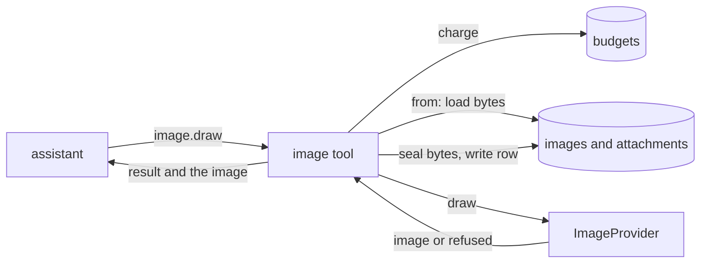

# Images

- **Status:** draft
- **Work items:**
  [the assistant draws and edits pictures in passes](https://linear.app/zgeoff/issue/GEO-2728), then
  [the notebook](https://linear.app/zgeoff/issue/GEO-2726) and
  [devices](https://linear.app/zgeoff/issue/GEO-2758), which show an image by its ID

The assistant draws a picture, looks at it, and asks for a change, pass after pass, until the
picture is right. One tool, `image.draw`, makes a new image from a prompt, or edits a stored image
when the call names it in `from`. nixie stores every image it gets back and sends the stored bytes
with each edit, so no pass depends on state that a provider keeps. Each provider sits behind one
interface as an image profile, and a refusal comes back as a result the assistant can act on.

## Shape



## Contracts

### The tools

```ts
image.draw({ prompt: 'a small cove at dusk, loose watercolour, warm light', size: '1536x1024' });
// → { image: 'k3x9m2p7qa', from: null, profile: 'openai', size: '1536x1024', isShown: true }
//   with the picture beside the result

image.draw({
  prompt: 'move the boat to the right third, keep everything else',
  from: 'k3x9m2p7qa',
});
// → { image: 'p8d2v6t1wz', from: 'k3x9m2p7qa', profile: 'openai', size: '1536x1024', isShown: true }

image.draw({ prompt: 'a lighthouse keeper asleep at the lamp' });
// → { refused: { profile: 'openai', reason: 'safety', message: 'The request was rejected…' },
//     profiles: ['gemini'] }
//   a result with refusalCode 'IMAGE_REFUSED'; profiles lists the others, and is empty when there are none

image.draw({
  prompt: 'the keeper from the reference, now rowing out at dawn',
  references: ['m4t7q1x8ze'],
});
// references: up to 4 image IDs the provider sees beside the prompt, so a character stays the same

image.mark({ image: 'p8d2v6t1wz', name: 'cove, final', isKept: true });
// → { image: 'p8d2v6t1wz', name: 'cove, final', isKept: true }

image.import({ file: 'f9k2m4q7ws' }); // a code.run file, or { photo: { eventID: '1042', number: 1 } }
// → { image: 'h6w3n8r2pk', from: null, size: '1024x1024', isShown: true }
//   an imported image can be a `from` or a reference like any other

image.list({ isKept: true });
// → { images: [{ image: 'p8d2v6t1wz', name: 'cove, final', isKept: true, from: 'k3x9m2p7qa',
//                prompt: 'move the boat…', isForgotten: false, at: '2026-11-21T08:10:00Z' }], next: null }
//   newest first; filter by `from` for one image's edits or by `isKept`; a forgotten image lists with prompt null

image.read({ image: 'k3x9m2p7qa' });
// → { image: 'k3x9m2p7qa', from: null, prompt: 'a small cove…', size: '1536x1024', isShown: true }
//   with the picture beside the result; a forgotten image returns "The image k3x9m2p7qa was forgotten."
```

`isShown` is false only on `image.read` and `image.import`, when the session's image caps leave no
room. `image.draw` never pays for a picture the assistant can't see: its `check` refuses with
`IMAGE_CAPS_FULL` before the charge, and the refusal says that the next turn opens a rebuilt
session, where earlier pictures show as markers and `image.read` brings any one back.

```ts
// connectors module
type ImageDrawInput =
  | { prompt: string; size?: ImageSize; profile?: string; references?: string[] } // a new image
  | { prompt: string; from: string; profile?: string; references?: string[] }; // an edit, at the size of `from`
// prompt: 1 to 4,000 characters. profile: a key of images.profiles; images.default when absent.
// size defaults to the profile's first. references: 0 to 4 image IDs.
type ImageSize = '1024x1024' | '1536x1024' | '1024x1536';

// image.draw: paid, effects ['fetch'], execution 'direct', results { prompt: 'untrusted' }
// image.mark, image.list, image.read: effects ['note'], execution 'direct'
// image.import: effects ['send'], queued; destination: the image providers.
//   Your starter rules allow it for a code.run file and ask for one of your photos.
```

### The provider interface

```ts
// connectors module. Adapters: image-openai (the images API), image-gemini (the Gemini API).
interface ImageProvider {
  draw(request: DrawRequest): Promise<DrawReply>; // times out after 120 seconds
}

interface DrawRequest {
  model: string;
  prompt: string;
  size: ImageSize;
  source?: { mediaType: string; bytes: Uint8Array }; // an edit: the stored image, sent whole
  references: { mediaType: string; bytes: Uint8Array }[]; // 0 to 4
}

type DrawReply =
  | { kind: 'image'; mediaType: string; bytes: Uint8Array } // at most 8 MiB
  | { kind: 'refused'; reason: 'safety' | 'other'; message: string; isBilled: boolean }
  | { kind: 'failed'; reason: string; isBilled: boolean }; // the reason never holds the key
```

### The config

```yaml
# deployment config; the connectors module reads it
images:
  default: openai
  profiles:
    openai:
      provider: openai # picks the adapter
      model: gpt-image-2.6-sunburst
      credential: deployment:openai-images # a connector_credentials entry
      prices: { '1024x1024': 40000, '1536x1024': 60000, '1024x1536': 60000 } # micros per image
    gemini:
      provider: gemini
      model: gemini-nano-banana-2.1
      credential: deployment:gemini-images
      prices: { '1024x1024': 40000, '1536x1024': 40000, '1024x1536': 40000 }
```

nixie refuses to start when a profile names a credential that the secrets file lacks, or lists no
price for a size.

### The paid tool

```ts
// tools module
interface PaidTool {
  priceMicros: number | ((input: ParsedInput) => number); // called after check, before the charge
  check?: (input: ParsedInput) => Promise<DirectResult | null>; // a non-null result returns with no charge
  // …existing fields
}
// runPaidCall credits the charge when a result carries a refusalCode, unless the result sets billed
```

`image.draw` prices each call from its profile and size. Its `check` refuses an unknown profile and
a forgotten `from` before anything is charged.

| Outcome                                  | The charge                |
| ---------------------------------------- | ------------------------- |
| an image                                 | kept                      |
| a refusal or a failure, `isBilled` false | credited                  |
| a refusal or a failure, `isBilled` true  | kept                      |
| a timeout after 120 seconds              | kept: the image may exist |
| `check` refuses                          | never charged             |

### The images table

```text
images                         -- connectors module
  image_id     text            -- primary key; short ID from createShortID; the only ID the model sees
  uuid         text            -- crypto.randomUUID()
  sequence     integer         -- the tool_result record whose attachments hold the bytes
  position     integer         -- the attachment's index on that record; 0 for image.draw
  parent_id    text null       -- the image an edit started from
  source       text            -- 'draw', 'code_file' or 'photo'
  name         text null       -- erasable, from image.mark
  is_kept      integer         -- 0 or 1, from image.mark
  profile      text null       -- null for an imported image
  model        text null
  media_type   text
  size         text
  byte_count   integer
  created_at   integer
```

The tool writes the row in the transaction that writes the tool_result record, so neither exists
without the other. The prompt sits among the record's erasable fields, never in this table. The
model IDs in the config are what the deployment sets; the code holds none.

## Constraints

Storage:

- An image ID resolves on every thread, so a later conversation, a task, a notebook page or a device
  can use it. A reader in the connectors module reads the bytes by the row's sequence and position.
- An edit loads `from` from nixie's store and sends its bytes. nixie keeps no provider conversation
  or response ID between calls.
- A notebook page, a device and `file.send` refer to an image by its short ID, never by a copy of
  its bytes, and none of them keeps the bytes past a forget.
- An imported photo keeps the photo's own record as its source, so a forget of your message erases
  the imported image too.
- A photo reaches a provider only after you approve its `image.import`, or a rule you wrote allows
  it.

Forgets:

- A forget of the tool_result record makes its image unreadable. The `images` row stays, so the edit
  chain keeps its shape.
- When `from` names a forgotten image, `check` returns "The image k3x9m2p7qa was forgotten."

Spend:

- nixie never tries another profile on its own. A refusal lists the other profiles, and the
  assistant chooses.
- The budgets `image.draw-day` ($2) and `image.draw-month` ($20) limit image spend. The image calls
  bypass the model gateway, so the spending stop doesn't count them.
- The cost goes under `hidden.costUSD`, which the model never reads.
- The API keys stay in the server process and never enter a sandbox.

Showing:

- Each image passes through the same fit and reservation as a fetched image: up to 4 images beside a
  result, counted against the session's image caps.

## Decisions

- **One tool draws and edits.** An edit is a draw with `from`, so every pass is the same call and
  the passes form a chain.
- **nixie stores every attempt.** A pass the assistant rejects is still a step it can go back to,
  and the stored bytes make edits independent of any provider.
- **Images are their own kind.** A code-run file resolves only on its own thread, and an image must
  outlive the conversation that drew it.
- **The image calls run outside the model gateway.** The gateway forwards only the model APIs'
  message endpoints, so an images endpoint can't pass through it.

## Builder decides

- The tools' descriptions, and how `image.list` pages.
- How each adapter maps `size` and the edit onto its provider's API.
- The refusal wording, and which provider errors count as `refused`.
- The table's indexes and the migration's number.

## Out of scope

- Drawing with code, such as SVG or a canvas. The assistant does that today with `code.run`.
- A gallery page in the web client. `file.send` sends you an image.
- Video, and image models beyond the 2 profiles.
- Importing a picture from a fetched page. nixie keeps no copy of a fetched image; the computer's
  `computer.download` saves one as a file.

## Open questions

- **Are the session's image caps roomy enough for drawing in passes?** A measurement settles it:
  count the passes in a real sitting. Until then, the caps stay as they are, and a full session
  rebuilds at the next turn.

- **Are `image.draw`, `image.list` and `image.read` the right names?** The owner settles it. Until
  then, the build uses them.
- **Does image spend count toward the spending stop?** The owner settles it. Until then, only the 2
  image budgets limit it.
