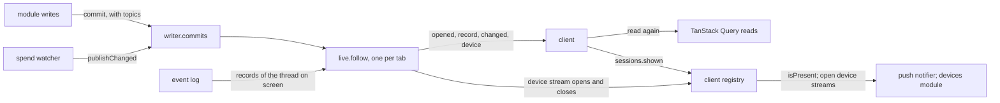

# Live updates and presence

- **Status:** draft

The web client hears of a pause, a spending stop or a backup notice up to a minute late, because it
polls for them. One page can also hold 3 record streams. The server pushes changes to the web client
and to devices through `live.follow`, one server-sent stream in each client tab. It replaces today's
2 kinds of stream and 7 polls of 15 to 60 s. A tab holds 2 streams for a short overlap when it
switches threads.

A page's stream carries the records of the thread on screen, and a `changed` event that names each
kind of state a commit changed, such as the pause or the task list. A device screen's stream carries
only its screen. One in-memory client registry in the API holds presence and the open device
streams, and the push notifier and the devices module each read their part.

The owner approves this design and settles its open questions. A builder starts from it to build the
stream, the topic marks, the client registry and the web client's move onto the stream.

## Shape



## Contracts

### The stream

```ts
// A page: the records of one thread, and every changed topic.
const events = await client.live.follow({ afterSequence: 4812, thread: 't7k2' });
for await (const event of events) {
  // → { kind: 'opened' }
  // → { kind: 'record', record: { sequence: 4813, thread: 't7k2', kind: 'model.reply', … } }
  // → { kind: 'changed', topics: ['pause', 'tasks'] }
}

// A device screen: its screen state, and nothing else.
await client.live.follow({ device: { pixels: { width: 1080, height: 1920, pixelRatio: 2 } } });
// → { kind: 'opened' }, then { kind: 'device', event: { kind: 'idle', scene: [] } }
```

```ts
// contract: live. Replaces records.follow, its alias log.follow, and devices.follow for nixie's
// own clients.
const liveTopicSchema = z.enum([
  'approvals',
  'backups',
  'computer',
  'definitions',
  'pause',
  'spend',
  'tasks',
]);

const followLive = signedIn
  .errors({
    FORBIDDEN: { status: 403 }, // the page form from a device-scope session
    NOT_A_DEVICE: notADeviceError, // the device form from a full session with no device row
  })
  .input(
    // Strict objects, so a device form never parses as a page form with its key stripped.
    z.union([
      // The page form: opened, then record and changed events.
      z.strictObject({
        afterSequence: sequenceSchema.optional(), // the read's readAtSequence; none starts at the head
        thread: threadSchema.optional(), // with none, the stream sends no records
        clipPayloads: z.boolean().optional(),
      }),
      // The device form: opened, then device events only.
      z.strictObject({ device: z.object({ pixels: pixelsSchema }) }),
    ]),
  )
  .output(
    eventIterator(
      z.discriminatedUnion('kind', [
        z.object({ kind: z.literal('opened') }), // always the first event
        z.object({ kind: z.literal('record'), record: recordSchema }), // event ID: the sequence
        z.object({ kind: z.literal('changed'), topics: z.array(liveTopicSchema).min(1) }), // no ID
        z.object({ kind: z.literal('device'), event: deviceEventSchema }), // no ID
      ]),
    ),
  );

export type LiveTopic = z.output<typeof liveTopicSchema>;
```

The web client maps each topic to the reads it invalidates, in place of the polls and streams in the
last column:

| Topic         | Reads the client invalidates                                     | Replaces                                    |
| ------------- | ---------------------------------------------------------------- | ------------------------------------------- |
| `pause`       | `nixie.read`                                                     | a 15 s poll                                 |
| `spend`       | `spend.read`                                                     | a 15 s poll                                 |
| `backups`     | `backups.readNotice`                                             | a 60 s poll                                 |
| `approvals`   | `approvals.listItems`, `approvals.readProposals`                 | 15 s polls                                  |
| `computer`    | `computer.readHandover`                                          | a 60 s poll, and the banner's record stream |
| `tasks`       | `tasks.list`, `tasks.read`, `tasks.listEnded`, `triggers.report` | a 60 s poll, and 2 pages' record streams    |
| `definitions` | `definitions.listTasks`                                          | the definition list's record stream         |

A new task can belong to a definition, so a write that creates a task marks both `tasks` and
`definitions`.

### Marking a topic

A record marks its topics through the log. A write with no record, or a change that no write makes,
marks them by hand.

```ts
// log module. At startup, each module that owns record kinds gives the topics each kind changes.
// The log marks them for every record that a transaction appends.
registerRecordTopics(writer, {
  'task.created': ['tasks', 'definitions'],
  'trigger.skipped': ['tasks'],
  'definition.changed': ['definitions'],
  'session.labelled': [], // a kind that changes no topic says so
});

// A write with no record: the topics join the transaction's commit.
await withWriteTransaction(writer, async (tx) => {
  await insertBackupNotices(tx, notices);
  markChanged(tx, ['backups']);
});

// Outside a transaction: a change that no write makes, such as the gateway's stop.
publishChanged(writer, ['spend']);
```

```ts
// log module. New: writer.commits dispatches a second event type beside the plain 'commit' event.
// 'commit' keeps waking record readers; 'changed' wakes only the live streams.
class ChangedEvent extends Event {
  readonly topics: readonly LiveTopic[]; // the union of every markChanged in one transaction
  // type: 'changed'
}
```

### A read that changes with time

A task due on a schedule moves in the task list with no write, so no topic can announce it.
`tasks.list` returns the time its answer next changes on its own.

```ts
// contract: tasks.list
await client.tasks.list({});
// → { readAtSequence: 4812, tasks: […], changesAt: new Date('2026-11-24T09:00:00Z') }

// …existing fields
changesAt: z.date().nullable(), // the earliest time a listed task changes with no write
```

### The client registry

This build adds `sessions.shown` and the client's beat, with the shape and rules in
[the push notice](push-notice.md#presence). The registry keeps two facts apart: presence, from
`sessions.shown` beats, and the open device streams, which make a device online.

```ts
// api module. In memory: a restart forgets it, and each client calls and opens again.
interface ClientRegistry {
  readonly presence: Presence; // read by the push notifier
  readonly devices: DeviceStreams; // read by the devices module; its type, as createDeviceStreams gives today
}

interface Presence {
  // true while any session's newest sessions.shown lies within withinMs; the notifier passes
  // its channels.telegram.presence_seconds
  readonly isPresent: (withinMs: number) => boolean;
}
```

## Constraints

### The stream

- The web client holds one `live.follow` in each tab, and each page reads records and topics from
  that stream. The one exception is the overlap of a thread switch, below.
- The stream sends `opened` first, once it listens on `writer.commits` and, for the device form,
  once its device stream is open.
- The stream sends a `record` event only for a record whose thread is the input's `thread`, in
  sequence order.
- The stream starts after `lastEventId` when that is a sequence of 1 to 15 digits, and otherwise
  after `afterSequence`, with the start clamped to the head.
- A `session.revoked` record that names the caller ends a page stream with `UNAUTHORIZED`, whether
  or not it sends records. A revoke ends a device-form stream as it ends `devices.follow`.
- A shredded record arrives with `isRemoved`, as on `records.follow`.
- The stream sends each topic within 1 s of its commit, and may merge the topics of several commits
  into one `changed` event.
- When a tab with no open stream gets `opened`, the client invalidates the reads of every topic.
  This covers the tab's first open and each reconnect, because a `changed` event carries no ID and a
  closed stream misses it.
- When the thread on screen changes, including to or from a page with no thread, the client opens a
  new stream from that page's `readAtSequence`, and closes the old one once the new one sends
  `opened`. It then invalidates nothing.
- While the client shows live updates as unavailable, it runs each topic's reads again every 60 s.
- When `tasks.list` returns a `changesAt`, the client reads the list again at that time.
- No page in the web client sets `refetchInterval` on a read that a topic covers.
- The stream wakes on `writer.commits` in the process. One process holds the writer and every stream
  ([0011](../../decisions/0011-sqlite-on-one-host.md)), so the stream watches no WAL file.

### Topics

- Every record kind has an entry in `registerRecordTopics`, an empty list included. A test walks
  every record kind the modules declare and fails on a kind with no entry.
- The `tasks` entries cover each kind the task list reads: every `task.*` and `action.*` kind, the
  inbox kinds, `owner_message`, `task_message`, `timer.fired`, `trigger.fired`, `trigger.skipped`
  and `log_reset`.
- The proposal kinds and the action kinds that end a `waiting` call mark `approvals`, and each
  `computer.handover_*` kind marks `computer`.
- Each write with no record that changes what a topic's reads return calls `markChanged` in its
  transaction, such as a backup notice.
- A transaction that rolls back drops its topics.
- A module that learns of a change from outside nixie calls `publishChanged` when it sees the
  change. The spend watcher calls it when the stop it reads, or its reachability, differs from its
  last read.
- A test for each topic makes the change and asserts that an open stream receives `changed` with
  that topic.
- A design that adds a read the client keeps fresh adds its topic to `liveTopicSchema`.

### Device screens

- The device form sends `opened`, then the screen state, then each change, as `devices.follow` does.
- A device-scope session may call `live.follow` with the device form only. The page form returns
  `FORBIDDEN`.
- A device-form stream keeps its session's last seen fresh, every `lastSeenIntervalMs`. A page
  stream never does.
- A device is online while one or more of its device-form streams are open.

### Presence

- An open stream never counts as present. Only a `sessions.shown` beat does.
- A device-scope session never calls `sessions.shown`, and a browser in device mode never calls it.
- The push notifier reads `presence`, and the devices module reads `devices`, from the one registry.
- When a client goes away, the server ends its stream within 10 s, and drops a device-form stream
  from the registry in the same step. A test closes the connection and asserts the device turns
  offline.

### Keepalive and the transport

- The server sends a keepalive into a quiet stream every 5 s, and the web client treats a stream
  with no byte for 15 s as dead.
- The API sets the keepalive interval explicitly, and a test asserts that 3 intervals fit in the
  client's idle limit. oRPC 1.16.2 sets it with `eventIteratorKeepAliveInterval`. oRPC 2 moves it to
  `toFetchResponse.eventStream.keepAlive.interval` and raises the default to 15 s, so an upgrade
  sets 5 s there.
- nixie's API serves no WebSocket. The computer view's noVNC socket is the one exception: it relays
  the desktop's binary frames and input both ways, carries no change of state, and keeps its one-use
  ticket and `isWatched` rules from [the desktop and take-over](desktop.md).

## Decisions

- **One stream per tab.** One stream keeps one keepalive, one reconnect loop and one place that
  registers a client. A browser opens at most 6 HTTP/1.1 connections to one origin across its tabs,
  and one page can hold 3 record streams.
- **A record kind marks its topics, and a write with no record marks its own.** The module that owns
  a kind knows what it changes, and the test over every kind catches a new kind with no entry.
  Writes with no record are few, such as a backup notice.
- **Records go only for the thread on screen.** The task list, the views and the handover banner
  follow topics, so no page needs every thread's records.
- **The device screen is a form of `live.follow`.** A device screen and a page share the transport,
  the keepalive and the registry, and each form gets only its own events.
- **The API module owns the client registry.** It serves `sessions.shown` and every stream, and
  hands each reader the narrow view it reads. This moves the registry out of the channels module,
  where [the push notice](push-notice.md#presence) put it.
- **The web client keeps its own reconnect loop.** It resumes by `afterSequence`, so it needs no
  `ClientRetryPlugin` and sends no `Last-Event-ID`. The server's `lastEventId` path serves other
  clients.

## Builder decides

- How the web client shares the one stream between its hooks, and how each hook moves onto it.
- How the stream merges topics within the 1 s limit.
- How `markChanged` finds its transaction's topic set.
- Which listed task fields set `changesAt`.
- The names of internal functions and files, and the test layout.

## Out of scope

- Push notices: [the push notice](push-notice.md) builds on this registry.
- The voice call's transport, which [the voice design](../platform/channels/voice.md) holds.
- One stream shared by several tabs of the same browser.
- The oRPC 2 upgrade. The keepalive constraint holds through it.

## Open questions

- **Does the stream send changed rows or only name what changed?** The owner settles it in
  [GEO-2823](https://linear.app/zgeoff/issue/GEO-2823).
  [The live view](../platform/channels/live-view.md#how-the-client-stays-current) sends each record
  with its changed projection rows, for every thread. The recommendation is topics: the reads exist
  and are tested, and a backup notice or a gateway stop changes with no record to send. Until then,
  the stream sends topics and the records of the thread on screen.
- **Does a signed-in browser in device mode count as present?** The owner settles it in
  [GEO-2824](https://linear.app/zgeoff/issue/GEO-2824). Until then, device mode never calls
  `sessions.shown`.
- **When do the old stream procedures leave the published contract?** The owner settles it in
  [GEO-2825](https://linear.app/zgeoff/issue/GEO-2825). Until then, `records.follow`, `log.follow`
  and `devices.follow` stay, deprecated, and serve their events as before.
- **Are `live.follow`, its event kinds and the topic names right?** The owner settles it in
  [GEO-2826](https://linear.app/zgeoff/issue/GEO-2826). Until then, the build uses them.
