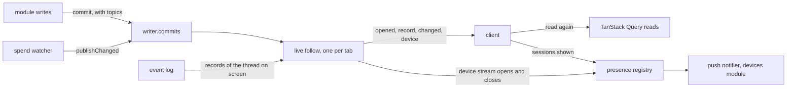

# Live updates and presence

- **Status:** draft

This design gives the server one way to push changes to the web client and to devices: one
server-sent stream per client tab, `live.follow`, in place of today's 2 streams and 7 polls of 15 to
60 s. The stream carries the records of the thread on screen, a `changed` event that names each kind
of state a commit changed, such as the pause or the task list, and a device's screen. One in-memory
registry in the API holds presence and device online state, and the push notifier and the devices
module read it.

## Shape



## Contracts

### The stream

```ts
// A page: the records of one thread, and every changed topic.
const events = await client.live.follow({ afterSequence: 4812, thread: 't7k2' });
for await (const event of events) {
  // → { kind: 'opened' }
  // → { kind: 'record', record: { sequence: 4813, thread: 't7k2', kind: 'model.reply', … } }
  // → { kind: 'changed', topics: ['pause', 'tasks'] }
}

// A device screen: its screen state, and nothing else.
await client.live.follow({ device: { pixels: { width: 1080, height: 1920, pixelRatio: 2 } } });
// → { kind: 'opened' }, then { kind: 'device', event: { kind: 'idle', scene: [] } }
```

```ts
// contract: live. Replaces records.follow and devices.follow for nixie's own clients.
const liveTopicSchema = z.enum([
  'approvals',
  'backups',
  'computer',
  'definitions',
  'pause',
  'spend',
  'tasks',
]);

const followLive = signedIn
  .errors({
    FORBIDDEN: { status: 403 }, // the page form from a device-scope session
    NOT_A_DEVICE: notADeviceError, // the device form from a full session with no device row
  })
  .input(
    z.union([
      // The page form: opened, then record and changed events.
      z.object({
        afterSequence: sequenceSchema.optional(), // the read's readAtSequence; none starts at the head
        thread: threadSchema.optional(), // with none, the stream sends no records
        clipPayloads: z.boolean().optional(),
      }),
      // The device form: opened, then device events only.
      z.object({ device: z.object({ pixels: pixelsSchema }) }),
    ]),
  )
  .output(
    eventIterator(
      z.discriminatedUnion('kind', [
        z.object({ kind: z.literal('opened') }), // always the first event
        z.object({ kind: z.literal('record'), record: recordSchema }), // event ID: the sequence
        z.object({ kind: z.literal('changed'), topics: z.array(liveTopicSchema).min(1) }), // no ID
        z.object({ kind: z.literal('device'), event: deviceEventSchema }), // no ID
      ]),
    ),
  );

export type LiveTopic = z.output<typeof liveTopicSchema>;
```

The web client maps each topic to the reads it invalidates. The last column names what the topic
replaces in today's client:

| Topic         | Reads the client invalidates                                     | Replaces                                    |
| ------------- | ---------------------------------------------------------------- | ------------------------------------------- |
| `pause`       | `nixie.read`                                                     | a 15 s poll                                 |
| `spend`       | `spend.read`                                                     | a 15 s poll                                 |
| `backups`     | `backups.readNotice`                                             | a 60 s poll                                 |
| `approvals`   | `approvals.listItems`, `approvals.readProposals`                 | 15 s polls                                  |
| `computer`    | `computer.readHandover`                                          | a 60 s poll, and the banner's record stream |
| `tasks`       | `tasks.list`, `tasks.read`, `tasks.listEnded`, `triggers.report` | a 60 s poll, and 2 pages' record streams    |
| `definitions` | `definitions.listTasks`                                          | the definition list's record stream         |

A new task can belong to a definition, so a write that creates a task marks both `tasks` and
`definitions`.

### Marking a topic

```ts
// log module. Inside a write transaction: the topics join the transaction's commit.
await withWriteTransaction(writer, async (tx) => {
  await insertBackupNotices(tx, notices);
  markChanged(tx, ['backups']);
});

// Outside a transaction: a change that no write makes, such as the gateway's stop.
publishChanged(writer, ['spend']);
```

```ts
// log module. New: writer.commits dispatches a second event type beside the plain 'commit' event.
// 'commit' keeps waking record readers; 'changed' wakes only the live streams.
class ChangedEvent extends Event {
  readonly topics: readonly LiveTopic[]; // the union of every markChanged in one transaction
  // type: 'changed'
}
```

### A read that changes with time

```ts
// contract: tasks.list
await client.tasks.list({});
// → { readAtSequence: 4812, tasks: […], changesAt: new Date('2026-11-24T09:00:00Z') }

// …existing fields
changesAt: z.date().nullable(), // the earliest time a listed task changes with no write
```

### Presence

This build adds `sessions.shown` and the client's beat, with the shape and rules in
[the push notice](push-notice.md#presence).

```ts
// api module. In memory: a restart forgets it, and each client calls and opens again.
interface Presence {
  // true while any session's newest sessions.shown lies within withinMs; the notifier passes
  // its channels.telegram.presence_seconds
  readonly isPresent: (withinMs: number) => boolean;

  // the open device streams: open, isOnline, readPixels, resize, as createDeviceStreams gives today
  readonly devices: DeviceStreams; // devices module type
}
```

## Constraints

### The stream

- The web client opens at most one `live.follow` per tab, and each page reads records and topics
  from that stream.
- The stream sends `opened` first, as soon as it has registered, and before any other event.
- The stream sends a `record` event only for a record whose thread is the input's `thread`, in
  sequence order.
- The stream starts after `lastEventId` when that is a sequence of 1 to 15 digits, and otherwise
  after `afterSequence`, with the start clamped to the head.
- A `session.revoked` record that names the caller ends the stream with `UNAUTHORIZED`, whether or
  not the stream sends records.
- A shredded record arrives with `isRemoved`, as on `records.follow`.
- The stream sends each topic within 1 s of its commit, and may merge the topics of several commits
  into one `changed` event.
- When a tab with no open stream gets `opened`, the client invalidates the reads of every topic.
  This covers the tab's first open and each reconnect, because a `changed` event carries no ID and a
  closed stream misses it.
- When the thread on screen changes, the client opens a new stream from that page's
  `readAtSequence`, and closes the old one once the new one sends `opened`. It then invalidates
  nothing.
- While the client shows live updates as unavailable, it reads each topic's reads every 60 s.
- When `tasks.list` returns a `changesAt`, the client reads the list again at that time.
- No page in the web client sets `refetchInterval` on a read that a topic covers.
- The stream wakes on `writer.commits` in the process. One process holds the writer and every stream
  ([0011](../../decisions/0011-sqlite-on-one-host.md)), so the stream watches no WAL file.

### Topics

- Each write that changes what a topic's reads return calls `markChanged` in its transaction.
- The tasks projection calls `markChanged(tx, ['tasks'])` for each record it folds that moves a
  listed task, so a module that appends such a record needs no mark of its own.
- The proposal writers and the actions module mark `approvals`. The actions module marks it when an
  action's call leaves `waiting`.
- The computer module marks `computer` with each `computer.handover_*` record.
- A module that learns of a change from outside nixie calls `publishChanged` when it sees the
  change. The spend watcher calls it when the gateway's stop or reachability changes.
- A test for each topic makes the change and asserts that an open stream receives `changed` with
  that topic.
- A design that adds a read the client keeps fresh adds its topic to `liveTopicSchema`.

### Device screens

- The device form sends `opened`, then the screen state, then each change, as `devices.follow` does.
- A device-scope session may call `live.follow` with the device form only. The page form returns
  `FORBIDDEN`.
- A device-form stream keeps its session's last seen fresh, every `lastSeenIntervalMs`. A page
  stream never does.
- A device is online while one or more of its device-form streams are open.

### Presence

- An open stream never counts as present. Only a `sessions.shown` beat does.
- A device-scope session never calls `sessions.shown`, and a browser in device mode never calls it.
- The push notifier reads `isPresent`, and the devices module reads `devices`, from the one
  registry.
- When a client goes away, the server ends its stream and drops it from the registry within 10 s. A
  test closes the connection and asserts the device turns offline.

### Keepalive and the transport

- The server sends a keepalive into a quiet stream every 5 s, and the web client treats a stream
  with no byte for 15 s as dead.
- The API sets the keepalive interval explicitly, and a test asserts that 3 intervals fit in the
  client's idle limit. oRPC 1.16.2 sets it with `eventIteratorKeepAliveInterval`. oRPC 2 moves it to
  `toFetchResponse.eventStream.keepAlive.interval` and raises the default to 15 s, so an upgrade
  sets 5 s there.
- nixie's API serves no WebSocket. The computer view's noVNC socket is the one exception: it relays
  the desktop's binary frames and input both ways, carries no change of state, and keeps its one-use
  ticket and `isWatched` rules from [the desktop and take-over](desktop.md).

## Decisions

- **One stream per tab.** One stream keeps one keepalive, one reconnect loop and one place that
  registers a client. A browser opens at most 6 HTTP/1.1 connections to one origin, and a page can
  hold 3 record streams.
- **A topic names the data that changed, and the client reads it again.** The reads exist and are
  tested, and a backup notice or a gateway stop changes with no record to send.
  [Open question](https://linear.app/zgeoff/issue/GEO-2823).
- **The writer marks a topic in its transaction.** The module that writes knows what changed. A map
  from record kinds to topics would miss writes with no record, such as a backup notice.
- **Records go only for the thread on screen.** The task list, the views and the handover banner
  follow topics, so no page needs every thread's records.
- **The device screen is a form of `live.follow`.** A device screen and a page share the transport,
  the keepalive and the registry, and each form gets only its own events.
- **The API module owns the presence registry.** It serves `sessions.shown` and every stream, and
  hands each reader the narrow view it reads. This moves the registry out of the channels module
  that [the push notice](push-notice.md#presence) named.
- **`records.follow`, `log.follow` and `devices.follow` stay, deprecated, and serve their events as
  before.** [Open question](https://linear.app/zgeoff/issue/GEO-2825).
- **The web client keeps its own reconnect loop.** It resumes by `afterSequence`, so it needs no
  `ClientRetryPlugin` and sends no `Last-Event-ID`. The server's `lastEventId` path serves other
  clients.

## Builder decides

- How the web client shares the one stream between its hooks, and how each hook moves onto it.
- How the stream merges topics within the 1 s limit.
- How `markChanged` finds its transaction's topic set.
- Which listed task fields set `changesAt`.
- The names of internal functions and files, and the test layout.

## Out of scope

- Push notices: [the push notice](push-notice.md) builds on this registry.
- The voice call's transport, which [the voice design](../platform/channels/voice.md) holds.
- One stream shared by several tabs of the same browser.
- The oRPC 2 upgrade. The keepalive constraint holds through it.

## Open questions

- **Does the stream send changed rows or only name what changed?** The owner settles it in
  [GEO-2823](https://linear.app/zgeoff/issue/GEO-2823).
  [The live view](../platform/channels/live-view.md#how-the-client-stays-current) sends each record
  with its changed projection rows, for every thread. Until then, the stream sends topics and the
  records of the thread on screen.
- **Does a signed-in browser in device mode count as present?** The owner settles it in
  [GEO-2824](https://linear.app/zgeoff/issue/GEO-2824). Until then, device mode never calls
  `sessions.shown`.
- **When do the old stream procedures leave the published contract?** The owner settles it in
  [GEO-2825](https://linear.app/zgeoff/issue/GEO-2825). Until then, they stay, deprecated.
- **Are `live.follow`, its event kinds and the topic names right?** The owner settles it in
  [GEO-2826](https://linear.app/zgeoff/issue/GEO-2826). Until then, the build uses them.
