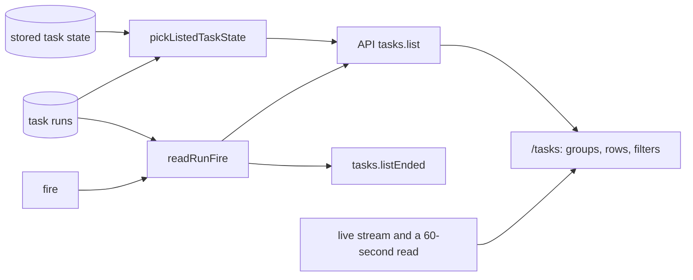

# Dashboard states, fires and filters

- **Status:** draft
- **Work items:** [dashboard states, fires and filters](https://linear.app/zgeoff/issue/GEO-2650)
- **Blocked by:** [the wake rule](https://linear.app/zgeoff/issue/GEO-1865), which adds the listed
  state `asleep` and the task list fields `wakeable` and `nextRunAt`

The dashboard at `/tasks` puts each task in 1 of 3 groups by its stored task state: Conversation,
Working and Held. A done or closed task leaves the dashboard. The model tool `tasks.list`, which the
conversation calls, reads a finer state than the dashboard does. This design gives the dashboard
that finer state, shows on a definition's task when its task run was scheduled and whether it fired
late, and filters the dashboard by definition and by state. The
[live view baseline](../platform/channels/live-view.md#the-dashboard) gives the dashboard's purpose,
and [the views of definitions and ended task runs](definition-views.md) give the routes
`/definitions` and `/tasks/ended`.

The design uses these terms:

| Term              | Meaning                                                                                                                                                                     |
| ----------------- | --------------------------------------------------------------------------------------------------------------------------------------------------------------------------- |
| listed state      | the state that `pickListedTaskState` in the tasks module gives a task: its stored state, or one of the 3 below for a task whose stored state is `waiting` with no open wait |
| `idle`            | a task that can take a message and has nothing to do                                                                                                                        |
| `finished`        | a task that can take a message and sent the report of its last task run                                                                                                     |
| `asleep`          | a task that no message wakes, which waits for its next scheduled fire                                                                                                       |
| definition's task | the one task that a task definition runs on ([the task of a definition](definition-tasks.md)). A task that the conversation or another task starts is a **started task**    |
| task run          | one execution of a task, which opens with `task.run_opened` and ends with `task.run_ended` ([task run records](task-runs/records.md))                                       |
| fire              | the `trigger.fired` record that opened a task run ([the 2 fire records](definition-tasks.md#the-2-fire-records))                                                            |
| catch-up          | a fire whose `isCatchUp` is true: nixie wrote it more than 60 seconds after its scheduled time                                                                              |
| carrying task run | a task run that opens when you raise a task's limit or restart the task after its task run ended at a limit, a stop or a failure. Its `carriesRunID` names that task run    |

## Shape



## Contracts

```ts
const listed = await api.tasks.list({ definitionID: 'water-the-tomatoes', states: ['asleep'] });
// → { readAtSequence: 9120, tasks: [{ taskID: 't4k2', name: 'Water the tomatoes', state: 'waiting',
//     listedState: 'asleep', definitionID: 'water-the-tomatoes', fire: null,
//     nextRunAt: '2027-03-19T08:00:00.000Z', … }] }
const open = await api.tasks.list({});
// → { tasks: [{ taskID: 'k8r2', state: 'running', listedState: 'running',
//     definitionID: 'weekly-digest', fire: { scheduledFor: '2027-03-15T07:00:00.000Z',
//     firedAt: '2027-03-15T09:12:40.000Z', isCatchUp: true }, … }, …] }
```

```ts
// contract lib. The API's tasks.list gains an optional input. Every new output field is optional:
// a client that gets none groups by `state`, as the dashboard does today.
interface TasksListInput {
  definitionID?: string; // only the task of that definition
  states?: ListedState[]; // 1 to 11 distinct values: only tasks in one of them
}
// TaskState: the contract's taskStateSchema, 8 values from ready to closed
type ListedState = TaskState | 'idle' | 'finished' | 'asleep';

// listedTaskSchema: { …existing fields, plus: }
interface ListedTaskAdded {
  listedState?: ListedState; // its own field, so `state` keeps its 8 values for older clients
  definitionID?: string; // present only on a definition's task
  fire?: RunFire | null; // present only on a definition's task; null when the task run has no fire
}

// each task run that tasks.listEnded returns: { …the fields of the views design, plus: }
interface EndedRunAdded {
  fire: RunFire | null;
}

// contract lib
interface RunFire {
  scheduledFor: string; // ISO instant, from the fire's scheduledFor
  firedAt: string; // ISO instant, from the fire's firedAt
  isCatchUp: boolean; // from the fire's isCatchUp
}
```

```ts
// tasks module: the fire of one task run, or null
const fire = await readRunFire(context, run);
// → { scheduledFor: '2027-03-15T07:00:00.000Z', firedAt: '2027-03-15T09:12:40.000Z', isCatchUp: true }

declare function readRunFire(
  context: Pick<TasksContext, 'log'>,
  run: TaskRun, // one row of task_runs, from task run records
): Promise<RunFire | null>;
```

The table maps each listed state to a group. A task's row shows its name, state, last activity and
brief, the prompt it started with, and adds what the third column says.

| Listed state                  | Group   | The row adds                                            |
| ----------------------------- | ------- | ------------------------------------------------------- |
| `ready`, `running`, `waiting` | Working | the fire, on a definition's task                        |
| `idle`                        | Working | nothing                                                 |
| `asleep`                      | Working | the next fire, from `nextRunAt`                         |
| `finished`                    | Working | that the task sent its report                           |
| `paused`, `stopped`, `failed` | Held    | the fire of its newest task run, on a definition's task |
| `done`, `closed`              | none    | nothing: the task leaves the dashboard                  |

## Constraints

### The listed state

- The API's `tasks.list` and `tasks.read` set `listedState` through the same `pickListedTaskState`
  that the model tool `tasks.list` calls, so the dashboard and the conversation show one state.
- `state` keeps the stored task state. A client groups and labels by `listedState` when it is set,
  and by `state` when it is not.
- While nixie is paused, every task reads as `paused` ([the pause](pause.md#the-pause)), so each
  task sits in Held.
- The conversation is the task with the ID `conversation`. Its row sits in Conversation in every
  state, a pause of nixie included.

### The fire

- `readRunFire` reads the `origin` of the task run's `task.run_opened`. For `origin.kind` `trigger`,
  the fire is the `trigger.fired` record at `origin.sequence`.
- For a carrying task run, with `origin.kind` `raise` or `restart`, `readRunFire` follows
  `carriesRunID` back until it reaches a task run that carries none, and returns that task run's
  fire.
- For every other `origin.kind`, such as `message` or `owner`, `readRunFire` returns null.
- A [reset of the log](../../architecture/core/event-log.md#the-reset) can remove the fire's record.
  `readRunFire` then returns null.
- The API's `tasks.list` sets `fire` on a definition's task only. It takes `fire` from the open task
  run, or from the newest task run when the task has none open. It sets null when that task run has
  no fire, or when the task has no task run.
- `tasks.listEnded` sets `fire` on every task run it returns, through the same `readRunFire`.
- A row shows the scheduled time in your time zone. A catch-up also shows how late it fired, as
  `firedAt` less `scheduledFor`.

### The filters

- The server applies `definitionID` and `states` before the list's limit of 100 tasks, so a filter
  finds a matching task that an unfiltered list would leave out.
- `states` matches the listed state. While nixie is paused, a filter on `paused` therefore matches
  every task, the conversation included.
- The dashboard keeps both filters in the route's search parameters, so a reload or a shared link
  keeps them.
- The definition filter offers each definition that has a task, by its name, from
  `definitions.listTasks` of [the views](definition-views.md#contracts). A definition whose target
  is the conversation has no task, so the filter leaves it out.
- The state filter offers the 11 listed states.
- With a filter set, the dashboard shows only the groups that hold a matching task, and a control
  that clears the filters. With no match, it shows its empty-group text.

### Staying current

- `isTaskListRecord` matches `trigger.fired`, beside the kinds it matches today, so the dashboard
  reads the list again on each fire. A fire moves a task's last activity and opens a task run.
- The live stream carries only records that belong to a task's thread, and nixie writes the records
  of a pause and a resume outside every thread. The dashboard therefore reads the list again every
  60 seconds while the page is visible, and at once when the page becomes visible again.
- The query key of each read holds the filters, so a change of filter reads a fresh list, and the
  dashboard follows the stream from that read's `readAtSequence`.

### A rollback

- This design adds no record kind, no migration and no config key.
- After a rollback, the server has no `listedState`, `definitionID` or `fire`, and strips the
  unknown `tasks.list` input. A newer client then gets the whole list unfiltered, and groups each
  task by `state`. It hides the definition filter when no listed task has a `definitionID`.
- A client of the release before, under a newer server, sends no filter and ignores the new fields,
  so it shows the dashboard as it does today.

## Decisions

- **The dashboard keeps its 3 groups, Conversation, Working and Held, and Working holds every task
  that is not held, done or closed.** An agent's call on 13 Nov 2026: the layout stays as it is
  while the owner's question below is open, and every task the dashboard shows today stays on it.
- **`listedState` is a field of its own, and `state` gains no value.** An agent's call on 13 Nov
  2026: today's client maps every `state` value to a label, and a client of the release before would
  show no label for a new value.
- **The server filters, never the client.** An agent's call on 13 Nov 2026: the list stops at 100
  tasks, so a filter in the client would miss a match and give no sign of it.
- **A carrying task run shows the fire of the task run it carries on from.** An agent's call on 13
  Nov 2026: a raise or a restart goes on with the same scheduled work, so its row keeps that work's
  scheduled time.
- **The dashboard reads the list on a 60-second timer as well as on the stream.** An agent's call on
  13 Nov 2026: the stream never carries a pause or a resume of nixie.

## Builder decides

- The wording of each state label, the fire and the filter controls.
- Where the filters sit on the page.
- How `readRunFire` reads the fires of a page of task runs at once.
- The layout of the tests.

## Out of scope

- Supervised coding sessions as a group, which [GEO-311](https://linear.app/zgeoff/issue/GEO-311)
  covers.
- Proposals that wait for your answer. The approval cards and the approval digest of
  [the approval record](https://linear.app/zgeoff/issue/GEO-1804) show them.
- The routes `/tasks/ended` and `/definitions`, which
  [the views of definitions and ended task runs](definition-views.md) cover.

## Open questions

- **Does the dashboard gain the "needs you" and the "finished in the last 7 days" groups of the
  baseline?** The owner settles it in [the view routes](https://linear.app/zgeoff/issue/GEO-1837).
  Until then, the dashboard keeps its 3 groups, as the table in Contracts maps them.
