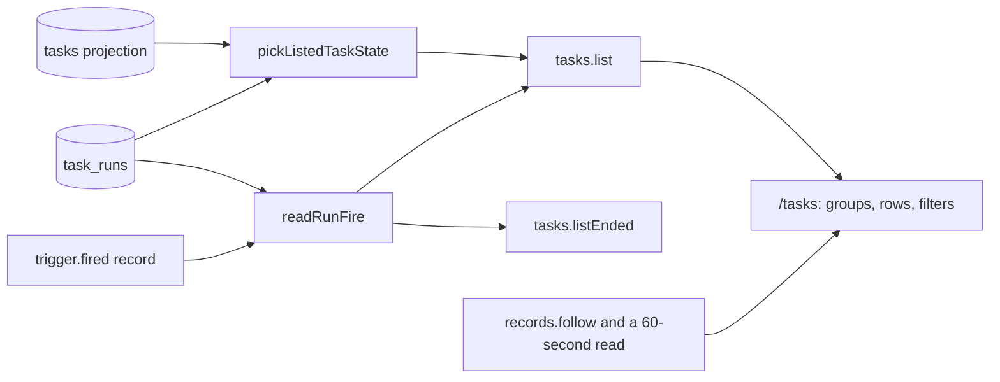

# Dashboard states, fires and filters

- **Status:** draft
- **Work items:** [the view procedures](https://linear.app/zgeoff/issue/GEO-2545),
  [the view routes](https://linear.app/zgeoff/issue/GEO-1837); the `asleep` state and `nextRunAt`
  come from [the wake rule](https://linear.app/zgeoff/issue/GEO-1865)

The dashboard at `/tasks` sorts your tasks into 3 groups by their stored task state: the
conversation, Working and Held. The conversation's model tool `tasks.list` reads a finer state,
which tells a task waiting on a reply from one with nothing to do or one that sent its report. This
design gives the dashboard that finer state, shows on a definition's task when its task run was
scheduled and whether it fired late, and filters the dashboard by definition and by state. The
[live view baseline](../platform/channels/live-view.md#the-dashboard) gives the dashboard's purpose,
and [the views of definitions and ended task runs](definition-views.md) give the routes
`/definitions` and `/tasks/ended`.

The terms this design uses:

| Term              | Meaning                                                                                                                                                                         |
| ----------------- | ------------------------------------------------------------------------------------------------------------------------------------------------------------------------------- |
| listed state      | the state that `pickListedTaskState` in the tasks module gives a task: a stored task state, or `idle`, `finished` or `asleep` for a task that waits                             |
| definition's task | the one task that a task definition runs on, as [the task of a definition](definition-tasks.md) says. A task that the conversation or another task starts is a **started task** |
| task run          | one execution of a task, as [task run records](task-runs/records.md) define, with its `task.run_opened` and `task.run_ended` records                                            |
| fire              | the `trigger.fired` record that opened a task run, as [the 2 fire records](definition-tasks.md#the-2-fire-records) define                                                       |
| carrying task run | a task run that a raise of a limit or a restart opens to go on with an ended task run's work; its `carriesRunID` names that task run                                            |

## Shape



## Contracts

```ts
const listed = await api.tasks.list({ definitionID: 'water-the-tomatoes', states: ['asleep'] });
// → { readAtSequence: 9120, tasks: [{ taskID: 't4k2', name: 'Water the tomatoes', state: 'waiting',
//     listedState: 'asleep', definitionID: 'water-the-tomatoes', fire: null,
//     nextRunAt: '2027-03-19T08:00:00.000Z', … }] }
const open = await api.tasks.list({});
// → { tasks: [{ taskID: 'k8r2', state: 'running', listedState: 'running',
//     definitionID: 'weekly-digest', fire: { scheduledFor: '2027-03-15T07:00:00.000Z',
//     firedAt: '2027-03-15T09:12:40.000Z', isCatchUp: true }, … }, …] }
```

```ts
// contract lib. tasks.list gains an optional input. Every new output field is optional, and a
// client reads a missing field as the dashboard on main does.
interface TasksListInput {
  definitionID?: string; // only the task of that definition
  states?: ListedState[]; // 1 to 11 distinct values: only tasks in one of them
}
// TaskState: taskStateSchema on main, 8 values from ready to closed
type ListedState = TaskState | 'idle' | 'finished' | 'asleep';

// listedTaskSchema: { …existing fields, plus: }
interface ListedTaskAdded {
  listedState?: ListedState; // a new field: a client's label map for `state` still matches
  definitionID?: string; // set only on a definition's task
  fire?: RunFire | null; // a definition's task only; null when its task run has no fire
  // wakeable and nextRunAt: the wake rule adds both
}

// each task run that tasks.listEnded returns: { …the fields of the views design, plus: }
interface EndedRunAdded {
  fire: RunFire | null; // null for a task run that a message, you or a start opened
}

// contract lib
interface RunFire {
  scheduledFor: string; // ISO instant, from the fire's scheduledFor
  firedAt: string; // ISO instant, from the fire's firedAt
  isCatchUp: boolean; // from the fire's isCatchUp
}
```

```ts
// tasks module: the fire of one task run, or null
const fire = await readRunFire(context, run);
// → { scheduledFor: '2027-03-15T07:00:00.000Z', firedAt: '2027-03-15T09:12:40.000Z', isCatchUp: true }

declare function readRunFire(
  context: Pick<TasksContext, 'log'>,
  run: TaskRun, // one row of task_runs, from task run records
): Promise<RunFire | null>;
```

The table maps each listed state to a dashboard group. The conversation is a task too, with the task
ID `conversation`, and its row always sits in the conversation group.

| Listed state                  | Group   | The row adds to its name, state, last activity and brief  |
| ----------------------------- | ------- | --------------------------------------------------------- |
| `ready`, `running`, `waiting` | Working | the fire, on a definition's task                          |
| `idle`                        | Working | nothing                                                   |
| `asleep`                      | Working | the next fire, from `nextRunAt`                           |
| `finished`                    | Working | that the task sent its report                             |
| `paused`, `stopped`, `failed` | Held    | the fire of the task run that was open when the task held |
| `done`, `closed`              | none    | nothing: the task leaves the dashboard                    |

## Constraints

### The listed state

- `tasks.list` and `tasks.read` of the API set `listedState` through the same `pickListedTaskState`
  that the `tasks.list` tool calls, so the dashboard and the conversation show the same state.
- `state` keeps the stored task state. A client groups and labels by `listedState` when it is set,
  and by `state` when it is not.
- While nixie is paused, every task reads as `paused`, as [the pause](pause.md#the-pause) says, so
  each task sits in Held.
- A task lists as `asleep` only once the wake rule is built. Until then, no row shows a next fire.

### The fire

- `readRunFire` reads the `origin` of the task run's `task.run_opened`. For `origin.kind` `trigger`,
  the fire is the `trigger.fired` record at `origin.sequence`.
- For a carrying task run, `readRunFire` follows `carriesRunID` back to the first task run that
  carries none, and returns that task run's fire.
- For every other `origin.kind`, such as `message`, `readRunFire` returns null.
- When a [reset](../../architecture/core/event-log.md#the-reset) removed the fire's record,
  `readRunFire` returns null.
- `tasks.list` leaves `fire` out on a started task. On a definition's task, it takes `fire` from the
  open task run, or from the newest task run when the task is held, and sets null when that task run
  has no fire or none exists.
- `tasks.listEnded` sets `fire` on every task run it returns, through the same `readRunFire`.
- A row shows the scheduled time in your time zone. A catch-up shows how late it fired, as `firedAt`
  less `scheduledFor`.

### The filters

- The server applies `definitionID` and `states` before the list's limit of 100 tasks, so a filter
  finds a task that an unfiltered list leaves out.
- `states` matches the listed state. While nixie is paused, a filter on `paused` therefore matches
  every task.
- The dashboard keeps both filters in the route's search parameters, so a reload or a shared link
  keeps them.
- The definition filter lists each definition that `definitions.listTasks` returns with a non-null
  `taskID`, by its name. The state filter lists the 11 listed states.
- With a filter set, the dashboard shows only the groups that hold a matching task, and a control
  that clears the filters. With no match, it shows the text it shows for an empty group.

### Staying current

- The dashboard reads the list again on `trigger.fired`, because a fire moves a task's last activity
  and opens a task run. `isTaskListRecord` already matches every `task.*` and `action.*` kind,
  `owner_message`, `task_message`, `timer.fired` and `log_reset`.
- nixie writes the records of a pause and a resume on no thread, and the live stream never carries
  such a record. The dashboard therefore reads the list again every 60 seconds while the page is
  visible, and at once when the page becomes visible again.
- The query key of each read holds the filters, so a change of filter reads a fresh list, and the
  dashboard follows the stream from that read's `readAtSequence`.

### A rollback

- This design adds no record kind, no migration and no config key.
- The contract of the release before has no `listedState`, `definitionID` or `fire`, and its server
  strips the unknown `tasks.list` input. A newer client then gets the whole list unfiltered, and
  groups each task by `state`.
- The newer client hides the definition filter when no listed task has a `definitionID`.

## Decisions

- **The dashboard keeps its 3 groups: the conversation, Working and Held. Every task that is not
  held, done or closed sits in Working.** An agent's call on 13 Nov: until the owner settles the
  groups, the dashboard keeps its layout, and every task it shows on main stays on it.
- **`listedState` is a new field, and `state` gains no member.** An agent's call on 13 Nov: the
  client on main maps every `state` value to a label, and a client of the release before would show
  no label for a new value.
- **The server filters, and the client never filters the list it loaded.** An agent's call on 13
  Nov: the list stops at 100 tasks, so a filter in the client would miss a match and give no sign.
- **The fire of a carrying task run is the fire of the first task run it carries on from.** An
  agent's call on 13 Nov: a raise or a restart goes on with the same scheduled work, so its row
  keeps that work's scheduled time.
- **The dashboard reads the list on a 60-second timer as well as on the stream.** An agent's call on
  13 Nov: the pause records reach no thread, so the stream never tells the dashboard of a pause.

## Builder decides

- The wording of each state label, the fire and the filter controls.
- Where the filters sit on the page.
- How `readRunFire` reads the fires of a page of task runs at once.
- The layout of the tests.

## Out of scope

- Supervised coding sessions as a group, which [GEO-311](https://linear.app/zgeoff/issue/GEO-311)
  covers.
- Approvals that wait on you. The [approval record](https://linear.app/zgeoff/issue/GEO-1804) serves
  them, and its cards and its digest show them.
- The routes `/tasks/ended` and `/definitions`, which
  [the views of definitions and ended task runs](definition-views.md) cover.

## Open questions

- **Does the dashboard gain the "needs you" and the "finished in the last 7 days" groups of the
  baseline?** The owner settles it in [the view routes](https://linear.app/zgeoff/issue/GEO-1837).
  Until then, the dashboard keeps its 3 groups, as the table in Contracts maps them.
