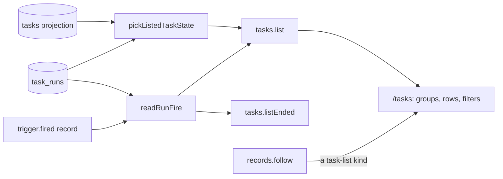

# The dashboard groups, rows and filters

- **Status:** draft
- **Work items:** [the view procedures](https://linear.app/zgeoff/issue/GEO-2545),
  [the view routes](https://linear.app/zgeoff/issue/GEO-1837)

The dashboard at `/tasks` lists your tasks by group, and today it knows only the stored task state.
The tasks module already tells a task that waits for nothing apart from one that waits on a reply,
and [the wake rule](https://linear.app/zgeoff/issue/GEO-1865) adds a task that is asleep until its
next fire. This design brings those listed states to the dashboard, shows when a definition's task
run was scheduled and whether it came late, and filters the list by definition and by state. The
[live view baseline](../platform/channels/live-view.md#the-dashboard) gives the dashboard's purpose,
and [the views](definition-views.md) give the routes for definitions and ended task runs.

Terms: the **listed state** is the state that `pickListedTaskState` of the tasks module gives a
task, which the conversation's `tasks.list` tool already shows. A **fire** is the `trigger.fired`
record that opened a task run, as [the 2 fire records](definition-tasks.md#the-2-fire-records)
define.

## Shape



## Contracts

```ts
const listed = await api.tasks.list({ definitionID: 'water-the-tomatoes', states: ['asleep'] });
// → { readAtSequence: 9120, tasks: [{ taskID: 't4k2', name: 'Water the tomatoes', state: 'waiting',
//     listedState: 'asleep', definitionID: 'water-the-tomatoes', fire: null,
//     nextRunAt: '2027-03-19T08:00:00.000Z', … }] }
const open = await api.tasks.list({});
// → { tasks: [{ taskID: 'k8r2', state: 'running', listedState: 'running',
//     definitionID: 'weekly-digest', fire: { scheduledFor: '2027-03-15T07:00:00.000Z',
//     firedAt: '2027-03-15T09:12:40.000Z', isCatchUp: true }, … }, …] }
```

```ts
// contract lib. tasks.list gains an optional input; every new output field is optional, so a
// client reads a missing field as the built behaviour.
interface TasksListInput {
  definitionID?: string; // only the task of that definition
  states?: ListedState[]; // 1 to 11 distinct values: only tasks in one of them
}
type ListedState = TaskState | 'idle' | 'finished' | 'asleep'; // TaskState: built taskStateSchema

// listedTaskSchema: { …existing fields, plus: }
interface ListedTaskAdded {
  listedState?: ListedState; // a new field, so a client's map of `state` labels still matches
  definitionID?: string; // set for a definition's task
  fire?: RunFire | null; // a definition's task only: the fire of its open task run; null with none
  // wakeable and nextRunAt: the wake rule work adds both.
}

// tasks.listEnded's runs: { …the fields the views give, plus: }
interface EndedRunAdded {
  fire: RunFire | null; // null for a task run that a message, the owner or a start opened
}

// contract lib
interface RunFire {
  scheduledFor: string; // ISO instant, from the fire's scheduledFor
  firedAt: string; // ISO instant, from the fire's firedAt
  isCatchUp: boolean; // from the fire's isCatchUp
}
```

```ts
// tasks module: the fire of one task run, or null
const fire = await readRunFire(context, run);
// → { scheduledFor: '2027-03-15T07:00:00.000Z', firedAt: '2027-03-15T09:12:40.000Z', isCatchUp: true }

declare function readRunFire(
  context: Pick<TasksContext, 'log'>,
  run: TaskRun, // task runs work: one row of task_runs
): Promise<RunFire | null>;
```

The dashboard groups, by listed state. The conversation's own row always sits in the conversation
group, whatever its state.

| Listed state                  | Group   | The row shows besides the built facts                    |
| ----------------------------- | ------- | -------------------------------------------------------- |
| `ready`, `running`, `waiting` | Working | the fire, for a definition's task run                    |
| `idle`                        | Working | nothing more                                             |
| `asleep`                      | Working | the next fire from `nextRunAt`, once the list carries it |
| `finished`                    | Working | that the task sent its report                            |
| `paused`, `stopped`, `failed` | Held    | the fire of the task run that the hold stopped           |
| `done`, `closed`              | none    | the task leaves the dashboard, as built                  |

## Constraints

### The listed state

- `tasks.list` and `tasks.read` of the API set `listedState` through the same `pickListedTaskState`
  that the `tasks.list` tool calls, so you and the conversation see the same state.
- `state` keeps the stored task state. A client groups and labels by `listedState` when it is set,
  and by `state` as built when it is not.
- While nixie is paused, every task reads as `paused`, as [the pause](pause.md#the-pause) says, so
  each one sits in the held group.
- Before the wake rule is built, no task lists as `asleep`, and the dashboard shows no next fire.

### The fire

- `readRunFire` reads `task.run_opened.origin` of the task run. For `origin.kind` `trigger`, the
  fire is the `trigger.fired` record at `origin.sequence`.
- For a carrying task run, with `origin.kind` `raise` or `restart`, `readRunFire` follows
  `carriesRunID` to the first task run of the chain and returns that task run's fire.
- For any other origin, such as `message`, `readRunFire` returns null, and the row shows no fire.
- A fire whose record the reset removed gives null.
- `tasks.list` sets `fire` only for a definition's task: from its open task run, or, for a held
  task, from its newest task run. A started task gets no `fire` key.
- `tasks.listEnded` sets `fire` on every run it returns, through the same `readRunFire`.
- The row shows the scheduled time in your time zone, and a catch-up shows how late it fired, from
  `firedAt` less `scheduledFor`.

### The filters

- The server applies `definitionID` and `states` before the list's limit of 100, so a filter never
  misses a task that a later page would hold.
- `states` matches the listed state. A filter on `paused` therefore holds every task while nixie is
  paused.
- The dashboard keeps both filters in the route's search parameters, so a reload or a shared link
  keeps them.
- The dashboard offers each definition that `definitions.listTasks` returns with a `taskID`, by its
  name, and each listed state, as filter choices. A choice that matches no task shows the empty
  group text.
- With a filter set, the dashboard shows only the groups that hold a matching task, and a control
  that clears the filters.

### Staying current

- The dashboard reads the list again on `trigger.fired`, beside the kinds that `isTaskListRecord`
  matches, because a fire moves a task's last activity and opens a task run.
- Each read of the list carries the filters in its query key, so a change of filter reads a fresh
  list and follows the stream from its `readAtSequence`, as built.

### A rollback

- This design adds no record kind, no migration and no config key.
- The release before has no `listedState`, `definitionID` or `fire` in its contract. Its server
  strips the unknown `tasks.list` input, so a newer client gets the whole list unfiltered, and
  groups each task by `state`. The newer client hides the definition filter when no listed task has
  a `definitionID`.

## Decisions

- **The dashboard keeps its 3 built groups, and every live task that is not held sits in Working.**
  An agent's call on 13 Nov: until the owner settles the groups, the smaller change keeps the built
  layout, and no listed task leaves the page that the built dashboard shows.
- **`listedState` is a new field, never new members of `state`.** An agent's call on 13 Nov: the
  built client maps every `state` value to a label, and a client from the release before would show
  no label for a new member.
- **The server filters, and the client never filters the loaded list.** An agent's call on 13 Nov:
  the list stops at 100 tasks, so a client filter would hide a match without a sign.
- **The fire of a carrying task run is the fire of the task run it carries.** An agent's call on 13
  Nov: a raise or a restart goes on with the same scheduled work, so its row keeps that work's
  scheduled time.

## Builder decides

- The wording of each state label, the fire fact and the filter controls.
- Where the filters sit on the page.
- How `readRunFire` reads a page of task runs at once.
- The layout of the tests.

## Out of scope

- Supervised coding sessions as a group, which [GEO-311](https://linear.app/zgeoff/issue/GEO-311)
  covers.
- Approvals that wait on you. The [approval record](https://linear.app/zgeoff/issue/GEO-1804) work
  serves them, and its cards and digest show them.
- The routes `/tasks/ended` and `/definitions`, which [the views](definition-views.md) cover.

## Open questions

- **Does the dashboard gain the "needs you" and the "finished in the last 7 days" groups of the
  baseline?** The owner settles it in [the view routes](https://linear.app/zgeoff/issue/GEO-1837).
  Until then, the dashboard keeps its 3 groups, as the table above maps them.
