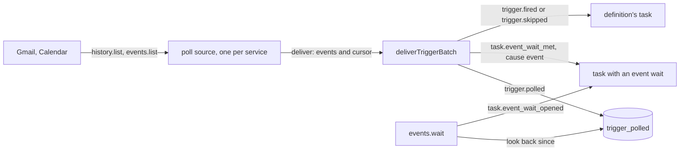

# Mail and calendar polls

- **Status:** draft
- **Work items:** [the Gmail and Calendar polls](https://linear.app/zgeoff/issue/GEO-1827). They
  build on [the schedule source and the trigger core](https://linear.app/zgeoff/issue/GEO-1835).

nixie asks Gmail and Google Calendar what changed every 5 minutes, for each Google connection. Each
new mail and each changed event becomes one record, which wakes each task that waits for it and
fires each definition whose `poll` trigger matches it. The record, the wakes, the fires and the
service's cursor commit in one write transaction of the [trigger core](triggers.md), so a restart or
a replayed poll neither misses nor repeats an event. A task waits on one mail thread or one calendar
event through a tool, and the wait sees an event that arrived before the wait opened.

Terms: a poll is one call of a service for one connection. A polled event is one new mail or one
change to one calendar event. An event wait is a task's wait on one thread or one calendar event.
The [trigger core design](triggers.md) defines a source, a batch and a dedupe key.

## Shape



## Contracts

### The poll spec

```ts
// connectors module. Fills `polls` of the connector design's Connector. The Google connector
// declares 2: gmailPoll and calendarPoll.
interface PollSpec<Cursor extends JSONValue> {
  source: 'gmail' | 'calendar'; // the trigger source's ID; one source covers every connection
  scopes: string[]; // gmail: ['gmail.modify']; calendar: ['calendar.events']
  begin(context: ConnectorContext): Promise<Cursor>; // the cursor of now; delivers no event
  poll(cursor: Cursor, since: number, context: ConnectorContext): Promise<PollAnswer<Cursor>>;
  // since: the last good poll's start, epoch ms, for a resync's look back
}

type PollAnswer<Cursor> =
  | { kind: 'changes'; cursor: Cursor; events: PolledEvent[] }
  | { kind: 'resynced'; cursor: Cursor; events: PolledEvent[]; reason: ResyncReason } // events since `since`
  | { kind: 'failed'; reason: string; status?: number; after?: number }; // after: the service's retry time, ms

type ResyncReason = 'history_expired' | 'sync_token_gone'; // Gmail's 404, Calendar's 410

type GmailCursor = { historyID: string };
type CalendarCursor = { syncToken: string };
```

```ts
// connectors module. The server app builds 2 and passes them to startTriggerSources beside the
// schedule source.
declare function buildPollSource<Cursor extends JSONValue>(input: {
  spec: PollSpec<Cursor>;
  clock: Clock;
  listConnections: () => Promise<PollConnection[]>; // each Google connection that is not forgotten
  readContext: (connectionID: string) => ConnectorContext; // the fetcher of that connection
}): TriggerSource;

interface PollConnection {
  connectionID: string; // the UUID; the model never sees it
  status: ConnectionStatus; // libs/contract
  grantedScopes: string[];
}

// The source's cursor in trigger_sources: one entry per connection it polls.
type PollSourceCursor<Cursor> = Record<string, { cursor: Cursor; polledAt: number }>; // key: connectionID
// polledAt: the start of the last good poll, epoch ms
```

### The polled events

```ts
// triggers module. The member of TriggerEvent that a poll source builds.
interface PollEvent {
  kind: 'poll';
  connectionID: string;
  dedupeKey: string; // gmail: '<connectionID>|<messageID>'; calendar: '<connectionID>|<eventID>|<etag>'
  occurredAt: string; // ISO: the start of the poll that found it
  payload: PolledEvent;
}

type PolledEvent = PolledMail | PolledCalendarChange;

interface PolledMail {
  service: 'gmail';
  messageID: string; // Gmail's own IDs, as the Gmail tools take them
  threadID: string;
  labelIDs: string[]; // such as ['INBOX', 'UNREAD', 'CATEGORY_PERSONAL']
  receivedAt: string; // ISO, from internalDate
  from: { address: string; name: string | null }; // erasable
  subject: string; // erasable
}

interface PolledCalendarChange {
  service: 'calendar';
  calendarID: 'primary';
  eventID: string;
  recurringEventID: string | null; // set for one instance of a recurring event
  status: 'confirmed' | 'tentative' | 'cancelled';
  start: string | null; // ISO instant, or 'YYYY-MM-DD' for an all-day event; null when cancelled
  end: string | null;
  updated: string; // ISO
  title: string | null; // erasable
  organizer: string | null; // erasable: an address
  attendees: {
    address: string;
    response: 'needsAction' | 'declined' | 'tentative' | 'accepted';
    self: boolean;
  }[]; // erasable
}
```

### The `poll` trigger

```yaml
# tasks/bank-statement/task.yaml
name: File the bank statement
brief: Read the new statement mail and note the closing balance.
trigger:
  poll:
    mail:
      from: ['@bank.example']
      subject: statement
```

```ts
// contract lib, beside Trigger. Every key is optional; each key set must match.
type Trigger = { schedule: Schedule } | { at: string } | { poll: PollFilter }; // …existing members

type PollFilter =
  | {
      mail: {
        connection?: string; // a connection's short ID; omitted: every Google connection
        from?: string[]; // addresses or '@domain'; any one matches
        subject?: string; // a substring
        label?: string; // a Gmail label ID, such as 'IMPORTANT'
      };
    }
  | {
      calendar: {
        connection?: string;
        cancelled?: boolean; // true: only cancellations; omitted: every change
      };
    };
```

### The event wait

```ts
const wait = await call('events.wait', { on: { mail: { thread: '18c4f2a9b7e1d03c' } } });
// → { wait: 'w7q2m4', matched: false }
//   matched: true: a polled event since `since` matched, and its record is in the inbox now
//   or NOT_A_TASK: the conversation called it
//   or CONNECTION_NOT_FOUND, SINCE_TOO_OLD (more than 7 days back), TOO_MANY_WAITS (20 open)

// triggers module. Effect `note`. Its input:
interface EventWaitInput {
  on: EventWaitOn;
  since?: string; // ISO; default: the start of the step that calls it; at most 7 days back
}

// contract lib, beside PollFilter
type EventWaitOn =
  | { mail: { connection?: string; thread: string } } // the thread ID the Gmail tools return
  | { calendar: { connection?: string; event: string } }; // matches the event and each of its instances
```

The `connection` key follows
[the connection argument](../platform/connectors/connector.md#the-connection-argument): required
when the caller reaches 2 or more Google connections, and bound to the one otherwise.

```ts
// tasks module. On the task's thread. The tool writes both through the tasks module.
interface TaskEventWaitOpened {
  waitID: string; // random UUID
  shortID: string; // createShortID: the `wait` the model sees
  source: 'gmail' | 'calendar';
  connectionID: string;
  match: string; // the thread ID or the event ID
  since: string;
}

// An inbox record: it wakes the task with the cause `event`, and closes the wait.
interface TaskEventWaitMet {
  waitID: string;
  polled: number; // the sequence of the trigger.polled record
}

// Not an inbox record. Closes the wait unmet.
interface TaskEventWaitReleased {
  waitID: string;
  cause: 'done' | 'failed' | 'stopped' | 'closed' | 'task_run_ended';
}
```

```ts
// tasks module. The trigger core and the tool call these inside their own transaction.
declare function readOpenEventWaitsInTransaction(
  tx: Transaction,
  source: 'gmail' | 'calendar',
  connectionID: string,
): Promise<OpenEventWait[]>; // oldest first
declare function writeEventWaitMetInTransaction(
  tx: Transaction,
  waitID: string,
  polled: number,
): Promise<void>;
```

### The records and the tables

```ts
// triggers module. On no thread. The one copy of a polled event's content.
interface TriggerPolled {
  source: 'gmail' | 'calendar';
  connectionID: string;
  dedupeKey: string;
  polledAt: string;
  event: PolledEvent; // the fields marked erasable sit in the record's erasable fields
}

// triggers module. On no thread. No erasable field.
interface TriggerResynced {
  source: 'gmail' | 'calendar';
  connectionID: string;
  reason: ResyncReason;
  gapFrom: string; // the last good poll's start
  gapTo: string; // this poll's start
  recovered: number; // the events of the gap this poll delivered, before dedupe
}
```

The fire records gain one member each, in
[the 2 fire records](definition-tasks.md#the-2-fire-records): `trigger.fired` takes `kind: 'poll'`
and `polled`, the sequence of its `trigger.polled` record.

```text
2 projections, one appended migration:
trigger_polled     triggers module. key sequence. source_id, connection_id, match_id (the thread
                   ID or the event ID), recurring_id (null for mail), occurred_at (receivedAt or
                   updated, epoch ms). From trigger.polled. Never deleted.
task_event_waits   tasks module. key wait_id. short_id, task_id, source_id, connection_id,
                   match_id, state (open | met | released), updated_sequence.
                   From the 3 task.event_wait_* records.
```

## Constraints

### The polls

- Each source polls each listed connection every 5 minutes, one connection at a time. It polls a
  connection whose status is `active`, `failing` or `expiring` and which holds every scope of its
  spec, and no other.
- A mail that reaches a mailbox while its source runs wakes its waiting task within 6 minutes.
- The Gmail poll calls `history.list` with `startHistoryId`, `historyTypes: messageAdded`, and up to
  500 records a page, over every page. It stores the `historyId` of the last page, the one with no
  `nextPageToken`.
- It reads each added message once with `messages.get`, format `metadata`, headers `From` and
  `Subject`. It drops a message that the read cannot find, and a message labelled `SENT`, `DRAFT`,
  `SPAM` or `TRASH`. Neither your own mail nor nixie's then meets a wait on its thread.
- The Calendar poll calls `events.list` on `primary` with `syncToken`, `showDeleted: true` and 2500
  events a page, over every page, and stores the `nextSyncToken` of the last page. Every list it
  makes, the first one included, uses those same parameters.
- One poll of one connection is one `deliver` call, with every event the poll found and the whole
  source cursor, which holds the connection's new entry. A sync token covers every change before it,
  so the cursor commits only with all of them.
- The source drops the entry of each connection that `listConnections` no longer lists at its next
  `deliver`.
- A poll fails when the fetcher or the service fails, or when `deliver` throws. The source then
  keeps that connection's last committed cursor, and polls it again after 1 minute, doubling to 1
  hour, or after the service's retry time when that is longer.
- After 3 failed polls in a row of any connection, the source reports `unhealthy`. When every
  connection's last poll is good, it reports `running`.
- The polls make read calls only, through the connection's fetcher. A poll is no tool call, so the
  decision point never sees it, and no model reads its result before a task does.

### The first poll and a resync

- The first poll of a connection calls `begin` and delivers no event: Gmail's `getProfile` gives the
  `historyId`, and Calendar's full list gives the sync token. Mail and changes from before the
  connection therefore never wake a task.
- When Gmail answers 404 to `history.list`, the poll resyncs: it reads `getProfile` first, for the
  new cursor, then lists the messages with the query
  `after:<since in seconds, less 600> -in:sent -in:drafts` and reads each one as above.
- When Calendar answers 410, the poll resyncs: it lists the calendar in full with the same
  parameters, for the new token, and keeps each event whose `updated` falls at or after `since`,
  less 10 minutes.
- A resync delivers its events in the batch with its new cursor, and the core writes one
  `trigger.resynced`. The dedupe keys drop each event of the gap that nixie already delivered.
- A resync can miss a mail received and deleted inside the gap, and a calendar change that left
  `updated` alone, such as a reminder edit. It delivers an event changed twice in the gap once, in
  its latest state.

### One `deliver` call of a poll batch

For each poll event, in batch order, inside the transaction of
[one `deliver` call](triggers.md#one-deliver-call):

1. When `trigger_keys` holds its key, or an earlier event of the batch took it, nothing happens.
2. The core writes `trigger.polled`, whose fold takes the key and adds the `trigger_polled` row.
3. For each open event wait of the source and connection whose `match` equals the thread ID, the
   event ID or the recurring event ID, oldest first, it calls `writeEventWaitMetInTransaction`.
4. For each armed definition of the source whose filter matches, by definition ID, rows 2 to 6 of
   the core's table decide, with the key `<definitionID>|<event key>`.

- The core stores a poll batch's cursor whether or not its events were new, so the source never has
  to tell a paused batch from a batch of repeats.
- While nixie is paused, the core delivers poll events as on any day. A fire and a met wait then
  wait in the inbox, and no claim starts until the resume.
- A poll fire takes `scheduledFor` as its event's `occurredAt`, with `skipped: []` and
  `skippedCount: 0`. A poll skip takes `scheduledFor` as `[occurredAt]` and `count: 1`.
- No fold moves a watermark for a poll event.
- A mail that matches a definition while its task run is open skips with `still_running`, so that
  mail never opens a task run. A definition that must see every mail lists the Gmail search tool and
  searches since its last task run.
- `from` compares the From address, lowered, with each entry; an entry `@<domain>` matches that
  domain alone, never a subdomain. `subject` matches a substring, both sides in NFC and lowered.
  `label` matches one of `labelIDs`. A `cancelled: true` filter matches `status: cancelled` alone.
- The From header is the sender's own claim, so a `from` match is no proof of the sender. The task
  run reads the mail as outside content, as every task run does.

### Event waits

- `events.wait` writes `task.event_wait_opened` in its own write transaction, while its step runs.
  In that transaction it reads the `trigger_polled` rows of the source and connection with
  `occurred_at` at or after `since`, and when one matches, writes `task.event_wait_met` for the
  oldest. The single writer orders it against each `deliver`, so an event commits either before the
  wait, and the look back finds it, or after, and `deliver` meets the wait.
- A wait is met at most once. Its met record and its state change commit in one transaction.
- When the task holds an open wait with the same `on`, the tool returns that wait and writes
  nothing.
- The tasks module writes `task.event_wait_released` for each open wait of a task in the commit that
  ends it as done, fails it, stops it or closes it. For a definition's task, it also does so in the
  transaction that ends the task run that opened the wait.
- An open event wait counts as an open wait wherever the tasks module reads one. A task run with one
  is waiting on a reply, so the fire answer gives `still_running`, and the step that the met record
  wakes runs inside that task run.
- The conversation never opens an event wait. It starts a task that waits.
- A wait on a forgotten connection stays open until its task releases it. No event meets it.
- The step renders a met wait or a poll fire from the `trigger.polled` record that `polled` names,
  as outside content with the source and the connection. A record whose key is gone renders as
  forgotten.

### Free text and keys

- A polled event's free text sits in the erasable fields of its `trigger.polled` record, under a key
  of that record's own. A Forget of the connection leaves these records, as it leaves every record
  that names the account (Forget in `docs/design/queue/google-connections.md`); you forget each one
  apart.
- The payloads, the projections and the cursors hold only Google's IDs, labels, times and statuses.
- A definition's `from` and `subject` sit in plain text in `trigger.armed` and
  `trigger_definitions`, as they do in the definition's files.
- `trigger_polled` grows by one row per polled event, and `trigger_keys` by one per polled event and
  one per poll fire or skip.

### Boundaries

- The connectors module holds `buildPollSource` and the 2 poll specs, and imports the triggers
  module's port types. The triggers module imports no connectors code. The server app passes it the
  connection lookup that `events.wait` needs.
- The triggers module holds `events.wait`, the filter match and `trigger_polled`. The tasks module
  holds the event waits and their table.
- The design adds no config key. The 5 minutes, the 7 days and the 20 waits are constants.

### A rollback

| The change                                  | The release before                                                                                      |
| ------------------------------------------- | ------------------------------------------------------------------------------------------------------- |
| the migration of the 2 projections          | starts, because the migration only adds tables, and never selects them                                  |
| `trigger.polled`, `trigger.resynced`        | never meets them on a thread, and no projection of it reads them                                        |
| the 3 `task.event_wait_*` kinds             | skips each unknown kind: a met wait wakes nothing, and a task that waits only on mail waits for input   |
| a poll `trigger.fired`                      | marks it read and opens no task run, under the rule for a fire of an unknown kind                       |
| the `gmail` and `calendar` cursors and keys | has no such source and never reads the rows; after the next upgrade the polls resume from those cursors |
| a `poll` trigger, `events.wait` in `tools`  | refuses the whole seed with `poll_trigger` or `start_refused`, and keeps the last accepted seed         |

- Before you start the release before, remove each `poll` trigger and each `events.wait` from the
  definitions repo, and let a seed run. The definitions format stays at 4.

## Changes to the trigger core and the baseline

This design extends [the trigger core](triggers.md) in these places:

- `TriggerSource.kind` takes `'poll'`, and `TriggerEvent` becomes the union of its schedule member
  and `PollEvent`.
- `ArmedDefinition.source` takes `'gmail'` and `'calendar'`: the seed arms a `poll.mail` trigger on
  `gmail` and a `poll.calendar` trigger on `calendar`. `readNextFire` returns null for a `poll`
  trigger, and `renderTrigger` renders it, such as 'on mail from @bank.example', with `next: null`.
- A poll batch goes through [the poll rows](#one-deliver-call-of-a-poll-batch) above, and the pause
  holds back only schedule events.

It replaces these parts of
[the trigger source design](../platform/channels/trigger-source.md#polls):

- One source per connection, `mail:<account_id>`: one source per service holds a cursor per
  connection.
- "Record the possible gap": a resync delivers the gap's events from the last good poll's time.
- Job filters in `deliver`: the core matches definitions' `poll` filters and event waits.

## Decisions

- **One source per service, with a cursor per connection.** An agent's call on 13 Nov 2026:
  `startTriggerSources` takes a fixed list at start, and connections come and go at runtime.
- **A wait names one thread or one event.** An agent's call on 13 Nov 2026: an ID match needs no
  free text in a projection, and covers a reply and a calendar answer. Wider filters belong to
  definitions.
- **Every polled event is stored, matched or not.** An agent's call on 13 Nov 2026: the look back
  needs it, so a reply that lands between a send and the wait still wakes the task.
- **A resync recovers the gap from the last good poll's time.** An agent's call on 13 Nov 2026: a
  task that waits on a reply would otherwise wait for good after a week of downtime.
- **Poll events deliver while nixie is paused.** An agent's call on 13 Nov 2026: inbox delivery runs
  while paused, a mail is no slot that a catch-up can rebuild, and no claim starts until the resume.
- **The source drops your own sent mail and drafts.** An agent's call on 13 Nov 2026: a send in the
  thread would otherwise meet the wait that waits for the other side's reply.
- **Only the `primary` calendar.** An agent's call on 13 Nov 2026: smaller first; another calendar
  is one more spec entry later.
- **The calendar key holds the event's `etag`.** An agent's call on 13 Nov 2026: Google keeps
  `updated` for a reminder edit, and the `etag` changes with every change of the resource.

## Builder decides

- The names of internal functions, the constants' module and the test layout.
- Whether the Gmail poll reads the messages one by one or in a batch request.
- The wording of the rendered event, within the outside-content rule.
- The error wording of `events.wait`.

## Out of scope

- Push from Google, webhooks and held streams
  ([the trigger source](../platform/channels/trigger-source.md#webhooks-and-streams)).
- Calendars other than `primary`, and other mail providers.
- A `poll` trigger from chat: `task.define` takes `schedule` and `at`
  ([definitions from chat](definitions-from-chat.md)).
- A view of source health and of `trigger.resynced` records.
- Pruning `trigger_polled`.
- The Gmail and Calendar tools, the morning report's reads among them:
  `docs/design/queue/gmail-calendar-drive-tools.md`.

## Open questions

These sit in [the polls issue](https://linear.app/zgeoff/issue/GEO-1827) for the owner:

- **The names: `events.wait`, the record kinds, and the `poll`, `mail` and `calendar` keys.** Until
  the owner settles them, the names here hold.
- **Does a resync or a skipped mail tell you in the conversation?** Until the owner settles it,
  neither does: the records and the log hold them.
- **May the conversation wait on mail itself?** Until the owner settles it, it starts a task that
  waits.
