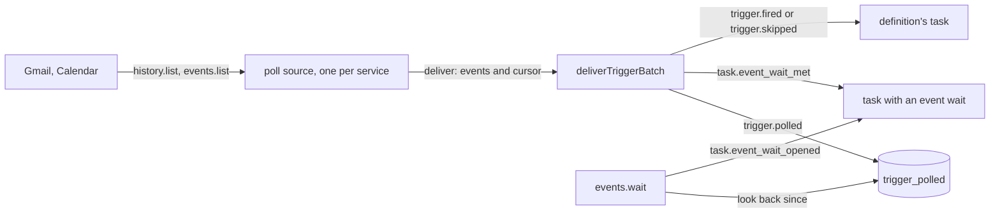

# Mail and calendar polls

- **Status:** draft
- **Work items:** [the Gmail and Calendar polls](https://linear.app/zgeoff/issue/GEO-1827). They
  build on [the schedule source and the trigger core](https://linear.app/zgeoff/issue/GEO-1835).

Every 5 minutes, nixie asks Gmail and Google Calendar what changed for each Google connection. Each
new mail and each changed calendar event becomes one record. That record wakes each task that waits
for it, and starts a task run of each [task definition](task-definition-format.md) whose `poll`
trigger matches it. The record, the wakes, the task runs it starts and the service's cursor commit
in one write transaction of the [trigger core](triggers.md). A restart therefore misses no event,
and a poll that asks for the same changes again repeats none. A task waits on one mail thread or one
calendar event through a tool, and the wait also sees an event that arrived before it opened.

This design uses the terms below. The linked docs define each one in full.

| Term         | Meaning                                                                                                                     |
| ------------ | --------------------------------------------------------------------------------------------------------------------------- |
| poll         | one call of Gmail or Calendar for one connection                                                                            |
| polled event | one new mail, or one change to one calendar event                                                                           |
| event wait   | a task's wait on one mail thread or one calendar event, opened by `events.wait`                                             |
| open wait    | an event wait, or a [message wait](../../architecture/core/task-messages.md), that nothing has answered or released yet     |
| armed        | a definition in force that has a trigger ([trigger core terms](triggers.md#shape))                                          |
| fire         | one event of a definition's trigger, recorded as `trigger.fired` or `trigger.skipped` ([fire records](definition-tasks.md)) |
| fire answer  | the tasks module's answer to a fire: take it, or skip it ([the fire answer](definition-tasks.md#the-fire-answer-1))         |
| dedupe key   | the text that identifies one polled event or one fire; `trigger_keys` holds each one taken                                  |
| erasure key  | the key of a record's own that seals its free text ([erasable fields](../../architecture/core/erasable-fields.md))          |
| seed         | the load of the definitions repo into nixie ([the seed](task-definition-format.md#the-seed))                                |
| inbox record | a record that lands in a task's inbox and wakes it ([the inbox](../../architecture/core/tasks.md#the-inbox))                |
| the core     | `deliverTriggerBatch`, which each source reaches through `deliver` ([the port](triggers.md#the-port))                       |

## Shape



## Contracts

### The poll spec

```ts
// connectors module. Fills `polls` of Connector in the connector design:
// ../platform/connectors/connector.md#the-interface. The Google connector declares 2: gmailPoll
// and calendarPoll.
interface PollSpec<Cursor extends JSONValue> {
  source: 'gmail' | 'calendar'; // the trigger source's ID; one source covers every connection
  scopes: string[]; // gmail: ['gmail.modify']; calendar: ['calendar.events']
  begin(context: ConnectorContext): Promise<Cursor>; // the service's cursor at this moment; finds no event
  poll(cursor: Cursor, since: number, context: ConnectorContext): Promise<PollAnswer<Cursor>>;
  // since: the start of the connection's last good poll, epoch ms. Only a resync reads it.
}

type PollAnswer<Cursor> =
  | { kind: 'changes'; cursor: Cursor; events: PolledEvent[] }
  | { kind: 'resynced'; cursor: Cursor; events: PolledEvent[]; reason: ResyncReason }
  | { kind: 'failed'; reason: string; status?: number; after?: number }; // after: the service's retry time, ms

type ResyncReason = 'history_expired' | 'sync_token_gone'; // Gmail's 404, Calendar's 410

type GmailCursor = { historyID: string };
type CalendarCursor = { syncToken: string };
```

```ts
// connectors module. The server app builds 2 and passes them to startTriggerSources beside the
// schedule source.
declare function buildPollSource<Cursor extends JSONValue>(input: {
  spec: PollSpec<Cursor>;
  clock: Clock;
  listConnections: () => Promise<PollConnection[]>; // each Google connection whose status is not `forgotten`
  readContext: (connectionID: string) => ConnectorContext; // the fetcher of that connection
}): TriggerSource;

interface PollConnection {
  connectionID: string; // the connection's UUID; a tool shows the model its short ID instead
  status: ConnectionStatus; // libs/contract
  grantedScopes: string[];
}

// The source's cursor in trigger_sources: one entry per connection it polls.
type PollSourceCursor<Cursor> = Record<string, { cursor: Cursor; polledAt: number }>; // key: connectionID
// polledAt: the start of the connection's last good poll, epoch ms
```

### The polled events

```ts
// triggers module. The member of TriggerEvent that a poll source builds.
interface PollEvent {
  kind: 'poll';
  connectionID: string;
  dedupeKey: string;
  // gmail: '<connectionID>|<messageID>'
  // calendar: '<connectionID>|<eventID>|<etag>', or '<connectionID>|<eventID>|cancelled' for a
  // cancellation that Google sends without an etag
  occurredAt: string; // ISO: the start of the poll that found it
  payload: PolledEvent;
}

type PolledEvent = PolledMail | PolledCalendarChange;

// A field marked erasable sits in the erasable fields of the trigger.polled record.
interface PolledMail {
  service: 'gmail';
  messageID: string; // Gmail's own IDs, as the Gmail tools take them
  threadID: string;
  labelIDs: string[]; // such as ['INBOX', 'UNREAD', 'CATEGORY_PERSONAL']
  receivedAt: string; // ISO, from internalDate
  from: { address: string; name: string | null }; // erasable
  subject: string; // erasable
}

interface PolledCalendarChange {
  service: 'calendar';
  calendarID: 'primary';
  eventID: string;
  recurringEventID: string | null; // set for one instance of a recurring event
  status: 'confirmed' | 'tentative' | 'cancelled';
  // Google can send a cancelled event with its ID alone, so each field below is null or empty when
  // Google leaves it out.
  etag: string | null;
  start: string | null; // ISO instant, or 'YYYY-MM-DD' for an all-day event
  end: string | null;
  updated: string | null; // ISO
  title: string | null; // erasable
  organizer: string | null; // erasable: an address
  attendees: {
    address: string;
    response: 'needsAction' | 'declined' | 'tentative' | 'accepted';
    self: boolean;
  }[]; // erasable
}
```

### The `poll` trigger

```yaml
# tasks/bank-statement/task.yaml
name: File the bank statement
brief: Read the new statement mail and note the closing balance.
trigger:
  poll:
    mail:
      from: ['@bank.example']
      subject: statement
```

```ts
// contract lib, beside Trigger. Every key is optional. Each key that the filter sets must match.
type Trigger = { schedule: Schedule } | { at: string } | { poll: PollFilter }; // …existing members

type PollFilter =
  | {
      mail: {
        connection?: string; // a connection's short ID; omitted: every Google connection
        from?: string[]; // addresses or '@domain'; any one matches
        subject?: string; // a substring
        label?: string; // a Gmail label ID, such as 'IMPORTANT'
      };
    }
  | {
      calendar: {
        connection?: string;
        cancelled?: boolean; // true: only cancellations; omitted: every change
      };
    };
```

### The event wait

```ts
const wait = await call('events.wait', { on: { mail: { thread: '18c4f2a9b7e1d03c' } } });
// → { wait: 'w7q2m4', matched: false }
//   or { wait: 'w7q2m4', matched: true }: an event that arrived since `since` matched, and its
//   met record is in the task's inbox now

// Errors:
//   NOT_A_TASK            the conversation called it
//   CONNECTION_NOT_FOUND  no connection the caller reaches holds that short ID
//   SINCE_TOO_OLD         `since` is more than 7 days back
//   TOO_MANY_WAITS        the task already holds 20 open event waits

// triggers module. The tool's effect is `note`, as for task.message. Its input:
interface EventWaitInput {
  on: EventWaitOn;
  since?: string; // ISO; default: the start of the step that calls the tool; at most 7 days back
}

// contract lib, beside PollFilter
type EventWaitOn =
  | { mail: { connection?: string; thread: string } } // the thread ID the Gmail tools return
  | { calendar: { connection?: string; event: string } }; // matches the event and each of its instances
```

The `connection` key follows
[the connection argument](../platform/connectors/connector.md#the-connection-argument): it is
required when the caller reaches 2 or more Google connections, and it binds to the one connection
otherwise.

```ts
// tasks module. On the task's thread. The tool writes it through the tasks module.
interface TaskEventWaitOpened {
  waitID: string; // random UUID
  shortID: string; // createShortID: the `wait` the model sees
  source: 'gmail' | 'calendar';
  connectionID: string;
  match: string; // the thread ID or the event ID
  since: string;
}

// An inbox record: it wakes the task with the cause `event`, and closes the wait.
interface TaskEventWaitMet {
  waitID: string;
  polled: number; // the sequence of the trigger.polled record
}

// Not an inbox record. It closes the wait unmet.
interface TaskEventWaitReleased {
  waitID: string;
  cause: 'done' | 'failed' | 'stopped' | 'closed' | 'task_run_ended';
}
```

```ts
// tasks module. The core and the tool call these inside their own transaction.
declare function readOpenEventWaitsInTransaction(
  tx: Transaction,
  source: 'gmail' | 'calendar',
  connectionID: string,
): Promise<OpenEventWait[]>; // oldest first
declare function writeEventWaitMetInTransaction(
  tx: Transaction,
  waitID: string,
  polled: number,
): Promise<void>;
```

### The records and the tables

```ts
// triggers module. On no thread. The one copy of a polled event's content.
interface TriggerPolled {
  source: 'gmail' | 'calendar';
  connectionID: string;
  dedupeKey: string;
  polledAt: string;
  event: PolledEvent;
}

// triggers module. On no thread. No erasable field.
interface TriggerResynced {
  source: 'gmail' | 'calendar';
  connectionID: string;
  reason: ResyncReason;
  gapFrom: string; // the start of the last good poll
  gapTo: string; // the start of this poll
  recovered: number; // the events of the gap this poll delivered, before dedupe
}
```

[The 2 fire records](definition-tasks.md#the-2-fire-records) gain one member each: `trigger.fired`
takes `kind: 'poll'`, and `polled`, the sequences of its `trigger.polled` records, oldest first.

```text
2 projections, one appended migration:
trigger_polled     triggers module. key sequence. source_id, connection_id, match (the thread ID
                   or the event ID), recurring_id (null for mail), occurred_at (epoch ms: receivedAt;
                   for a calendar change, updated, or the poll's start when updated is null).
                   From trigger.polled. Never deleted.
task_event_waits   tasks module. key wait_id. short_id, task_id, source_id, connection_id, match,
                   state (open | met | released), updated_sequence.
                   From the 3 task.event_wait_* records.
```

## Constraints

### The polls

- Each source polls each connection that `listConnections` returns every 5 minutes, one connection
  at a time. It polls a connection only when its status is `active`, `failing` or `expiring` and it
  holds every scope of the spec.
- A mail reaches the task that waits for it within 6 minutes of its arrival, while its source
  reports `running`: up to 5 minutes until the next poll, and up to 1 minute for the poll and its
  commit.
- The Gmail poll calls `history.list` with `startHistoryId`, `historyTypes: messageAdded`, and up to
  500 records a page, over every page. It stores the `historyId` of the last page, the one with no
  `nextPageToken`.
- It reads each added message once with `messages.get`, format `metadata`, headers `From` and
  `Subject`. It drops a message that the read cannot find. It also drops each message labelled
  `SENT`, `DRAFT`, `SPAM` or `TRASH`, so a mail that you send, or that nixie sends through the Gmail
  tools, never meets a wait on its thread.
- The Calendar poll calls `events.list` on `primary` with `syncToken`, `showDeleted: true` and 2500
  events a page, over every page, and stores the `nextSyncToken` of the last page. Every list it
  makes, the first one included, uses those same parameters.
- One poll of one connection is one `deliver` call. The call holds every event the poll found, and
  the whole source cursor with that connection's new entry. A sync token covers every change before
  it, so the cursor commits only with all of them.
- At its next `deliver`, the source drops the cursor entry of each connection that `listConnections`
  no longer returns.
- A poll fails when the fetcher or the service fails, or when `deliver` throws. The source keeps
  that connection's last committed cursor. It polls the connection again 1 minute after the first
  failure, and doubles the wait after each further failure, up to 1 hour. When the service gives a
  longer retry time, the source waits that long instead.
- After 3 failed polls in a row of any connection, the source reports `unhealthy`. When the last
  poll of every connection is good, it reports `running`.
- The polls make read calls only, through the connection's fetcher. A poll is not a tool call, so it
  never reaches the [decision point](../platform/policy/decision-point.md), and a model reads its
  result only inside a task.

### The first poll and a resync

- The first poll of a connection calls `begin` and delivers no event: Gmail's `getProfile` gives the
  `historyId`, and Calendar's full list gives the sync token. Mail and changes from before the
  connection therefore never wake a task.
- When Gmail answers 404 to `history.list`, the poll resyncs. It reads `getProfile` first, for the
  new cursor. It then lists the messages with the query `after:<s> -in:sent -in:drafts`, where `<s>`
  is 10 minutes before `since`, in epoch seconds, and reads each one as a normal poll does.
- When Calendar answers 410, the poll resyncs. It lists the calendar in full with the same
  parameters, for the new token, and keeps each event whose `updated` is no earlier than 10 minutes
  before `since`. It drops each cancelled event with no `updated`, because a full list also returns
  old cancellations, and nothing dates them.
- A resync delivers its events in one batch with its new cursor, and the core writes one
  `trigger.resynced`. The dedupe keys drop each event of the gap that nixie already delivered.
- A resync can miss a mail received and deleted inside the gap, a calendar change that left
  `updated` alone, such as a reminder edit, and a cancellation that Google sent with its ID alone.
  An event that changed twice in the gap arrives as one event, in its latest state.

### One `deliver` call of a poll batch

The core runs these steps inside the transaction of
[one `deliver` call](triggers.md#one-deliver-call). Steps 1 to 3 run for each poll event, in batch
order. Step 4 runs once, after the last event.

1. When `trigger_keys` holds the event's dedupe key, or an earlier event of the batch took it, the
   core skips the event.
2. The core writes `trigger.polled`. Its fold takes the dedupe key and adds the `trigger_polled`
   row.
3. For each open event wait of the source and the connection whose `match` equals the thread ID, the
   event ID or the recurring event ID, oldest first, the core calls
   `writeEventWaitMetInTransaction`.
4. For each armed definition of the source that one or more new events of the batch match, by
   definition ID, the core decides once, by rows 2 to 6 of
   [the core's table](triggers.md#one-deliver-call). The fire's dedupe key is
   `<definitionID>|<the dedupe key of its first matching event>`, and its `polled` holds the
   sequence of each matching event.

- The core stores the cursor of a poll batch whether or not its events were new.
- While nixie is [paused](pause.md), the core delivers poll events as on any other day. Their fires
  and met waits stay in the inbox, and no task takes a step until the resume.
- A poll fire takes `scheduledFor` as the batch's `occurredAt`, with `skipped: []` and
  `skippedCount: 0`. A poll skip takes `scheduledFor` as `[occurredAt]`, and `count` as the number
  of its matching events.
- A poll event never moves a definition's [watermark](triggers.md#the-watermark).
- Mail that matches a definition while its task run is open or pending skips with `still_running`,
  so that mail never opens a task run. A definition that must see every mail lists the Gmail search
  tool, and searches since its last task run.
- `from` compares the From address, lowered, with each entry. An entry `@<domain>` matches that
  domain, and never a subdomain. `subject` matches a substring, with both sides in NFC and lowered.
  `label` matches one of `labelIDs`. A `cancelled: true` filter matches only `status: cancelled`.
- The sender writes the From header, so a `from` match proves nothing about the sender. The task run
  reads the mail as outside content, as every task run does.

### Event waits

- `events.wait` writes `task.event_wait_opened` in a write transaction of its own, while its step
  runs. In the same transaction, it reads the `trigger_polled` rows of the source and the connection
  whose `occurred_at` is at or after `since`. When one matches, the tool writes
  `task.event_wait_met` for the oldest.
- nixie has [one writer](../../architecture/core/database.md#the-single-writer), so each
  `events.wait` transaction commits either before or after each `deliver` transaction. An event that
  commits first is in `trigger_polled` when the wait looks back. A wait that commits first is open
  when `deliver` runs.
- A wait is met at most once. Its met record and its change of state commit in one transaction.
- When the task already holds an open wait with the same `on`, the tool returns that wait and writes
  nothing.
- The tasks module writes `task.event_wait_released` for each open wait of a task, in the commit
  that ends the task as done, fails it, stops it or closes it. For a definition's task, it also
  writes one in the transaction that ends the task run that opened the wait.
- The tasks module counts an open event wait wherever it counts a message wait. A task run with an
  open event wait is therefore waiting on a reply: a fire of its definition skips with
  `still_running`, and the step that the met record wakes runs inside that task run.
- The conversation never opens an event wait. It starts a task that waits instead.
- A wait on a forgotten connection stays open until its task releases it, because no poll of that
  connection runs.
- The step renders a met wait or a poll fire from the `trigger.polled` records at the sequences in
  `polled`, as outside content, with the source and the connection. When a record's erasure key is
  gone, the step renders the event as forgotten.

### Free text and erasure

- A polled event's free text sits in the erasable fields of its `trigger.polled` record, under that
  record's erasure key.
- A Forget of the connection keeps every `trigger.polled` record and its erasure key, as the Forget
  of `docs/design/queue/google-connections.md` keeps every other record that names the account. You
  remove one with the forget of a single record, which
  [redaction](redaction.md#part-1-the-forget-takes-every-record-with-its-own-text) widens to every
  record with its own text.
- The payloads, the projections and the cursors hold only Google's IDs, labels, times and statuses.
- A definition's `from` and `subject` sit in plain text in `trigger.armed` and
  `trigger_definitions`, as they do in the definition's files and in `task_definition_versions`.
- `trigger_polled` grows by one row per polled event. `trigger_keys` grows by one row per polled
  event, and one per poll fire or skip.

### Boundaries

- The connectors module holds `buildPollSource` and the 2 poll specs, and imports the triggers
  module's port types. The triggers module imports no connectors code. The server app passes the
  triggers module the connection lookup that `events.wait` needs.
- The triggers module holds `events.wait`, the filter match and `trigger_polled`. The tasks module
  holds the event waits and their table.
- The design adds no config key. The 5 minutes, the 7 days and the 20 waits are constants.

### A rollback

| The change                                  | The release a rollback returns to                                                                        |
| ------------------------------------------- | -------------------------------------------------------------------------------------------------------- |
| the migration of the 2 projections          | starts, because the migration only adds tables, and it never selects them                                |
| `trigger.polled`, `trigger.resynced`        | never meets them on a thread, and none of its projections reads them                                     |
| the 3 `task.event_wait_*` kinds             | skips each unknown kind: a met wait wakes nothing, and a task that waits only on mail waits for input    |
| a poll `trigger.fired`                      | marks it read and opens no task run, under the rule for a fire of an unknown kind                        |
| the `gmail` and `calendar` cursors and keys | has no such source and never reads the rows; after the next upgrade, the polls resume from those cursors |
| a `poll` trigger, `events.wait` in `tools`  | refuses the whole seed and keeps the last accepted one                                                   |

Its seed refuses a `poll` trigger with the fault `poll_trigger`, and `events.wait` in `tools` with
`start_refused` ([what a seed refuses](task-definition-format.md#what-a-seed-refuses)). Before a
rollback:

1. Remove each `poll` trigger and each `events.wait` from the definitions repo.
2. Let a seed run on the current release.

The definitions format stays at 4, so the release a rollback returns to reads the manifest
([the folder and the keys](task-definition-format.md#the-folder-and-the-keys)).

## Changes to the trigger core and the baseline

This design extends [the trigger core](triggers.md) in these places:

- `TriggerSource.kind` takes `'poll'`, and `TriggerEvent` becomes the union of its schedule member
  and `PollEvent`.
- `ArmedDefinition.source` takes `'gmail'` and `'calendar'`. The seed arms a `poll.mail` trigger on
  `gmail`, and a `poll.calendar` trigger on `calendar`.
- `readNextFire` returns null for a `poll` trigger. `renderTrigger` renders one, such as 'on mail
  from @bank.example', with `next: null`.
- A poll batch goes through [the steps above](#one-deliver-call-of-a-poll-batch), and the pause
  holds back only schedule events.

It replaces these parts of
[the trigger source design](../platform/channels/trigger-source.md#polls):

- In place of one source per connection, named `mail:<account_id>`, one source per service holds a
  cursor per connection.
- In place of a record of the possible gap, a resync delivers the gap's events from the time of the
  last good poll.
- In place of job filters in `deliver`, the core matches the `poll` filters of definitions and the
  event waits.

## Decisions

- **One source per service, with a cursor per connection.** An agent's call on 13 Nov 2026:
  `startTriggerSources` takes a fixed list at start, and connections come and go at runtime.
- **A wait names one thread or one event.** An agent's call on 13 Nov 2026: a match by ID keeps free
  text out of the projections, and covers a reply and an answer to an invitation. Wider filters
  belong to definitions.
- **nixie stores every polled event, matched or not.** An agent's call on 13 Nov 2026: the look back
  needs it, so a reply that lands between a send and the wait still wakes the task.
- **A resync recovers the gap from the time of the last good poll.** An agent's call on 13 Nov 2026:
  a task that waits on a reply would otherwise wait for good after a week of downtime.
- **Poll events deliver while nixie is paused.** An agent's call on 13 Nov 2026: the inbox takes
  records while paused, and no task takes a step until the resume. A catch-up rebuilds a missed slot
  of a schedule, but it cannot rebuild a missed mail.
- **The source drops your own sent mail and drafts.** An agent's call on 13 Nov 2026: a send in the
  thread would otherwise meet the wait for the other side's reply.
- **Only the `primary` calendar.** An agent's call on 13 Nov 2026: smaller first. Another calendar
  is one more spec entry later.
- **The calendar's dedupe key holds the event's `etag`.** An agent's call on 13 Nov 2026: Google
  keeps `updated` for a reminder edit, and the `etag` changes with every change of the event. A
  cancellation without an `etag` gets the key `cancelled`, so a second such cancellation of the same
  event, after a restore, is missed.
- **One batch gives a definition at most one fire, for all its matching events.** An agent's call on
  13 Nov 2026: a second fire in the batch would skip as `still_running`, and its mail would open no
  task run.

## Builder decides

- The names of internal functions, the module of the constants, and the test layout.
- Whether the Gmail poll reads the messages one by one or in a batch request.
- The wording of the rendered event, within the outside-content rule.
- The error wording of `events.wait`.

## Out of scope

- Push from Google, webhooks and held streams
  ([the trigger source](../platform/channels/trigger-source.md#webhooks-and-streams)).
- Calendars other than `primary`, and other mail providers.
- A `poll` trigger from chat: `task.define` takes `schedule` and `at`
  ([definitions from chat](definitions-from-chat.md)).
- A view of source health and of `trigger.resynced` records.
- Pruning `trigger_polled`.
- The Gmail and Calendar tools, the reads of the morning report among them:
  `docs/design/queue/gmail-calendar-drive-tools.md`.

## Open questions

These sit in [the polls issue](https://linear.app/zgeoff/issue/GEO-1827) for the owner:

- **The names: `events.wait`, the record kinds, and the `poll`, `mail` and `calendar` keys.** Until
  the owner settles them, the names here hold.
- **Does a resync or a skipped mail tell you in the conversation?** Until the owner settles it,
  neither does: the records and the log hold them.
- **May the conversation wait on mail itself?** Until the owner settles it, the conversation starts
  a task that waits.
