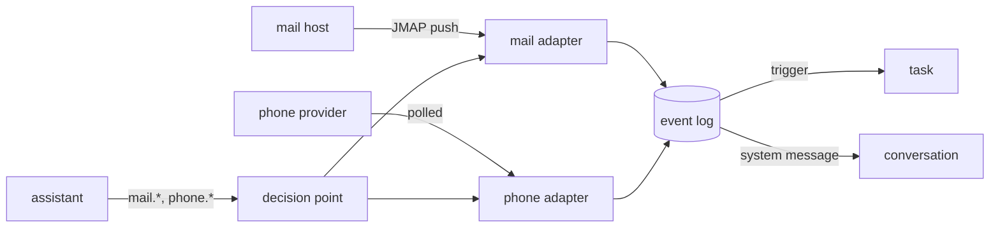

# The assistant's mail and phone

- **Status:** draft
- **Work items:** [the assistant's own email and accounts](https://linear.app/zgeoff/issue/GEO-2731)

The assistant gets a mailbox and a mobile number of its own. It reads, waits for, sends and mutes
mail, and reads, waits for and sends texts. Sign-up codes reach it this way, and
[accounts, sign-in and the wallet](accounts-and-wallet.md) uses the mailbox as every account's
username and way back in.

## Shape



## Contracts

### The mailbox

```ts
// connectors module. Adapter: mail-jmap, against the mail host's JMAP API.
mail.list({ unread: true, from: 'penpal@example.com', text: 'chess' }); // from, subject, text: JMAP filters
// → { messages: [{ message: 'mz4k8q2w7p', thread: 'th6p2k9w4x', from: 'hello@library.example.org',
//                  subject: 'Your code', at, isUnread: true }], next: null }
mail.read({ message: 'mz4k8q2w7p' });
// → { from, subject, thread, text: 'Your code is 482913. [L4] Sign in',
//     attachments: [{ attachment: 1, name: 'board.png', bytes: 30422 }] }   // every field outside, links as link IDs
mail.mark({ message: 'mz4k8q2w7p', isUnread: false }); // → { message: 'mz4k8q2w7p', isUnread: false }
mail.saveAttachment({ message: 'mz4k8q2w7p', attachment: 1 });
// → { file: 'f7m3q8k2wz', name: 'board.png' }   a file like computer.export_file's; at most 25 MiB
mail.send({ to: ['hello@library.example.org'], subject, text, files: ['f2r8k5w1mz'] });
mail.reply({ message: 'mz4k8q2w7p', text, files: [] }); // threads with In-Reply-To; to: the sender
mail.wait({ from: 'hello@library.example.org', seconds: 120 }); // from, subject, text: as mail.list
// → the first new message that matches, as mail.list lists it, or { message: null } after seconds
//   (at most 300); for a sign-up code
mail.mute({ from: 'news@shop.example' }); // an address, or a domain after @
mail.unmute({ from: 'news@shop.example' });
// → { muted: ['news@shop.example'] }
// mail.list, mail.read, mail.mark, mail.saveAttachment, mail.wait, mail.mute, mail.unmute: ['note'],
//   direct
// mail.send, mail.reply: ['send'], queued, destination: each address; files: up to 10 file or image
//   IDs, 25 MiB in all. Their "always allow" rule pins `to` (mail.reply: the sender), so a rule
//   allows one address; subject, text and files are free text to the card
// refusals: UNKNOWN_MESSAGE, UNKNOWN_ATTACHMENT, TOO_BIG, UNKNOWN_FILE, FILE_FORGOTTEN,
//   UNKNOWN_IMAGE, IMAGE_FORGOTTEN
// the mail_messages table maps each message's and thread's short ID to its JMAP ID.
// the adapter's credential is deployment:mail, a connector_credentials entry
```

### New mail

```ts
// a task's trigger, beside the schedule triggers; a new trigger source
trigger: { on: 'mail', from?: ['penpal@example.com', '@example.org'] }
// from: addresses, or a domain after @, matched without case; absent, every mail matches.
// A task run gets "New mail from <from>: <subject> (message mz4k8q2w7p)" for each mail it takes.

// with no task matching, the conversation gets a system message
// { kind: 'mail', messages: [{ message: 'mz4k8q2w7p', from, subject }] }   from and subject are outside
```

### The phone

```ts
// connectors module. Adapter: phone-twilio, against the provider's messaging API. One mobile number.
phone.list({ from: '+61400000000' }); // from: optional
// → { number: '+61411111111', texts: [{ text: 'tx8k2m4q9w', from: 'Example', body: 'Your code is 5521',
//     at }], next: null }   from and body are outside
phone.wait({ from: 'Example', seconds: 120 }); // the first new text that matches, or { text: null }
phone.send({ to: '+61400000000', body: 'Running 10 minutes late.' }); // → { text: 'tx2w9q4k8m' }
// phone.list, phone.wait: ['note'], direct
// phone.send: ['send'], queued; destination: the number. Its "always allow" rule pins `to`.
// refusals: BAD_NUMBER, TOO_LONG (over 640 characters), SEND_FAILED
// the adapter's credential is deployment:phone, a connector_credentials entry with the account,
//   the API key and the number
```

A new text that no `phone.wait` takes goes to the conversation as a `text` system message, folded as
new mail is.

## Constraints

Mail:

- Every mail field comes back with the source `outside`, and HTML mail is parsed in a fetch sandbox,
  as [the Gmail design](gmail-calendar-drive-tools.md) does it.
- The mailbox is one mailbox at a JMAP host, such as Fastmail, on a domain of the assistant's own.
  The assistant picks the name before the `@`. The deployment's own repo holds the domain's mail
  records.
- A one-time code in a mail or a text is visible to the assistant, which types it with
  `computer.browser_fill`.
- Mail from a muted sender writes its `mail.received` record and starts no task and no system
  message. `mail.list` and `mail.wait` still find it.
- The adapter follows the host's JMAP push stream, and writes a `mail.received` record for each new
  mail. A lost stream reconnects, and nixie reads what arrived since its last state.
- Each mail is a `mail.received` record, keyed by its JMAP ID so a reconnect never repeats one, with
  from and subject among its erasable fields. The adapter's cursor is the JMAP state.
- Every task whose trigger matches starts for the mail. A mail that arrives while that task runs
  waits, and the next run takes every waiting mail at once.
- New mail that no task takes goes to the conversation in a `mail` system message. The first mail
  goes at once, and each mail in the next 15 minutes folds into one message at the window's end.
- A saved attachment counts as untrusted, like a download.

The phone:

- The adapter reads the provider's message list every 20 seconds, and every 3 seconds while a
  `phone.wait` runs, so nixie needs no address the internet can reach. Each text is a
  `phone.text_received` record keyed by the provider's message ID, with from and body erasable.
- The number takes texts only. Calls to it are refused by the provider's settings, and nixie places
  none.

## Builder decides

- The JMAP calls, and how `mail.list` pages.
- The provider's API calls, and how `phone.list` pages.
- The tools' descriptions and the refusal wording.

## Out of scope

- Phone calls, in and out.
- Mail on a second address.
