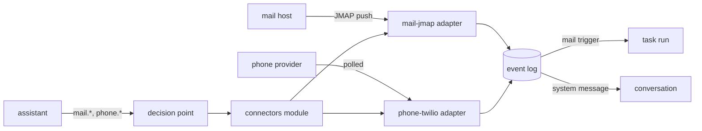

# The assistant's mail and phone

- **Status:** draft
- **Work items:** [the assistant's own email and accounts](https://linear.app/zgeoff/issue/GEO-2731)

The assistant gets a mailbox and a mobile number of its own. It reads, waits for, sends and mutes
mail, and reads, waits for and sends texts. Sign-up codes reach it this way, and
[accounts, sign-in and the wallet](accounts-and-wallet.md) uses the mailbox as every account's
username and way back in. New mail starts a task whose trigger matches, or reaches the conversation
as a system message. A new text reaches the conversation.

## Shape



The [decision point](../../architecture/policy/decision-point.md) runs before every tool call, and
asks you or lets the call run by the effects it declares.

## Contracts

### The mailbox

```ts
// connectors module; MailProvider interface, adapter mail-jmap, against the host's JMAP API with fetch
mail.list({ unread: true, from: 'penpal@example.com', text: 'chess' }); // from, subject, text: JMAP filters
// → { messages: [{ message: 'mz4k8q2w7p', thread: 'th6p2k9w4x', from: 'hello@library.example.org',
//                  subject: 'Your code', at, isUnread: true }], next: null }
mail.read({ message: 'mz4k8q2w7p' });
// → { from, subject, thread, text: 'Your code is 482913. [L4] Sign in',
//     attachments: [{ attachment: 1, name: 'board.png', bytes: 30422 }] }
mail.mark({ message: 'mz4k8q2w7p', isUnread: false }); // → { message: 'mz4k8q2w7p', isUnread: false }
mail.saveAttachment({ message: 'mz4k8q2w7p', attachment: 1 });
// → { file: 'f7m3q8k2wz', name: 'board.png' }   a file like computer.export_file's; at most 25 MiB
mail.send({ to: 'hello@library.example.org', subject, text, files: ['f2r8k5w1mz'] }); // one address
mail.reply({ message: 'mz4k8q2w7p', text, files: [] }); // threads with In-Reply-To; to: the sender
mail.wait({ from: 'hello@library.example.org', seconds: 120 }); // from, subject, text: as mail.list
// → the first matching mail that no wait returned yet, received up to 2 minutes before the call or
//   during it, as mail.list lists it; or { message: null } after seconds
mail.mute({ from: 'news@shop.example' }); // an address, or a domain after @
mail.unmute({ from: 'news@shop.example' });
// → { muted: ['news@shop.example'] }
```

| Tool                                                         | Effect  | Runs   | Destination   |
| ------------------------------------------------------------ | ------- | ------ | ------------- |
| `mail.list`, `mail.read`, `mail.saveAttachment`, `mail.wait` | `read`  | direct | none          |
| `mail.mark`                                                  | `note`  | direct | none          |
| `mail.mute`, `mail.unmute`                                   | `write` | queued | the address   |
| `mail.send`, `mail.reply`                                    | `send`  | queued | the recipient |

- The "always allow" rule of `mail.send` pins `to`. The rule of `mail.reply` pins its destination,
  the sender of the message, which the rule builder pins as it pins an argument.
- `files` takes up to 10 IDs, 25 MiB in all. Each ID names a file, such as a saved attachment, or an
  image.
- Refusals: `UNKNOWN_MESSAGE`, `UNKNOWN_ATTACHMENT`, `TOO_BIG`, `UNKNOWN_FILE`, `FILE_FORGOTTEN`,
  `UNKNOWN_IMAGE`, `IMAGE_FORGOTTEN`, `BAD_ADDRESS` and `SEND_FAILED`.
- A send reconciles an unknown outcome by checking the Sent mailbox for an `X-Nixie-Action` header
  that holds the action's ID.

```text
mail_messages                -- connectors module; short ID → JMAP ID, for messages and threads
mail.received                -- one per new mail, keyed by its JMAP ID; from and subject erasable
mail.muted, mail.unmuted     -- the mute list is their projection; the address is erasable
```

The adapter's credential is `deployment:mail`, a `connector_credentials` entry whose value is JSON:
`{ sessionURL, token }`.

### New mail

```ts
// core module; a new member of the trigger union, beside the poll filter of the polls design
type Trigger =
  | { schedule: Schedule }
  | { at: string }
  | { poll: PollFilter }
  | { mail: MailFilter };
type MailFilter = { from?: string[] }; // addresses, or a domain after @, without case; absent: every mail

// a task run's first message, one line per mail it takes, from and subject marked outside:
// New mail from <from>: <subject> (message mz4k8q2w7p)

// with no task matching, the conversation gets a system message
// <system type="mail">{ messages: [{ message: 'mz4k8q2w7p', from, subject }] }</system>
```

### The phone

```ts
// connectors module; PhoneProvider interface, adapter phone-twilio, against the provider's API with fetch
phone.list({ from: '+61400000000' }); // from: optional
// → { number: '+61411111111', texts: [{ text: 'tx8k2m4q9w', from: 'Example', body: 'Your code is 5521',
//     at }], next: null }   number: the assistant's own
phone.wait({ from: 'Example', seconds: 120 }); // as mail.wait: the first matching text, or { text: null }
phone.send({ to: '+61400000000', body: 'Running 10 minutes late.' }); // → { text: 'tx2w9q4k8m' }
// phone.list, phone.wait: ['read'], direct
// phone.send: ['send'], queued; destination: the number. Its "always allow" rule pins `to`.
// refusals: BAD_NUMBER, TOO_LONG (over 640 characters), SEND_FAILED
```

```text
phone_texts                  -- connectors module; short ID → the provider's message ID
phone.text_received          -- one per new text, keyed by the provider's message ID; from and body erasable
```

The adapter's credential is `deployment:phone`, whose value is JSON:
`{ accountSID, apiKeySID, apiKeySecret, number }`.

## Constraints

Reading:

- Every field of a mail or a text comes back marked as outside content, and each link in a mail as a
  link ID. HTML mail is parsed in a fetch sandbox, through a new frame of the wire lib that carries
  the HTML, as [the Gmail design](gmail-calendar-drive-tools.md) parses it.
- Link IDs count per conversation session, or per task run.
- A saved attachment counts as untrusted, like a download.
- A one-time code in a mail or a text is visible to the assistant, which types it with
  `computer.browser_fill`.
- `mail.wait` and `phone.wait` take `seconds` up to 300, or the turn frame's tool-call wait less 10
  seconds when that is shorter.
- `phone.wait` matches `from` as a number in E.164 form, or as a sender name without case.

New mail:

- The adapter follows the host's JMAP push stream. A lost stream reconnects, and nixie reads what
  arrived since its JMAP state, the adapter's cursor.
- At its first start, the adapter records the mailbox's state and writes no record for older mail.
  After a resync, it writes a record for each mail it missed, and only mail from the last hour
  starts a task or a system message.
- Mail that a `mail.wait` returns starts no task and no system message. Mail from a muted sender
  starts neither, and `mail.list` and `mail.wait` still find it.
- One mail starts every task whose trigger matches, one trigger event per definition, keyed by the
  definition and the JMAP ID.
- A mail that finds its task still running waits, and the trigger fires again when that task run
  ends, with every mail that waited.
- New mail that no task takes goes to the conversation in a `mail` system message, which wakes the
  conversation as a reminder does. The first mail goes at once, and each mail in the next 15 minutes
  folds into one message at the window's end. A restart rebuilds the window from the log.
- A text that no `phone.wait` returns goes to the conversation in a `text` system message with its
  from and body, folded in the same 15-minute window.

Mailbox and number:

- The mailbox is one mailbox at a JMAP host, on a domain of the assistant's own. The assistant picks
  the name before the `@`. The deployment's own repo holds the domain's mail records.
- The phone adapter reads the provider's message list every 20 seconds, and every 3 seconds while a
  `phone.wait` runs, so nixie needs no address the internet can reach.
- The number takes texts only. The provider's settings refuse calls, and nixie places none.
- A send by phone reconciles an unknown outcome by finding a sent message to the same number with
  the same body after the attempt, and asks you when it finds none.
- Forgetting a `mail.received` record erases nixie's copy of its fields, and leaves the mail at the
  host.

## Builder decides

- The JMAP calls, and how `mail.list` pages.
- The provider's API calls, and how `phone.list` pages.
- The tools' descriptions and the refusal wording.
- How the trigger source holds mail that waits for a task run to end.

## Out of scope

- Phone calls, in and out.
- A task trigger and muting for texts. A text reaches only the conversation and `phone.wait`.
- Deleting mail at the host.
- Mail on a second address, and copies to a second recipient.
