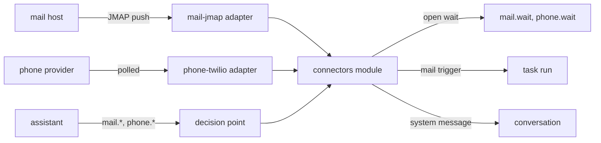

# The assistant's mail and phone

- **Status:** draft
- **Work items:** [the assistant's own email and accounts](https://linear.app/zgeoff/issue/GEO-2731)
- **Replaced in part:** the [mail design](mail/README.md) replaces every part of this design about
  the mailbox. The phone parts stand.

The assistant gets a mailbox and a mobile number of its own. It reads, waits for, sends and mutes
mail, and reads, waits for and sends texts. Sign-up codes reach it this way, and
[accounts and sign-in](accounts.md) uses the mailbox as every account's username and way back in.
New mail goes to a `mail.wait` that matches it, else starts each task whose trigger matches, else
reaches the conversation as a system message. A new text goes to a `phone.wait`, else reaches the
conversation.

## Shape



## Contracts

### The mailbox

```ts
// connectors module; MailProvider interface, adapter mail-jmap, against the host's JMAP API with fetch
mail.list({ unread: true, from: 'hello@library.example.org', text: 'code' }); // from, subject, text: JMAP filters
// → { messages: [{ message: 'mz4k8q2w7p', thread: 'th6p2k9w4x', from: 'hello@library.example.org',
//                  subject: 'Your code', at, isUnread: true }], next: null }
mail.read({ message: 'mz4k8q2w7p' });
// → { from, subject, thread, text: 'Your code is 482913. [L4] Sign in',
//     attachments: [{ attachment: 1, name: 'board.png', bytes: 30422 }] }
mail.mark({ message: 'mz4k8q2w7p', isUnread: false }); // → { message: 'mz4k8q2w7p', isUnread: false }
mail.saveAttachment({ message: 'mz4k8q2w7p', attachment: 1 });
// → { file: 'f7m3q8k2wz', name: 'board.png' }   stored as computer.export_file stores a file
mail.send({ to: 'hello@library.example.org', subject, text, files: ['f2r8k5w1mz'], images: [] });
mail.reply({ message: 'mz4k8q2w7p', text, files: [], images: [] }); // In-Reply-To; to: the sender
mail.wait({ from: 'hello@library.example.org', seconds: 120 }); // from, subject, text: as mail.list
// → the first mail it takes, as mail.list lists it, or { message: null } after seconds
mail.mute({ from: 'news@shop.example' }); // an address, or a domain after @
mail.unmute({ from: 'news@shop.example' });
// → { muted: ['news@shop.example'] }
```

| Tool                                                         | Effect  | Runs   | Destination   |
| ------------------------------------------------------------ | ------- | ------ | ------------- |
| `mail.list`, `mail.read`, `mail.saveAttachment`, `mail.wait` | `read`  | direct | none          |
| `mail.mark`                                                  | `write` | direct | none          |
| `mail.mute`, `mail.unmute`                                   | `write` | queued | none          |
| `mail.send`, `mail.reply`                                    | `send`  | queued | the recipient |
| `phone.list`, `phone.wait`                                   | `read`  | direct | none          |
| `phone.send`                                                 | `send`  | queued | the number    |

- The effects are those of [the decision point](../../architecture/policy/decision-point.md). No
  starter rule allows `mail.mute`, so it asks: it decides what wakes the conversation, and a mail
  could ask the assistant to mute a site's security notices.
- The "always allow" rules of `mail.send` and `phone.send` pin `to`. The rule of `mail.reply` pins
  its destination, the sender of the message. The rule builder in the policy module gains that pin
  in this build.
- `mail.reply` sets no reply target, so a task run that a mail started never replies without a rule
  or your answer.
- `files` takes up to 10 file IDs and `images` up to 10 image IDs, 25 MiB in all. A file resolves
  only on the conversation or task run that made it. The tool checks each ID at the call, and the
  send checks again when the queued action runs.
- `mail.saveAttachment` refuses `TOO_BIG` above the attachments table's limit.
- Refusals: `UNKNOWN_MESSAGE`, `UNKNOWN_ATTACHMENT`, `TOO_BIG`, `UNKNOWN_FILE`, `FILE_FORGOTTEN`,
  `UNKNOWN_IMAGE`, `IMAGE_FORGOTTEN`, `BAD_ADDRESS` and `SEND_FAILED`.
- A send reconciles an unknown outcome by checking the Sent mailbox for an `X-Nixie-Action` header
  that holds the action's ID.

```text
mail_messages                -- connectors module; short ID → JMAP ID for messages and threads, and
                                taken: null | 'wait' | 'task' | 'conversation'
mail.received                -- one per new mail, keyed by its JMAP ID; from and subject erasable
mail.muted, mail.unmuted     -- the mute list is their projection; the address is plain
```

The adapter's credential is `deployment:mail`, a `connector_credentials` entry whose value is JSON:
`{ sessionURL, token }`. The JMAP state, the adapter's cursor, is written in the transaction that
writes the mail's record.

### New mail

```ts
// contract lib: a new member of the trigger union, in the next definitions format
type Trigger = { schedule: Schedule } | { at: string } | { mail: MailFilter }; // …existing members
type MailFilter = {
  from?: string[]; // addresses, or a domain after @, without case; absent: every mail
  subject?: string; // a substring of the subject, without case
}; // no body filter: a trigger matches on the push, before nixie reads the body
```

A task run that mail starts gets one line per mail, with from and subject in the untrusted block
that system messages use:

```text
New mail <untrusted id="…">from <from>: <subject></untrusted> (message mz4k8q2w7p)
```

Mail that no task takes reaches the conversation as a system message, rendered as the built ones
are:

```text
<system-message type="mail" id="…" at="…">
New mail: 1 message. <untrusted id="…">from hello@library.example.org: Your code</untrusted> (message mz4k8q2w7p)
</system-message>
```

### The phone

```ts
// connectors module; PhoneProvider interface, adapter phone-twilio, against the provider's API with fetch
phone.list({ from: '+61400000000' }); // from: optional
// → { number: '+61411111111', texts: [{ text: 'tx8k2m4q9w', from: 'Example', body: 'Your code is 5521',
//     at }], next: null }   number: the assistant's own
phone.wait({ from: 'Example', seconds: 120 }); // as mail.wait: the first text it takes, or { text: null }
phone.send({ to: '+61400000000', body: 'Running 10 minutes late.' }); // → { text: 'tx2w9q4k8m' }
// refusals: BAD_NUMBER, TOO_LONG (over 640 characters), SEND_FAILED
```

```text
phone_texts                  -- connectors module; short ID → the provider's message ID, and taken
phone.text_received          -- one per new text, keyed by the provider's message ID; from and body erasable
```

The adapter's credential is `deployment:phone`, whose value is JSON:
`{ accountSID, apiKeySID, apiKeySecret, number }`.

## Constraints

Reading:

- Every field of a mail or a text comes back marked as outside content, and each link in a mail as a
  link ID. HTML mail is parsed in a fetch sandbox, through a new frame of the wire lib that carries
  the HTML. This build defines that frame, and the [Gmail design](gmail-calendar-drive-tools.md)
  uses it.
- Link IDs count per conversation session, or per task run.
- A saved attachment counts as untrusted, like a download.
- A one-time code in a mail or a text is visible to the assistant, which types it with
  `computer.browser_fill`.
- `mail.wait` and `phone.wait` take `seconds` up to 300, or the turn frame's tool-call wait less 10
  seconds when that is shorter.
- `phone.wait` matches `from` as a number in E.164 form, or as a sender name without case. Anyone
  can send a text under any sender name, so a code from a named sender is only as good as a code
  from a stranger.

Where new mail goes:

- The connectors module runs the push loop and the phone poll, which `apps/server` starts. For each
  new mail it writes the record, then gives the mail to the first of these that takes it, and marks
  `taken`:
  1. the oldest open `mail.wait` that matches;
  2. every task whose trigger matches, with one trigger event per definition, keyed by the
     definition and the JMAP ID;
  3. the conversation's `mail` system message.
- A wait also takes a matching mail from the 2 minutes before its call whose `taken` is still null.
- Mail from a muted sender starts no task and no system message, and `mail.list` and `mail.wait`
  still find it.
- A mail whose task is still running reaches the conversation's system message instead, so no mail
  is lost to a skipped trigger.
- The source matches triggers and mutes on the values it just read from the host, never on a
  projection of erasable fields.
- The first mail goes to the conversation at once, and wakes it as a reminder does. Each mail in the
  next 15 minutes folds into one message at the window's end, and a mail after a quiet window goes
  at once again. A restart rebuilds the window from `taken`, and a mail forgotten inside the window
  drops out of it.
- Texts follow the same rules, with no task step: an open `phone.wait`, then a `text` system message
  in a window of its own.

Start and resync:

- At its first start, each adapter records the host's or the provider's state, and writes no record
  for older mail or texts.
- After a resync or an outage, it writes a record for each mail or text it missed, and only those
  from the last hour start a task or a system message.
- The 15-minute fold window, the hour a resync delivers, and the 20-second and 3-second polls are
  settings with those defaults.

Mailbox and number:

- The mailbox is one mailbox at a JMAP host, on a domain of the assistant's own. The assistant picks
  the name before the `@`. The deployment's own repo holds the domain's mail records.
- The phone adapter reads the provider's message list every 20 seconds, and every 3 seconds while a
  `phone.wait` runs, so nixie needs no address the internet can reach.
- The number takes texts only. The provider's settings refuse calls, and nixie places none.
- A send by phone reconciles an unknown outcome by finding a message to the same number with the
  same body, created during the attempt and recorded by no other send. The provider takes no
  idempotency key, so two identical texts sent in the same minute can still confuse it. The send
  asks you when it finds no message.
- Forgetting a `mail.received` record erases nixie's copy of its fields, and leaves the mail at the
  host.

## Builder decides

- The JMAP calls, and how `mail.list` pages.
- The provider's API calls, and how `phone.list` pages.
- The tools' descriptions and the refusal wording.

## Out of scope

- Phone calls, in and out.
- A task trigger and muting for texts. A text reaches only the conversation and `phone.wait`.
- Deleting mail at the host.
- Mail on a second address, and copies to a second recipient.
