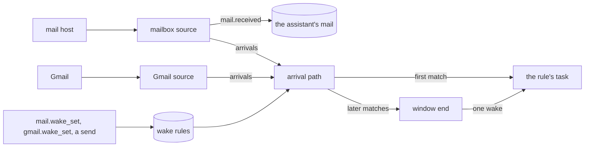

# Mail

- **Status:** draft
- **Work items:** [the assistant's own mailbox](https://linear.app/zgeoff/issue/GEO-2816) and
  [the mail polls](https://linear.app/zgeoff/issue/GEO-1827)

The assistant has 2 mail products that share nothing but one arrival path. Its own mailbox, under
`mail.*` tools, keeps every mail in nixie. Your Gmail, under `gmail.*` tools, stays at Google: nixie
stores no copy, `gmail.search` asks Gmail live, and an arrival leaves at most a small erasable
record. Both hand each new mail to the [trigger core](../../architecture/core/triggers.md), which
wakes a task only when a wake rule matches. The assistant registers each rule with a mailbox, a
match, the task to wake and an expiry. The first match wakes the task at once, and later matches
inside the rule's window arrive together in one wake.

This design replaces the mailbox half of [mail and phone](mail-and-phone.md) and the Gmail half of
[mail and calendar polls](mail-and-calendar-polls.md). The phone, the calendar poll and the
[Gmail tools](gmail-calendar-drive-tools.md) stand.

## Shape



## Terms

- **Arrival:** one new mail in one mailbox, handed to the arrival path by its source.
- **Wake rule:** a standing request to wake one task when an arrival in one mailbox matches. It
  always has an expiry.
- **Wake:** one `trigger.mail_woke` record in a task's inbox, which names one or more arrivals.
- **Window:** the time after a wake during which later matches of the same rule wait for one wake
  together.
- **Throttle:** the same, for every rule of one mailbox at once.

## Contracts

### Wake rules

```ts
mail.wake_set({ from: ['@library.example.org'], subject: 'code', expires: '30m' });
// → { rule: 'wq4k8m2x7p', mailbox: 'mail', expiresAt: '2026-11-24T10:45:00Z', window: '15m' }
gmail.wake_set({
  connection: 'k3x9m2p7qa',
  thread: '18c2f0a9b3d4e5f6',
  expires: '3d',
  window: '1h',
});
// → { rule: 'wz7p2k9q4m', mailbox: 'gmail', expiresAt: '2026-11-27T10:15:00Z', window: '1h' }
//   or, under the default policy, "Waiting for approval as <shortID>"
mail.wake_list(); // gmail.wake_list({ connection }) for Gmail
// → { rules: [{ rule: 'wq4k8m2x7p', match: { from: ['@library.example.org'], subject: 'code' },
//      expiresAt, window: '15m', origin: 'tool' }] }
mail.wake_cancel({ rule: 'wq4k8m2x7p' }); // gmail.wake_cancel for Gmail → { rule, ended: true }
```

```ts
// triggers module. The tools of both products call it in their own write transaction.
setWakeRuleInTransaction(tx, input: WakeRuleInput): Promise<WakeRule>;
endWakeRuleInTransaction(tx, ruleID: string, reason: 'cancelled' | 'task_ended'): Promise<void>;

interface WakeRuleInput {
  mailbox: Mailbox;
  match: WakeMatch;
  taskID: string; // the task that called the tool, or that ran the send; never another task
  expiresAt: number; // epoch ms; the tool turns `expires` into it at the call
  windowMs: number;
  origin: 'tool' | 'reply'; // 'reply': registered by a send
}

type Mailbox = { kind: 'mail' } | { kind: 'gmail'; connectionID: string }; // connection UUID

// Every field is optional, and every field present must match. An empty match takes every arrival.
interface WakeMatch {
  from?: string[]; // addresses, or '@domain' for that domain and never a subdomain; without case
  subject?: string; // a substring, both sides in NFC and lowered
  thread?: string; // the mailbox's own thread ID: a short ID for 'mail', Gmail's thread ID for 'gmail'
}

interface WakeRule extends WakeRuleInput {
  ruleID: string; // crypto.randomUUID()
  shortID: string; // createShortID; the one ID the model reads and passes
  createdAt: number; // epoch ms; the rule matches only arrivals received at or after it
}
```

| Tool                                | Effect     | Runs   |
| ----------------------------------- | ---------- | ------ |
| `mail.wake_set`, `mail.wake_cancel` | `note`     | direct |
| `mail.wake_list`, `gmail.wake_list` | `read`     | direct |
| `gmail.wake_set`                    | `schedule` | queued |
| `gmail.wake_cancel`                 | `note`     | direct |

- `expires` and `window` take the duration text that `parseDuration` reads today, such as `30m`,
  `2h` or `7d`. `parseDuration` moves from the turn-inputs module to the clock lib, because the mail
  module and the connectors module both read it.
- `expires` runs from 1 minute to `mail.wake_max_expiry`. `window` runs from 1 minute to `expires`,
  and defaults to `mail.wake_window`.
- A `wake_set` with the same mailbox, match and task as a live rule replaces it: the old rule ends
  as `cancelled`, and the new one keeps the old short ID.
- The `gmail.*` rule tools take the
  [connection argument](../platform/connectors/connector.md#the-connection-argument).
- A rule's match is stored in plain text, as a definition's filter is.
- `mail.wake_set` declares `note`, as [`reminder.set`](../../architecture/core/reminders.md) does,
  so the starter rule `allow-notes` lets it through. `gmail.wake_set` declares `schedule`, which no
  [starter rule](../platform/policy/rules.md#the-starter-rule-set) allows, so it asks you unless
  consent or an allow rule covers it. One rule `{ outcome: allow, tools: [gmail.wake_set] }` makes
  every Gmail rule free.
- Cancelling and listing never ask: a cancel only narrows what wakes the assistant.

### The arrival path

```ts
// triggers module. A new member of the TriggerEvent union, beside the schedule event.
interface MailArrivalEvent {
  kind: 'mail';
  mailbox: Mailbox;
  dedupeKey: string; // 'mail|<hostMessageID>' or 'gmail|<connectionID>|<messageID>'
  occurredAt: string; // ISO: when the source read it
  payload: MailArrival;
}

interface MailArrival {
  messageID: string; // the short ID for 'mail'; Gmail's message ID for 'gmail'
  threadID: string; // as WakeMatch.thread
  receivedAt: number; // epoch ms, the host's receive time: JMAP receivedAt, Gmail internalDate
  from: string; // the From address, lowered
  subject: string;
}

// …existing fields of TriggerSource
type TriggerSourceKind = 'schedule' | 'mail' | 'gmail';
```

For each `MailArrivalEvent`, inside the one write transaction of
[one deliver call](../../architecture/core/triggers.md#one-deliver-call):

1. When `trigger_keys` holds the dedupe key, the core skips the event.
2. The core finds every live rule of the event's mailbox that matches, with `createdAt` at or before
   `receivedAt` and `expiresAt` after `occurredAt`. When none matches, it writes nothing and claims
   no key.
3. For each matching rule whose task has ended, the core ends the rule as `task_ended` and drops it
   from the list.
4. The core writes one `trigger.mail_arrived` record, whose fold claims the dedupe key. The record
   lists each rule that matched, and for each one whether the arrival woke its task now or was held.
5. For each task with a rule that woke now, the core writes one `trigger.mail_woke` through the
   inbox writer, which wakes the task with the cause `event` at hop 0.

The core never reads the [task gate](task-gate.md) for an arrival. While a task is held, its wakes
land in its inbox and wait there, as the gate's rule for poll sources says. A match on a task in the
middle of a step lands the same way. A wake never becomes `trigger.skipped`.

### Windows and the throttle

An arrival wakes its rule's task now only when both of these are open:

- the rule's window: no wake of this rule in the last `windowMs`;
- the mailbox's throttle: no wake from this mailbox, to any task, in the last `mail.wake_throttle`.

Otherwise the core holds the match. The flush runs every 20 seconds on the
[`startSweep` helper](https://linear.app/zgeoff/issue/GEO-2827), in one write transaction per tick:

1. It finds each held match whose rule window and mailbox throttle have both closed.
2. It writes one `trigger.mail_woke` per task, naming every such match for that task, oldest first.
3. Each flush counts as a wake: it opens a new window for each rule it names, and a new throttle for
   the mailbox.

```text
wake_windows        -- triggers module; projection of trigger.mail_arrived and trigger.mail_woke
  rule_id           -- or null for a mailbox's throttle row
  mailbox           -- 'mail' or 'gmail:<connectionID>'
  last_wake_at      -- epoch ms
wake_held           -- one row per held match
  rule_id, task_id, arrived_seq   -- the trigger.mail_arrived record's sequence
```

```ts
// trigger.mail_woke, an inbox record. The step renders it from the arrival records it names.
interface MailWoke {
  taskID: string;
  rules: string[]; // rule IDs
  arrivals: number[]; // sequences of trigger.mail_arrived, oldest first
}
```

The step renders a wake as outside content, in the block that system messages use:

```text
<system-message type="mail" id="…" at="…">
Wake rule wq4k8m2x7p (mail from @library.example.org, subject "code", until 10:45): 2 new mails.
<untrusted id="…">from hello@library.example.org: Your code</untrusted> (message mz4k8q2w7p)
<untrusted id="…">from hello@library.example.org: Your new code</untrusted> (message mb2x9k4q8w)
</system-message>
```

### The assistant's mailbox

```ts
// mail module. Adapters: one per mail host, named mailhost-<system>, once the host is chosen
// (GEO-2816); an in-memory fake for tests.
interface MailHost {
  begin(): Promise<HostCursor>; // the host's state now; finds no mail
  readChanges(cursor: HostCursor): Promise<HostChanges>;
  send(mail: OutgoingMail): Promise<{ hostMessageID: string }>;
  findSent(actionID: string): Promise<{ hostMessageID: string } | null>; // reconciles an unknown send
  watch?(signal: AbortSignal): AsyncIterable<void>; // a push hint, when the host has one
}

type HostCursor = JSONValue;
type HostChanges =
  | { kind: 'changes' | 'resynced'; cursor: HostCursor; mails: HostMail[] }
  | { kind: 'failed'; reason: string; after?: number }; // after: the host's retry time, ms

interface HostMail {
  hostMessageID: string;
  receivedAt: number; // epoch ms
  raw: Uint8Array; // the RFC 5322 message; the mail module parses it, so no adapter parses mail
}

interface OutgoingMail {
  raw: Uint8Array; // carries the header X-Nixie-Action: <actionID>
  actionID: string;
}
```

```ts
mail.list({ from: 'hello@library.example.org', text: 'code', unread: true }); // reads nixie's store
// → { mails: [{ message: 'mz4k8q2w7p', thread: 'th6p2k9w4x', from, subject, at, unread: true }],
//     next: null }
mail.read({ message: 'mz4k8q2w7p' });
// → { from, to, subject, thread, text: 'Your code is 482913. [L4] Sign in',
//     attachments: [{ attachment: 1, name: 'board.png', bytes: 30422 }] }
mail.save_attachment({ message: 'mz4k8q2w7p', attachment: 1 }); // → { file: 'f7m3q8k2wz', name }
mail.send({ to: ['hello@library.example.org'], subject, text, files: [], replyWake: '7d' });
mail.reply({ message: 'mz4k8q2w7p', text, files: [], replyWake: 'off' });
// → { message: 'mr8w2k4q9z', thread: 'th6p2k9w4x', replyRule: 'wq4k8m2x7p' | null }
```

| Tool                                             | Effect | Runs   | Destination    |
| ------------------------------------------------ | ------ | ------ | -------------- |
| `mail.list`, `mail.read`, `mail.save_attachment` | `read` | direct | none           |
| `mail.send`, `mail.reply`                        | `send` | queued | each recipient |

```text
mail_messages       -- mail module; one row per stored mail
  message_id        -- crypto.randomUUID()
  short_id          -- createShortID; the model's message ID
  thread_short_id   -- createShortID, one per thread, from References and In-Reply-To
  host_message_id   -- unique; makes a second store of one mail a no-op
  received_at, unread
mail.received       -- one per stored mail; from, to, cc, subject, text and attachment names erasable
mail.sent           -- one per sent mail, written by the send's outcome
```

- The mailbox source stores each new mail, `mail.received` and its row, in a write transaction of
  its own, then delivers its arrival. A crash between the two stores nothing twice, because
  `host_message_id` is unique, and delivers the arrival at the next read, because the cursor commits
  only with the arrival.
- Attachments are stored as files, the way `computer.export_file` stores one, and count as
  untrusted, like a download.
- The adapter reaches the host only through the credential store's `fetcher` or `socket`, under the
  connector credential `deployment:mail`, and never reads a credential's value. The
  [credentials design](https://github.com/zgeoff/nixie/pull/1414) defines both calls.
- `mail.send` and `mail.reply` send from the assistant's own address, never from yours.

### Gmail arrivals

```ts
// connectors module. The server app passes it to startTriggerSources beside the schedule source.
declare function buildGmailArrivalSource(input: {
  clock: Clock;
  listConnections: () => Promise<GmailConnection[]>; // each active Google connection with gmail.modify
  readContext: (connectionID: string) => ConnectorContext;
  hasLiveRule: (connectionID: string) => Promise<boolean>; // the triggers module answers it
}): TriggerSource; // id 'gmail', kind 'gmail'

// The source's cursor: one entry per connection.
type GmailSourceCursor = Record<string, { historyID: string; polledAt: number }>; // key: connectionID
```

- Every `gmail.poll_interval`, the source calls `history.list` with `historyTypes: messageAdded` for
  each connection, over every page, and keeps the `historyId` of the last page.
- When the connection has a live rule, the source reads each added message with `messages.get`,
  format `metadata`, for From, Subject, `threadId`, `internalDate` and `labelIds`. It drops each
  message labelled `SENT`, `DRAFT`, `SPAM` or `TRASH`. Otherwise it reads no message and only moves
  the cursor.
- One poll of one connection is one `deliver` call, with its arrivals and the whole cursor.
- The first poll of a connection calls `getProfile` for the `historyId` and delivers nothing.
- When `history.list` answers 404, the source reads `getProfile` for a new cursor, lists messages
  with `after:<s> -in:sent -in:drafts`, where `<s>` is 10 minutes before `polledAt`, and delivers
  them as arrivals. The dedupe keys drop each arrival already recorded, and `createdAt` keeps a rule
  from matching mail older than itself.
- The failure, backoff and health rules of the [polls design](mail-and-calendar-polls.md#the-polls)
  apply unchanged.
- `trigger.mail_arrived` is the only record a Gmail arrival leaves, and only when a rule matched. An
  arrival that matches nothing leaves no trace in nixie.

### Reply rules

- When the outcome of `mail.send`, `mail.reply`, `gmail.send` or `gmail.reply` records a sent mail,
  the same transaction calls `setWakeRuleInTransaction` with `{ thread }` of the sent mail, the
  sending task, `origin: 'reply'`, and an expiry of `replyWake`, which defaults to
  `mail.reply_wake`. `replyWake: 'off'` registers none.
- A Gmail send's decision covers its reply rule, and the send's approval card shows the rule's
  expiry. [GEO-2829](https://linear.app/zgeoff/issue/GEO-2829) holds that choice.
- A send whose outcome is unknown registers its rule once the reconcile finds the sent mail.

### Erasure

- `trigger.mail_arrived` holds `from` and `subject` in its erasable fields. Its payload, the rows
  and the cursors hold only IDs, times and labels.
- Forgetting a `trigger.mail_woke` erases each `trigger.mail_arrived` it names, as forgetting a
  record does today. `trigger.mail_woke` joins `forgettableKinds`, and `trigger.mail_arrived` joins
  its exceptions.
- Forgetting a Google connection erases every `trigger.mail_arrived` of that connection. The
  [erasure design](https://github.com/zgeoff/nixie/pull/1413) runs it as a child of the connection's
  credential.
- Forgetting a mail in the assistant's mailbox erases its `mail.received` fields and its
  attachments, and leaves the mail at the host.

### Settings

| Key                       | Default | What it sets                                     |
| ------------------------- | ------- | ------------------------------------------------ |
| `mail.wake_window`        | `15m`   | a rule's window when `wake_set` gives none       |
| `mail.wake_throttle`      | `5m`    | the throttle of each mailbox                     |
| `mail.wake_max_expiry`    | `30d`   | the longest `expires` a rule takes               |
| `mail.reply_wake`         | `7d`    | the expiry of a reply rule                       |
| `mail.host_poll_interval` | `30s`   | how often the mailbox source reads the host      |
| `gmail.poll_interval`     | `2m`    | how often the Gmail source polls each connection |

## Constraints

- Nothing wakes the assistant on mail unless a live wake rule matches.
- The arrival path never drops a match. Each match wakes its task at once or in a later flush,
  unless the task ends first, when the rule ends and the mail stays in its mailbox.
- A rule that expires or is cancelled matches nothing more. Its held matches still flush.
- A rule matches only arrivals with `receivedAt` at or after its `createdAt`. To see older mail, the
  assistant searches its mailbox or Gmail.
- At most one wake per rule per window, and one flush per mailbox per throttle, however much mail
  arrives.
- One arrival that matches several rules of one task gives that task one wake.
- The sources match on values they just read from the host, never on erasable fields read back.
- A restart rebuilds `wake_windows` and `wake_held` from the records, so a held match flushes after
  the restart.
- The From header proves nothing about the sender. A wake renders every field as outside content,
  and a `from` match is a filter, never a trust check.
- The mailbox source reads the host every `mail.host_poll_interval`, and at once on a `watch` hint.
  A mail reaches a waiting task within 1 minute of its arrival, or within `gmail.poll_interval` plus
  1 minute for Gmail, while the source reports `running`.
- The Gmail source makes read calls only, and never reaches the decision point.
- The mail module never imports the connectors module, and neither imports the other's tools. Both
  reach wake rules only through the triggers module.

## Decisions

- **Two products, one arrival path.** The assistant's mail and yours differ in identity, storage and
  policy, so each keeps its own tools. Only the wake logic is shared, so a rule works the same way
  in both.
- **Rules wake the task that registered them.** A rule never targets another task, so a rule can't
  wake a task the caller doesn't own.
- **A wake rule is not a task definition.** A rule arms nothing in `trigger_definitions`, and its
  wakes never pass `readDefinitionTask`, so a busy task gets its mail in the inbox in place of a
  `still_running` skip.
- **No `mail.wait` and no `mail.mute`.** A short wake rule replaces the wait: the assistant
  registers one, ends its turn, and the code wakes it. Silent by default leaves nothing to mute.
- **Only a matched Gmail arrival is recorded.** Gmail stays the one copy of your mail, and an
  arrival that matched nothing has nothing to forget.

## Builder decides

- The host calls each `MailHost` adapter makes, and how `mail.list` pages.
- How `wake_windows` and `wake_held` index their rows.
- The wording of the tools' descriptions, their refusals and the wake's line.
- How the flush shares a transaction with the core when both run in the same tick.

## Out of scope

- The mail host and the assistant's domain. [GEO-2816](https://linear.app/zgeoff/issue/GEO-2816)
  waits on that choice, and the design reads the host only through `MailHost`.
- The phone, which [mail and phone](mail-and-phone.md) keeps.
- The calendar poll, which [mail and calendar polls](mail-and-calendar-polls.md) keeps.
- Reading, labelling, searching and sending Gmail, which the
  [Gmail tools](gmail-calendar-drive-tools.md) design owns.
- Deleting mail at the host, and mail on a second address.

## Open questions

- **Does a Gmail send's decision cover its reply rule?** The owner settles it in
  [GEO-2829](https://linear.app/zgeoff/issue/GEO-2829). The recommendation is yes, with the rule
  shown on the send's card. Until then, the code does that.
- **Can a task definition hold a standing mail trigger?** The owner settles it in
  [GEO-2830](https://linear.app/zgeoff/issue/GEO-2830). The recommendation is no: a definition that
  must see every mail runs on a schedule and searches since its last task run. Until then, the seed
  refuses a `mail` or `poll` trigger, as it does today.
