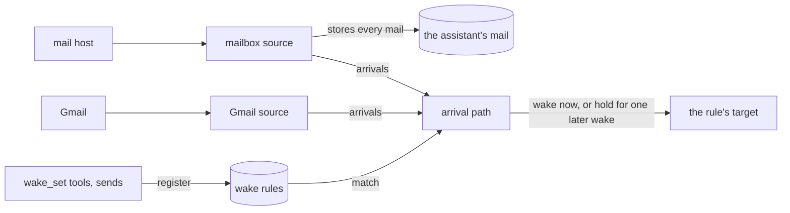

# Mail

- **Status:** draft
- **Work items:** [the assistant's own mailbox](https://linear.app/zgeoff/issue/GEO-2816) and
  [the mail polls](https://linear.app/zgeoff/issue/GEO-1827)

The assistant has 2 mail products that share nothing but one arrival path. Its own mailbox, under
`mail.*` tools, keeps every mail in nixie. Your Gmail, under `gmail.*` tools, stays at Google: nixie
stores no copy, `gmail.search` asks Gmail live, and an arrival leaves at most a small erasable
record. Both hand each new mail to the [trigger core](../../../architecture/core/triggers.md), which
wakes the conversation or a task only when a wake rule matches. All mail is silent until a rule
matches. The assistant sets each rule with a mailbox, a match, the conversation or task it wakes,
and an optional expiry; a rule with no expiry stays until it is cancelled. A match wakes its target
at once, unless the same rule woke it within the rule's window. In that case the match waits, and
every waiting match arrives in one later wake, so a burst of mail costs one turn.

A builder reads this page, then the part their work item builds.

This design replaces the mailbox half of [mail and phone](../mail-and-phone.md) and the Gmail half
of [mail and calendar polls](../mail-and-calendar-polls.md). The phone, the calendar poll and the
[Gmail tools](../gmail-calendar-drive-tools.md) stand.

## Shape

## The parts

| Part                                     | What it holds                                                                                   | Built by                                             |
| ---------------------------------------- | ----------------------------------------------------------------------------------------------- | ---------------------------------------------------- |
| [Wake rules and arrivals](wake-rules.md) | rules, the arrival path, windows, the flush, the wake, erasure                                  | [GEO-1827](https://linear.app/zgeoff/issue/GEO-1827) |
| [The assistant's mailbox](mailbox.md)    | the mail host interface, the store, the `mail.*` tools with `mail.wake_*`, reply rules on sends | [GEO-2816](https://linear.app/zgeoff/issue/GEO-2816) |
| [Gmail arrivals](gmail.md)               | the Gmail source, the `gmail.wake_*` tools, reply rules on Gmail sends                          | [GEO-1827](https://linear.app/zgeoff/issue/GEO-1827) |

Build wake rules and arrivals first, against a fake source. The other parts wait on these:

- the mailbox, on the choice of mail host and the
  [credentials design](https://github.com/zgeoff/nixie/pull/1414);
- Gmail arrivals, on the [Google connection](https://linear.app/zgeoff/issue/GEO-1824) and the
  [Gmail tools](https://linear.app/zgeoff/issue/GEO-1825);
- forgetting a Google connection's mail, on the
  [erasure design](https://github.com/zgeoff/nixie/pull/1413).

The mail polls item gets its acceptance lines from this design, and the calendar poll moves to an
item of its own.

## Terms

- **Arrival:** one new mail in one mailbox, which its source hands to the arrival path.
- **Wake rule:** a request to wake one target, the conversation or a task, when an arrival in one
  mailbox matches, until the rule is cancelled or its optional expiry passes.
- **Target:** the conversation or the task that a rule wakes, named in the call that sets it.
- **Wake:** one `trigger.mail_woke` record in the target's inbox, with one or more mails.
- **Window:** the time after a rule's wake during which its later matches wait, to arrive together.

## Decisions

- **Two products, one arrival path.** The assistant's mail and yours differ in identity, storage and
  policy, so each keeps its own tools. They share the wake logic, so a rule works the same way in
  both.
- **Google's tools are `gmail.*`.** `mail.*` names only the assistant's own mailbox.
- **A rule names its target.** The call that sets a rule names the conversation or any task as the
  target, and a send registers its reply rule on the conversation or the task that sent it. The
  conversation holds rules like any task.
- **A rule may be permanent.** `expires` is optional and has no upper limit. The assistant sets a
  rule with no expiry on its own mailbox when it wants every mail.
- **Each rule keeps its own window, and nothing limits a mailbox as a whole.** A burst of matches on
  one rule costs one wake per window.
- **A wake rule is not a task definition.** A rule arms nothing in `trigger_definitions`, and its
  wakes never pass `readDefinitionTask`. A busy or held task gets its mail in its inbox, never as a
  `still_running` or `task_held` skip. A task definition holds no standing mail trigger: a
  definition that must see every mail runs on a schedule and searches since its last task run, and
  the seed keeps refusing a `mail` or `poll` trigger.
- **No `mail.wait` and no `mail.mute`.** All mail is silent by default, so nothing needs muting. A
  short wake rule replaces the wait: a task sets one, ends its turn, and the trigger core wakes it.
- **A send's decision covers its reply rule.** The send's approval card shows the reply rule and its
  expiry.
- **Only a matched Gmail arrival is recorded.** Gmail stays the one copy of your mail, and an
  arrival that matched nothing leaves nothing to forget.
- **Durations are text.** `expires` and `window` take the form `parseDuration` reads, such as `30m`,
  `2h` or `7d`, and so do the config keys. `parseDuration` and `buildDurationSchema` move from the
  turn-inputs module to the clock lib, because 4 modules read them.

## Out of scope

- The mail host and the assistant's domain. [GEO-2816](https://linear.app/zgeoff/issue/GEO-2816)
  waits on that choice, and the design reaches the host only through `MailHost`.
- Reading, labelling, searching and sending Gmail, which the
  [Gmail tools](../gmail-calendar-drive-tools.md) design owns.
- Deleting mail at the host, and mail on a second address.
