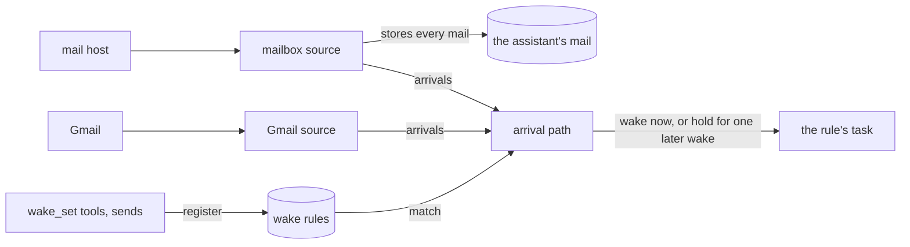

# Mail

- **Status:** draft
- **Work items:** [the assistant's own mailbox](https://linear.app/zgeoff/issue/GEO-2816) and
  [the mail polls](https://linear.app/zgeoff/issue/GEO-1827)

The assistant has 2 mail products that share nothing but one arrival path. Its own mailbox, under
`mail.*` tools, keeps every mail in nixie. Your Gmail, under `gmail.*` tools, stays at Google: nixie
stores no copy, `gmail.search` asks Gmail live, and an arrival leaves at most a small erasable
record. Both hand each new mail to the [trigger core](../../../architecture/core/triggers.md), which
wakes a task only when a wake rule matches. A task registers each rule for itself, with a mailbox, a
match and an expiry. A match wakes the task at once, unless the same rule woke it within the rule's
window, or any rule on that mailbox woke it within the throttle. Then the match waits, and every
match that waits arrives in one later wake, so a burst of mail costs one turn.

The owner reads this page to approve the design and settle its open questions. A builder reads it,
then the part their work item builds.

This design replaces the mailbox half of [mail and phone](../mail-and-phone.md) and the Gmail half
of [mail and calendar polls](../mail-and-calendar-polls.md). The phone, the calendar poll and the
[Gmail tools](../gmail-calendar-drive-tools.md) stand.

## Shape

## The parts

| Part                                     | What it holds                                                                                   | Built by                                             |
| ---------------------------------------- | ----------------------------------------------------------------------------------------------- | ---------------------------------------------------- |
| [Wake rules and arrivals](wake-rules.md) | rules, the arrival path, windows and the throttle, the flush, the wake, erasure                 | [GEO-1827](https://linear.app/zgeoff/issue/GEO-1827) |
| [The assistant's mailbox](mailbox.md)    | the mail host interface, the store, the `mail.*` tools with `mail.wake_*`, reply rules on sends | [GEO-2816](https://linear.app/zgeoff/issue/GEO-2816) |
| [Gmail arrivals](gmail.md)               | the Gmail source, the `gmail.wake_*` tools, reply rules on Gmail sends                          | [GEO-1827](https://linear.app/zgeoff/issue/GEO-1827) |

Build wake rules and arrivals first, against a fake source. The other parts wait on these:

- the mailbox, on the choice of mail host and the
  [credentials design](https://github.com/zgeoff/nixie/pull/1414);
- Gmail arrivals, on the [Google connection](https://linear.app/zgeoff/issue/GEO-1824) and the
  [Gmail tools](https://linear.app/zgeoff/issue/GEO-1825);
- forgetting a Google connection's mail, on the
  [erasure design](https://github.com/zgeoff/nixie/pull/1413).

The mail polls item still describes the older polls design. It gets new acceptance lines from this
design once the owner agrees it, and the calendar poll moves to an item of its own.

## Terms

- **Arrival:** one new mail in one mailbox, which its source hands to the arrival path.
- **Wake rule:** a request to wake the task that registered it when an arrival in one mailbox
  matches, until the rule expires.
- **Wake:** one `trigger.mail_woke` record in a task's inbox, which shows one or more mails.
- **Window:** the time after a rule's wake during which its later matches wait, to arrive together.
- **Throttle:** the time after any wake of a task from one mailbox during which that task's other
  rules on that mailbox wait too, so several rules can't wake one task in quick turns.

## Decisions

- **Two products, one arrival path.** The assistant's mail and yours differ in identity, storage and
  policy, so each keeps its own tools. Only the wake logic is shared, so a rule works the same way
  in both.
- **Google's tools are `gmail.*`.** `mail.*` names only the assistant's own mailbox.
- **A rule wakes only the task that registered it.** A task can't wake a task it doesn't own, and
  the conversation holds no rule: it starts a task that holds one.
- **A wake rule is not a task definition.** A rule arms nothing in `trigger_definitions`, and its
  wakes never pass `readDefinitionTask`. A busy or held task gets its mail in its inbox, never as a
  `still_running` or `task_held` skip.
- **No `mail.wait` and no `mail.mute`.** A short wake rule replaces the wait: a task registers one,
  ends its turn, and the code wakes it. Nothing wakes the assistant by default, so nothing needs
  muting.
- **Only a matched Gmail arrival is recorded.** Gmail stays the one copy of your mail, and an
  arrival that matched nothing leaves nothing to forget.
- **Durations are text.** `expires` and `window` take the form `parseDuration` reads, such as `30m`,
  `2h` or `7d`, and so do the config keys. `parseDuration` and `buildDurationSchema` move from the
  turn-inputs module to the clock lib, because 4 modules read them.

## Out of scope

- The mail host and the assistant's domain. [GEO-2816](https://linear.app/zgeoff/issue/GEO-2816)
  waits on that choice, and the design reaches the host only through `MailHost`.
- Reading, labelling, searching and sending Gmail, which the
  [Gmail tools](../gmail-calendar-drive-tools.md) design owns.
- Deleting mail at the host, and mail on a second address.

## Open questions

- **Does a Gmail send's decision cover its reply rule?** The owner settles it in
  [GEO-2829](https://linear.app/zgeoff/issue/GEO-2829). The recommendation is yes, with the rule
  shown on the send's approval card. Until then, the send's decision covers the rule.
- **Can a task definition hold a standing mail trigger?** The owner settles it in
  [GEO-2830](https://linear.app/zgeoff/issue/GEO-2830). The recommendation is no: a definition that
  must see every mail runs on a schedule and searches since its last task run. Until then, the seed
  refuses a `mail` or `poll` trigger, as it does today.
