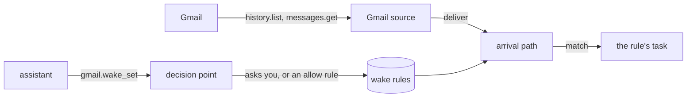

# Gmail arrivals

- **Status:** draft
- **Work items:** [the mail polls](https://linear.app/zgeoff/issue/GEO-1827)

Your Gmail stays at Google. The connectors module polls each Google connection for new mail and
hands each new mail to the [arrival path](wake-rules.md), which keeps a small erasable record only
when one of the assistant's wake rules matches. The assistant sets a rule on your Gmail with
`gmail.wake_set`, a tool call under your policy that asks you by default. Every other Gmail tool,
`gmail.search` among them, is in the [Gmail tools design](../gmail-calendar-drive-tools.md).

## Shape



## Contracts

### The source

```ts
// connectors module. The server app passes it to startTriggerSources beside the schedule source.
declare function buildGmailArrivalSource(input: {
  clock: Clock;
  listConnections: () => Promise<GmailConnection[]>; // each Google connection granted gmail.modify
  readContext: (connectionID: string) => ConnectorContext; // the connection's fetcher
}): TriggerSource; // id 'gmail', kind 'gmail'

// The source's cursor in trigger_sources: one entry per connection.
type GmailSourceCursor = Record<string, { historyID: string; polledAt: number }>; // key: connectionID
// polledAt: the start of the connection's last good poll, epoch ms
```

### The tools

```ts
gmail.wake_set({
  connection: 'k3x9m2p7qa',
  thread: '18c2f0a9b3d4e5f6',
  expires: '3d',
  window: '1h',
});
// → { rule: 'wz7p2k9q4m', expiresAt: '2026-11-27T10:15:00Z', window: '1h', replaced: false }
//   or, under the default policy: Waiting for approval as <shortID>
gmail.wake_list({ connection: 'k3x9m2p7qa' }); // → { rules: [...] }, as mail.wake_list
gmail.wake_cancel({ rule: 'wz7p2k9q4m' }); // → { rule: 'wz7p2k9q4m', ended: true }
```

| Tool                | Effect     | Runs   | Destination |
| ------------------- | ---------- | ------ | ----------- |
| `gmail.wake_set`    | `schedule` | queued | none        |
| `gmail.wake_list`   | `read`     | direct | none        |
| `gmail.wake_cancel` | `note`     | direct | none        |

- `gmail.wake_set` and `gmail.wake_list` take the
  [connection argument](../../platform/connectors/connector.md#the-connection-argument).
  `gmail.wake_cancel` takes the connection from the rule.
- `gmail.wake_set` takes the same match, `expires` and `window` as `mail.wake_set` in
  [the mailbox](mailbox.md#the-tools), with Gmail's thread ID in `thread`.
- `gmail.wake_set` declares `schedule`. No
  [starter rule](../../platform/policy/rules.md#the-starter-rule-set) allows `schedule`, so a call
  asks you unless consent or an allow rule covers it. One allow rule with `tools: [gmail.wake_set]`
  makes every Gmail rule free.

- Cancelling and listing never ask: a cancel only narrows what wakes the assistant.

### Reply rules

- When a `gmail.send` or `gmail.reply` outcome records a sent mail, the same transaction calls
  `setWakeRuleInTransaction` with Gmail's thread ID of the sent mail, the sending task,
  `origin: 'reply'` and an expiry of `replyWake`, which defaults to `mail.reply_wake`.
  `replyWake: 'off'` registers none.
- The send's decision covers its reply rule, and the send's approval card shows the rule's expiry.
  [GEO-2829](https://linear.app/zgeoff/issue/GEO-2829) holds that choice.

## Constraints

- Every `gmail.poll_interval`, default `2m`, the source polls each connection that `listConnections`
  returns and whose status is `active`, `failing` or `expiring`, one at a time.
- A poll calls `history.list` with `startHistoryId` and `historyTypes: messageAdded`, over every
  page, and keeps the `historyId` of the last page.
- It reads each added message with `messages.get`, format `metadata`, for From, Subject, `threadId`,
  `internalDate` and `labelIds`. It drops each message labelled `SENT`, `DRAFT`, `SPAM` or `TRASH`,
  so a mail you send, or the assistant sends, never meets a reply rule.
- The source reads every new message, whether or not a rule is live, so a rule set during a poll
  misses nothing. The core drops each arrival that no rule matches, and nixie keeps no trace of it.
- One poll of one connection is one `deliver` call, with its arrivals and the whole cursor.
- The first poll of a connection calls `getProfile` for the `historyId` and delivers nothing.
- When `history.list` answers 404, the source reads `getProfile` for the new cursor, then lists
  messages with the query `after:<s> -in:sent -in:drafts`, where `<s>` is 10 minutes before
  `polledAt` in epoch seconds, and delivers each one as an arrival. The dedupe keys drop each
  arrival already recorded.
- A failed poll keeps the connection's last cursor. The source polls the connection again after 1
  minute, doubles the wait after each further failure up to 1 hour, and waits longer when Google
  gives a retry time. After 3 failed polls in a row of any connection, it reports `unhealthy`.
- At its next `deliver`, the source drops the cursor entry of each connection that `listConnections`
  no longer returns.
- The source makes read calls only, through the connection's fetcher, and never reaches the decision
  point.
- A match wakes its task within `gmail.poll_interval` plus 1 minute of the mail's arrival, while the
  source reports `running` and the rule's window and throttle are open.
- Forgetting a Google connection erases every `trigger.mail_arrived` of that connection. The
  [erasure design](https://github.com/zgeoff/nixie/pull/1413) runs it as a child of the connection's
  credential.

## Builder decides

- Whether the source reads messages one by one or in a batch request.
- The tools' descriptions and the refusal wording.
