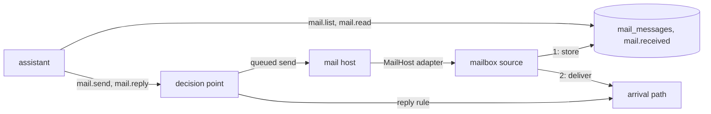

# The assistant's mailbox

- **Status:** draft
- **Work items:** [the assistant's own mailbox](https://linear.app/zgeoff/issue/GEO-2816)

The assistant has one mailbox of its own, at a mail host that nixie reaches through one interface. A
new mail module keeps a copy of every mail in nixie, gives the assistant the `mail.*` tools, and
hands each new mail to the [arrival path](wake-rules.md). Sign-up codes and reset links reach the
assistant here, and [accounts and sign-in](../accounts.md) uses the mailbox as each account's
username.

## Shape



## Contracts

### The host

```ts
// mail module. Adapters: one per mail host, named mailhost-<system>, once the host is chosen;
// an in-memory fake for tests.
interface MailHost {
  begin(): Promise<HostCursor>; // the host's state now; finds no mail
  readChanges(cursor: HostCursor): Promise<HostChanges>;
  send(mail: OutgoingMail): Promise<{ hostMessageID: string }>;
  findSent(messageIDHeader: string): Promise<{ hostMessageID: string } | null>; // reconciles a send
  watch?(signal: AbortSignal): AsyncIterable<void>; // a push hint, when the host has one
}

type HostCursor = JSONValue;
type HostChanges =
  | { kind: 'changes' | 'resynced'; cursor: HostCursor; mails: HostMail[] }
  | { kind: 'failed'; reason: string; after?: number }; // after: the host's retry time, ms

interface HostMail {
  hostMessageID: string;
  receivedAt: number; // epoch ms
  raw: Uint8Array; // the RFC 5322 message; only the mail module parses mail
}

interface OutgoingMail {
  raw: Uint8Array; // its Message-ID is '<actionID>@<the assistant's domain>'
}
```

- The adapter reaches the host only through the credential store's `fetcher` or `socket`, under the
  connector credential `deployment:mail`, and never reads a credential's value. The
  [credentials design](https://github.com/zgeoff/nixie/pull/1414) defines both calls.
- A send reconciles an unknown outcome with `findSent`, by the Message-ID that nixie set. The
  Message-ID carries no other mark of nixie.

### The tools

```ts
mail.list({ from: 'hello@library.example.org', text: 'code', unread: true }); // reads nixie's store
// → { mails: [{ message: 'mz4k8q2w7p', thread: 'th6p2k9w4x', from, subject, at, unread: true }],
//     next: null }
mail.read({ message: 'mz4k8q2w7p' }); // marks the mail read
// → { from, to, subject, thread, text: 'Your code is 482913. [L4] Sign in',
//     attachments: [{ attachment: 1, name: 'board.png', bytes: 30422 }] }
mail.save_attachment({ message: 'mz4k8q2w7p', attachment: 1 }); // → { file: 'f7m3q8k2wz', name }
mail.send({ to: ['hello@library.example.org'], subject, text, files: [], replyWake: '7d' });
mail.reply({ message: 'mz4k8q2w7p', text, files: [], replyWake: 'off' });
// → { message: 'mr8w2k4q9z', thread: 'th6p2k9w4x', replyRule: 'wq4k8m2x7p' | null }
mail.wake_set({ from: ['@library.example.org'], subject: 'code', expires: '30m', window: '1m' });
// → { rule: 'wq4k8m2x7p', expiresAt: '2026-11-24T10:45:00Z', window: '1m', replaced: false,
//     recent: [] }   recent: stored mail of the last 10 minutes that the match takes, as mail.list
mail.wake_list(); // → { rules: [{ rule, match, expiresAt, window, origin: 'tool' | 'reply' }] }
mail.wake_cancel({ rule: 'wq4k8m2x7p' }); // → { rule: 'wq4k8m2x7p', ended: true }
```

| Tool                                                               | Effect | Runs   | Destination    |
| ------------------------------------------------------------------ | ------ | ------ | -------------- |
| `mail.list`, `mail.read`, `mail.save_attachment`, `mail.wake_list` | `read` | direct | none           |
| `mail.wake_set`, `mail.wake_cancel`                                | `note` | direct | none           |
| `mail.send`, `mail.reply`                                          | `send` | queued | each recipient |

- Effects are those of [the decision point](../../../architecture/policy/decision-point.md). The
  starter rules `allow-reads` and `allow-notes` let the first 2 rows through, so a rule on the
  assistant's own mailbox never asks, as [`reminder.set`](../../../architecture/core/reminders.md)
  never does.
- `mail.wake_set` calls `setWakeRuleInTransaction` with the mailbox `{ kind: 'mail' }` and the
  calling task. `expires` runs from `1m` to `wake_rules.max_expiry`. `window` runs from `1m` to
  `expires`, and defaults to `wake_rules.window`. In the conversation, the tool refuses
  `CONVERSATION`.
- A rule matches only mail received after it, so `recent` shows a code that arrived while the
  assistant set the rule. The tool's description tells the assistant to set the rule before it asks
  a site for a code, and to give a short window when it waits on one.
- `mail.wake_cancel` refuses `UNKNOWN_RULE` for a rule of another task or another mailbox.
- `files` takes up to 10 file IDs, 25 MiB in all. A file resolves only on the conversation or task
  run that made it.
- Refusals: `UNKNOWN_MESSAGE`, `UNKNOWN_ATTACHMENT`, `UNKNOWN_FILE`, `UNKNOWN_RULE`, `TOO_BIG`,
  `BAD_ADDRESS`, `BAD_DURATION`, `CONVERSATION` and `SEND_FAILED`.

### The store

```text
mail_messages       -- mail module; one row per stored mail
  message_id        -- crypto.randomUUID()
  short_id          -- createShortID; the model's message ID
  thread_short_id   -- createShortID, one per thread, joined by References and In-Reply-To
  host_message_id   -- unique, so a second store of one mail changes nothing
  received_at, unread
mail.received       -- one per stored mail; from, to, cc, subject, text and attachment names erasable
mail.sent           -- one per sent mail, written by the send's outcome
```

### Reply rules

- When a `mail.send` or `mail.reply` outcome writes `mail.sent`, the same transaction calls
  `setWakeRuleInTransaction` with `{ thread }` of the sent mail, the sending task, `origin: 'reply'`
  and an expiry of `replyWake`, which defaults to `wake_rules.reply_expiry`. `replyWake: 'off'`
  registers none, and so does a send from the conversation.
- A send whose outcome is unknown registers its rule once the reconcile finds the sent mail.

## Constraints

- The mailbox source stores each new mail in a write transaction of its own, then delivers its
  arrival. A crash between the two stores nothing twice, because `host_message_id` is unique. The
  next read delivers the arrival again, because the cursor commits only with the arrival.
- The source reads the host every `mail.host_poll_interval`, default `30s` in the mail module's
  `mail` config section, and at once on a `watch` hint. It retries a failed read after 1 minute,
  doubles the wait after each further failure up to 1 hour, and reports `unhealthy` after 3 failures
  in a row.
- At its first start, the source calls `begin` and stores no older mail. After a `resynced` answer,
  it stores each mail it missed and delivers each one, and the rules' `createdAt` keeps a rule from
  matching mail older than itself.
- Every field of a mail comes back marked as outside content, and each link as a link ID. HTML mail
  is parsed in a fetch sandbox. Link IDs count per conversation session, or per task run.
- A saved attachment is stored as a file, the way `computer.export_file` stores one, and counts as
  untrusted, like a download.
- A one-time code in a mail is visible to the assistant, which types it with
  `computer.browser_fill`.
- The tools send only from the assistant's own address, never from yours.
- Forgetting a stored mail erases its `mail.received` fields and its attachments, and leaves the
  mail at the host.

## Builder decides

- The host calls each adapter makes, and how `mail.list` pages.
- How the mail module joins threads when a mail has no References header.
- The tools' descriptions and the refusal wording.
