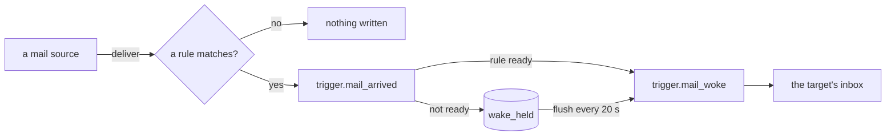

# Wake rules and arrivals

- **Status:** draft
- **Work items:** [the mail polls](https://linear.app/zgeoff/issue/GEO-1827)

The triggers module holds the wake rules and the one arrival path that both mail products share.
Each mail source hands its new mail to the [trigger core](../../../architecture/core/triggers.md) as
arrivals. The core matches each arrival against the rules of its mailbox, and either wakes the
rule's target, the conversation or a task, at once or holds the match for one later wake. See the
[README](README.md) for the terms. Read this part to build the triggers module's half of the mail
polls item. Build and test it against a fake mail source, so it waits on neither mailbox.

## Shape



## Contracts

### The rules

```ts
// triggers module. The mail and connectors modules call these from their tools and sends.
const rule = await setWakeRuleInTransaction(tx, {
  mailbox: { kind: 'mail' },
  match: { from: ['@library.example.org'], subject: 'code' },
  target: { kind: 'task', taskID },
  setBy: callerTaskID, // the conversation's or task's ID that called the tool or ran the send
  expiresAt: 1795943100000,
  windowMs: 900000,
  origin: 'tool',
});
// → { ruleID: '7c1e…', shortID: 'wq4k8m2x7p', createdAt: 1795941300000, replaced: false, …input }
await endWakeRuleInTransaction(tx, rule.ruleID, 'cancelled');
const rules = await readWakeRules(tx, { mailbox }); // rules not expired or ended, newest first
```

```ts
interface WakeRuleInput {
  mailbox: Mailbox;
  match: WakeMatch;
  // the conversation or any task the caller names; a send's reply rule targets the sender
  target: { kind: 'conversation' } | { kind: 'task'; taskID: string };
  setBy: string; // the task ID of the conversation or task that set it
  expiresAt: number | null; // epoch ms; null: the rule stays until it is cancelled
  windowMs: number;
  origin: 'tool' | 'reply'; // 'reply': registered by a send
}

type Mailbox = { kind: 'mail' } | { kind: 'gmail'; connectionID: string }; // connection UUID
// mailboxKey(mailbox): 'mail' or 'gmail:<connectionID>', the one text form tables store

// Every field is optional, and every field present must match. An empty match takes every arrival.
interface WakeMatch {
  from?: string[]; // addresses, or '@domain' for that domain and never a subdomain; without case
  subject?: string; // a substring, both sides in NFC and lowered
  thread?: string; // the mailbox's thread ID: a short ID for 'mail', Gmail's thread ID for 'gmail'
}

interface WakeRule extends WakeRuleInput {
  ruleID: string; // crypto.randomUUID()
  shortID: string; // createShortID; the one ID the model reads and passes
  createdAt: number; // epoch ms: the commit of the transaction that set the rule
}

type WakeRuleEndReason = 'cancelled' | 'task_ended' | 'connection_forgotten';
```

```text
trigger.wake_rule_set     -- the whole rule; a replace writes it again under the same ruleID
trigger.wake_rule_ended   -- ruleID, reason, released: the held arrivals it drops, by sequence;
                             empty for 'cancelled', whose held matches still flush
wake_rules                -- projection: one row per rule, with ended_at and reason
```

- Setting a rule with the same mailbox, match and target as a live rule replaces that rule in place.
  The rule keeps its ID, short ID, `createdAt` and the time of its last wake, and takes the new
  expiry and window length. The result holds `replaced: true`.
- The core writes no record when a rule expires. A rule with an `expiresAt` matches no mail received
  at or after it. A rule with none matches until it ends.
- `readWakeRules`, which the list tools call, leaves out a rule that expired, ended, or targets a
  task that ended. Every list tool shows every live rule of its mailbox, whoever set it.
- A rule's match is stored in plain text, as a definition's filter is.
- The conversation never ends, so a rule that targets it ends only when it is cancelled, expires or
  its connection is forgotten.

### The arrival event

```ts
// triggers module. The schedule event keeps its shape as ScheduleEvent, and
// TriggerEvent = ScheduleEvent | MailArrivalEvent, discriminated on kind; TriggerBatch.events
// takes the union.
interface MailArrivalEvent {
  kind: 'mail';
  mailbox: Mailbox; // the core refuses an event whose mailbox doesn't belong to its source
  dedupeKey: string; // the source's part: '<hostMessageID>' for 'mail', '<connectionID>|<messageID>'
  //                    for 'gmail'; buildSourceKey adds the source ID, as for a schedule event
  occurredAt: string; // ISO: when the source read it
  payload: MailArrival;
}

interface MailArrival {
  messageID: string; // the short ID for 'mail'; Gmail's message ID for 'gmail'
  threadID: string; // as WakeMatch.thread
  receivedAt: number; // epoch ms, the host's receive time, such as Gmail's internalDate
  from: string; // the From address alone, lowered
  subject: string;
}

// …existing fields of TriggerSource
kind: 'schedule' | 'mail'; // both mail sources: id 'mail' for the assistant's, 'gmail' for Gmail
```

`deliverTriggerBatch` dispatches on the event's `kind`. A schedule event takes the steps of
[one deliver call](../../../architecture/core/triggers.md#one-deliver-call) as today. A mail event
takes these, in the same write transaction:

1. When `trigger_keys` holds the event's key, the core skips the event.
2. The core finds each rule of the event's mailbox that has not ended and matches, with `createdAt`
   at or before `receivedAt`, and `receivedAt` before `expiresAt` when the rule has one.
3. For each matching rule whose target task has ended, the core ends the rule as `task_ended` and
   drops it. When no rule is left, the core writes no arrival record and claims no key.
4. The core writes one `trigger.mail_arrived`. Its fold adds the key to `trigger_keys`, as the folds
   of `trigger.fired` and `trigger.skipped` do. The record holds each matching rule, and whether its
   target woke now or the match was held.
5. The core writes one `trigger.mail_woke` for each target with a ready matching rule, through the
   [inbox](../../../architecture/core/tasks.md#the-inbox) writer. The record holds every matching
   rule of that target. The core wakes the target with the cause `event`, at
   [hop](../../../architecture/core/task-messages.md#the-hop-limit) 0.
6. The core holds every other match in `wake_held`.

### Windows and the flush

A wake starts a window for each rule in it. While a rule's window runs, its matches wait. A rule is
ready when its last wake was `windowMs` or more ago, or it never woke. The flush runs every 20
seconds, in one write transaction per tick:

1. It finds each held match that has at least one ready rule.
2. When the match's target task has ended, it ends each of that task's rules as `task_ended`, with
   the task's held matches in `released`.
3. Otherwise it writes one `trigger.mail_woke` per target, with every such match of that target,
   oldest first.

```text
wake_rule_windows   -- rule_id, last_wake_at: the recorded time of the rule's last wake
wake_held           -- rule_id, target_task_id, arrived_seq: the trigger.mail_arrived record's sequence
                    -- both: triggers module, projections of trigger.mail_arrived, trigger.mail_woke
                    -- and trigger.wake_rule_ended, so a rebuild restores every held match
```

### The wake

```ts
// trigger.mail_woke: an inbox kind beside trigger.fired, with its codec where trigger.fired's is.
// It carries what the render needs, so the render reads no other record.
interface MailWoke {
  taskID: string; // the target's task ID; the conversation's for a conversation target
  mailbox: string; // mailboxKey
  rules: { ruleID: string; shortID: string; match: WakeMatch; expiresAt: number | null }[];
  mails: {
    arrived: number; // the sequence of its trigger.mail_arrived; the folds clear it from wake_held
    messageID: string;
    threadID: string;
    receivedAt: number;
    from: string;
    subject: string;
  }[];
  // oldest first; from and subject sit in the record's erasable fields
}
```

The step renders a wake as outside content, in the block that system messages use:

```text
<system-message type="mail" id="…" at="…">
Wake rule wq4k8m2x7p (mail from @library.example.org, subject "code", until 10:45): 2 new mails.
<untrusted id="…">from hello@library.example.org: Your code</untrusted> (message mz4k8q2w7p)
<untrusted id="…">from hello@library.example.org: Your new code</untrusted> (message mb2x9k4q8w)
</system-message>
```

### Erasure

- `trigger.mail_arrived` holds `from` and `subject` in its erasable fields, and the core deletes its
  erasure key once no held match names it: when the last wake or release that needs it commits. So a
  mail's text lasts in nixie's records only in the wakes that showed it.
- `trigger.mail_woke` sits on its task's thread with `from` and `subject` erasable, so you forget it
  as you forget any record, and the forget takes the mail's text with it.
- A wake whose fields are erased renders each mail as forgotten.
- Forgetting a Google connection ends its rules as `connection_forgotten`, and erases the fields of
  its wakes and its held arrivals. That waits on the
  [erasure design](https://github.com/zgeoff/nixie/pull/1413), which runs it as a child of the
  connection's credential.

### Settings

The triggers module owns the `wake_rules` section of the deployment config. Its values are durations
in the shared text form.

```yaml
wake_rules:
  window: 15m # a rule's window when the tool gives none
  reply_expiry: 7d # the expiry of the rule a send registers
```

## Constraints

- All mail is silent: nothing wakes the assistant on mail unless a wake rule matched that mail.
- While its target lives, every match wakes the target, at once or in a later flush. Once a target
  task has ended, the core records no new match for it, and lists each of its held matches in
  `released`. The mail itself stays in its mailbox.
- A rule that has not ended matches mail received from its `createdAt` up to its `expiresAt`, if it
  has one, both by the host's receive time, even when that mail is delivered after `expiresAt`.
- A cancelled rule matches nothing more. Its held matches still flush, because each matched while
  the rule stood.
- A match with a ready rule wakes its target in the transaction that delivers it. A held match wakes
  its target within 20 seconds of one of its rules becoming ready.
- A wake happens only when at least one of the wake's rules is ready, and a rule that is not ready
  joins that wake without causing it.
- One arrival gives each target at most one wake, however many of its rules match.
- The core never reads the [task gate](../task-gate.md) for an arrival or a flush. While a task is
  held, its wakes land in its inbox and wait there, as the gate design says for poll sources.
- The core and the flush check that a task has not ended before they call the inbox writer for it.
- The core matches on the values the source just read from the host, never on erasable fields read
  back.
- The From header proves nothing about the sender. A `from` match is a filter, never a trust check.
- The mail module and the connectors module reach wake rules only through the triggers module, and
  never import each other.

## Builder decides

- Whether the flush runs on the [`startSweep` helper](https://linear.app/zgeoff/issue/GEO-2827) or
  on a loop of its own until that helper lands.
- How the flush and a deliver share the one writer when both fall due in the same tick.
- How a replace compares two matches, and the indexes of the 3 tables.
- The wording of the wake's line, and the zone its times show in.
