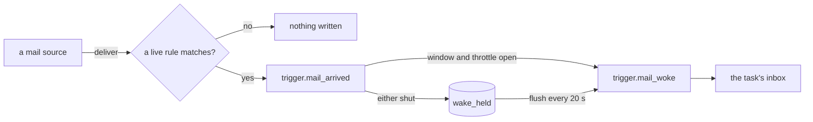

# Wake rules and arrivals

- **Status:** draft
- **Work items:** [the mail polls](https://linear.app/zgeoff/issue/GEO-1827)

The triggers module holds the wake rules and the one arrival path that both mail products share.
Each mail source hands its new mail to the [trigger core](../../../architecture/core/triggers.md) as
arrivals. The core matches each arrival against the live rules of its mailbox, and either wakes the
rule's task at once or holds the match until the window ends. The [README](README.md) defines the
terms.

## Shape



## Contracts

### The rules

```ts
// triggers module. The mail and connectors modules call these from their tools and sends.
const rule = await setWakeRuleInTransaction(tx, {
  mailbox: { kind: 'mail' },
  match: { from: ['@library.example.org'], subject: 'code' },
  taskID,
  expiresAt: 1795943100000,
  windowMs: 900000,
  origin: 'tool',
});
// → { ruleID: '7c1e…', shortID: 'wq4k8m2x7p', createdAt: 1795941300000, replaced: false, …input }
await endWakeRuleInTransaction(tx, rule.ruleID, 'cancelled');
const rules = await readWakeRules(tx, { mailbox, taskID }); // live rules only, newest first
```

```ts
interface WakeRuleInput {
  mailbox: Mailbox;
  match: WakeMatch;
  taskID: string; // the task that called the tool or ran the send
  expiresAt: number; // epoch ms; the tool turns `expires` into it at the call
  windowMs: number;
  origin: 'tool' | 'reply'; // 'reply': registered by a send
}

type Mailbox = { kind: 'mail' } | { kind: 'gmail'; connectionID: string }; // connection UUID
// mailboxKey(mailbox): 'mail' or 'gmail:<connectionID>', the one text form tables store

// Every field is optional, and every field present must match. An empty match takes every arrival.
interface WakeMatch {
  from?: string[]; // addresses, or '@domain' for that domain and never a subdomain; without case
  subject?: string; // a substring, both sides in NFC and lowered
  thread?: string; // the mailbox's thread ID: a short ID for 'mail', Gmail's thread ID for 'gmail'
}

interface WakeRule extends WakeRuleInput {
  ruleID: string; // crypto.randomUUID()
  shortID: string; // createShortID; the one ID the model reads and passes
  createdAt: number; // epoch ms
}
```

```text
trigger.wake_rule_set     -- the whole rule; a replace writes it again under the same ruleID
trigger.wake_rule_ended   -- ruleID, reason: 'cancelled' | 'task_ended', released: arrival sequences
wake_rules                -- projection: one row per rule, with ended_at and reason
```

- A set with the same mailbox, match and task as a live rule replaces that rule in place: the rule
  keeps its ID, short ID, `createdAt` and window, and takes the new expiry and window length. The
  result says `replaced: true`.
- An expired rule writes no record. It stops matching at `expiresAt`, and `readWakeRules` leaves it
  out.
- A rule's match is stored in plain text, as a definition's filter is.

### The arrival event

```ts
// triggers module. TriggerEvent becomes the union of the schedule event and this one.
interface MailArrivalEvent {
  kind: 'mail';
  mailbox: Mailbox;
  dedupeKey: string; // the source's part: '<hostMessageID>' for 'mail', '<connectionID>|<messageID>'
  //                    for 'gmail'; buildSourceKey adds the source ID, as for a schedule event
  occurredAt: string; // ISO: when the source read it
  payload: MailArrival;
}

interface MailArrival {
  messageID: string; // the short ID for 'mail'; Gmail's message ID for 'gmail'
  threadID: string; // as WakeMatch.thread
  receivedAt: number; // epoch ms, the host's receive time: JMAP receivedAt, Gmail internalDate
  from: string; // the From address, lowered
  subject: string;
}

// …existing fields of TriggerSource
kind: 'schedule' | 'mail' | 'gmail';
```

`deliverTriggerBatch` dispatches on the event's `kind`. A schedule event takes the steps of
[one deliver call](../../../architecture/core/triggers.md#one-deliver-call) as today. A mail event
takes these, in the same write transaction:

1. When `trigger_keys` holds the event's key, the core skips the event.
2. The core finds each live rule of the event's mailbox that matches, with `createdAt` at or before
   `receivedAt`, and `receivedAt` before `expiresAt`.
3. For each matching rule whose task has ended, the core writes `trigger.wake_rule_ended` with
   `task_ended` and drops the rule. When no rule is left, the core writes nothing and claims no key.
4. The core writes one `trigger.mail_arrived`. Its fold adds the key to `trigger_keys`, as the folds
   of `trigger.fired` and `trigger.skipped` do. The record lists each matching rule, and for each
   whether the arrival woke its task now or was held.
5. For each task with a rule that woke now, the core writes one `trigger.mail_woke` through the
   [inbox](../../../architecture/core/tasks.md#the-inbox) writer. It wakes the task with the cause
   `event`, at [hop](../../../architecture/core/task-messages.md#the-hop-limit) 0.

### Windows, the throttle and the flush

A match wakes its task now only when both of these are open:

- the rule's window: no wake of this rule in the last `windowMs`;
- the throttle of the task and the mailbox: no wake of this task from this mailbox in the last
  `mail.wake_throttle`.

Otherwise the core holds the match in `wake_held`. The flush runs every 20 seconds, in one write
transaction per tick:

1. It finds each held match whose rule window and throttle have both closed.
2. When the match's task has ended, it ends the rule as `task_ended`, with the dropped matches in
   `released`.
3. Otherwise it writes one `trigger.mail_woke` per task, naming every such match of that task,
   oldest first.
4. Each flush counts as a wake: it opens a new window for each rule it names, and a new throttle for
   the task and the mailbox.

```text
wake_rule_windows   -- rule_id, last_wake_at (epoch ms)
wake_throttles      -- mailbox_key, task_id, last_wake_at (epoch ms)
wake_held           -- rule_id, task_id, arrived_seq: the trigger.mail_arrived record's sequence
                    -- all 3: triggers module, projections of trigger.mail_arrived, trigger.mail_woke
                    -- and trigger.wake_rule_ended, so a rebuild restores every held match
```

### The wake

```ts
// trigger.mail_woke: triggers module, an inbox kind beside trigger.fired
interface MailWoke {
  taskID: string;
  rules: string[]; // rule IDs; the render shows each rule's short ID
  arrivals: number[]; // sequences of trigger.mail_arrived, oldest first
}
```

The sessions module renders a wake from the arrival records it names, as outside content, in the
block that system messages use. The conversation and every other task render it the same way.

```text
<system-message type="mail" id="…" at="…">
Wake rule wq4k8m2x7p (mail from @library.example.org, subject "code", until 10:45): 2 new mails.
<untrusted id="…">from hello@library.example.org: Your code</untrusted> (message mz4k8q2w7p)
<untrusted id="…">from hello@library.example.org: Your new code</untrusted> (message mb2x9k4q8w)
</system-message>
```

### Erasure

- `trigger.mail_arrived` holds `from` and `subject` in its erasable fields. Its payload, the rows
  and the cursors hold only IDs, times and labels.
- Forgetting a `trigger.mail_woke` erases each `trigger.mail_arrived` it names, for every task that
  names it, because a forget takes the mail's text out of nixie. `trigger.mail_woke` joins
  `forgettableKinds`, and `trigger.mail_arrived` joins its exceptions.
- A wake whose arrival is erased renders that mail as forgotten.

### Settings

The triggers module owns these keys.

| Key                    | Default | What it sets                             |
| ---------------------- | ------- | ---------------------------------------- |
| `mail.wake_window`     | `15m`   | a rule's window when the tool gives none |
| `mail.wake_throttle`   | `5m`    | the throttle of each task and mailbox    |
| `mail.wake_max_expiry` | `30d`   | the longest expiry a rule takes          |
| `mail.reply_wake`      | `7d`    | the expiry of the rule a send registers  |

## Constraints

- Nothing wakes the assistant on mail unless a live wake rule matches.
- The arrival path never drops a match. Each match wakes its task at once or in a later flush,
  unless the task ends first, when `trigger.wake_rule_ended` lists it in `released`. The mail itself
  stays in its mailbox.
- A rule that expires or is cancelled matches nothing more. Its held matches still flush.
- A rule matches only mail received between its `createdAt` and its `expiresAt`, both by the host's
  receive time. To see older mail, the assistant searches.
- A match whose window and throttle are open wakes its task in the transaction that delivers it. A
  held match wakes its task within 20 seconds of both closing.
- A rule wakes its task at most once per window, and a mailbox wakes a task at most once per
  throttle, however much mail arrives.
- One arrival that matches several rules of one task gives that task one wake.
- The core never reads the [task gate](../task-gate.md) for an arrival or a flush. While a task is
  held, its wakes land in its inbox and wait there, as the gate design says for poll sources.
- The sources match on values they just read from the host, never on erasable fields read back.
- The From header proves nothing about the sender. A `from` match is a filter, never a trust check.
- The mail module and the connectors module reach wake rules only through the triggers module, and
  never import each other.

## Builder decides

- Whether the flush runs on the [`startSweep` helper](https://linear.app/zgeoff/issue/GEO-2827) or
  on a loop of its own until that helper lands.
- How the flush and a deliver share the one writer when both fall due in the same tick.
- The indexes of `wake_rules`, `wake_rule_windows`, `wake_throttles` and `wake_held`.
- The wording of the wake's line.
