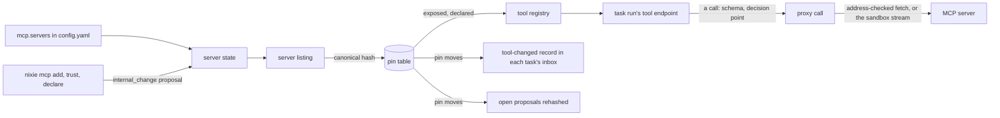

# The MCP proxy build

- **Status:** draft
- **Work items:** [the proxy](https://linear.app/zgeoff/issue/GEO-1842), in 3 stages. Both of these
  build on stage 1: [a changed tool in a running task](https://linear.app/zgeoff/issue/GEO-1254) and
  [the pinned hash in the action hash](https://linear.app/zgeoff/issue/GEO-1255).
- **Decision records:** [0009](../../decisions/0009-mcp-proxy.md)

You plug an outside MCP server into nixie without trusting it. The deployment configures the server,
you approve it once, and nixie fetches its tools. A tool reaches the model only after you declare
its effects, and nixie pins the exact form you reviewed. A changed tool stops working until you
allow it. Every call runs under your rules, and the
[decision point](../platform/policy/decision-point.md) marks its result as outside content, of
source `untrusted`, as [taint](../platform/policy/decision-point.md#taint-in-the-first-build)
defines. [The MCP proxy design](../platform/connectors/mcp-proxy.md) sets the rules that nixie
keeps: when a changed tool stops, what a failed fetch of a server's tools leaves the model, how an
input request reaches you, and which token a server gets. This design adds the contracts that build
them.

The first server is a hosted MCP server of your own. It serves Streamable HTTP on a private network,
takes no token, and offers only read tools with no annotations, the hints a server may attach to a
tool. It therefore runs with `auth: none` and a private range. Each of its declarations starts from
the strictest effects, `write`, `delete` and `send`, which you narrow before you approve. A stand-in
server in the test build covers what the first server lacks: a write tool, a destination, an input
request and a tool that changes.

The build ships in 3 stages, one release or more apart:

1. **HTTP:** the proxy, with `auth: none` and `auth: static`, the pins, the declarations, the
   health, the input requests, the tool-changed record and the pinned hash in the action hash. Stage
   1 also adds the `mcp_server` sandbox kind to the spec schema, which nothing writes until stage 2.
2. **stdio:** a server run as a command in a sandbox of kind `mcp_server`.
3. **OAuth:** `auth: oauth`, once a server the deployment adds needs it.

This design uses 2 terms throughout. A **server listing** is the proxy's fetch of one server's
tools, an MCP `tools/list`. A **tool list** is the set of tools one task run or worker run may call,
which [one endpoint per task run](../platform/connectors/tools.md#one-endpoint-per-task-run)
defines.

## Shape



## Contracts

### The config

```yaml
# config.yaml: the mcp section, which the mcp module's schema owns. Every object is strict.
mcp:
  listingTimeoutSeconds: 10 # the default
  servers:
    notes: # the server ID, which prefixes every tool name
      transport:
        url: https://notes.example.internal/mcp # https only, with no user name, query or fragment
        # or, from stage 2: command: [bun, /server/index.js]; files: /srv/mcp/notes
      trusted: false # the default
      auth: { kind: none } # or { kind: static, token: deployment:notes-token, header: Authorization }
      # or, from stage 3: { kind: oauth, clientID: nixie-notes }
      privateRange: 10.42.0.0/16 # needed when the host resolves to a non-public address
```

- A server ID matches `^[a-z][a-z0-9]{1,15}$`. The config load refuses an ID that equals the first
  segment of a tool nixie registers, such as `memory` or `task`.
- `privateRange` is one CIDR range. The load refuses a range that holds a loopback, link-local or
  unspecified address. A test build (`NIXIE_TEST_BUILD`) is the one exception, because the stand-in
  server listens on loopback.
- `auth: static` takes only a `deployment:` reference. The credential store's deployment backend
  holds the token, with the server's host as its only host. `header` defaults to `Authorization`,
  which carries `Bearer <token>`.
- `transport.files` is a host folder of 64 MiB or less, which the proxy copies into the sandbox at
  `/server`.

### Server state and the commands

Each change in the table below asks you once, through one proposal, when it widens, and applies at
once with a record when it narrows. A change widens when it lets outside code reach the model, or
reach it with fewer checks. Trusting a server widens, because a trusted server's changed tool
applies with a notice, while an untrusted server's changed tool stops until you allow it. A
declaration that drops an effect widens, because a call with fewer effects gets past an ask or deny
rule that matched the dropped effect.

| Change                                                                                          | Kind      |
| ----------------------------------------------------------------------------------------------- | --------- |
| Adding a server, or trusting it                                                                 | widening  |
| A first declaration of a tool                                                                   | widening  |
| A declaration that drops anything: an effect, a destination, the amount or a content argument   | widening  |
| A declaration that adds a `reconcile`, so nixie settles an interrupted call without you         | widening  |
| Allowing a changed tool                                                                         | widening  |
| A config entry with a new host, a wider range, new files, another auth binding, or `trusted` on | widening  |
| Removing a server, or untrusting it                                                             | narrowing |
| A declaration that only adds an effect, a destination, the amount or a content argument         | narrowing |
| A declaration that only removes its `reconcile`                                                 | narrowing |
| A config entry with a smaller range, or with `trusted` turned off                               | narrowing |

A declaration that both adds and drops is a widening.

```ts
// mcp module. The facts the proxy uses for each server, which records fold into the mcp_servers
// projection. The config entry holds the facts the deployment asks for; these hold the facts in use.
interface ServerFacts {
  transport: { url: string } | { command: string[]; filesHash: string }; // filesHash: SHA-256 of the folder's files
  trusted: boolean;
  auth: // the binding, never a secret: a changed reference, header or client is a new binding
    | { kind: 'none' }
    | { kind: 'static'; token: string; header: string } // token: the deployment: reference
    | { kind: 'oauth'; clientID: string };
  privateRange: string | null;
  issuer: string | null; // oauth only: the authorization server that the protected resource metadata named
}

type ServerState =
  | 'configured' // in the config, never added
  | 'proposed' // an add waits for your approval; a trust proposal leaves an added server 'added'
  | 'added'
  | 'held' // the config entry widened past the facts in use, and waits for your approval
  | 'removed';
```

```bash
nixie mcp list                       # each server: state, trusted, health, next try, tool counts by pin state
nixie mcp add notes                  # proposes adding the configured entry; prints the proposal's short ID
nixie mcp remove notes               # applies at once
nixie mcp trust notes                # proposes; nixie mcp untrust notes applies at once
nixie mcp tools notes                # the pin table: each tool, its state, pinned and latest hash, declaration
nixie mcp declare notes.search --file search.yaml  # applies a narrowing at once; proposes a widening
nixie mcp diff notes.search          # the pinned tool form and the latest one, field by field
```

- Each command that widens creates one `internal_change` proposal of the `mcp` family and prints its
  short ID. You answer it in the client or with `nixie proposals approve <id>`, through the shared
  answer path of the approval record (`docs/design/queue/approval-record.md`).

```ts
// mcp module: the canonical operation of an mcp proposal, whose SHA-256 is the row's action hash
type McpOperation =
  | { change: 'add' | 'trust' | 'widen'; serverID: string; facts: ServerFacts } // widen: a held entry
  | { change: 'declare'; tool: string; hash: string; declaration: ToolDeclared['declaration'] }
  | { change: 'allow'; tool: string; fromHash: string; hash: string }; // hash: the tool form the card shows
```

- The mcp kind's handler recomputes the operation at each answer from the current facts and the
  tool's `latest_hash`, so the answer path refuses an answer from a card that shows an older tool
  form as `CONFLICT`.
- When a server listing moves a tool's `latest_hash` while a `declare` or `allow` proposal of that
  tool is open, the proxy withdraws the proposal and opens one for the new hash in the same
  transaction.
- `add` takes its facts from the config entry alone, and refuses an ID the config lacks.
- At each start, the proxy compares each config entry with the server's facts in use:
  - The same facts: the server stays as it is.
  - A narrowing: the proxy applies it at once.
  - A widening: the server is `held`, and the start writes one proposal for the new facts.
  - An entry gone from the config: the server is `removed`, and its pins and declarations stay for a
    later add.
- `remove` and `untrust` set aside part of the config entry, and each records a copy of the entry as
  it stood. At each later start, the proxy keeps the set-aside in force while the entry still
  matches that copy. Once the deployment changes the entry, the start compares it as above. `add` or
  `trust` ends the set-aside through its own proposal.
- A removed server whose entry is still in the config stays `removed` until you run `add` or the
  deployment changes the entry.

### Pins

```ts
// mcp module
const hash = hashToolForm(toolForm); // → 'sha256:3b9f…'

// A tool form: the canonical JSON of one tool, serialised as the snapshot form is (policy design,
// "The snapshot hash"): sorted keys, no whitespace, NFC strings.
interface ToolForm {
  name: string; // the server's name for the tool, before the prefix
  title: string | null;
  description: string | null;
  inputSchema: JSONObject;
  outputSchema: JSONObject | null;
  annotations: JSONObject | null; // _meta is left out
}

type PinState =
  | 'exposed'
  | 'stopped_changed' // an untrusted server's changed hash, until you allow it
  | 'stopped_unfit' // the declaration names an argument that the latest input schema lacks
  | 'hidden_new' // no declaration yet
  | 'removed';
```

```text
mcp_tools, a projection, one row per tool a server listing has held
  tool            text primary key -- '<serverID>.<name>', such as 'notes.search'
  server_id       text not null
  pinned_hash     text             -- null until a declaration pins the tool
  latest_hash     text not null    -- the hash of the newest server listing that held the tool
  state           text not null    -- a PinState; no check constraint, as the database's migrations require
  declared_seq    integer          -- the declaration in force

mcp_tool_forms, a projection, one row per tool form a server listing has held
  hash            text primary key
  listed_seq      integer not null -- the mcp.tool_listed record whose erasable fields hold the form
```

- An approved declaration or allow moves the pin to the hash its operation holds, never to a later
  one. A trusted server's change moves the pin to the hash of the server listing that brought it.
- A stopped tool stays on each tool list in its pinned tool form. The proxy answers each call with
  an error that gives the tool and the wait, such as "notes.search changed and waits for your
  review". A hidden or removed tool never appears on a tool list.
- The fit check runs on every server listing. A declaration fits when each argument it names is a
  property of the latest input schema. A declaration names no result field.
- The model reads a tool as `mcp__nixie__<serverID>_<name>`, after `toSDKToolName`. A tool stays
  `hidden_new` when another tool already holds its model name, or when its model name passes 64
  characters, the Messages API's limit. `nixie mcp tools` shows the reason.

### Effect declarations

```yaml
# search.yaml, the declaration file for nixie mcp declare notes.search
effects: [read]
destinations: [] # argument names that hold a destination
amount: null # the argument that holds the amount of a spend
content: [query] # free-text arguments
reconcile: null # how nixie settles an interrupted queued call: { idempotencyKey: <argument> }
# resends with the same key, and { check: <read tool> } asks the server; null brings the call to you
```

```ts
// mcp module: the record a declaration writes. The effect overrides of the decision point cutover
// (docs/design/queue/decision-point-cutover.md) change a declaration in code, and a proxied tool has none.
interface ToolDeclared {
  // kind mcp.tool_declared
  tool: string;
  declaration: Omit<EffectDeclaration, 'results'>; // EffectDeclaration: policy module
  reconcile: { idempotencyKey: string } | { check: string } | null;
  pinnedHash: string; // the hash the declaration pins
  proposalID: string | null; // null for a narrowing, which applies with no proposal
}
```

- The declaration's `results` holds `untrusted` for every field of the tool's output schema, and
  nobody declares it, because every result field is outside content.
- `nixie mcp declare --prefill <tool>` prints a declaration file built from the latest tool form's
  annotations: `readOnlyHint: true` gives `[read]`, and `destructiveHint: false` drops `delete`.
  With no annotations it holds the strictest effects that need no argument named: `write`, `delete`
  and `send`. `spend` and `device` need an amount or a device, which only you can name. Only the
  declaration you approve counts.
- A tool with no declaration in force is `hidden_new`, and the registry denies a call to it.
- The [snapshot hash](../platform/policy/rules.md#the-snapshot-hash) covers each proxied tool's
  declaration in force and its pinned hash, so a replay reads each decision under the declaration it
  ran under.

### The registry

```ts
// tools module: a second source of tool definitions, which the composition root passes in. The mcp
// module provides it.
interface ToolSource {
  findTool(name: string): RegisteredTool | null; // reads the pin table at each call
  // Runs a server listing of each server that the names reach, before the task run's first step
  // reads its tool list. The endpoint's start awaits it, and a failed server listing never rejects.
  prepareTaskRun(tools: readonly string[]): Promise<void>;
}

declare function buildToolRegistry(
  definitions: readonly ToolDefinition[],
  sources: readonly ToolSource[], // …existing parameter first; nixie's own tools win a name
): ToolRegistry;
```

```ts
// mcp module: the definition of an exposed or stopped proxied tool, built from its pinned tool form
const definition: ToolDefinition = {
  name: 'notes.search',
  description: pinned.description ?? '',
  input: pinned.inputSchema,
  output: pinned.outputSchema ?? { type: 'object', properties: { text: { type: 'string' } } },
  declaration, // from mcp.tool_declared, with results set to untrusted
  execution: 'direct', // 'queued' when the effects hold write, delete, send, spend or device
  run: callServerTool,
};
```

- A tool's `RegisteredTool` changes when its pin moves, and every later call parses its input and
  its result with the new pinned schemas.
- A tool whose pinned tool form has no output schema returns `{ text }`, the text blocks of the
  result joined by a blank line. Image blocks go back as the result's images, under the turn's image
  caps. Every other block kind is dropped, and `text` ends with a line that counts them.
- An output schema that is not an object makes the tool `hidden_new`, because the registry needs an
  object result.

### Calls and input requests

```ts
// mcp module: the typed result, in nixie's own text, of a call that the server answered with an
// input request
// → { status: 'input_requested', request: 'r7k2m9x4qa' }

// The record of the request, on the calling task's thread
interface InputRequested {
  // kind mcp.input_requested
  requestID: string; // crypto.randomUUID()
  shortID: string;
  callSequence: number; // the tool_called record
  tool: string;
  expiresAt: string; // 15 minutes after the request
  // erasable fields (../../architecture/core/erasable-fields.md): { message, requestedSchema },
  // which are outside content
}

// libs/contract: a checked action (../../architecture/channels/api.md#checked-actions)
await client.mcp.answerInput({
  clientActionID,
  request: 'r7k2m9x4qa',
  answer: { action: 'accept', content },
});
// → ok, or EXPIRED, or ANSWERED
// The retry's outcome lands as mcp.input_outcome in the inbox of the task whose step made the call,
// the worker's caller for a worker's call, and wakes that task.
```

- The proxy sends every HTTP request through the credential store's fetcher, which checks the
  address on every hop. The proxy passes the server's host and its `privateRange` as the fetcher's
  one `pairing`, the host that may resolve to a non-public address
  ([the credential store](../platform/connectors/credentials.md#the-interface)). With `auth: none`,
  the fetcher holds no credential.
- The proxy sends each request to the configured URL alone, and refuses every redirect.
- The proxy sends no `Origin` header, and no cookie.
- The MCP client runs in `auto` protocol mode, with `inputRequired: { autoFulfill: false }` and no
  sampling, roots or logging capability, and with its own output check off.
- The proxy returns an `isError` result as a tool error with its text, whose source is `untrusted`.
- Your answer makes the proxy retry the call once, with the same arguments and your answer. The
  retry passes the decision point again, under the call's original tool list.
- For a queued tool, the retry is a new action, whose canonical operation holds your answer, so it
  needs its own allow or approval. The approval the first attempt consumed never covers it.
- The proxy refuses an answer past `expiresAt` as `EXPIRED`, and writes an `mcp.input_outcome` that
  says so to the inbox.

### Health

```ts
// mcp module: one state per server, in memory, shared by every task run
interface ServerHealth {
  failures: number; // failed server listings in a row
  nextTryAt: Date | null; // set while failures > 0; the backoff from libs/retry, 1 min to 1 h
  isUnhealthy: boolean; // failures >= 3; sets the notice, while any failure already blocks calls
  lastError:
    | 'refused'
    | 'error'
    | 'unparsable'
    | 'timeout'
    | 'unauthorised'
    | 'start_failed'
    | null;
}

// mcp.health_changed { serverID, isUnhealthy, lastError, nextTryAt }: one record when the server
// becomes unhealthy and one when it recovers. The web client shows each one in its server list.
```

- While the latest server listing failed, the proxy answers a call with "notes is unreachable, next
  try 14:05", with the time in the zone the time tool answers in.
- A start resets every server's health. The first server listing after a start counts as any other.

### A changed tool in a running task

```ts
// mcp module: an inbox record kind, one per task per tool, in the transaction that moves the pin or
// removes the tool
interface ToolChanged {
  // kind mcp.tool_changed
  tool: string;
  fromHash: string;
  toHash: string | null; // null when the server dropped the tool
  cause: 'trusted' | 'allowed' | 'removed';
}
```

- The proxy writes the record to every task that is ready, running, waiting, paused or stopped and
  whose tool list holds the tool. A done, failed or closed task gets none.
- The record never wakes a task, unlike the other
  [inbox](../../architecture/core/tasks.md#the-inbox) kinds, because a change matters only once the
  task runs a step. The next step reads it as any other inbox record.
- The turn renders it as a system message of nixie's own text: the tool, the first 12 digits of each
  hash, and that the tool list holds the new tool form, or that the tool is gone.
- A [worker](../../glossary.md) has no inbox, so it keeps its starting tool form, and the proxy
  checks its calls against the current pin.

### The pinned hash in the action hash

Policy hashes each action proposal: the SHA-256 of its canonical operation, the tool, its arguments
and its destinations in one serialised form, as
[the proposal](../platform/policy/approvals.md#the-proposal) defines. Your answer carries the hash
its [card](../../glossary.md) showed.

```ts
// policy module: the canonical operation of a proxied tool's action proposal adds the pin
const operation = {
  kind: 'action',
  tool: 'notes.add_entry',
  input,
  destinations,
  pin: 'sha256:3b9f…',
};

// A record kind of its own, which the proposals projection folds into the row's actionHash
interface ActionRehashed {
  // kind policy.action_rehashed
  proposalID: string;
  actionHash: string;
  pin: string;
}
```

- The transaction that moves a pin writes one `policy.action_rehashed` for each pending or deferred
  proposal of the tool, and a deferred one returns to pending.
- The action kind's handler recomputes the hash at each answer (`currentHashes` in the approval
  record design). It reads the pin through a reader the composition root passes in, so the answer
  path refuses an answer from a card that showed the old tool form as `CONFLICT`.
- An approved action that has not run yet returns to pending with the new hash. The check before
  each attempt finds the moved pin, and
  [actions under policy](https://linear.app/zgeoff/issue/GEO-1810) builds that check.

### The stdio sandbox

```ts
// sandbox module: a kind that stage 1 adds to the spec schema and stage 2 writes
// | kind        | Egress | Model credential | Other grants | Tool route |
// | mcp_server  | None   | No               | No           | No         |
export const sandboxSizes = {
  // …existing rows
  mcpServer: { vcpus: 1, memoryMiB: 256, diskMiB: 4096 }, // 256: the starting figure for the probe
} as const satisfies Readonly<Record<string, SandboxLimits>>;
```

```ts
// libs/wire: the frames between the proxy and the bridge guest
type BridgeFrame =
  | { type: 'message'; json: string } // one JSON-RPC message, either way
  | { type: 'exited'; code: number | null }; // from the bridge, when the server's process ends
```

- The spec builder gives the `mcp_server` kind egress `none`, no grant and no tool route, and every
  adapter refuses a spec of that kind with any other egress, a grant or a tool route.
- The proxy keeps one sandbox per added stdio server, with the server ID as its owner. It creates
  the sandbox at the server's first server listing and keeps it until nixie stops or you remove the
  server. A start destroys every sandbox of kind `mcp_server`, and the next server listing creates
  it again.
- The sandbox runs the code image, which the code tool design (`docs/design/queue/code-tool.md`)
  adds, at the `mcpServer` row. The proxy copies the bridge guest and the entry's files in, hashes
  the copied files, and spawns the bridge only when that hash equals `filesHash` in the facts in
  use. A mismatch fails the server listing as `start_failed` and holds the server, so files changed
  after an approval never run without one. The bridge runs the command and turns its
  newline-delimited JSON-RPC into frames, because a spawn stream carries framed messages.
- The proxy caps each frame at 4 MiB. A frame past the cap stops the server, and the server listing
  or the call fails as `unparsable`.
- A sandbox that fails to start fails its server listing as `start_failed`.

### OAuth

```ts
// connections module, stage 3: an MCP server's grant is a connection of connector 'mcp:<serverID>'
const spec: OAuthSpec = {
  kind: 'oauth',
  authorizeURL, // from the authorization server metadata of the issuer in the facts in use
  tokenURL,
  revokeURL, // when the metadata names one
  identityScopes: [],
  scopes, // from the protected resource metadata's scopes_supported
  authorizeParams: { resource: 'https://notes.example.internal/mcp' }, // the server's canonical URI
  hosts: ['notes.example.internal'],
  returnPath: '/connections/mcp/notes/return',
};
```

- The client is the public client that `clientID` names, which you register at the server's
  authorization server. nixie uses PKCE with S256, and never dynamic client registration or a client
  metadata document.
- Every token request and every refresh sends `resource` with the server's canonical URI.
- The proxy discovers the issuer from the server's protected resource metadata once, when you add
  the server, and pins it in the facts in use. When the metadata later names another issuer, the
  server becomes unhealthy with `unauthorised`.

## Constraints

### Server listings and calls

- The proxy runs a server listing when you add a server or allow a widening of it, when the server
  reports a changed list, when a task run's endpoint starts with one of the server's tools, and on
  the backoff while its latest server listing failed.
- The proxy never runs a server listing of a `held`, `proposed` or `removed` server. A tool of a
  `held` server stays on each tool list in its pinned tool form, and the proxy answers each call
  with an error that says the server waits for your approval.
- A call reaches the server only when the latest server listing passed and left the tool `exposed`.
- The input check and the result check read the current pin, never the task run's starting tool
  form.
- The proxy never sends a server a token issued for another resource.

### Records and tables

- Every `mcp.*` record sits off any task thread, except `mcp.tool_changed`, `mcp.input_requested`
  and `mcp.input_outcome`.
- The proxy writes `mcp.tool_listed { serverID, tool, hash }`, with the `toolForm` as canonical JSON
  in its [erasable fields](../../architecture/core/erasable-fields.md), once for each pair of a tool
  and a hash that `mcp_tools` has not held, and `mcp.pin_moved { tool, fromHash, toHash, cause }`
  for each move. A server listing that changes nothing writes nothing. The proxy reads a form, for a
  tool list or a change card, from the record at `listed_seq`. When a forget has made that form
  unreadable, the next server listing that holds the hash writes the record again.
- A pin move, its `mcp.tool_changed` records and its `policy.action_rehashed` records commit in one
  transaction.
- `mcp_servers`, `mcp_tools` and `mcp_tool_forms` arrive in one appended migration that only adds
  tables.

### The stand-in server

- The mcp module's test utilities export a stand-in Streamable HTTP server on loopback, with a read
  tool, a write tool that names a destination, and a tool that answers with an input request.
- A test changes a tool form, fails the next server listing, or drops a tool between 2 server
  listings.
- Only a test build loads a config that pairs a host with a loopback range, and the composition root
  never builds the stand-in server.

### The port rules

[The port rules](https://linear.app/zgeoff/issue/GEO-2581) hold. A port is an interface that one
module owns and that has a second real provider in sight, one that does the work in a release.

- The proxy has no port, because it has one real provider. The mcp module holds the HTTP transport
  and, from stage 2, the stdio transport, which reaches the server only through the sandbox
  interface.
- The MCP client package needs no import zone, because it is a protocol library that the tools
  module and the server already import.
- A provider that runs in another image or process needs a table of the release pairs that work
  together, and nixie stops on a pair the table lacks (rule 12). The bridge guest runs in the image
  of its own release, so its table has one row: the same release.

### Rollback

| Added                                            | The release before                                                                                          |
| ------------------------------------------------ | ----------------------------------------------------------------------------------------------------------- |
| The `mcp` config section                         | Refuses to start, because the schema is strict. Remove the section from `config.yaml` before the rollback   |
| The migration of the 3 tables                    | Never reads them. The migration only adds tables, so the oldest reader does not change                      |
| `mcp.*` records off a task thread                | Skips them, because no projection of that release folds them                                                |
| `mcp.tool_changed` and `mcp.input_*` on a thread | Skips them: they are not inbox kinds there, so no step reads them and none wakes a task                     |
| `policy.action_rehashed`                         | Skips it. Its registry lacks the proxied tool, so its action runner fails an approved action at the attempt |
| A proxied tool on a started task's tool list     | Keeps the list, and refuses each call as a tool it does not have                                            |
| The `mcp_server` kind, at stage 1                | Never meets it, because stage 1 writes none                                                                 |
| A `sandbox.created` of kind `mcp_server`         | Reads it, because stage 1 adds the kind, and destroys the sandbox at start                                  |
| `transport.command` and `auth: oauth` in config  | Refuses to start. Remove the entry, or change it, before the rollback                                       |
| A connection of an `mcp:` connector, at stage 3  | Skips it, because stage 1 makes the connections list and the refresh sweep skip such a connection           |

## Decisions

- **The config holds the facts the deployment asks for, and records hold the facts in use.** An
  agent's call on 13 Nov 2026: nixie reads the config only at start, so the commands write records,
  and a start holds a widening for one approval, as a
  [seed](../../architecture/policy/rules.md#rules-in-force) holds a widened rule.
- **Every widening is one `internal_change` proposal.** An agent's call on 13 Nov 2026: the shared
  answer path then carries every approval the proxy needs. That covers the card with a changed
  tool's old and new form, and the one approval to add or trust a server. A host command then needs
  no answer path of its own.
- **`add` takes its facts from the config alone.** An agent's call on 13 Nov 2026: a host command
  that took a URL would add a server the deployment never configured.
- **A stopped or held tool stays on the tool list in its pinned tool form.** An agent's call on 13
  Nov 2026: it follows the rule of
  [a failed listing](../platform/connectors/mcp-proxy.md#a-failed-listing), since a tool that
  vanishes reads to the model as a missing capability, and an unchanged tool list keeps the model's
  prompt cache.
- **A tool-changed record never wakes a task.** An agent's call on 13 Nov 2026: a waiting task has
  no step that a changed tool affects, and a wake would spend a turn on it.
- **A proxied declaration has its own record, apart from the effect overrides.** An agent's call on
  13 Nov 2026: an override changes a declaration in code, and a proxied tool has no declaration in
  code.
- **The stdio server runs on the code image behind a bridge guest.** An agent's call on 13 Nov 2026:
  the code image already holds Bun and Python, a spawn stream carries frames, and the sandbox has no
  egress to fetch a package.
- **OAuth ships as stage 3.** An agent's call on 13 Nov 2026: the first server takes no token, and
  the smaller build ships first.
- **Adding or trusting a server is always-ask.** An agent's call on 13 Nov 2026: each one lets a new
  outside party reach the model, so it takes the stricter
  [risk class](../platform/policy/approvals.md#risk-class), and the owner approves each with the
  passkey. A declaration and a changed tool stay routine.
- **An input request waits 15 minutes.** An agent's call on 13 Nov 2026, as the interim that
  [the input-request spike](https://linear.app/zgeoff/issue/GEO-269) replaces with the window it
  measures.

## Builder decides

- The internal names, the projections' index columns and the order of their folds.
- How the endpoint awaits `prepareTaskRun` within its start, and the test that shows it.
- The wording of each error, each notice and the change note.
- The layout of `nixie mcp` output, beyond the fields above.
- The `mcpServer` row's figure, from the probe on the code image.

## Out of scope

- Coding sessions in [atc](../platform/connectors/coding.md), the first coding adapter, which
  [the coding session runner](https://linear.app/zgeoff/issue/GEO-1843) reaches over atc's own
  contract, never through the proxy.
- Sampling, roots and logging from a server.
- A declaration in the definitions repo for a proxied tool.
- A server reached through a sandbox's own egress.

## Open questions

The owner settles the form of a proxied tool's name, kept in
[the work item](https://linear.app/zgeoff/issue/GEO-1842). Until then, a name is
`<serverID>.<name>`.
