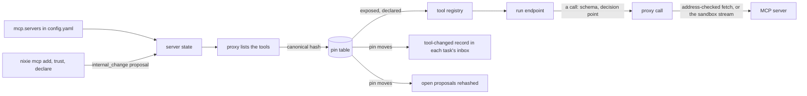

# The MCP proxy build

- **Status:** draft
- **Work items:** [the proxy](https://linear.app/zgeoff/issue/GEO-1842), in 3 stages;
  [a changed tool in a running task](https://linear.app/zgeoff/issue/GEO-1254) and
  [the pinned hash in the action hash](https://linear.app/zgeoff/issue/GEO-1255), each on stage 1
- **Decision records:** [0009](../../decisions/0009-mcp-proxy.md)

You plug an outside MCP server into nixie without trusting it. The deployment configures the server,
you approve it once, and nixie lists its tools. A tool reaches the model only after you declare its
effects, and nixie pins the exact form you reviewed. A changed tool stops until you allow it, and
every call runs under your rules, with its result as outside content.
[The MCP proxy design](../platform/connectors/mcp-proxy.md) holds the rules this build follows: the
pin table, the failed listing, the input requests and the authorization. This design adds the
contracts that build them.

The first server is a hosted MCP server of your own. It serves Streamable HTTP on a private network,
takes no token, and lists only read tools with no annotations. It therefore runs with `auth: none`
and a private range, and each of its declarations starts from the strictest effects. A stand-in
server in the test build covers what the first server lacks: a write tool, a destination, an input
request and a tool that changes.

The build ships in 3 stages, one release or more apart:

1. **HTTP:** the proxy, with `auth: none` and `auth: static`, the pins, the declarations, the
   health, the input requests, the tool-changed record and the pinned hash in the action hash. Stage
   1 also adds the `mcp_server` sandbox kind to the spec schema, which nothing writes until stage 2.
2. **stdio:** a server run as a command in a sandbox of kind `mcp_server`.
3. **OAuth:** `auth: oauth`, once a server the deployment adds needs it.

## Shape



## Contracts

### The config

```yaml
# config.yaml: the mcp section, which the mcp module's schema owns. Every object is strict.
mcp:
  listingTimeoutSeconds: 10 # the default
  servers:
    notes: # the server ID, which prefixes every tool name
      transport:
        url: https://notes.example.internal/mcp # https only, with no user name, query or fragment
        # or, from stage 2: command: [bun, /server/index.js]; files: /srv/mcp/notes
      trusted: false # the default
      auth: { kind: none } # or { kind: static, token: deployment:notes-token, header: Authorization }
      # or, from stage 3: { kind: oauth, clientID: nixie-notes }
      privateRange: 10.42.0.0/16 # needed when the host resolves to a non-public address
```

- A server ID matches `^[a-z][a-z0-9]{1,15}$`, and the config load refuses an ID that equals the
  first segment of a tool nixie registers, such as `memory` or `task`.
- `privateRange` is one CIDR range. The load refuses a range that holds a loopback, link-local or
  unspecified address, except in a test build (`NIXIE_TEST_BUILD`), where the stand-in server
  listens on loopback.
- `auth: static` takes only a `deployment:` reference. The token goes through the credential store's
  deployment backend, with the server's host as its only host. `header` defaults to `Authorization`,
  which sends `Bearer <token>`.
- `transport.files` is a host folder of 64 MiB or less, which the proxy copies into the sandbox at
  `/server`.

### Server state and the commands

```ts
// mcp module. The applied state of each server, which records fold into the mcp_servers projection.
// The config entry is the declared version; the applied version is what the proxy uses.
interface ServerFacts {
  transport: { url: string } | { command: string[]; filesHash: string }; // filesHash: SHA-256 of the folder's files
  trusted: boolean;
  auth: 'none' | 'static' | 'oauth';
  privateRange: string | null;
  issuer: string | null; // oauth only: the authorization server the protected resource metadata named
}

type ServerState =
  | 'configured' // in the config, never added
  | 'proposed' // an add or a widening waits for your approval
  | 'added'
  | 'held' // the config changed wider than the applied facts; the change waits for your approval
  | 'removed';
```

```bash
nixie mcp list                       # each server: state, trusted, health, next try, tool counts by pin state
nixie mcp add notes                  # proposes adding the configured entry; prints the proposal's short ID
nixie mcp remove notes               # applies at once
nixie mcp trust notes                # proposes; nixie mcp untrust notes applies at once
nixie mcp tools notes                # the pin table: each tool, its state, pinned and latest hash, declaration
nixie mcp declare notes.search --file search.yaml  # applies a narrowing at once; proposes a widening
nixie mcp diff notes.search          # the pinned form and the latest form, field by field
```

- Each command that widens creates one `internal_change` proposal of the `mcp` family and prints its
  short ID. You answer it in the client or with `nixie proposals approve <id>`, through the shared
  answer path of the approval record (`docs/design/queue/approval-record.md`).
- These widen: adding a server, trusting it, a first declaration, a declaration that drops an
  effect, a destination, the amount or a content argument, and allowing a changed tool. Removing a
  server, clearing its trust and a declaration that adds an effect narrow, and apply at once with a
  record.
- `add` takes its facts from the config entry alone, and refuses an ID the config lacks.
- At each start the proxy compares each entry with its applied facts:
  - The same facts: the server stays as it is.
  - Narrower facts, such as `trusted` turned off or a smaller range: the proxy applies them at once.
  - Wider or other facts, such as a new host, a wider range, a new files hash, another auth kind or
    `trusted` turned on: the server is `held`, and the start writes one proposal for the new facts.
  - An entry gone from the config: the server is `removed`, and its pins and declarations stay for a
    later add.
- A runtime narrowing, `remove` or `untrust`, records the config facts it overrode as its base. A
  start proposes again only once the entry differs from that base, so `untrust` holds over
  `trusted: true` until the config changes or you run `trust`.

### Pins

```ts
// mcp module
const hash = hashToolForm(form); // → 'sha256:3b9f…'

// The canonical form, serialised as the snapshot form is: sorted keys, no whitespace, NFC strings.
interface ToolForm {
  name: string; // the server's name for the tool, before the prefix
  title: string | null;
  description: string | null;
  inputSchema: JSONObject;
  outputSchema: JSONObject | null;
  annotations: JSONObject | null; // _meta is left out
}

type PinState =
  | 'exposed'
  | 'stopped_changed' // an untrusted server's changed hash, until you allow it
  | 'stopped_unfit' // the declaration names an argument or a result field the latest form lacks
  | 'hidden_new' // no declaration yet
  | 'removed';
```

```text
mcp_tools, a projection, one row per tool a server has listed
  tool            text primary key -- '<serverID>.<name>', such as 'notes.search'
  server_id       text not null
  pinned_hash     text             -- null until a declaration pins the tool
  latest_hash     text not null    -- the hash of the newest listing that held the tool
  state           text not null    -- a PinState; no check, under the migration rule
  declared_seq    integer          -- the declaration in force

mcp_tool_forms, a projection, one row per form a server has listed
  hash            text primary key
  form            text not null    -- the ToolForm as canonical JSON
```

- A first declaration pins the tool's latest hash. Allowing a changed tool, and a trusted server's
  change, move the pin to the latest hash.
- A stopped tool stays on each tool list in its pinned form, and each call returns an error that
  names the tool and the wait, such as "notes.search changed and waits for your review". A hidden or
  removed tool is on no list.
- The fit check runs on every listing. A declaration fits when each argument it names is a property
  of the latest input schema, and each result field it names is a property of the latest output
  schema.
- The model reads a tool as `mcp__nixie__<serverID>_<name>`, after `toSDKToolName`. A tool whose
  model name another tool already holds, or whose model name passes 64 characters, the Messages
  API's limit, stays `hidden_new`, and `nixie mcp tools` shows the reason.

### Effect declarations

```yaml
# search.yaml, for nixie mcp declare notes.search
effects: [read]
destinations: [] # argument names that hold a destination
amount: null # the argument that holds the amount of a spend
content: [query] # free-text arguments
reconcile: null # or { idempotencyKey: requestID }, or { check: notes.find_request }
```

```ts
// mcp module: the record a declaration writes, in place of an EffectOverride (the decision point
// cutover), which covers only nixie's own tools
interface ToolDeclared {
  // kind mcp.tool_declared
  tool: string;
  declaration: Omit<EffectDeclaration, 'results'>; // EffectDeclaration: policy module
  reconcile: { idempotencyKey: string } | { check: string } | null;
  pinnedHash: string; // the hash the declaration pins
  proposalID: string | null; // null for a narrowing, which applies with no proposal
}
```

- The declaration's `results` holds `untrusted` for every field of the tool's output schema, and
  nobody declares it, because every result field is outside content.
- The form pre-fills from the latest form's annotations: `readOnlyHint: true` gives `[read]`, and
  `destructiveHint: false` drops `delete`. With no annotations it starts from
  `[write, delete, send]`. The pre-fill is a starting point, and only the declaration you approve
  counts.
- A tool with no declaration in force is `hidden_new`, and the registry denies a call to it.
- The snapshot's policy part holds each proxied tool's declaration in force and its pinned hash, so
  a replay reads each decision under the declaration it ran under.

### The registry

```ts
// tools module: a second source of tool definitions, which the composition root passes in. The mcp
// module provides it.
interface ToolSource {
  findTool(name: string): RegisteredTool | null; // reads the pin table at each call
  // Lists each server that the names reach, before the run's first step lists its tools; the endpoint
  // start awaits it. A failed listing never rejects.
  prepareRun(tools: readonly string[]): Promise<void>;
}

declare function buildToolRegistry(
  definitions: readonly ToolDefinition[],
  sources: readonly ToolSource[], // …existing parameter first; nixie's own tools win a name
): ToolRegistry;
```

```ts
// mcp module: the definition of an exposed or stopped proxied tool, built from its pinned form
const definition: ToolDefinition = {
  name: 'notes.search',
  description: pinnedForm.description ?? '',
  input: pinnedForm.inputSchema,
  output: pinnedForm.outputSchema ?? { type: 'object', properties: { text: { type: 'string' } } },
  declaration, // from mcp.tool_declared, with results set to untrusted
  execution: 'direct', // 'queued' when the effects hold write, delete, send, spend or device
  run: callServerTool,
};
```

- A tool's `RegisteredTool` changes when its pin moves, and every later call parses its input and
  its result with the new pinned schemas.
- A tool whose pinned form has no output schema returns `{ text }`, the text blocks of the result
  joined by a blank line. Image blocks go back as the result's images, under the turn's image caps.
  Every other block kind is dropped, and `text` ends with a line that counts them.
- An output schema that is not an object makes the tool `hidden_new`, because the registry needs an
  object result.

### Calls and input requests

```ts
// mcp module: the result of a call that the server answered with an input request
// → { status: 'input_requested', request: 'r7k2m9x4qa' } // a typed result in nixie's own text

// The record of the request, on the calling task's thread
interface InputRequested {
  // kind mcp.input_requested
  requestID: string; // crypto.randomUUID()
  shortID: string;
  callSequence: number; // the tool_called record
  tool: string;
  expiresAt: string; // 15 minutes after the request, until the input-request spike sets the window
  // erasable: { message, requestedSchema }, which are outside content
}

// libs/contract: a checked action
await client.mcp.answerInput({
  clientActionID,
  request: 'r7k2m9x4qa',
  answer: { action: 'accept', content },
});
// → ok, or EXPIRED, or ANSWERED
// The retry's outcome lands in the task's inbox as mcp.input_outcome, which wakes the task.
```

- The proxy sends every HTTP request through the credential store's fetcher, which checks the
  address on every hop. With `auth: none`, the fetcher runs with no credential.
- The proxy sends no `Origin` header, and no cookie.
- The client runs in `auto` protocol mode, with `inputRequired: { autoFulfill: false }` and no
  sampling, roots or logging capability, and its own output check off.
- An `isError` result returns as a tool error with its text, whose source is `untrusted`.
- An answer retries the call once, with the same arguments and your answer, as a step of the proxy.
  The retry passes the decision point again, under the call's original tool list.
- A request past `expiresAt` refuses its answer as `EXPIRED`, and the inbox gets an
  `mcp.input_outcome` that says so.

### Health

```ts
// mcp module: one state per server, in memory, shared by every task run
interface ServerHealth {
  failures: number; // failed listings in a row
  nextTryAt: Date | null; // set while failures > 0; the backoff from libs/retry, 1 min to 1 h
  isUnhealthy: boolean; // failures >= 3
  lastError:
    | 'refused'
    | 'error'
    | 'unparsable'
    | 'timeout'
    | 'unauthorised'
    | 'start_failed'
    | null;
}

// mcp.health_changed { serverID, isUnhealthy, lastError, nextTryAt }: one record each way, which
// the client's server list reads as its notice
```

- A call's error while the latest listing failed reads "notes is unreachable, next try 14:05", with
  the time in the zone the time tool answers in.
- A start resets every server's health. The first listing after a start counts as any other.

### A changed tool in a running task

```ts
// mcp module: an inbox record kind, one per task per tool, in the transaction that moves the pin or
// removes the tool
interface ToolChanged {
  // kind mcp.tool_changed
  tool: string;
  fromHash: string;
  toHash: string | null; // null when the server dropped the tool
  cause: 'trusted' | 'allowed' | 'removed';
}
```

- The proxy writes the record to every task that is ready, running, waiting, paused or stopped and
  whose tool list holds the tool. A done, failed or closed task gets none.
- The record never wakes a task. It is a fourth exception to the wake rule of
  [the inbox](../../architecture/core/tasks.md#the-inbox), because a change matters only once the
  task runs a step. The next step reads it as any other inbox record.
- The turn renders it as a system message of nixie's own text: the tool, the first 12 digits of each
  hash, and that the tool list holds the new form, or that the tool is gone.
- A worker has no inbox, so it keeps its starting form, and its calls meet the checks of the current
  pin.

### The pinned hash in the action hash

```ts
// policy module: the canonical operation of a proxied tool's action proposal adds the pin
const operation = {
  kind: 'action',
  tool: 'notes.add_entry',
  input,
  destinations,
  pin: 'sha256:3b9f…',
};

// A record kind of its own, which the proposals projection folds into the row's actionHash
interface ActionRehashed {
  // kind policy.action_rehashed
  proposalID: string;
  actionHash: string;
  pin: string;
}
```

- The transaction that moves a pin writes one `policy.action_rehashed` for each pending or deferred
  proposal of the tool, and a deferred one returns to pending.
- The action kind's `currentHashes` reads the pin through a reader the composition root passes in,
  so an answer from a card that showed the old form refuses as `CONFLICT`.
- An approved action that has not run yet meets the moved pin at the check before its attempt, which
  [actions under policy](https://linear.app/zgeoff/issue/GEO-1810) builds, and returns to pending
  with the new hash.

### The stdio sandbox

```ts
// sandbox module: a kind that stage 1 adds to the spec schema and stage 2 writes
// | kind        | Egress | Model credential | Other grants | Tool route |
// | mcp_server  | None   | No               | No           | No         |
export const sandboxSizes = {
  // …existing rows
  mcpServer: { vcpus: 1, memoryMiB: 256, diskMiB: 4096 }, // from the probe on the code image
} as const satisfies Readonly<Record<string, SandboxLimits>>;
```

```ts
// libs/wire: the frames between the proxy and the bridge guest
type BridgeFrame =
  | { type: 'message'; json: string } // one JSON-RPC message, either way
  | { type: 'exited'; code: number | null }; // from the bridge, when the server's process ends
```

- One sandbox per added stdio server, created at its first listing and kept until a stop or a
  remove, with the server ID as its owner. A start destroys every sandbox of kind `mcp_server` and
  creates it again at the next listing.
- The sandbox runs the code image, which the code tool design (`docs/design/queue/code-tool.md`)
  adds, at the `mcpServer` row. The proxy copies the bridge guest and the entry's files in, then
  spawns the bridge, which runs the command and turns newline-delimited JSON-RPC into frames,
  because a spawn stream carries framed messages.
- The proxy caps each frame at 4 MiB. A frame past the cap stops the server, and the listing or the
  call fails as `unparsable`.
- An imp that fails to start fails its listing as `start_failed`.

### OAuth

```ts
// connections module, stage 3: an MCP server's grant is a connection of connector 'mcp:<serverID>'
const spec: OAuthSpec = {
  kind: 'oauth',
  authorizeURL, // from the authorization server metadata of the issuer in the applied facts
  tokenURL,
  revokeURL, // when the metadata names one
  identityScopes: [],
  scopes, // from the protected resource metadata's scopes_supported
  authorizeParams: { resource: 'https://notes.example.internal/mcp' }, // the server's canonical URI
  hosts: ['notes.example.internal'],
  returnPath: '/connections/mcp/notes/return',
};
```

- The client is the public client named by `clientID`, which you register at the server's
  authorization server. nixie uses PKCE with S256, never dynamic client registration and never a
  client metadata document.
- Every token request and every refresh sends `resource` with the server's canonical URI.
- The proxy discovers the issuer from the server's protected resource metadata once, when you add
  the server, and pins it in the applied facts. A listing that names another issuer marks the server
  unhealthy with `unauthorised`.

## Constraints

### Listings and calls

- The proxy lists a server when it is added or allowed, when the server reports a changed list, when
  a run endpoint starts with one of its tools, and on the backoff while its latest listing failed.
- A listing of a `held`, `proposed` or `removed` server never runs. A call to a tool of a `held`
  server returns an error that names the wait for your approval, and the tool stays listed in its
  pinned form.
- A call reaches the server only when the latest listing passed and left the tool `exposed`.
- The input check and the result check read the current pin, never the run's starting form.
- The proxy never sends a server a token issued for another resource.

### Records and tables

- Every `mcp.*` record, except `mcp.tool_changed`, `mcp.input_requested` and `mcp.input_outcome`,
  belongs to no task thread.
- The proxy writes `mcp.tool_listed { serverID, tool, hash, form }` only for a hash that
  `mcp_tool_forms` lacks, and `mcp.pin_moved { tool, fromHash, toHash, cause }` for each move. A
  listing that changes nothing writes nothing.
- A pin move, its `mcp.tool_changed` records and its `policy.action_rehashed` records commit in one
  transaction.
- `mcp_servers`, `mcp_tools` and `mcp_tool_forms` arrive in one appended migration that only adds
  tables.

### The stand-in server

- The mcp module's test utilities export a stand-in Streamable HTTP server on loopback with a read
  tool, a write tool that names a destination, and a tool that answers with an input request.
- A test changes a tool's form, fails the next listing, or drops a tool between 2 listings.
- Only a test build loads a config that pairs a host with a loopback range.

### The port rules

- No port: the proxy has one real provider. The mcp module holds the HTTP transport and, from stage
  2, the stdio transport, which reaches the server only through the sandbox interface.
- The MCP client package is a protocol library, and no import zone holds it, because the tools
  module and the server already import it.
- The bridge guest runs in the image of its own release, so its table of release pairs has one row:
  the same release ([port rule 12](https://linear.app/zgeoff/issue/GEO-2581)).
- The stand-in server lives with the mcp module's test utilities, and the composition root never
  builds it.

### Rollback

| Added                                            | The release before                                                                                                      |
| ------------------------------------------------ | ----------------------------------------------------------------------------------------------------------------------- |
| The `mcp` config section                         | Refuses to start, because the schema is strict. Remove the section from `config.yaml` before the rollback               |
| The migration of the 3 tables                    | Never reads them. The migration only adds tables, so the oldest reader does not change                                  |
| `mcp.*` records off a task thread                | Skips them, because no projection of that release folds them                                                            |
| `mcp.tool_changed` and `mcp.input_*` on a thread | Skips them: they are not inbox kinds there, so no step reads them and none wakes a task                                 |
| `policy.action_rehashed`                         | Skips it. A proxied tool's proposal finds no tool in that registry, so an approved action fails at its attempt          |
| A proxied tool on a started task's tool list     | Keeps the list, and refuses each call as a tool it does not have                                                        |
| The `mcp_server` kind, at stage 1                | Never meets it, because stage 1 writes none                                                                             |
| A `sandbox.created` of kind `mcp_server`         | Is stage 1, which reads it and destroys the sandbox at start                                                            |
| `transport.command` and `auth: oauth` in config  | Refuses to start. Remove the entry, or change it, before the rollback                                                   |
| A connection of an `mcp:` connector, at stage 3  | Is stage 2. Stage 1 makes the connections list and the refresh sweep skip such a connection, so stage 2 leaves it alone |

## Decisions

- **The config holds each server's facts, and records hold the facts in use.** An agent's call on 13
  Nov 2026: nixie reads the config only at start, so the commands write records, and a start holds a
  widening for one approval as a seed holds a rule.
- **Every widening is one `internal_change` proposal.** An agent's call on 13 Nov 2026: the
  side-by-side card and "asks once" then use the shared answer path, and a host command needs no
  answer path of its own.
- **`add` takes its facts from the config alone.** An agent's call on 13 Nov 2026: a host command
  that took a URL would add a server the deployment never configured.
- **A stopped or held tool stays listed in its pinned form.** An agent's call on 13 Nov 2026: it
  follows the failed listing's rule, since a tool that vanishes reads to the model as a missing
  capability, and the tool list keeps its cache.
- **A tool-changed record never wakes a task.** An agent's call on 13 Nov 2026: a waiting task has
  no step that a changed tool affects, and a wake would spend a turn on it.
- **A proxied declaration has its own record, apart from the effect overrides.** An agent's call on
  13 Nov 2026: an override changes a declaration in code, and a proxied tool has none.
- **The stdio server runs on the code image behind a bridge guest.** An agent's call on 13 Nov 2026:
  the code image already holds Bun and Python, a spawn stream carries frames, and the sandbox has no
  egress to fetch a package.
- **OAuth ships as stage 3.** An agent's call on 13 Nov 2026: the first server takes no token, and
  the smaller build ships first.
- **An input request waits 15 minutes.** The interim until
  [the input-request spike](https://linear.app/zgeoff/issue/GEO-269) measures how long a server
  keeps one.

## Builder decides

- The internal names, the projections' index columns and the order of their folds.
- How the endpoint awaits `prepareRun` within its start, and the test that shows it.
- The wording of each error, each notice and the change note.
- The layout of `nixie mcp` output, beyond the fields above.
- The `mcpServer` row's figure, from the probe on the code image.

## Out of scope

- The atc runner, which talks to atc over its own contract, in
  [the coding session runner](https://linear.app/zgeoff/issue/GEO-1843).
- Sampling, roots and logging from a server.
- A declaration in the definitions repo for a proxied tool.
- A server reached through a sandbox's own egress.

## Open questions

The owner settles 2 questions, kept in [the work item](https://linear.app/zgeoff/issue/GEO-1842):
the form of a proxied tool's name, and the risk class of adding and trusting a server. Until then, a
name is `<serverID>.<name>`, and adding or trusting a server is `always_ask` while a declaration and
a changed tool are routine.
