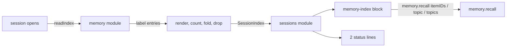

# The memory index at a session's opening

- **Status:** draft
- **Work items:** [the memory index block](https://linear.app/zgeoff/issue/GEO-2364) builds it, on
  by default, and sets the similarity push's limits to 0 by default.

Each session opens with a `memory-index` block that shows every active item that is not pinned, by
subject and then by topic: one row per topic, with its count and its items' gists. The agent sees
where to look, and reads an item in full with `memory.recall` only when it wants the item. A big
topic folds to its newest items and its sub-topics, so the block still fits at 1,000 items. The
memory module renders the block within a token budget, and the sessions module places it through its
`ConversationMemory` port.

Terms of this doc, beside the [glossary](../../glossary.md) and [the labels](memory-labels.md):

- **topic row:** one topic in the block: its name, its count and its items, each as
  `[shortID] gist`.
- **folded topic:** a topic whose row shows only its newest items and its sub-topics.
- **sub-topic:** the part of a topic after its first `/`, such as `friends` in `people/friends`.
- **active item:** an item that is neither retired nor forgotten.

The store's built in-memory item index (`MemoryIndex`) is a search structure, not this block. The
label entries that [the labels design](memory-labels.md#where-label-text-lives) adds to it are what
the block reads.

## Shape



## Contracts

```ts
const index = await memory.readIndex();
// → { text: '<the block below>', items: 103, tokens: 2_870, budget: 3_000 }
```

```ts
// sessions module: the built port of the same name (not the server's tool-wiring type). The memory store implements it.
interface ConversationMemory {
  // …existing methods
  readonly readIndex: () => Promise<SessionIndex>;
}

interface SessionIndex {
  text: string; // the block's text; '' when the block is omitted
  items: number; // the active items that are not pinned, for the first status line
  tokens: number; // the block's counted tokens, for the second status line
  budget: number; // index_tokens
}
```

```text
<the opening line>
About Robin:
  home (3)           [b7kq2m9xza] spare bike pump behind the shed door · [c2hd81mmqa] piano tuned
                     each March · [d9pp20xkcw] recycling out Thursday night
  people (180)       folded · newest: [m8lw1qa2zk] sister in Lisbon · [m2aa5pq7tt] partner's
                     shift work · [p4ty7cv1mb] neighbour feeds the cat
                     · sub-topics: family 24, friends 61, colleagues 70, neighbours 25
Between you and Robin:
  running jokes (1)  [k1n0zz8w2p] "the lasagne incident"
and 12 more topics with 85 items: list them with memory.recall topics
```

```yaml
# deployment config, memory module. memoryConfigSchema stays a strict object.
memory:
  index_tokens: 3000 # the block's token budget: 0 omits the block, otherwise at least 3000
  index_open_topic_items: 25 # a topic with more items folds
  index_item_order: newest-first # the one value
  index_topic_page: 200 # the most lines one memory.recall with `topic` returns; the recall design reads it
```

## Constraints

### Where the block sits

- Every session opening, the conversation's and a task's, holds `pinned-memory`, `memory-index`,
  `status`, `summary` and `recent-turns`, in that order: the built order of `readSessionOpening`
  with the index after the pinned core. nixie omits an empty block.
- A task with `memory: none` gets no memory block, and the sessions module calls no `readIndex` for
  it.
- The blocks of a later turn keep their built order.
- The `status` block gets 2 lines: the count of active items that are not pinned, and the index's
  tokens against its budget. Both come from the one `readIndex` call of that opening, so they match
  the block. The opening record stores the 2 numbers, as it stores every status value, and no item.
- nixie sends the opening blocks to the model of the turn and to no other provider.
- No rollback crosses the migration that drops the sensitive flag's column. The way back across it
  is a restore from a backup taken directly before that deploy.

### What the block lists

- The block lists every active item that is not pinned, grouped by subject in the order `owner`,
  `shared`, `self`, then by topic. A topic belongs to one subject, so `home` under `owner` and
  `home` under `shared` are 2 topics.
- With no such item, `readIndex` returns `text: ''`.
- Each topic is one row: its name, its count, then each item as `[shortID] gist`, joined by `·`. A
  row wraps under its own indent.
- The items of a topic follow `index_item_order`: newest first.
- A topic with more than `index_open_topic_items` items folds. Its row shows its count, its 3 newest
  items, and each sub-topic with its count. A topic with no sub-topic shows its newest items alone.
- Two topics that differ only by case are one, spelled as its newest item spells it.
- The opening line tells the agent what the index is, that `memory.recall` with `itemIDs` reads an
  item, and that `memory.recall` with `topic` opens a folded topic or a sub-topic, such as
  `people/friends`.
- The closing line reads
  `and {topics} more topics with {items} items: list them with memory.recall topics`.

### The budget

- The memory module counts every line of the block: the opening line, the headings, the topic rows
  and the closing line.
- While the count is over `index_tokens`, the renderer folds the open topic with the most items.
- When every topic is folded and the count is still over, the renderer drops topics into the closing
  line, the one with the fewest items first, until the count fits.
- The index budget is separate from `pinned_core_tokens`.
- The config schema refuses an `index_tokens` from 1 to 2,999, so the block always fits its opening
  and closing lines.
- When `index_tokens` is 0, `readIndex` returns `text: ''`, and the opening has no `memory-index`
  block and neither index status line.

### When it renders

- nixie renders the block once, when the session opens. A label edit or an item that lands later
  shows in the next session's block.
- `readIndex` reads the in-memory label entries and the item projection (subject, pin, state, short
  ID) in one read under the store lock, and decrypts nothing.
- nixie writes no record of what the block showed, for the conversation or a task, and writes no
  recall record for it. Trigger push skips only an item whose text a recall record lists, so it can
  place an item whose gist the block showed.

## Decisions

- **One row per topic, with its gists inline.** The owner chose this layout over a line per item and
  over counts alone, so the block stays readable at 1,000 items.
- **No record of what the index showed.** Its one reader would have been a measurement.
- **The memory module renders and counts, and the sessions module places.** The sessions module
  reaches memory only through its port.

## Builder decides

- The wording of the opening line and of the 2 status lines, within the rules above.
- What "newest" measures, and the order of topics inside a subject.
- The internal names of the renderer and its helpers.
- Test layout.

## Out of scope

- A note in a later turn for items that land during a session. Until the next session, such an item
  reaches a turn only by recall or trigger push.
- A count of recalls per item, and an order such as most-recalled first.
- A filter that hides some items. nixie has no sensitive flag once
  [the flag's removal](https://linear.app/zgeoff/issue/GEO-2363) lands.
- A split or merge of a big topic. A topic past `index_topic_page` takes one more call per page.
- A measurement of the index before release.

## Open questions

None.
