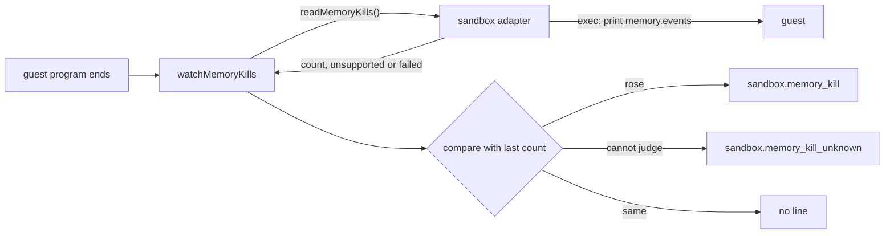

# The memory-kill signal

- **Status:** draft
- **Work items:** [the read of memory kills](https://linear.app/zgeoff/issue/GEO-2580),
  [the watcher](https://linear.app/zgeoff/issue/GEO-2526),
  [the day's check of the sizes](https://linear.app/zgeoff/issue/GEO-2583)

When a guest uses more memory than its sandbox's size, the guest's kernel kills one of its
processes, and nixie sees only a failed turn, step or fetch. A wrapper around the sandbox adapter
reads each guest's count of memory kills after each guest program ends, and writes a log line when
the count rose. A guest program is a program nixie starts in a guest: the guest turn, the sandbox
check, the guest purge, the guest summary or the fetcher. A day of nixie's log with no such line is
the acceptance of [the sandbox sizes](sandbox-sizes.md).

## Shape



## Contracts

```ts
// In the server's `sandbox_adapter` part, once, around whichever adapter the part built: the
// server's own createSandboxAdapter, or the one passed in as the `createSandboxAdapter` option.
const adapter = watchMemoryKills(built, { log });
// → logs {"event":"sandbox.memory_watch"}

// After a turn whose guest lost a process to the kernel:
// {"event":"sandbox.memory_kill","ended":"turn","kind":"conversation","memoryMiB":512,
//  "sandboxID":"sbx_41c","kills":1}
```

```ts
// sandbox module. The returned adapter has the id and the boundary of the adapter it wraps.
export declare function watchMemoryKills(
  adapter: SandboxAdapter,
  options: { readonly log: Logger; readonly readTimeoutMs?: number }, // default 2000
): SandboxAdapter;

// sandbox module types.
export interface Sandbox {
  // …existing fields
  readonly readMemoryKills: (signal?: AbortSignal) => Promise<MemoryKillRead>; // never rejects
}

export type MemoryKillRead =
  | { readonly kind: 'count'; readonly kills: number } // kills since boot; never falls while booted
  | { readonly kind: 'unsupported' } // the adapter, or the guest at its size, holds no count
  | { readonly kind: 'failed' }; // the sandbox is gone, the runtime refused, or the read timed out

// sandbox module test utils. Writes one whole number to the guest file /.memory-kills of a test
// sandbox. A stub guest can write the same file before it exits.
export declare function writeMemoryKills(sandbox: Sandbox, kills: number): Promise<void>;

// imp adapter test utils: the fake runtime (startFakeImp, built) gives the adapter's read its result from
// this field, and never runs the read's command on the test's host.
interface FakeImpMemory {
  memoryKills: number | 'missing' | 'lost'; // 'missing' → unsupported, 'lost' → failed
}
```

```ts
// The 3 log lines. Each is JSON with an `event` field, as every nixie log line is.
// level info. Once, when the server applies the watcher.
interface MemoryWatchLine {
  event: 'sandbox.memory_watch';
}

// level error. When the count rose.
interface MemoryKillLine {
  event: 'sandbox.memory_kill';
  ended: MemoryKillEnded;
  kind: SandboxKind; // from the sandbox's spec
  memoryMiB: number; // from the sandbox's spec; with `kind`, it identifies the size row
  sandboxID: string;
  kills: number; // the guest's count
}

// level warn. When nixie cannot judge the end.
interface MemoryKillUnknownLine {
  event: 'sandbox.memory_kill_unknown';
  ended: MemoryKillEnded;
  kind: SandboxKind;
  memoryMiB: number;
  sandboxID: string;
  reason: 'unsupported' | 'read_failed' | 'no_baseline' | 'counter_reset';
}

// From the sandbox's kind: conversation → turn, fetch → fetch, every other kind → step.
// A summary or a purge on the conversation's sandbox therefore shows as turn.
type MemoryKillEnded = 'turn' | 'step' | 'fetch';
```

## Constraints

The read:

- The imp adapter runs one command in the guest, through its own exec, that prints the guest's
  `memory.events` file. An `oom_kill <n>` line gives a count of n. A missing file or line gives
  `unsupported`. A rejected exec gives `failed`.
- The path and the parser live in the imp adapter. `ImpPort` gains no method.
- A read of a sleeping imp wakes it, as any exec does.
- The test sandbox reads `/.memory-kills`. With no such file, the count is 0.
- Any other adapter returns `unsupported` or reads its own count.

The watcher:

- Code that calls the adapter calls the same methods with or without the watcher.
- The watcher keeps, in memory, the last count for each sandbox ID. A sandbox the watcher created
  starts at 0.
- After nixie restarts, the watcher reads each sandbox it did not create once, before that sandbox's
  first `spawn`. A count above 0 there gives a `no_baseline` line whose `ended` comes from the
  sandbox's kind, as on every line.
- The watcher starts a read when a `spawn`ed guest program ends, for any cause. It never reads after
  an `exec`. Code that starts a guest program through `exec` makes its own read.
- The watcher never changes `exit` or `stop()`. Both settle with the adapter's own values.
- A read that passes `readTimeoutMs` counts as `failed`. A failed read never changes an exit.
- The watcher keys the pending read by sandbox ID, because `read` and `list` hand out a new object
  for the same sandbox. The wrapped `destroy`, the wrapped `suspension.sleep` and the next `spawn`
  on that ID wait for it.
- A fetch's reply never waits for the read. The read runs in the background, ahead of the fetch's
  background destroy.
- The watcher compares and stores the count in one synchronous step. When 2 guest programs end
  together on one sandbox, one kill gives one line.
- The watcher writes at most one line for one end of a guest program.
- The watcher never reads the exit's code or signal. A stop's `SIGKILL` looks like a memory kill,
  and a watched process can exit 0 after its child was killed.
- The watcher does nothing when an imp wakes.

The lines:

- nixie writes exactly one `sandbox.memory_kill` line for a count that rose, even when the turn, the
  step or the fetch succeeded.
- nixie writes no line when the count is the same: a requested stop, a program's own exit, a model
  API failure, a time limit or a lost connection.
- An end that nixie cannot judge never counts as an end with no kill.
- The lines are log lines only. nixie writes no event-log record for a memory kill, so a rollback
  needs no step.
- A line never holds a task ID, a step key, guest output, a URL, a message or a prompt.
- Each case gives this line:

  | Case                                                      | Line                        |
  | --------------------------------------------------------- | --------------------------- |
  | a kill between 2 guest programs, or during a file copy    | the next program's line     |
  | the whole guest stops, such as an imp crash               | unknown, `read_failed`      |
  | the guest booted again between 2 reads, so the count fell | unknown, `counter_reset`    |
  | the count climbed back to exactly the last count          | no line                     |
  | nixie stopped between the end and the read                | unknown, `no_baseline`      |
  | a sandbox with a kill under an earlier nixie process      | 1 `no_baseline` per restart |
  | an adapter that returns `unsupported`                     | unknown, on each end        |

## Decisions

- **A wrapper around the adapter reads the count and writes log lines.** No caller changes, and a
  killed guest cannot always report.

## Builder decides

- The names `FakeImpMemory`, `MemoryWatchLine`, `MemoryKillLine` and `MemoryKillUnknownLine`, and
  the return types the sketches leave loose, matched to the built code.
- The names of the watcher's internal helpers and maps.
- How `readTimeoutMs` is enforced, such as an abort signal.
- Test names and layout.

## Out of scope

- An event-log record kind, a migration, a tool or a config key for the signal.
- A check of the count in each piece of code that starts a guest program.
- A sandbox runtime whose sleep resets the count.
- The read of the sandbox runtime's log on the host.

## Open questions

- **Does a sleeping sandbox keep its count?** A spike settles it: the test-imp test of the read
  sleeps and wakes a sandbox and prints the count before and after. Until then, the watcher is built
  as above. When the count is 0 after a wake, the watcher is not built, and the day's check reads
  the runtime's log on the host.
- **Is `kills` the guest's count or the rise since the last read?** The owner settles it. Until
  then, it is the count.
- **How often does an `unsupported` adapter log?** The owner settles it: once per end, once per
  sandbox, or once when the watcher is applied. Until then, once per end.
