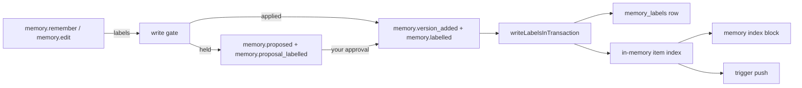

# The labels and the revision of a memory item

- **Status:** draft
- **Work items:** [the labels and the revision](https://linear.app/zgeoff/issue/GEO-2549) builds
  this design. [The memory index block](https://linear.app/zgeoff/issue/GEO-2364) reads the gist and
  the topic, and [trigger push](https://linear.app/zgeoff/issue/GEO-2555) reads the trigger phrases.

Every memory item gets 3 labels that the agent writes: a gist, a topic and up to 5 trigger phrases.
The memory index lists an item by its gist under its topic, and trigger push brings an item to a
turn when your message matches one of its phrases. A label edit moves a new number, the revision, so
a caller that read the item before the edit gets a stale error, while the text version stays put, so
nixie never sends the same text twice.

Terms of this doc, beside the [glossary](../../glossary.md):

- **label-only edit:** a `memory.edit` call that passes no `text`.
- **text version:** the built `version` column of `memory_items`. A `memory.version_added` record
  adds 1 to it.
- **revision:** the text version plus the count of approved label-only edits. Every memory tool
  shows it as `version`.
- **seal:** encrypt under the item's own key. A forget deletes that key.

## Shape



## Contracts

### The labels in the write tools

```ts
memory.remember({
  text: 'The piano is tuned each March by the same tuner.',
  gist: 'piano tuned each March by the same tuner',
  topic: 'home',
  triggers: ['piano', 'out of tune', 'book the tuner'],
  quote: 'the piano tuner comes every March, same one as always',
  eventID: '#5310',
});
// → { status: 'applied', itemID: 'c2hd81mmqa', version: 1 }

memory.edit({ itemID: 'c2hd81mmqa', version: 1, topic: 'home/music', triggers: [] });
// → { status: 'proposed', itemID: 'c2hd81mmqa', version: 1, proposalID: '…', reason: 'labels', merged: false }
// The approval moves the revision to 2. The text version stays 1.
```

```ts
// memory module
interface Labels {
  gist: string; // 1 to 80 characters, one line
  topic: string; // 1 to 40 characters, one line, such as 'home' or 'work/standups'
  triggers: string[]; // 0 to 5 phrases, each 1 to 60 characters, one line
}

interface RememberInput {
  // …existing fields: text, quote, eventID, image, subject, until
  gist: string; // required, for every subject
  topic: string; // required, for every subject
  triggers?: string[]; // omitted: no trigger phrase
}

interface EditInput {
  itemID: string;
  version: number; // the revision the caller read
  text?: string; // was required; omitted makes a label-only edit
  gist?: string;
  topic?: string;
  triggers?: string[]; // replaces the whole list; [] clears it
  // …existing fields quote, eventID, until, subject: only beside `text`
}
// The write output is the built memoryWriteOutput. Its `version` is the revision.
```

```ts
// memory.pending: each proposal with a proposal label record also shows
interface PendingProposalLabels {
  gist: string;
  topic: string;
  triggers: string[];
  isLabelOnly: boolean; // true: the proposal shows no text of its own
}
// memory.recall shows gist, topic and triggers on each item: the recall design owns it.
```

### The records

```ts
// memory module. kind 'memory.labelled'. Its schema accepts an extra key, so a later field never breaks an older reader.
interface MemoryLabelled {
  itemID: string;
  revision: number; // the item's revision once this record lands
  version: number; // the text version in force; this record never moves it
  change: 'written' | 'edited' | 'backfilled';
  sealed: string; // Labels under the item's key, named `labels/<itemID>/<revision>`
  origin: MemoryOrigin | 'migration'; // MemoryOrigin: memory module, built. 'migration': backfilled only
  source: 'owner' | 'owner_data' | 'untrusted';
  taskID: string | null;
  proposalID: string | null;
  model: string | null;
}

// kind 'memory.proposal_labelled', in the commit of its memory.proposed record
interface MemoryProposalLabelled {
  proposalID: string;
  itemID: string;
  sealed: string; // the whole Labels the approval applies, named `proposal-labels/<proposalID>`
  targetRevision: number | null; // the revision the caller read; null for a proposal that creates the item
  isLabelOnly: boolean;
}
```

### The projections and the revision

```text
memory_items.label_edits        integer, default 0; a memory.labelled with change 'edited' adds 1
memory_proposals.sealed_labels  text, null without a proposal label record
memory_proposals.target_revision integer, null
memory_proposals.is_label_only  integer 0 or 1, default 0
memory_labels                   one row per memory.labelled: item_id, revision, version, change,
                                sealed, origin, source, task_id, proposal_id, model, sequence,
                                recorded_at; the row with the highest sequence holds the item's labels
```

```ts
// memory module: the 2 built stale checks, requireItem and the one in writePin, change alike.
await requireItem(db, { target: { itemID, version: 4 }, operation: 'retire', states: ['active'] });
// → the item's row, or throws StaleVersionError(target, revision) when 4 is not
//   row.version + row.label_edits. The error names the revision, never the text version.
// The revision is computed on each read and never stored. Every step after the check reads
// row.version, the text version.
```

## Constraints

### The labels

- Every item has a gist and a topic, whatever its subject. Trigger push never places an item with no
  trigger phrase.
- The agent reuses a topic that exists when one fits, and creates one without asking when none fits.
  The descriptions of `memory.remember` and `memory.edit` say so, and say that a broad trigger
  phrase such as `home` matches almost every turn.
- Two topics that differ only by case are one topic.
- A label-only edit that passes `quote`, `eventID`, `until` or `subject` is refused, and so is an
  edit that passes none of `text`, `gist`, `topic` and `triggers`. A `memory.remember` without
  `gist` or `topic` is refused.
- In `memory.edit`, a label the call omits keeps its value. The tool merges the call's labels with
  the item's current ones before the gate, so every proposal and record holds a whole label set.
- The write gate holds every label-only edit as a proposal with the reason `labels`, from the
  conversation and from a task. The gate's checks on labels are
  [their own item](https://linear.app/zgeoff/issue/GEO-2557).
- A change of an item's subject writes no label record, and the item keeps its labels.

### Where label text lives

- On disk, label text exists only sealed: in the 2 label records, in `memory_labels.sealed` and in
  `memory_proposals.sealed_labels`.
- A topic has no ID and no hash in any record, so a forget leaves nothing that leads from the item
  to its topic.
- The store's in-memory item index holds each item's unsealed gist, topic and trigger phrases, and
  rebuilds them at each start. A forget removes the item's entries and deletes its key, so every
  sealed label of the item becomes unreadable.
- nixie creates an item's ID and key when it writes the proposal that creates it, and seals that
  proposal's labels under that key.

### The writes

| Call                                          | Records, in one transaction                                                       |
| --------------------------------------------- | --------------------------------------------------------------------------------- |
| `memory.remember` or a text edit that applies | `memory.version_added`, and `memory.labelled` (`written`) when it carries a label |
| `memory.remember` or a text edit that waits   | `memory.proposed`, and `memory.proposal_labelled` when it carries a label         |
| a label-only `memory.edit`                    | `memory.proposed` and `memory.proposal_labelled`                                  |
| your approval of a labelled text proposal     | the version and `memory.labelled` (`written`) with exactly the labels shown       |
| your approval of a label-only proposal        | `memory.labelled` (`edited`) alone                                                |

- `memory.labelled` always holds the whole label set. One function, `writeLabelsInTransaction`,
  writes it for every path and updates the in-memory entries.
- A waiting proposal writes nothing to its item. A rejected or lapsed labelled proposal writes the
  built rejection or lapse record.
- `buildProposalHash` adds the labels, `targetRevision` and `isLabelOnly` only for a proposal that
  has a proposal label record.
- `readMatchingProposal` matches a labelled proposal only when the built fields match and the 2
  whole label sets are equal. A second label-only proposal with the same labels merges into the
  pending one. One with other labels waits beside it, and once you approve one, the other's approval
  is stale.

### The revision

- The tools keep the field name `version` for the revision, so the published contract and every
  caller keep their shape.
- A text edit and an approved label-only edit each move the revision by 1. nixie never writes a text
  version for a label edit.
- Every number a tool, the API, the memory view or the web client's mocks show as `version` is the
  revision: the recall and pending outputs, the `vN` of `renderMemoryLine`, the stale error, the
  inputs of `memory.edit`, `retire`, `pin` and `unpin`, the forget and lapse targets of the API, and
  the next number a change or notice procedure returns.
- Every record and projection column that names an item version holds the text version:
  `memory.recalled`, the turn-ended item refs, the export, the pin, unpin and forget records, a
  proposal's `targetVersion`, the proposal hash and the duplicate check. Only `memory.labelled` and
  `memory.proposal_labelled` hold a revision beside it.
- An edit proposal shows `targetRevision` as its `version`. A proposal with no proposal label record
  shows `targetVersion` plus the item's `label_edits`.
- An approval is stale when `targetRevision` differs from the revision, or, with no proposal label
  record, when `targetVersion` differs from the text version. A proposal that creates an item has no
  stale check. A stale approval writes nothing, and the proposal waits until you reject it or it
  lapses.
- After a label-only edit, `memory.retire` passes the read check for a text recalled before the
  edit, and `memory.pin`, `memory.unpin` and a forget succeed with the revision a recall shows. A
  session that holds the text gets no second copy, and a pinned item gets no change note.
- History entries keep the text version: `versions[].version` in the memory view and the `vN` of a
  history line.
- `undo` takes the revision as its target.
- A session that holds the number from before a label edit gets the stale error once, and reads the
  revision from it.
- A moment's version is not an item number, and these rules leave it as built.

### The stored items and the release before

- At each start, an insert-only data step labels each active or retired item that has no label
  record, with the source of its current version: the first 80 characters of its text as the gist,
  its subject as the topic, no trigger phrase, in one `memory.labelled` with change `backfilled` and
  origin `migration`. It writes no marker, so it labels an item that a kill left unlabelled or that
  a rollback release created.
- The migration adds only columns with defaults and one table, so the release before reads the
  schema and inserts rows with `label_edits` 0.
- A label-only proposal's `memory.proposed` holds operation `remember`, the text version and a copy
  of the text, so the release before parses it. The hash and the duplicate check treat that text as
  they treat any proposal's.
- A proposal with no proposal label record hashes as built.
- The release before skips both label record kinds and refuses a revision number once with its stale
  error. If it approves a label-only proposal, it writes a version with the same text, and the
  reviewed labels are lost. It shows the reason `labels` as `other`, through the built
  `toReviewReason`.

## Decisions

- **A label edit takes the approval flow of every memory edit.** No quote can back a label.
- **A label edit makes no item version, and a second counter counts label edits.** The paths that
  mean "the model read this text" stay as built.
- **A topic is sealed text on each item.** A topic ID or hash would outlive a forget.

## Builder decides

- The wording of each tool error and of the label lines in the tool descriptions.
- How case folds when two topics differ only by case, and how a gist is cut at 80 characters.
- Internal names, where the label entries live in the store, the order of the commits, and the test
  layout.

## Out of scope

- The removal of the sensitive flag. [Its own item](https://linear.app/zgeoff/issue/GEO-2363) holds
  it.
- The gate's checks on labels, [their own item](https://linear.app/zgeoff/issue/GEO-2557), and the
  web review sentence for `labels`.
- A batch proposal, a gate setting for labels, label editing in the memory view, and a split or
  merge of a topic.
- A revision column, and a revision for a moment.

## Open questions

- **Do the API's proposal output and the web client show the labels and the reason `labels`?** The
  owner settles it. [The gate's checks on labels](https://linear.app/zgeoff/issue/GEO-2557) add the
  reason `labels` and leave this question open. Until then, the API and the web client show a
  label-only proposal with the reason `other` and its unchanged text, and only `memory.pending`
  shows its labels.
- **What does an approval with `editedText` or `revisionOf` do to labels?** The owner settles it.
  Until then, a label-only proposal refuses both, a labelled text proposal with `editedText` applies
  its labels unchanged, and one with `revisionOf` applies them to the named item under its key, with
  `revisionOf.version` a revision.
- **Does `undo` undo a label edit?** The owner settles it. Until then, it undoes the last text
  change only.
- **Does the memory export hold labels?** The owner settles it. Until then, the export holds none
  and its version stays, and an imported item gets labels from the data step.
