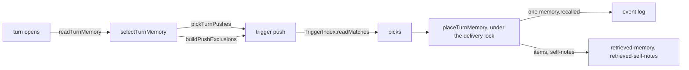

# What memory a turn brings

- **Status:** draft
- **Decision records:** [0052](../../decisions/0052-the-lean-memory-index.md)
- **Work items:** trigger push builds the port and trigger push beside the built similarity search.
  The similarity push cleanup deletes the similarity search.

On each turn, nixie can place up to 3 memory items in the turn's blocks without a tool call: the
items whose trigger phrases match your message. The agent sees the memory index only when a session
opens, so trigger push brings an item the agent did not think to read. The sessions module asks once
per turn through one port method, and the memory module picks and places the items.

Terms of this doc, beside the [glossary](../../glossary.md) and [the labels](memory-labels.md):

- **push:** a way to pick items for a turn without a tool call.
- **pick:** one item a push picked.
- **place:** load a pick's text and put it in a block of the turn.
- **held:** a session holds a text version once a recall record lists it and that record's turn
  ended.
- **excluded words:** the names of you and the agent, which never count as a match.
- **encoder:** the embedding model of the store's vector search. A deployment can run without one.

## Shape



## Contracts

```ts
const turnMemory = await memory.readTurnMemory({
  text: 'is the piano out of tune again?',
  thread,
  excludedWords: ['Robin'],
  held: { readVersions, readMessages },
});
// → { kind: 'placed', items: [/* the piano item */], selfNotes: [], messages: [] }
//   or { kind: 'none' } when nothing passes the floor
```

```ts
// sessions module: the built port. readTurnMemory replaces recall and recallMessages.
interface ConversationMemory {
  // …existing methods: readPinnedCore, readPinnedCoreUse, readShortIDs, and readIndex from the index design
  readonly readTurnMemory: (ask: TurnMemoryAsk) => Promise<TurnMemory>;
}

interface TurnMemoryAsk {
  readonly text: string;
  readonly thread: string;
  readonly excludedWords: readonly string[];
  readonly held: SessionHeld; // no cap, no floor, no push name
}

interface SessionHeld {
  readonly readVersions: () => Promise<readonly MemoryRef[]>; // lazy
  readonly readMessages: () => Promise<readonly number[]>; // lazy; see Open questions
}

type TurnMemory =
  | {
      readonly kind: 'placed';
      readonly items: readonly MemoryItem[];
      readonly selfNotes: readonly MemoryItem[];
      readonly messages: readonly PastMessage[]; // sessions module's PastMessage; empty once the similarity push is gone
    }
  | { readonly kind: 'none' };

// ConversationMemorySettings keeps rebuildTokens, ownerName and agentNames, and loses every retrieval* field.
```

```ts
// memory module. One exported function per file.
declare function selectTurnMemory(
  sources: TurnSources,
  settings: TurnMemorySettings,
  ask: TurnMemoryAsk,
): Promise<
  | { kind: 'selected'; picks: readonly PushPick[]; messages: readonly PastMessage[] }
  | { kind: 'none' }
>;
declare function pickTurnPushes(settings: TurnMemorySettings): readonly SelectPush[];
declare function buildPushExclusions(
  states: readonly ItemState[],
  held: readonly MemoryRef[],
): readonly string[];

type SelectPush = (
  sources: TurnSources,
  turn: TurnMemoryAsk & { states: readonly ItemState[]; excludedIDs: readonly string[] },
) => Promise<{ picks: readonly PushPick[]; messages: readonly PastMessage[] }>;

interface TurnSources {
  readonly index: MemoryIndex; // the store's built in-memory item index
  readonly vectors: VectorIndex | null; // built; null with no encoder
  readonly triggers: TriggerIndex;
  readonly readItemStates: () => Promise<readonly ItemState[]>;
}

interface TurnMemorySettings {
  readonly trigger: { readonly items: number; readonly minScore: number };
  // the similarity group lives here until the similarity push cleanup deletes it
}

interface ItemState {
  itemID: string;
  version: number; // the text version
  isPinned: boolean;
  isSelf: boolean;
  isLapsed: boolean; // its end time passed
}

interface PushPick extends MemoryRef, MatchScores {
  readonly isSelf: boolean;
}

// An in-memory search over trigger phrases, rebuilt at each start.
interface TriggerIndex {
  readonly readMatches: (
    text: string,
    options: {
      limit: number;
      minScore: number;
      excludedIDs: readonly string[];
      excludedWords: readonly string[];
    },
  ) => Promise<readonly (MatchScores & { itemID: string })[]>; // one per item, scored by its best phrase
}
```

```yaml
# deployment config, memory module
memory:
  trigger_items: 3 # the most items trigger push places on a turn; 0 turns it off
  # trigger_min_score: the floor of a match. The trigger push item sets its default.
```

## Constraints

### The ask

- `readTurnMemory` is the only port method that brings memory to a turn. The memory module decides
  which pushes run.
- When the session's start gives it no memory, such as a task with `memory: none`, the sessions
  module returns `none` and asks nothing.
- When every push is off, or the text is blank, `selectTurnMemory` returns `none` before any read,
  and neither `held` function runs.
- When a search or a log read rejects, `readTurnMemory` rejects and the port adds no catch, as the
  built turn search does. The built step runner then records the error and retries the step after a
  delay, and a task fails after 3 errors in a row.
- The composition root passes the whole memory config to the store and gives the store to the
  conversation's runner and the task runner. No adapter serves this port.

### The selection

- `buildPushExclusions` alone decides which items no push picks: a lapsed item, a pinned item, and
  an item whose current text version the session holds.
- Each push gets that list plus every earlier pick as `excludedIDs`, and applies only its own cap
  and floor.
- Trigger push picks an item only at or over `trigger_min_score`, picks at most `trigger_items`
  items, and never picks an item with no trigger phrase. Self-notes count toward `trigger_items`.
- The trigger match runs the built ranked-match search over phrases in place of item text: a keyword
  search and, with an encoder, a vector search. An item's score is the score of its best trigger
  phrase.
- `TriggerIndex` holds one keyword row and one vector per phrase. The trigger push item builds it at
  each start from each item's newest labels, and `writeLabelsInTransaction` and the forget keep it
  current.
- With no encoder, the match is by keyword only, and the record carries the keyword search mode.
- A score depends on the encoder, so a floor set for one encoder is wrong for another.
- `selectTurnMemory` appends nothing.

### The placing

- `placeTurnMemory` loads each pick's current text version, in order, under the delivery lock, and
  records that version. It drops a pick pinned, retired or forgotten since the selection, and never
  refills the cap.
- It appends one `memory.recalled` with the picks' references, scores and search mode, and no text,
  trigger phrase or push name.
- When every pick is dropped, it returns `none` and appends nothing. A turn that places nothing has
  no recall record and no recorded reason.
- Trigger push adds no block type, no record kind and no field on `model.turn_ended` or
  `memory.recalled`, so the release before parses every record.

### Between the 2 items

- While both pushes exist, trigger picks come first, then similarity picks, with no item twice. Each
  push has its own cap and floor, and past messages come from the similarity push only.
- `memory.rate` rates the items of the thread's newest recall record. From
  [the page cap](https://linear.app/zgeoff/issue/GEO-2523) on, a turn that placed nothing writes no
  record, so `memory.rate` after it rates an earlier recall's items. No fix is built: the cleanup
  deletes the tool.

### After the cleanup

- Trigger push is the only push. Past messages reach the agent only through `log.read`.
- The memory config has no `retrieval_*` key. nixie refuses to start on a file that sets one, so the
  cleanup's deploy removes them first.
- No agent has `memory.rate`, the API has no rating-notes procedure, and the web client has no view
  of rating notes.
- nixie starts on a log that holds `memory.rated` records, and skips them.

## Decisions

- **One port method, and the memory module picks the pushes.** The sessions module holds no setting
  that tunes a push.
- **The similarity push and `memory.rate` go directly after the index is on, in the same milestone,
  with no measurement first.** [0052](../../decisions/0052-the-lean-memory-index.md)

## Builder decides

- The default of `trigger_min_score`: a high floor, set as a tuning value in the trigger push item.
  Its pull request shows the floor on invented items with the encoder and with keyword search only.
- The match type's name and fields beyond `itemID` and the scores, which phrase counts as best in
  hybrid search, and the search mode a record carries when a search falls back.
- File names, and the names of helpers that the module does not export.

## Out of scope

- A model that judges the picks before nixie places them.
- Other port shapes: a parameter that picks pushes from the sessions module, caps and floors in the
  ask, a push registry, or a port per push.
- A cap of its own for self-notes, a rating of a missed memory, and a measurement of trigger push
  before release.

## Open questions

- **Which score does `trigger_min_score` floor?** The built search keeps a keyword score and a
  vector similarity on different scales. A measurement on invented phrases settles it in the trigger
  push item. Until then, `trigger_min_score` floors the keyword score as the built `minScore` does,
  vector matches keep the built default similarity floor, and an item passes when either search
  returns it.

- **Does the port keep `held.readMessages` and the `messages` of `placed` once the similarity push
  is gone?** The owner settles it. Until then, both stay and `messages` is always empty, so the
  cleanup changes no line in the code that asks for a turn's memory, renders the blocks or writes
  the turn-ended record.
