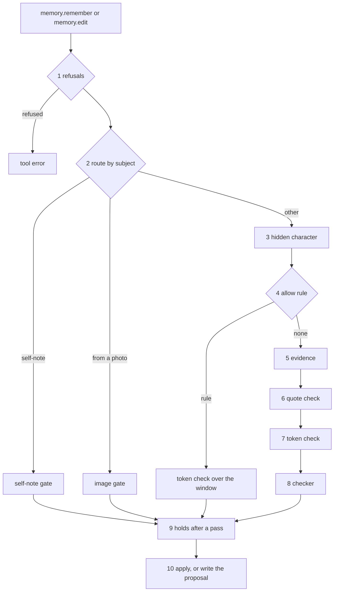

# The memory write gate

The write gate is the chain of checks that nixie runs on every memory write. nixie applies a write
at once only when it passes every check. Every other write is a proposal that waits for your review,
with one review reason. The gate exists because the conversation reads untrusted text, so only words
that you typed can back a memory. [Decision 0011](../../decisions/0011-memory-writes.md) records
which writes skip review. Terms that this doc does not define are in the
[glossary](../../glossary.md).

The sketches in `sketches/memory-gate/` hold each type, each flow and the exact text of each
sentence that the agent reads, in lettered sections. This doc holds the rules. Open items are in
[the open list](open/memory-gate.md), which states what is unsettled in each and links its tracker
issue. Each is marked here as `(open: <name>)`. The checks on an item's labels are in
[the gate's checks on labels](memory-write-gate-labels.md).

## Terms

- **Caller:** the conversation or the task whose model calls a memory tool.
- **Review reason:** the one name, from a closed list, of why a write waits for your review.
- **Evidence window:** your last `evidence_window` messages on one thread. The key is in the
  `memory` section of the config.
- **Cited event:** the message of yours that a write points at with `eventID`. The agent reads that
  number in the stamp that nixie puts on each message, or in an entry that the tool `log.read`
  returns.
- **Destination-like token:** an email address, a link, a phone number, a handle or an account
  number.
- **Checker:** the model that confirms that your message asserts a memory. It gets your whole
  message and the memory text, and nothing else of the conversation.
- **Allow rule:** a rule of yours that allows one memory tool by its name.
- **Forget:** your action that destroys the key of a message or of a memory item.

## Built

This section states what the code does, with the names to grep for. Every section after it states
the design.

- `writeGatedRemember` runs the chain for `memory.remember` and `memory.edit`. `runSubjectGate`
  makes the refusals and picks `runSelfNoteGate`, `runImageGate` or `runContentGate`.
- `runContentGate` reads the evidence with `readQuoteEvidence` or `readEventEvidence`. Both read
  only the caller's own thread.
- `getTypedQuote` is the quote check. `runQuotedGate` runs the token check and calls
  `runMemoryChecker`. `runRuleGate` is the path under an allow rule. The server gives the gate a
  rule lookup that finds no rule, so no write takes that path.
- `runSubjectGate` and `pickSubjectChangeReview` hold branches for the built-in note-taker as a
  caller, and `runBatchGate` checks a note-taker batch.
- `writeGatedRetirement` runs `runIntentGate` for `memory.retire`. `writeGatedPin` handles
  `memory.pin`.
- `reviewReasons` lists 16 reasons, and `renderReviewReason` holds one sentence for each. The web
  client holds a sentence of its own per reason in `formatReviewReason`.
- `writeProposalRecord` counts the proposals of one turn against `proposal_cap` and throws
  `ProposalCapError` past it.
- `memory.remember`, `memory.edit` and `memory.retire` each declare the effect `note`. Two decision
  records give another name for that effect `(open: effect name)`.

## The chain

- nixie runs the checks in the order of the diagram, and stops at the first check that fails.
- When a check fails, nixie writes a proposal with one of that check's review reasons, and applies
  nothing.
- When every check passes, nixie writes the item version, its record and its notice entry in one
  transaction. Three kinds of write wait even then: a self-note, a write from a photo and a pin.
- A refusal fails the tool call, and nixie writes nothing.

The chain as code is in [the sketch of the flows](sketches/memory-gate/03-flow.ts), section A. The
gate's result type is in [the sketch of the types](sketches/memory-gate/02-types.ts), section D.

## Each check

1. **Refusals.** nixie refuses 3 writes: one whose `until` time is in the past, one in which a task
   makes a self-note that did not exist, and one whose image is not an image that you sent. Text:
   [the errors of a write tool](sketches/memory-gate/02-types.ts), section G.
2. **Route by subject.** nixie sends a self-note to the self-note gate and a write from a photo to
   the image gate. It sends every other write to the content gate, which is checks 3 to 8.
3. **Hidden character.** nixie tests the memory text for a Unicode format character. A hit gives
   `invisible_character`. Pattern: [the hidden-character pattern](sketches/memory-gate/02-types.ts),
   section D.
4. **Allow rule.** When an allow rule covers the write's tool on the caller's thread, nixie skips
   checks 5, 6 and 8. It runs the token check against everything you typed in the evidence window on
   the caller's own thread. A missing token gives `token_missing`. A rule for `memory.remember`
   never covers `memory.edit`.
5. **Evidence.** The caller gives a quote, and nixie looks for it in a message of yours. With no
   cited event, nixie searches the evidence window on the caller's own thread. With a cited event,
   nixie reads that one message:
   [the thread it reads](#a-quote-that-a-task-with-the-log-grant-cites). A write with no quote, or
   with a quote that nixie finds in no message, gives `no_quote`.
6. **Quote check.** The match must lie wholly in spans that you typed. Each failure has a reason:
   - a match that touches a span that you pasted or dropped in gives `quote_not_typed`;
   - a match in a blockquote, a code block, or a reply or forward header gives
     `quote_in_quoted_block`;
   - a hidden character in the quote gives `invisible_character`;
   - a message that backed a memory item whose key you destroyed with a forget gives
     `forgotten_evidence`.
7. **Token check.** Every destination-like token in the memory text must appear word for word in the
   quote. A missing token gives `token_missing`.
8. **Checker.** nixie makes one call to the checker, which answers asserted, not asserted or unsure.
   Only asserted passes. The other 2 answers give `checker_not_asserted` and `checker_unsure`. A
   timeout or an error gives `checker_unreachable`.
9. **Holds after a pass.** nixie holds a write that passed when it moves an item to another subject,
   such as from `owner` to `shared`. The reason is `subject_change`.
10. **Apply.** When you forget the quoted message after the checks and ahead of the transaction, the
    transaction writes a proposal with `forgotten_evidence`.

The content gate as code is in [the sketch of the flows](sketches/memory-gate/03-flow.ts), sections
D, E and F.

## Self-notes, photos, pins and retirements

A self-note is a memory item that the agent writes about itself, with the subject `self`.

- The self-note gate and the image gate each run 2 checks: the hidden-character check, and a token
  check against everything you typed in the evidence window. Neither reads a quote or calls the
  checker.
- In both gates a hidden character gives `invisible_character`. A write with none always waits: a
  self-note with `self_note`, and a write from a photo with `from_photo`. The token check never
  changes the reason. nixie stores its verdict, `pass` or `fail`, in the proposal's checks.
- One exception: when a rule of yours allows `memory.remember` for the source `image`, a write from
  a photo takes the path of check 4.
- nixie runs no check on a pin. A pin waits with `pinned`, unless an allow rule covers `memory.pin`.
- For a retirement, nixie first looks for a record that the caller recalled the exact version on its
  own thread. With no such record, the reason is `ambiguous_target`. With one, the caller gives a
  quote in which you asked for the retirement. nixie runs checks 5 and 6 on that quote, and a second
  checker confirms that the quote asks to retire that item. A failure gives the reason of the check
  that failed.

Flow: [the 2 gates and a pin](sketches/memory-gate/03-flow.ts), sections B, C and I.

## A write from a task

nixie sends each write from a task through the same chain as a write from the conversation. The gate
treats a task's write unlike the conversation's in 3 ways:

- The window search of check 5 reads the caller's own thread, and a task's thread holds none of your
  messages. So a task's `memory.remember` or text edit is a proposal with `no_quote`. The 2
  exceptions are a write under an allow rule and a write that cites an event under the log grant.
- nixie refuses a write in which a task makes a self-note that did not exist. Only the conversation
  speaks as the agent to you, so only the conversation writes about the agent.
- nixie groups the notice entries of a task's writes by the task run that made them.

Which memory tools a task holds is in [memory tools on a task](memory-task-tools.md).

## A quote that a task with the log grant cites

A task start or a task definition sets `log: own`, the default, or `log: conversation`:
[the log grant of a task](task-log-grant.md). This doc uses "the log grant" for `log: conversation`
only. A tool call of a task has 2 threads: the task's own thread, and `logThread`, the thread that
the task may read. For the conversation and for a task with `log: own`, the 2 are the same thread.
For a task with the log grant, `logThread` is the conversation's thread. Usage:
[a task with the log grant cites your message](sketches/memory-gate/01-usage.ts), section D. Flow:
[where the gate looks for the quote](sketches/memory-gate/03-flow.ts), section F.

- nixie reads a cited event on the caller's `logThread`. It reads the window of check 5 on the
  caller's own thread, for every caller.
- When a task with the log grant cites a message that you typed on the conversation's thread, nixie
  runs checks 6 to 9 on it as for the conversation. When every check passes, nixie applies the write
  at once, with the origin `task`.
- When a task with the log grant gives a quote and cites no event, nixie searches the task's own
  thread, and writes a proposal with `no_quote`. Such a task must cite the event.
- When a task with `log: own` cites an event of the conversation's thread, nixie writes a proposal
  with `no_quote`.
- When the `logThread` has no record with the cited ID, the reason is `no_quote`. That covers an
  event on any thread other than the caller's `logThread`.
- When the cited record is not a message of yours, the reason is `quote_not_typed`.
- When you forgot the cited message, or it backed an item that you forgot, the reason is
  `forgotten_evidence`.
- When the checker answers not asserted or unsure, the reason is the checker's.
- When the task's setup has no log grant at the time of the write, nixie writes a proposal with
  `no_quote`, whatever the task read while it had the grant. The runner sets `logThread` once per
  step, so what happens when the setup changes inside a step is unsettled
  `(open: gate quote thread)`.
- nixie never holds a write only because its caller has the log grant. The grant adds no review
  reason and no error sentence.
- Each outcome is one transaction: the item version with its record and its notice entry, or one
  `memory.proposed` record.

## Review reasons and the tool result

- nixie stores exactly one review reason with each proposal, from the closed list `reviewReasons`.
  List: [the review reasons](sketches/memory-gate/02-types.ts), section A.
- The sections of this doc give every reason but 3. `labels` comes from
  [a label-only edit](memory-write-gate-labels.md). nixie gives `sensitive` to no write, and reads
  it on a proposal that a log holds: see [memory labels](memory-labels.md). `other` is what nixie
  reads for a stored reason that is not in the list.
- For a proposal, the write tool returns 3 parts to the agent: the reason, one fixed sentence with
  your name, and the reason's own sentence. Text:
  [the sentence of each reason](sketches/memory-gate/02-types.ts), sections B and C.
- nixie puts the size of the evidence window in each sentence that mentions your last messages.

## The proposal cap

- nixie counts the proposals that one turn makes against `proposal_cap`, 10 by default. It counts
  each turn of a task on its own, with the same cap.
- When a write would be a proposal past the cap, nixie fails the tool call and writes nothing. The
  cap exists so that an injected instruction cannot flood your review. Text:
  [the errors of a write tool](sketches/memory-gate/02-types.ts), section G. Config keys:
  [the gate's config keys](sketches/memory-gate/01-usage.ts), section F.

## Not in scope

- The `log` option, who may give the log grant, `logThread` on the tool call and `log.read`: see
  [the log grant of a task](task-log-grant.md).
- A review reason of its own for the writes of a task with the log grant.
- A window search on the conversation's thread for a task with the log grant.
- Any check for the conversation that this doc does not state, and the checker's prompt.
- The labels, the label record and the sensitive flag: see [memory labels](memory-labels.md).
- The example note-taking definition: see [the example definitions](example-definitions.md).
