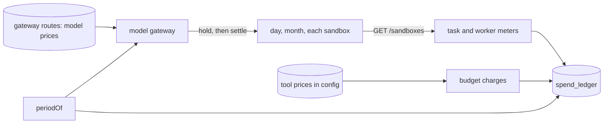

# One price source and one ledger

- **Status:** draft
- Decisions: [0012](../../decisions/0012-spending-stop.md), which puts the count that stops spending
  in the model gateway, outside nixie

nixie prices model tokens, searches and pictures, and counts what it spent against a day, a month, a
task run, a worker run or a budget. Today a model's prices live in two config files that nothing
compares, a search's price is a constant in its adapter, and a task run's dollars come from the
server pricing turn records its own way, so they disagree with the gateway's count of the same
replies. Budgets keep integer micros while the task meter sums floats, and each counter has its own
idea of a day. After this design, each price has one source, the gateway counts every model dollar
nixie limits, every other money count lands in one ledger keyed by counter, unit and period, and one
helper says when every period starts.

Once the owner approves this design, build its work items from it and the built
[spending stop](../../architecture/policy/spending-stop.md),
[budgets](../../architecture/policy/budgets.md) and
[model gateway](../../architecture/policy/model-gateway.md) it changes. The period helper comes
first, then the gateway's held admission, then the task meter's move to the gateway, then the
ledger. The wallet builds on the ledger.

## Shape



## Terms

- A **counter** is one thing a limit reads, such as `budget:search-day` or `task_run:<ID>`.
- A **unit** is what a counter counts: `micros:<currency>` or `tokens`.
- A **period** is the span a counter resets on: `day`, `week`, `month` or `none`, for a counter that
  never resets, such as a task run's.
- A **hold** is the gateway's worst-case charge for a request it has admitted and not yet settled.

## Contracts

### Periods

```ts
// libs/periods, which the server and the gateway both import.
periodOf('day', Date.parse('2026-11-23T23:30:00Z'), 'Pacific/Auckland');
// → { kind: 'day', start: '2026-11-24', startsAtMs, endsAtMs }

type PeriodKind = 'day' | 'week' | 'month' | 'none';
type Period = { kind: PeriodKind; start: string; startsAtMs: number; endsAtMs: number | null };
```

- Every counter takes its period from `periodOf` with the time tool's `default_zone`. A day starts
  at local midnight, a week on Monday, a month on the 1st. A clock change makes a day 23 or 25
  hours.
- `periodOf` replaces the gateway's reset helper, the budgets' period code and the turn count's
  sums, and gives the same bounds they give today for every zone whose offset is a whole number of
  15 minutes. The turn count keeps its 15-minute buckets.

### Prices

| Price                  | Its one source                                    | Unit                         |
| ---------------------- | ------------------------------------------------- | ---------------------------- |
| a model's tokens       | the gateway route's `prices`, when a gateway runs | dollars per million tokens   |
| a model's tokens       | the profile's `prices`, when no gateway runs      | dollars per million tokens   |
| a search               | `search.price_micros` in the server config        | micros of a dollar per call  |
| a picture of each size | `images.profiles.<id>.prices`, as today           | micros of a dollar per image |

- With a gateway, nixie never prices a model call itself: every model dollar it limits is the
  gateway's count. A profile's `prices` is then unused, and the server logs a warning at start when
  it differs from the route's. The release after this design drops the requirement that a profile
  set `prices` when a gateway runs, so a rollback by one release still reads the config.
- `search.price_micros` defaults to Kagi's 12,000. The search tool charges it and records it as the
  call's cost, from the one value.
- A changed price applies to calls after the process that holds it reads it, and never reprices a
  recorded call.

### The gateway's held admission

```ts
// model gateway. Admission adds a hold of the request's worst case to every counter it reads,
// then the reply settles the hold to the charge.
const hold = pickRequestHold(request, route); // the reply estimate's rule, run before the request
// → { dollars: 0.43, tokens: 128000 }
```

- The gateway admits a request only when each counter's spend plus its open holds plus this hold
  stays within the limit, and adds the hold under the store's lock. Two requests can't both take the
  last of a limit.
- The hold uses the estimate rule that prices a reply with no usage: the highest input-side rate,
  and `max_tokens` or the route's `maxOutputTokens` for output. A request with neither bound is
  refused, as today.
- Settling replaces the hold with the reply's charge, or with the estimate when the reply has no
  usage. A restart drops open holds, because the requests that held them are gone.
- The store file keeps its version and its float dollars; holds live in memory only.

### The task and worker meters

- With a gateway, a task run's dollars are the gateway's count for the task run's sandbox, plus each
  of its worker runs' counts. The server reads them with `GET /sandboxes/<name>` before each step
  and after each worker run.
- The server registers each task run's sandbox with a dollar limit: the run's limit less what its
  worker runs spent. The gateway then refuses a call past it, and the runner ends the step with
  `limit`.
- A worker run keeps today's rule: its limit is the smaller of `workerRun` and what its task run has
  left, and when the gateway doesn't answer at its end, it charges its planned dollars.
- Without a gateway, the task meter prices the guest's call frames with the profile's table, as
  today.
- A task run opened before this design keeps today's meter until it ends.

### The ledger

```text
spend_ledger          plain table, log module
  ledger_key          text   primary key: counter, unit, period kind and period start, joined
  counter             text   'budget:<id>', 'task_run:<id>', 'worker_run:<id>'
  unit                text   'micros:USD', 'micros:<a card's currency>', 'tokens'
  period_kind         text   from PeriodKind
  period_start        text   from periodOf; '' for none
  amount              int
```

- The ledger is a projection of `budget.charged`, `budget.credited`, `task.meter_read` and
  `worker.run_ended`, so a rebuild reproduces it. `task.meter_read` is a new record of the gateway's
  counts each time the server reads them for a task run.
- A budget charge records its `ledger_key`, and a credit subtracts from that key, so a credit lands
  on the row its charge added to, whatever the budget's period is by then. A charge from before this
  design has no key, and its credit uses its budget ID and `periodStart`, as today.
- For one release the budgets module keeps writing `budget_ledger` beside `spend_ledger`, so the
  release before reads current balances after a rollback. The release after drops it.
- Every amount in the ledger is an integer. A dollar amount from the gateway converts to micros
  rounded up.
- `search_calls`, the search tool's daily call count, and the turn count stay outside the ledger:
  neither is money.
- A wallet card's budget, `card-<account>`, is a budget like any other, counted in the card's
  currency. Its charge, its conversion and its lifecycle are [the wallet's](wallet.md).

### What counts where

| Spend           | Counted by the gateway         | Counted in the ledger                        |
| --------------- | ------------------------------ | -------------------------------------------- |
| a model call    | day, month, the call's sandbox | `task_run` or `worker_run`, from the gateway |
| a search        | no                             | `budget:search-*`                            |
| a picture       | no                             | `budget:image.draw-*`                        |
| a card purchase | no                             | `budget:card-<account>`                      |

- The stop reads the gateway's day and month and the turn count, as today. A paid tool counts
  against its budget and never against the stop. **Why:** model dollars on a plan are notional,
  while tool dollars are real, as [budgets](../platform/policy/budgets.md) sets out.

## Constraints

- Every limit reads exactly one counter, and every counter has exactly one writer.
- A budget charge and its ledger row commit in the transaction of the record that causes them.
- The gateway never reads nixie's ledger, and nixie never writes the gateway's store.
- Without a gateway, nothing stops model spend outside nixie, as today; the deployment's provider
  limit is the only backstop, as decision 0012 sets out.

## Builder decides

- How the work splits into pull requests within the order above.
- How the client lays out the ledger's counters.
- The name of the warning when a profile's prices differ from its route's.

## Out of scope

- A price for sandbox time, web fetches or storage. They stay unpriced, and the worker's minute
  limit stays a wall-time limit.
- What a coding session spends in atc, which the coding runner design keeps outside nixie.
- A price feed: prices stay hand-written in config, from each provider's price page.
- Reserving a turn before a step runs. The turn count stays a count of finished turns.

## Open questions

- **The deployment currency.** Model and tool providers price in US dollars. The owner may want
  limits and the client in another currency, which needs a rate source for every model call. Until
  the owner decides, nixie counts in US dollars, and only a wallet card counts in its own currency.
