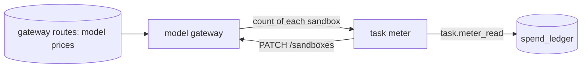

# The task and worker meters on the gateway's count

- **Status:** agreed
- Decisions: [0012](../../decisions/0012-spending-stop.md), which puts the count that stops spending
  in the model gateway, outside nixie

The [metering doc](../../architecture/policy/metering.md) describes what is built: the periods, one
source for each search and picture price, the gateway's count and limit for each route, and the
ledger with a row for each budget, task run and worker run. What remains is a task run's dollars.
They still come from the server pricing turn records by the profile's `prices`, so they disagree
with the gateway's count of the same replies. After this design, a task run's dollars are the
gateway's count of its sandboxes, and a profile that runs behind a gateway sets no `prices`.

## Shape



## Contracts

```text
task.meter_read           { taskRunID, sandbox, reason, countMicros }
  reason: 'run_start' | 'step_start' | 'step_end' | 'worker_end' | 'run_end'
```

The gateway gains `PATCH /sandboxes/<name>`, which sets a sandbox's limit whole, with
`{ limit: { dollars, tokens? } }` or `{ limit: null }`, and keeps its count; it answers 204, or 404
for a name the store lacks. A limit with no `tokens` sets no token limit. The sandbox's
`lastRefusal` is built.

- A task keeps its sandbox across its task runs, and replaces it when the host loses it. A task
  run's dollars are, for each sandbox it used, the last count less the count at the task run's start
  or at the sandbox's creation, summed, plus each of its worker runs' dollars.
- What a task run has left is its limit less its dollars.
- At a task run's start, the server sets the sandbox's limit to its count plus the task run's limit.
  When a worker run starts, the limit drops by the worker run's planned limit; when it ends, the
  planned limit comes back and what the worker run spent comes off. Each worker run's planned limit
  is at most what the task run has left after the planned limits of the worker runs already going.
- A `task-raise` patches the limit after its commit, retried until it succeeds; the next task run's
  start sets it too.
- The server reads the count with `GET /sandboxes/<name>` at each reason above, and writes each read
  as `task.meter_read`, rounded up to the micro. When a read before a step gets no answer, the step
  doesn't start and retries as a step does while the stop is unreachable. When any other read gets
  no answer, the next read catches up, and a task run waits to close until its end read succeeds.
- A `task.meter_read` sets its task run's ledger row to the run's dollars, in the transaction that
  writes the record. Today `task.run_ended` sets that row.
- At a restart, the server registers a sandbox with `PUT` only when the gateway has no such name,
  and patches every other.
- A worker run keeps today's rule: its limit is the smaller of `workerRun` and what its task run has
  left, and when the gateway doesn't answer at its end, it charges the larger of its planned dollars
  and its own tally, recorded in `worker.gateway_charged` as today.
- With a gateway, the runner's own pricing of each call, its interrupt at the dollar limit, its read
  of late spend, `task.failed_turn_spent` and `task.turn_spend_unrecorded` go: the sandbox's limit
  replaces them. A step whose sandbox refused it, by `lastRefusal` since the step began, ends with
  `limit`.
- Without a gateway, the task meter prices the guest's call frames with the profile's table, as
  today, and writes `task.meter_read` at the same points.
- A task run's start record gains `meter: 'gateway' | 'records'`. A task run whose start record has
  no `meter` began before this design, and keeps today's meter until it ends.
- With a gateway, a profile sets no `prices`, and a config file that sets them beside a gateway
  fails to load, with an error that names the route's `prices`.

## Constraints

- Every counter has exactly one writer. A task run's limit reads its sandboxes' counts and its
  worker runs' counters.
- A ledger row and the record that causes it commit in one transaction.
- The gateway never reads nixie's ledger, and nixie changes the gateway's store only through the
  control listener's calls.
- Without a gateway, nothing stops model spend outside nixie, as today; the deployment's provider
  limit is the only backstop, as decision 0012 sets out.
- The model never reads a dollar figure, a limit or a rate, from any tool or notice.

## Builder decides

- The build order and how the work splits into pull requests.
- The wording of the model's line after a wait.

## Out of scope

- A price for sandbox time, web fetches or storage. They stay unpriced, and the worker's minute
  limit stays a wall-time limit.
- What a coding session spends in atc, which the coding runner design keeps outside nixie.
- A price feed: prices stay hand-written in config, from each provider's price page.
- Reserving a turn or a worst case before a step runs.
- A limit that spans routes.
