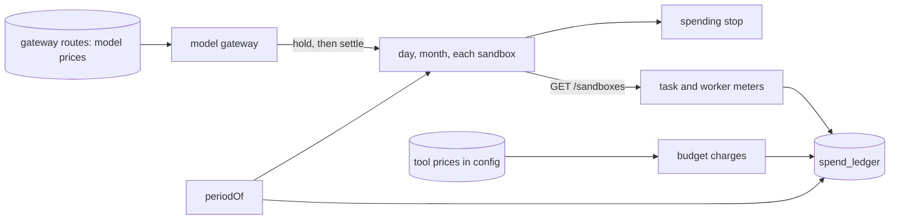

# One price source and one ledger

- **Status:** draft
- Decisions: [0012](../../decisions/0012-spending-stop.md), which puts the count that stops spending
  in the model gateway, outside nixie

nixie prices model tokens, searches and pictures, and counts what it spent against a day, a month, a
task run, a worker run or a budget. Today a model's prices live in two config files that nothing
compares, a search's price is a constant in its adapter, and a task run's dollars come from the
server pricing turn records its own way, so they disagree with the gateway's count of the same
replies. Budgets keep integer micros while the task meter sums floats, and each counter has its own
idea of a day. After this design, each price has one source. When a gateway runs, it counts every
model dollar nixie limits, a task run's dollars included, and holds a request's worst case before it
sends it. Every other money count lands in one ledger keyed by counter, unit and period, and one
helper works out when every period starts. Near a limit, a request with a large `max_tokens` is
refused where today it would pass.

Once the owner approves this design, build its work items from it and the built
[spending stop](../../architecture/policy/spending-stop.md),
[budgets](../../architecture/policy/budgets.md) and
[model gateway](../../architecture/policy/model-gateway.md) it changes. The task meter's move needs
the gateway's held admission, the ledger needs the task meter's `task.meter_read`, and the wallet
needs the ledger.

## Shape



## Terms

- A **counter** is one thing a limit reads, such as `budget:search-day` or `task_run:<ID>`.
- A **unit** is what a counter counts: `micros:<currency>` or `tokens`.
- A **period** is the span a counter resets on: `day`, `week`, `month` or `none`, for a counter that
  never resets, such as a task run's.
- A **hold** is the gateway's worst-case charge for a request it has admitted and not yet settled.

## Contracts

### Periods

```ts
// libs/periods, which the server and the gateway both import.
periodOf('day', Date.parse('2026-11-23T23:30:00Z'), 'Pacific/Auckland');
// → { kind: 'day', start: '2026-11-24', startsAtMs, endsAtMs }

type PeriodKind = 'day' | 'week' | 'month' | 'none';
type Period = { kind: PeriodKind; start: string; startsAtMs: number; endsAtMs: number | null };
```

- Every counter takes its period from `periodOf` with the time tool's `default_zone`. A day starts
  at local midnight, a week on Monday, a month on the 1st. A clock change makes a day shorter or
  longer by its shift.
- `periodOf` replaces the gateway's reset helper, the budgets' period code and the turn count's
  sums, and gives the same bounds they give today. The turn count keeps its 15-minute buckets, so
  the time tool refuses a `default_zone` whose offset isn't a whole number of 15 minutes.

### Prices

| Price                  | Its one source                                    | Unit                         |
| ---------------------- | ------------------------------------------------- | ---------------------------- |
| a model's tokens       | the gateway route's `prices`, when a gateway runs | dollars per million tokens   |
| a model's tokens       | the profile's `prices`, when no gateway runs      | dollars per million tokens   |
| a search               | `search.price_micros` in the server config        | micros of a dollar per call  |
| a picture of each size | `images.profiles.<id>.prices`, as today           | micros of a dollar per image |

- With a gateway, nixie never prices a model call itself: every model dollar it limits is the
  gateway's count. A profile's `prices` is then unused, and the server logs a warning at start when
  it differs from the route's. The release after this design drops the requirement that a profile
  set `prices` when a gateway runs, so a rollback by one release still reads the config.
- `search.price_micros` defaults to Kagi's 12,000. The search tool charges it and records it as the
  call's cost, from the one value. A deployment sets it only once the release after this design
  runs, so the release before still reads the config.
- A changed price applies to calls after the process that holds it reads it, and never reprices a
  recorded call.

### The gateway's held admission

```ts
// model gateway. After the body, header and model checks, admission adds a hold of the request's
// worst case to the day, the month and the request's sandbox, in dollars and tokens, just before
// it sends. The reply settles it.
const hold = pickRequestHold(body, route); // buildReplyEstimate, worked out before sending
// → { dollars: 0.23, tokens: 45096 }: a 33,000-token body, max_tokens 8,000, the 4,096 allowance

// GET /status and GET /sandboxes/<name> keep today's fields and gain the open holds beside them.
// GET /sandboxes/<name> also gains the last refusal, so the runner can tell why a step stopped.
// → { dollars: 1.84, tokens: 610000, tripped: false, held: { dollars: 0.23, tokens: 45096 },
//     lastRefusal: { counter: 'sandbox', atMs: 1795960000000 } }
```

```json
// The 403 for lack of room, whether the count or the holds filled it.
{ "type": "error", "error": { "type": "limit_reached", "counter": "day", "message": "…" } }
```

- The hold is exactly today's estimate of a reply with no usage, its 4,096-token allowance included:
  the body's measured input at the highest input-side rate, plus `max_tokens`, or the route's
  `maxOutputTokens`, for output.
- A request whose input the estimate can't bound, such as one that continues a stored response,
  holds the route's `contextWindow` in place of the measured input, and settles to that hold when
  its reply has no usage, with no lost mark. Every route sets `contextWindow`. A request with no
  output bound gets a 400 and sends nothing. Token counts and the model list take no hold.
- The gateway admits a request only when, for each counter, the count plus its open holds plus this
  hold stays within the limit in force, raises and overrides included. It adds the hold under the
  store's lock, so two requests can't both take the last of a limit. A request whose hold alone
  passes a limit is never admitted; the server refuses to plan a worker run whose limit is below its
  route's smallest hold.
- `tripped` keeps its meaning: the count reached the limit. The spending stop trips only on it.
- A step whose sandbox refused it, by `lastRefusal` since the step began, ends with `limit`. A
  conversation step or a task step refused on the day or the month waits and retries as a step does
  while the stop is unreachable.
- Settling replaces the hold with the charge that today's rules pick: the reply's usage, the
  estimate when the reply spent with no usage, and nothing when the provider refused it.
- A hold counts against the period it settles in, so the open holds carry into a new day or month.

#### The holds file

- The gateway writes each hold to `<store>.holds.json`, version 1, before it sends the request: its
  random ID, its sandbox and route, its dollars and tokens, and when it began.
- It adds the charge to the store before it removes the hold, so a crash between them counts twice
  and never not at all. When the holds file can't be written, the request gets a 503 and sends
  nothing.
- At start, before the first request, the gateway settles each hold in the file at its full amount,
  into the current day and month, and into its sandbox when the store still has it. It drops the
  holds instead when the store changed after the holds file, which means a gateway of the release
  before ran in between and counted those requests itself.
- The store file keeps its version and its float dollars. A gateway of the release before ignores
  the holds file. The gateway holds under both the `periods` and the `limits` configs, so a preview
  holds too.

### The task and worker meters

```text
PATCH /sandboxes/<name>   { "limit": { "dollars": 1.6, "tokens"?: 2000000 } | null }
  sets the sandbox's limit whole, and keeps its count and holds; 200, or 404 for an unknown name

task.meter_read           { taskRunID, sandbox, reason, countMicros }
  reason: 'run_start' | 'step_start' | 'step_end' | 'worker_end' | 'run_end'
```

- A task keeps its sandbox across its task runs, and replaces it when the host loses it. A task
  run's dollars are, for each sandbox it used, the last count less the count at the task run's start
  or at the sandbox's creation, summed, plus each of its worker runs' dollars.
- What a task run has left is its limit less its dollars and its open holds.
- At a task run's start, the server sets the sandbox's limit to its count plus the task run's limit.
  When a worker run starts, the limit drops by the worker run's planned limit; when it ends, the
  planned limit comes back and what the worker run spent comes off. Each worker run's planned limit
  is at most what the task run has left after the planned limits of the worker runs already going.
- A `task-raise` patches the limit after its commit, retried until it succeeds; the next task run's
  start sets it too.
- The server reads the count with `GET /sandboxes/<name>` at each reason above, and writes each read
  as `task.meter_read`, rounded up to the micro. When a read before a step gets no answer, the step
  doesn't start and retries as a step does while the stop is unreachable. When any other read gets
  no answer, the next read catches up, and a task run waits to close until its end read succeeds.
- At a restart, the server registers a sandbox with `PUT` only when the gateway has no such name,
  and patches every other. At start it sends a `PATCH` for a name no sandbox has, and refuses to
  start when the gateway answers 405 in place of 404, so the gateway ships first.
- A worker run keeps today's rule: its limit is the smaller of `workerRun` and what its task run has
  left, and when the gateway doesn't answer at its end, it charges the larger of its planned dollars
  and its own tally, recorded in `worker.gateway_charged` as today.
- With a gateway, the runner's own pricing of each call, its interrupt at the dollar limit, its read
  of late spend, `task.failed_turn_spent` and `task.turn_spend_unrecorded` go: the sandbox's limit
  replaces them.
- A rollback by one release prices a `meter: 'gateway'` task run's turn records as today, and counts
  it low for the rest of that task run. The release before ignores the unknown `meter` field.
- Without a gateway, the task meter prices the guest's call frames with the profile's table, as
  today, and writes `task.meter_read` at the same points.
- A task run's start record gains `meter: 'gateway' | 'records'`. A task run whose start record has
  no `meter` began before this design, and keeps today's meter until it ends.

### The ledger

```text
spend_ledger          plain table, log module
  ledger_key          text   primary key: counter, unit, period kind and period start, joined
  counter             text   'budget:<id>', 'task_run:<id>', 'worker_run:<id>'
  unit                text   'micros:USD', 'micros:<a card's currency>', 'tokens'
  period_kind         text   from PeriodKind
  period_start        text   from periodOf; '' for none
  amount              int
```

- The ledger is a projection of `budget.charged`, `budget.credited`, `task.meter_read` and
  `worker.run_ended`, so a rebuild reproduces it. A budget charge adds to its row and a credit
  subtracts. A `task.meter_read` or a `worker.run_ended` sets its task run's or worker run's row to
  that run's dollars, and a worker run's row also holds its tokens.
- A budget charge records its `ledger_key`, and a credit subtracts from that key, so a credit lands
  on the row its charge added to, whatever the budget's period is by then. A charge from before this
  design has no key, and its credit uses its budget ID, `periodStart` and the period kind the budget
  had at the charge's sequence.
- For one release the budgets module keeps writing `budget_ledger` beside `spend_ledger`, so the
  release before reads current balances after a rollback. The release before writes the same
  records, and `spend_ledger` folds them when the new release runs again. The release after drops
  `budget_ledger`.
- Every amount in the ledger is an integer. A dollar amount from the gateway converts to micros
  rounded up.
- `search_calls`, the search tool's daily call count, and the turn count stay in their own tables:
  each counts calls or turns, and its limit reads that table.
- A wallet card's budget, `card-<account>`, is a budget like any other, counted in the card's
  currency. Its charge, its conversion and its lifecycle are [the wallet's](wallet.md).

### What counts where

| Spend           | Counted by the gateway         | Counted in the ledger                        |
| --------------- | ------------------------------ | -------------------------------------------- |
| a model call    | day, month, the call's sandbox | `task_run` or `worker_run`, from the gateway |
| a search        | no                             | `budget:search-*`                            |
| a picture       | no                             | `budget:image.draw-*`                        |
| a card purchase | no                             | `budget:card-<account>`                      |

- The stop reads the gateway's day and month and the turn count, as today. A paid tool counts
  against its budget and never against the stop. Model dollars on a plan are notional, while tool
  dollars are real, as [budgets](../../architecture/policy/budgets.md) sets out.

## Constraints

- Every counter has exactly one writer. A limit reads one counter, except a task run's limit, which
  reads its sandboxes' counts and its worker runs' counters as the task meter section sets out.
- A budget charge and its ledger row commit in the transaction of the record that causes them.
- The gateway never reads nixie's ledger, and nixie changes the gateway's store only through the
  control listener's calls.
- The gateway takes its day and month from `periods.zone`, which the server's start check already
  holds equal to the time tool's `default_zone`. A changed zone takes effect at the next reset.
- Without a gateway, nothing stops model spend outside nixie, as today; the deployment's provider
  limit is the only backstop, as decision 0012 sets out.

## Builder decides

- The build order and how the work splits into pull requests, within the needs in the opening.
- How the client lays out the ledger's counters.
- The name of the warning when a profile's prices differ from its route's.

## Out of scope

- A price for sandbox time, web fetches or storage. They stay unpriced, and the worker's minute
  limit stays a wall-time limit.
- What a coding session spends in atc, which the coding runner design keeps outside nixie.
- A price feed: prices stay hand-written in config, from each provider's price page.
- Reserving a turn before a step runs. The turn count stays a count of finished turns.

## Open questions

- **The deployment currency**
  ([GEO-2821](https://linear.app/zgeoff/issue/GEO-2821/nixie-metering-choose-the-deployment-currency)).
  Model and tool providers price in US dollars. The owner may want limits and the client in another
  currency, which needs a rate source for every model call. Until the owner decides, nixie counts in
  US dollars, and only a wallet card counts in its own currency.
