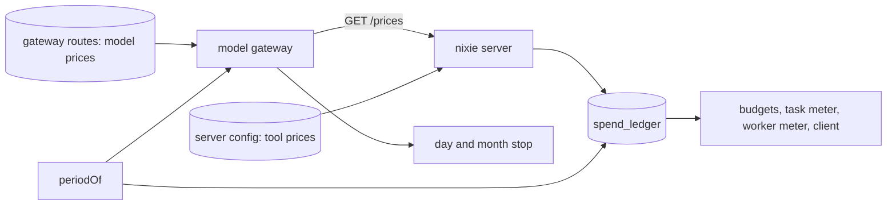

# One price list and one ledger

- **Status:** draft
- Decisions: [0012](../../decisions/0012-spending-stop.md), which puts the count that stops spending
  in the model gateway, outside nixie

nixie prices model tokens, searches and pictures, and counts what it spent against a day, a month, a
task run, a worker run or a budget. Today a model's prices live in two config files that nothing
compares, a search's price is a constant in its adapter, and 4 counters keep spend in dollars as
floats, micros of a dollar, and 15-minute buckets of turns, each with its own idea of a day. So a
task's dollars and the gateway's dollars disagree for the same replies, and the wallet would add a
fifth counter in another currency. After this design, each price has one source, every count lands
in one ledger keyed by counter, unit and period, and one helper says when every period starts.

Once the owner approves this design, build its work items from it and the built
[spending stop](../../architecture/policy/spending-stop.md),
[budgets](../../architecture/policy/budgets.md) and
[model gateway](../../architecture/policy/model-gateway.md) it changes. The period helper and the
ledger come first, then the price list, then the task meter's move to call prices. The wallet builds
on the ledger.

## Shape



## Terms

- A **counter** is one thing a limit reads, such as `day`, `budget:search-day` or `task_run:<ID>`.
- A **unit** is what a counter counts: `micros:<currency>`, `tokens`, `turns` or `calls`.
- A **period** is the span a counter resets on: `day`, `week`, `month` or `none`, for a counter that
  never resets, such as a task run's.
- The **deployment currency** is the currency of model and tool prices, `USD` by default.

## Contracts

### Periods

```ts
// libs/periods, which the server and the gateway both import.
periodOf('day', Date.parse('2026-11-23T23:30:00Z'), 'Pacific/Auckland');
// → { kind: 'day', start: '2026-11-24', startsAtMs: 1795950000000, endsAtMs: 1796036400000 }

type PeriodKind = 'day' | 'week' | 'month' | 'none';
type Period = { kind: PeriodKind; start: string; startsAtMs: number; endsAtMs: number | null };
```

- Every counter takes its period from `periodOf` with the time tool's `default_zone`. A day starts
  at local midnight, a week on Monday, a month on the 1st.
- The gateway's day and month, the turn count, the budgets and the day's raise all use it. The turn
  count keeps its 15-minute buckets and sums them by `periodOf`'s bounds.
- `periodOf` handles a day that a clock change makes 23 or 25 hours long by its local bounds.

### Prices

```yaml
# The gateway's config holds every model price, as each route does today.
routes:
  claude:
    prices: { input: 3, cache_write: 3.75, cache_write_1h: 6, cached_input: 0.3, output: 15 } # …existing

# The server's config holds every other price, in micros of the deployment currency.
prices:
  currency: USD
  search: { per_call: 12000 } # Kagi's price, which the adapter's constant holds today
  images:
    openai: { 1024x1024: 42000, 1536x1024: 63000, 1024x1536: 63000 } # replaces images.profiles.*.prices
```

```ts
// models module. The server reads the route prices from the gateway at start and after each
// resend of the limits, and prices every call with them.
const prices = await gateway.readPrices(); // GET /prices
// → { currency: 'USD', routes: { claude: { input: 3, … } } }
```

- With a gateway, a model profile sets no `prices`; the server refuses to start when one does.
  **Why:** the gateway is the boundary that stops spending, so its table must be the one nixie
  prices with, and a nixie that a bug or an attacker changes can't lower it.
- Without a gateway, a profile's `prices` is the source, as today.
- The server refuses to start when a profile's route has no prices at the gateway, or the gateway's
  currency differs from `prices.currency`.
- A tool's price comes from `prices`, never from a constant in its adapter. A paid tool that a later
  design adds, such as a text message or a minute of speech, adds a key there.
- A changed price applies to calls after nixie reads it, and never reprices a recorded call.

### The ledger

```text
spend_ledger                plain table, log module; one row per counter, unit and period
  counter                   text   'day', 'month', 'budget:<id>', 'card:<account>', 'task_run:<id>',
                                   'worker_run:<id>', 'tool:<name>'
  unit                      text   'micros:USD', 'micros:EUR', 'tokens', 'turns', 'calls'
  period_kind               text   from PeriodKind
  period_start              text   from periodOf; '' for none
  amount                    int    never a float
  through_sequence          int    the last record folded in

spend_charges               plain table; one row per charge, as budget_charges holds today
  charge_id                 text   UUID
  counter, unit             text
  amount                    int
  for_kind, for_id          text   what spent it, such as a tool call or a model call
  credited                  int    0 or 1
```

- `spend_ledger` replaces `budget_ledger`, `spend_turns` and the task meter's sum over records. A
  migration copies `budget_ledger` and `spend_turns` into it, and a test checks that a rebuild from
  the records gives the same rows.
- Every amount is an integer: micros of a currency, tokens, turns or calls. The gateway's period
  store moves from float dollars to integer micros, as version 3 of its file; it reads version 2.
- `budget.charged`, `budget.credited`, `model.turn_ended` and `worker.turn_ended` keep their kinds.
  The ledger is a projection of them, so a rebuild reproduces it.
- A model call adds to `task_run:<id>` or `worker_run:<id>` with the call's price, from the guest's
  `call` frames, priced one call at a time with the route's table, as the gateway prices it. The
  task meter no longer prices a whole turn as one call.
- `model.turn_ended` gains each call's `micros`, so a rebuild needs no price table. A record without
  it is priced as today.
- A card's budget counts in the card's currency, as `micros:<currency>`. A charge in another
  currency converts at the charge, as [the wallet](wallet.md) sets out, and the ledger keeps the
  converted amount.

### What counts where

| Spend           | Price from        | Counted by the gateway | Counted in the ledger                               |
| --------------- | ----------------- | ---------------------- | --------------------------------------------------- |
| a model call    | the gateway route | day, month, sandbox    | `task_run`, `worker_run`, `turns` for day and month |
| a search        | `prices.search`   | no                     | `budget:search-*`, `tool:search` calls              |
| a picture       | `prices.images`   | no                     | `budget:image.draw-*`                               |
| a card purchase | the page's total  | no                     | `card:<account>`                                    |

- The stop reads the gateway's dollars and tokens and the ledger's turns, as today. A paid tool
  counts against its budget and never against the stop. **Why:** model dollars on a plan are
  notional, while tool dollars are real, as [budgets](../platform/policy/budgets.md) sets out.
- A worker run's dollars are the gateway's count for its sandbox when the gateway answers, and the
  ledger's otherwise. The ledger records the difference as today's `worker.gateway_charged`.
- The client shows each counter's amount and limit from the ledger, and the gateway's day and month
  from `GET /status`.

## Constraints

- Every limit reads exactly one counter, and every counter has exactly one writer.
- A charge and its ledger row commit in the transaction of the record that causes them.
- The gateway never reads nixie's ledger, and nixie never writes the gateway's store.
- The gateway's store and nixie's ledger may disagree by the gateway's estimates and lost counts.
  The client shows both figures when they differ by more than 1%.
- A conversion between currencies happens only at a card charge, with the rate and margin the wallet
  records.
- A float never holds an amount of money, outside the gateway's own config file of prices.

## Builder decides

- The migration's split into steps.
- How the client lays out the counters.
- The price list's key names beyond `search` and `images`.

## Out of scope

- A price for sandbox time, web fetches or storage. They stay unpriced, and the worker's minute
  limit stays a wall-time limit.
- What a coding session spends in atc, which the coding runner design keeps outside nixie.
- A price feed: prices stay hand-written in config, from each provider's price page.

## Open questions

- **The deployment currency.** Model and tool providers price in US dollars. The owner may want
  limits and the client in another currency, which needs a rate source for every model call. Until
  the owner decides, the deployment currency is `USD`, and only a wallet card counts in its own.
