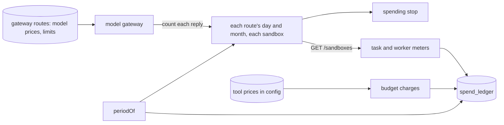

# One price source and one ledger

- **Status:** draft
- Decisions: [0012](../../decisions/0012-spending-stop.md), which puts the count that stops spending
  in the model gateway, outside nixie

nixie prices model tokens, searches and pictures, and counts what it spent against a day, a month, a
task run, a worker run or a budget. Today a model's prices live in two config files that nothing
compares, a search's price is a constant in its adapter, and a task run's dollars come from the
server pricing turn records its own way, so they disagree with the gateway's count of the same
replies. Budgets keep integer micros while the task meter sums floats, and each counter has its own
idea of a day. After this design, each price has one source. When a gateway runs, it counts the
model dollars nixie limits, a task run's dollars included, with a day and a month limit for each
route, so a subscription route and a pay-per-token route each have their own cap and their own
count. Every other money count lands in one ledger keyed by counter, unit and period, and one helper
works out when every period starts. Every count is in US dollars, and the client shows each figure
in your own currency beside it.

Once the owner approves this design, build its work items from it and the built
[spending stop](../../architecture/policy/spending-stop.md),
[budgets](../../architecture/policy/budgets.md) and
[model gateway](../../architecture/policy/model-gateway.md) it changes. The task meter's move needs
the gateway's per-route counts, the ledger needs the task meter's `task.meter_read`, and the wallet
needs the ledger.

## Shape



## Terms

- A **counter** is one thing a limit reads, such as `budget:search-day` or `task_run:<ID>`.
- A **unit** is what a counter counts: `micros:<currency>` or `tokens`.
- A **period** is the span a counter resets on: `day`, `week`, `month` or `none`, for a counter that
  never resets, such as a task run's.
- A **route** is one of the gateway's upstreams, such as a model subscription or a pay-per-token
  provider.

## Contracts

### Periods

```ts
// libs/periods, which the server and the gateway both import.
periodOf('day', Date.parse('2026-11-23T23:30:00Z'), 'Pacific/Auckland');
// → { kind: 'day', start: '2026-11-24', startsAtMs, endsAtMs }

type PeriodKind = 'day' | 'week' | 'month' | 'none';
type Period = { kind: PeriodKind; start: string; startsAtMs: number; endsAtMs: number | null };
```

- Every counter takes its period from `periodOf` with the time tool's `default_zone`. A day starts
  at local midnight, a week on Monday, a month on the 1st. A clock change makes a day shorter or
  longer by its shift.
- `periodOf` replaces the gateway's reset helper, the budgets' period code and the turn count's
  sums, and gives the same bounds they give today. The turn count keeps its 15-minute buckets, so
  the time tool refuses a `default_zone` whose offset isn't a whole number of 15 minutes.

### Prices

| Price                  | Its one source                                    | Unit                         |
| ---------------------- | ------------------------------------------------- | ---------------------------- |
| a model's tokens       | the gateway route's `prices`, when a gateway runs | dollars per million tokens   |
| a model's tokens       | the profile's `prices`, when no gateway runs      | dollars per million tokens   |
| a search               | `search.price_micros` in the server config        | micros of a dollar per call  |
| a picture of each size | `images.profiles.<id>.prices`, as today           | micros of a dollar per image |

- With a gateway, every model dollar nixie limits is the gateway's count. The one exception is a
  worker run whose end read gets no answer, as the task meter section sets out. A profile then sets
  no `prices`, and a config file that sets them beside a gateway fails to load, with an error that
  names the route's `prices`.
- A subscription route sets `prices` at the provider's API rates, so its count shows what the same
  use would cost at those rates.
- `search.price_micros` defaults to Kagi's 12,000. The search tool charges it and records it as the
  call's cost, from the one value.
- A changed price applies to calls after the process that holds it reads it, and never reprices a
  recorded call.

### The gateway's count per route

```yaml
# The gateway config. Each route has its own limits, in US dollars. No limit spans routes.
routes:
  anthropic-plan:
    prices: { input: 3, output: 15 } # …existing
    limits: { day: 40, month: 600 }
  openrouter:
    prices: { input: 1.25, output: 10 }
    limits: { day: 5, month: 50 }
```

```ts
// model gateway. GET /status keeps today's fields, one set per route.
// → { routes: { 'anthropic-plan': { day: { dollars: 12.4, limit: 40, tripped: false },
//                                   month: { dollars: 211.9, limit: 600, tripped: false } },
//               openrouter: { day: { dollars: 5.02, limit: 5, tripped: true, sinceMs }, … } } }

// GET /sandboxes/<name> gains the last refusal, so the runner can tell why a step stopped.
// → { dollars: 1.84, tokens: 610000, tripped: false,
//     lastRefusal: { counter: 'route_day', route: 'openrouter', atMs: 1795960000000 } }
```

```json
// The 403 when a route's day or month count reached its limit, or a sandbox's.
{
  "type": "error",
  "error": {
    "type": "limit_reached",
    "counter": "route_day",
    "route": "openrouter",
    "message": "…"
  }
}
```

- The gateway counts each reply after it arrives, as today, into its route's day and month and into
  the request's sandbox. A request that starts under a limit sends, and its reply may take the count
  past the limit by that one reply.
- A route whose day or month count reached its limit refuses every request on that route until the
  period resets or you raise the limit. Every other route goes on.
- `tripped` keeps its meaning per route: the count reached the limit. The spending stop trips a
  route only on it.
- A step whose sandbox refused it, by `lastRefusal` since the step began, ends with `limit`. A
  conversation step or a task step refused on a route's day or month waits and retries as a step
  does while the stop is unreachable.
- When a route trips, nixie sends you a notice that names the route and its limit. The model's next
  wake after a wait tells it that it was paused for a spending limit and for how long. The model
  never sees a dollar figure: a paused call tells it only to wait.

### The task and worker meters

```text
PATCH /sandboxes/<name>   { "limit": { "dollars": 1.6, "tokens"?: 2000000 } | null }
  sets the sandbox's limit whole, and keeps its count; 200, or 404 for an unknown name

task.meter_read           { taskRunID, sandbox, reason, countMicros }
  reason: 'run_start' | 'step_start' | 'step_end' | 'worker_end' | 'run_end'
```

- A task keeps its sandbox across its task runs, and replaces it when the host loses it. A task
  run's dollars are, for each sandbox it used, the last count less the count at the task run's start
  or at the sandbox's creation, summed, plus each of its worker runs' dollars.
- What a task run has left is its limit less its dollars.
- At a task run's start, the server sets the sandbox's limit to its count plus the task run's limit.
  When a worker run starts, the limit drops by the worker run's planned limit; when it ends, the
  planned limit comes back and what the worker run spent comes off. Each worker run's planned limit
  is at most what the task run has left after the planned limits of the worker runs already going.
- A `task-raise` patches the limit after its commit, retried until it succeeds; the next task run's
  start sets it too.
- The server reads the count with `GET /sandboxes/<name>` at each reason above, and writes each read
  as `task.meter_read`, rounded up to the micro. When a read before a step gets no answer, the step
  doesn't start and retries as a step does while the stop is unreachable. When any other read gets
  no answer, the next read catches up, and a task run waits to close until its end read succeeds.
- At a restart, the server registers a sandbox with `PUT` only when the gateway has no such name,
  and patches every other.
- A worker run keeps today's rule: its limit is the smaller of `workerRun` and what its task run has
  left, and when the gateway doesn't answer at its end, it charges the larger of its planned dollars
  and its own tally, recorded in `worker.gateway_charged` as today.
- With a gateway, the runner's own pricing of each call, its interrupt at the dollar limit, its read
  of late spend, `task.failed_turn_spent` and `task.turn_spend_unrecorded` go: the sandbox's limit
  replaces them.
- Without a gateway, the task meter prices the guest's call frames with the profile's table, as
  today, and writes `task.meter_read` at the same points.
- A task run's start record gains `meter: 'gateway' | 'records'`. A task run whose start record has
  no `meter` began before this design, and keeps today's meter until it ends.

### The ledger

```text
spend_ledger          plain table, log module
  ledger_key          text   primary key: counter, unit, period kind and period start, joined
  counter             text   'budget:<id>', 'task_run:<id>', 'worker_run:<id>'
  unit                text   'micros:USD', 'micros:<a card's currency>', 'tokens'
  period_kind         text   from PeriodKind
  period_start        text   from periodOf; '' for none
  amount              int
```

- The ledger is a projection of `budget.charged`, `budget.credited`, `task.meter_read` and
  `worker.run_ended`, so a rebuild reproduces it. A budget charge adds to its row and a credit
  subtracts. A `task.meter_read` or a `worker.run_ended` sets its task run's or worker run's row to
  that run's dollars, and a worker run's row also holds its tokens.
- A budget charge records its `ledger_key`, and a credit subtracts from that key, so a credit lands
  on the row its charge added to, whatever the budget's period is by then. A charge from before this
  design has no key, and its credit uses its budget ID, `periodStart` and the period kind the budget
  had at the charge's sequence.
- `spend_ledger` replaces `budget_ledger`. The migration that adds it drops `budget_ledger`, and the
  first rebuild fills `spend_ledger` from the records.
- Every amount in the ledger is an integer. A dollar amount from the gateway converts to micros
  rounded up.
- `search_calls`, the search tool's daily call count, and the turn count stay in their own tables:
  each counts calls or turns, and its limit reads that table.
- A wallet card's budget, `card-<account>`, is a budget like any other, counted in the card's
  currency. Its charge, its conversion and its lifecycle are [the wallet's](wallet.md).

### What counts where

| Spend           | Counted by the gateway                        | Counted in the ledger                                                                                |
| --------------- | --------------------------------------------- | ---------------------------------------------------------------------------------------------------- |
| a model call    | its route's day and month, the call's sandbox | a task's or a worker's call: `task_run` or `worker_run`, from the gateway; a conversation's call: no |
| a search        | no                                            | `budget:search-*`                                                                                    |
| a picture       | no                                            | `budget:image.draw-*`                                                                                |
| a card purchase | no                                            | `budget:card-<account>`                                                                              |

- The stop reads each route's day and month and the turn count. A paid tool counts against its
  budget and never against the stop. Model dollars on a plan are notional, while tool dollars are
  real, as [budgets](../../architecture/policy/budgets.md) sets out.

### Your currency in the client

```yaml
# The server config. Counts and limits stay in US dollars; this only changes what the client shows.
display:
  currency: AUD
```

- The server reads one US dollar rate for `display.currency` once a day, and keeps the last rate it
  read. The client shows each dollar figure with the converted amount beside it, marked as
  approximate, such as "$12.40 (about A$19)".
- You set every limit in US dollars. When no rate has been read yet, the client shows US dollars
  only.

## Constraints

- Every counter has exactly one writer. A limit reads one counter, except a task run's limit, which
  reads its sandboxes' counts and its worker runs' counters as the task meter section sets out.
- A budget charge and its ledger row commit in the transaction of the record that causes them.
- The gateway never reads nixie's ledger, and nixie changes the gateway's store only through the
  control listener's calls.
- The gateway takes its day and month from `periods.zone`, which the server's start check already
  holds equal to the time tool's `default_zone`. A changed zone takes effect at the next reset.
- Without a gateway, nothing stops model spend outside nixie, as today; the deployment's provider
  limit is the only backstop, as decision 0012 sets out.
- The model never reads a dollar figure, a limit or a rate, from any tool or notice.

## Builder decides

- The build order and how the work splits into pull requests, within the needs in the opening.
- How the client lays out the ledger's counters and each route's counts.
- The source of the daily exchange rate.
- The wording of the notice when a route trips, and of the model's line after a wait.

## Out of scope

- A price for sandbox time, web fetches or storage. They stay unpriced, and the worker's minute
  limit stays a wall-time limit.
- What a coding session spends in atc, which the coding runner design keeps outside nixie.
- A price feed: prices stay hand-written in config, from each provider's price page.
- Reserving a turn or a worst case before a step runs. The turn count stays a count of finished
  turns, and the gateway counts each reply after it arrives.
- A limit that spans routes.
