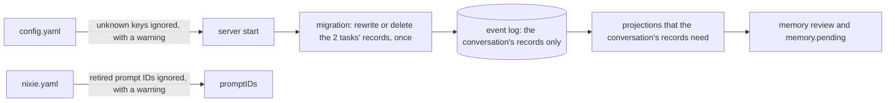

# nixie with no built-in memory task

- **Status:** draft
- **Work items:**
  [the migration of the 2 tasks' stored records](https://linear.app/zgeoff/issue/GEO-2664),
  [the note-taker delete](https://linear.app/zgeoff/issue/GEO-1849),
  [the consolidator delete](https://linear.app/zgeoff/issue/GEO-2114),
  [the deploy and its rollback](https://linear.app/zgeoff/issue/GEO-2556)

One release deletes nixie's 2 built-in memory tasks, the note-taker and the consolidator. A database
migration runs once at the first start of that release. It rewrites each stored record of the 2
tasks as the conversation's own, or deletes it where the conversation has no such record, so the log
holds no trace of either task. The deletes then remove every parser, fold, projection and origin
value that only those records needed. nixie ignores the 2 tasks' config sections with a warning, and
a task that the agent starts does their work through the ordinary memory tools.

Terms that the [glossary](../../glossary.md) lacks:

- **Note-taker:** the system task `memory-writer`, which saved memories from the conversation in
  batches.
- **Consolidator:** the system task `memory-consolidator`, which proposed a diff of merges and
  rewrites once a week.
- **Retired prompt ID:** `writer` or `consolidator`, which only a manifest file can still name.

## Shape



## Contracts

### The off config

```ts
// server test-utils. The tests of the delete read this one constant.
export const builtInMemoryTasksOffConfig = `
memory_writer:
  enabled: false
memory_consolidation:
  enabled: false
`;
```

### The system tasks

```ts
// server: the built map from a system task ID to its step
const systemSteps = new Map([[conversationTaskID, reader.get('conversation_imp').runStep]]);
```

### The prompt IDs

```ts
// prompts module. promptIDs feeds the manifest schema, the prompt tools, the render and every
// parser of stored data, because the migration leaves no stored record of a retired prompt ID.
export const promptIDs = [
  'content-checker',
  'retirement-checker',
  'session',
  'compaction',
  'task',
] as const satisfies readonly PromptID[]; // PromptID loses 'writer' and 'consolidator'
```

### The status procedures

```ts
memory.writerStatus(); // a constant, because no projection holds a note-taker row
// → { isEnabled: false, backlog: 0, batches: 0, cursor: 0, failures: 0,
//     isCatchingUp: false, lastError: null, retryAt: null }
memory.consolidatorStatus();
// → { isEnabled: false }

// API contract: both keep their built output schemas and gain .route({ deprecated: true }), as
// log.follow has. consolidatorStatus's built schema is { isEnabled: boolean }.
```

### The config that nixie ignores

```yaml
# config.yaml: nixie ignores each of these keys, whatever it holds, and logs a warning that names it
memory_writer: {}
memory_consolidation: {}
models:
  roles:
    memory-writer: {}
    memory-consolidator: {}
```

```yaml
# nixie.yaml: the seed ignores either key, logs a warning that names it, and keeps the rest
prompts:
  writer: {}
  consolidator: {}
```

### The origin `memory_writer`

The migration rewrites every stored `memory_writer` origin to `conversation`. The origin leaves the
parsers of stored records, the table checks, the API and host contracts, the export schema, the
renderers and the web screens. No reader holds a case for it.

## Constraints

### Who writes memory

- Only the conversation and a task write memory, through the ordinary memory tools and the write
  gate.
- nixie registers neither `memory.flag-self-note` nor `memory.consolidate`. The conversation holds
  neither `memory.diff` nor `memory.comment`, and the host has no `memory-diff` command.
- Each rewrite or retirement by a task is its own proposal or applied version. nixie never gathers
  them in one diff.

### What anyone reads

- No screen, contract, export, tool or prompt shows the note-taker, by name, by origin or by a
  sentence about it. A record it wrote reads as one the conversation wrote, because the migration
  made it one.
- The web review drops the note-taker from every sentence, such as the one for the reason
  `sensitive`.
- No code writes, parses or renders a catch-up record or a self-note flag record.
- Text of an item or of a message that holds "note-taker" renders as stored.

### The migration of the 2 tasks' records

The migration is one data-only file in `libs/db`. It uses literal strings and imports nothing
outside the package, so it keeps working after the deletes remove the code. It raises the oldest
reader of the schema, because a release before it would find its note-taker cursor gone and run the
catch-up again. The unit and integration tests of the migration go with the deletes, so the file is
its only trace.

- It rewrites these records in place, with the same sequence, key and sealed fields:
  - a `memory.version_added` of the note-taker, or of an approved consolidation change, gets the
    origin `conversation`, the task `conversation` and the thread `conversation`. A change's version
    also loses its proposal ID, approval ID and action hash, which named the change;
  - a `memory.proposed` or `memory.proposal_merged` of the note-taker gets the same origin, task and
    thread;
  - the approval, rejection, lapse, pin, sensitive and subject records of a note-taker proposal or
    version move to the thread `conversation`;
  - a cap group or notice key `batch/<start>-<end>` becomes `turn/conversation/<end>`;
  - a step key of either task becomes null.
- It deletes these records, with their projection changes and attachments:
  - the 11 kinds that only the 2 tasks write: `memory.writer_started`, `memory.batch_planned`,
    `memory.batch_published`, `memory.writer_failed`, `memory.self_note_flagged` and the 6
    `memory.consolidation_*` kinds;
  - a `memory.notice` of `batch` or `catch_up`;
  - every other record on the thread `memory-writer` or `memory-consolidator`, and every message
    addressed to either task;
  - the prompt override proposals for `writer` and `consolidator`, with the records that close them;
  - a record that forgets a deleted record, and a record that says the owner opened a deleted logged
    request.
- It keeps the `sandbox.*` records of the 2 tasks and the sandboxes they fold. Their VMs live
  outside the database, and only a recovery that reads these records can destroy them. They sit on
  no thread.
- It deletes the rows of the 2 tasks in the task, timer, lease, message, action, pause-exemption,
  writer, consolidation, logged-request and prompt-approval tables. It patches the memory and
  proposal rows and every projection change that held a rewritten value, and recomputes each thread.
  A rebuild of the projections afterwards gives the rows it left.
- It stops, and changes nothing, when a message from either task reaches another task, or when a
  kept record or projection row points at a deleted record: as its parent, or through a field that
  holds that record's sequence.
- It never stops for a read cursor, a through mark or a held-from mark that sits on a deleted
  record. Every reader compares such a mark with a sequence, so the mark stays valid.
- The keys of the deleted erasable records stay in the key store, which a migration cannot reach. An
  unused key with no record is the state that a failed write already leaves.
- A second run changes no row.
- A pending proposal stays pending, with its review state. An open consolidation diff is dropped,
  because nothing reads it once the consolidator is gone.
- This release ships before [the evidence purge](evidence-purge.md#one-release-and-a-rollback),
  whose start scrubs each merge change once.

### The task directory

- The task directory lists neither task, so neither is a recipient of `task.message`.
- nixie never creates either task.

### The config and the manifest

- nixie ignores each of these keys in `config.yaml`, as it ignores every key it does not know, and
  logs a warning at start that names it. A section with any content, `enabled: false` included, has
  no effect.
- When `nixie.yaml` holds one of these keys, the seed ignores it, logs a warning that names it, and
  keeps the rest of the manifest.

### Stored prompt IDs

- The migration removes the prompt IDs `writer` and `consolidator` from every stored definition in
  force, keeping the snapshot hashes, and deletes their approvals, export state and override
  proposals.
- A manifest that holds either key is ignored with a warning that names it, and the rest of the
  manifest seeds.

### The status procedures

- The web client calls neither status procedure. Its session probe is `sessions.list`.
- The API serves both, because a browser tab that loaded an earlier web client probes the session
  with `memory.writerStatus`.

### A rollback

The migration raises the oldest reader of the schema, so a rollback to a release before it needs the
copy of the database that the migration took before it ran, or a backup. A release that still holds
the built-in tasks then runs both again, because each `enabled` key defaults to `true`. A deployment
on a release before v0.41.0 takes v0.41.0 or later before it takes the delete.

## Decisions

- **nixie has no built-in memory task, and a started task does the work.**
- **The 2 deletes are one release.** A deployment takes the release in one deploy, and its old
  sections only log a warning until it drops them.
- **A migration rewrites the stored records, so the log holds no trace of either task.** The owner
  chose it over keeping the records and reading them as the conversation's, because the rewrite
  deletes every stored parser, fold and `runOffTaskStep` that those records needed.
- **A note-taker approval, rejection, lapse and subject record moves to the conversation too.** They
  close or mark a record that moved, so a rebuild still gives the same rows.
- **The `sandbox.*` records of the 2 tasks stay.** A recovery that reads them is the only way to
  destroy their VMs.
- **A request of either task that the turn-input log holds goes with its record.** The migration
  deletes the rows, and the next start removes the files no row holds.
- **The keys of deleted records stay.** The migration cannot reach the key store, and an unused key
  is the state a failed write leaves.

## Builder decides

- Internal names and the layout of the tests.

## Out of scope

- A trigger source that starts a task on each log record. The note-taking example runs on a
  schedule.
- A stub config section, a start check on the 2 tasks, and a record that closes either task.
- A rewrite of the text of stored items, proposals or messages that hold "note-taker".
- Memory triage: no set-aside, no `memory.reword`, no `memory.propose_change`, no reword gate, and
  no triage query, record or view.
- The release that takes the 2 status procedures out of the API contract.
- The example task definitions, which the definitions work owns.

## Open questions

None.
