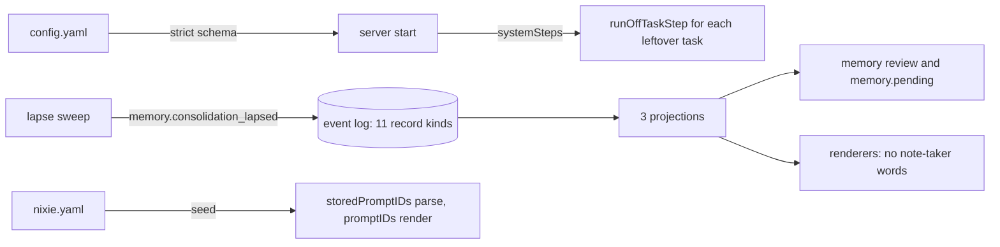

# nixie with no built-in memory task

- **Status:** draft
- **Decision records:** [0050](../../decisions/0050-no-built-in-memory-tasks.md),
  [0049](../../decisions/0049-milestone-deploys-and-the-rollback-target.md)
- **Work items:** the fixtures, the note-taker delete, the consolidator delete, the deploy and its
  rollback

One release deletes nixie's 2 built-in memory tasks, the note-taker and the consolidator. A
deployment's event log still holds what they wrote, so nixie keeps parsing and folding those records
and renders them to the agent in words that name no note-taker. A task of the 2 that a log still
holds gets the built `runOffTaskStep`, which empties its inbox and does nothing else. The config
refuses the 2 tasks' sections, and a task that the agent starts does their work through the ordinary
memory tools.

Terms that the [glossary](../../glossary.md) lacks:

- **Note-taker:** the system task `memory-writer`, which saved memories from the conversation in
  batches.
- **Consolidator:** the system task `memory-consolidator`, which proposed a diff of merges and
  rewrites once a week.
- **Leftover task:** either system task, in the log of a deployment that ran a release with the
  built-in tasks.
- **Retired prompt ID:** `writer` or `consolidator`, which only stored data holds.

## Shape



## Contracts

### The log fixtures and their loader

```ts
const { log } = await startTestLog();
await loadLogFixture(log, memoryTasksFixture); // a fixture read from its committed JSON file
// → resolves; a rebuild of the projections then gives the tables that the fixture script's log had
```

```ts
// log module, test-utils, beside startTestLog. The memory, prompts and definitions tests read it.
function loadLogFixture(
  log: Pick<Log, 'deploymentKey' | 'writer'>,
  fixture: LogFixture,
): Promise<void>;

interface LogFixture {
  // base64 of the raw AES-KW key that the fixture script's log wrapped every record key under.
  // startTestLog makes a new non-extractable key per log, so the loader unwraps each record key
  // with this one and wraps it again under log.deploymentKey.
  deploymentKey: string;
  keys: readonly { keyID: string; wrapped: string }[]; // base64, as the key store holds them
  records: readonly JSONObject[]; // each row of the record table as stored, sealed fields in base64
}

// The loader copies each row as stored, sequence included, into an empty test log, and writes
// each key row. It appends nothing through the writer. A later migration of the stored format
// runs over a loaded fixture as it runs over a deployment's log.

// startTestLog gains one option, so the fixture script's log has a key it can export:
function startTestLog(options?: { deploymentKey?: CryptoKey }): Promise<TestLog>; // TestLog as built
```

### The off config

```ts
// server test-utils. The tests of the delete and the rollback check read this one constant.
export const builtInMemoryTasksOffConfig = `
memory_writer:
  enabled: false
memory_consolidation:
  enabled: false
`;
```

### The steps of the leftover tasks

```ts
// server: the built map from a system task ID to its step
const systemSteps = new Map([
  [conversationTaskID, reader.get('conversation_imp').runStep],
  [memoryWriterTaskID, runOffTaskStep], // 'memory-writer'
  [memoryConsolidatorTaskID, runOffTaskStep], // 'memory-consolidator'
]);
```

### The prompt IDs

The note-taker delete adds `storedPromptIDs` with `writer`, and the consolidator delete moves
`consolidator` into it.

```ts
// prompts module. promptIDs feeds the manifest schema, the prompt tools and the render.
export const promptIDs = [
  'content-checker',
  'retirement-checker',
  'session',
  'compaction',
  'task',
] as const satisfies readonly PromptID[]; // PromptID loses 'writer' and 'consolidator'

// The closed enum that parses stored data: a prompts.override_proposed record, the 2 readers of a
// stored approval's prompt ID, and the stored definitions in force.
export const storedPromptIDs = [...promptIDs, 'writer', 'consolidator'] as const;
export type StoredPromptID = (typeof storedPromptIDs)[number];
```

### The status procedures

```ts
memory.writerStatus(); // isEnabled is always false; every other field reads the memory_writer projection
// → { isEnabled: false, backlog: 0, batches: 212, cursor: 40981, failures: 0,
//     isCatchingUp: false, lastError: null, retryAt: null }
memory.consolidatorStatus();
// → { isEnabled: false }

// API contract: both keep their built output schemas and gain .route({ deprecated: true }), as
// log.follow has. consolidatorStatus's built schema is { isEnabled: boolean }.
```

### The config that nixie refuses

```yaml
# config.yaml: nixie refuses to start when any of these keys is present, whatever it holds
memory_writer: {}
memory_consolidation: {}
models:
  roles:
    memory-writer: {}
    memory-consolidator: {}
```

```yaml
# nixie.yaml: the seed refuses the manifest when either key is present
prompts:
  writer: {}
  consolidator: {}
```

### The words for the origin `memory_writer`

Each renderer turns a stored origin into words only when it renders a record for the agent.

| Renderer                  | Words for `memory_writer`                       |
| ------------------------- | ----------------------------------------------- |
| `sessionPrompt`           | no sentence, and no `instruction` part          |
| `renderMemoryLine`        | none                                            |
| `buildPendingTool`        | none, and its description holds no "note-taker" |
| `buildProposalAnswerKind` | a neutral phrase, such as "a proposal"          |
| `buildProposalMergeKind`  | a neutral phrase                                |
| `buildCatchUpKind`        | a neutral phrase                                |
| `buildSelfNoteFlagKind`   | a neutral phrase                                |

## Constraints

### Who writes memory

- Only the conversation and a task write memory, through the ordinary memory tools and the write
  gate.
- nixie registers neither `memory.flag-self-note` nor `memory.consolidate`. The conversation holds
  neither `memory.diff` nor `memory.comment`, and the host has no `memory-diff` command.
- Each rewrite or retirement by a task is its own proposal or applied version. nixie never gathers
  them in one diff.

### What the agent reads

- A neutral phrase never holds "note-taker", and nixie never renders "you noted it" for the origin
  `memory_writer`.
- nixie never rewrites a stored origin. A stored version or proposal keeps `memory_writer`.
- No code writes a catch-up record or a self-note flag record. `buildCatchUpKind` and
  `buildSelfNoteFlagKind` stay, and render only the records of each kind that a log holds.
- Text of an item or of a message that holds "note-taker" renders as stored.

### Stored records of the 2 tasks

- nixie parses each of the 11 record kinds, and the `memory_writer` projection and the 2
  consolidation projections fold them, so a rebuild from the log gives the same tables.
- A rebuild gives the same rows of `memory_consolidation_changes` as before the delete.
- Every enum that parses a stored record holds the origin `memory_writer`: the parsers of versions
  and proposals, the table check, the export schema, and the API and host contracts.
- A pending proposal with the origin `memory_writer` shows in memory review and in `memory.pending`.
  You approve or reject it, and it lapses at its stored time. An approval writes a version with the
  origin `memory_writer`.
- The memory view and the export show the model name of a version that the note-taker applied, read
  from its batch record.
- nixie never publishes a batch that a log holds as planned and not published.
- No tool, command or procedure answers a pending diff. The built lapse sweep lapses each pending
  change at its stored time, on the thread `memory-consolidator`, and applies nothing.
- A version that an approved change wrote reads as any version.
- nixie never reads a diff's sealed summary or a change's sealed text. A forget of the item destroys
  the key they are sealed under.

### The leftover tasks

- A step of a leftover task acknowledges each inbox entry and each due timer, writes no `memory.*`
  record, starts no model and never fails.
- The task directory lists neither task, so neither is a recipient of `task.message`.
- nixie never creates a leftover task on a log that has none, and never writes a record that closes
  one.

### The config and the manifest

- The strict config schemas give the refusal of `config.yaml`. nixie has no start check of its own
  on the 2 tasks, and refuses a section with any content, `enabled: false` included.
- When `nixie.yaml` holds a refused key, the server starts, the seed logs the status `refused`, and
  the definitions in force stay those of the last accepted manifest.

### Stored prompt IDs

- A pending proposal for a retired prompt ID shows in the host's pending list. A rejection closes
  it, and it lapses at its stored time.
- An approval of a proposal for a retired prompt ID is refused with one sentence that says the
  prompt is deleted, and writes nothing.
- nixie reads an override of a retired prompt ID in the stored definitions in force, and never
  renders it.

### The status procedures

- The web client calls neither status procedure. Its session probe is `sessions.list`.
- The API serves both, because a browser tab that loaded an earlier web client probes the session
  with `memory.writerStatus`.

### A rollback

The target is the last release the deployment ran, under
[0049](../../decisions/0049-milestone-deploys-and-the-rollback-target.md). Every shipped release
from v0.41.0 holds both `enabled` keys, each with the default `true`, and `runOffTaskStep`. A
deployment on an earlier release takes v0.41.0 or later before it takes the delete.

- Before a rollback to a release with the built-in tasks, the deployment sets
  `builtInMemoryTasksOffConfig` in `config.yaml`. The config edit and the release change are one
  deploy. A later deploy of the delete release removes both sections again.

| The deployment                                                  | What the rollback target does                                                              |
| --------------------------------------------------------------- | ------------------------------------------------------------------------------------------ |
| took the delete, and sets the constant                          | accepts the config, gives both tasks the off step, and parses every record kind in the log |
| took the delete, a started task wrote memory, sets the constant | reads those versions and proposals, whose origin is `task`                                 |
| took the delete, and rolls back with neither section            | starts both tasks: the note-taker reads every message since its cursor                     |
| first installed on the delete, with the constant                | creates neither task                                                                       |
| first installed on the delete, with neither section             | creates both tasks: the note-taker reads the conversation from its first message           |

## Decisions

- **nixie has no built-in memory task, and a started task does the work.**
  [0050](../../decisions/0050-no-built-in-memory-tasks.md)
- **The 2 deletes are one release, with one config break.** A deployment drops both sections and
  takes the release in one deploy. [0050](../../decisions/0050-no-built-in-memory-tasks.md)
- **Stored records stay, and the agent reads no "note-taker".**
  [0050](../../decisions/0050-no-built-in-memory-tasks.md)
- **A rollback sets the off config first.**
  [0049](../../decisions/0049-milestone-deploys-and-the-rollback-target.md)

## Builder decides

- The exact text of each neutral phrase, within the rules above.
- The sentence that refuses an approval for a retired prompt ID.
- How the fixture encodes a sealed field, and the fixture files' names.
- Internal names and the layout of the tests.

## Out of scope

- A trigger source that starts a task on each log record. The note-taking example runs on a
  schedule.
- A stub config section, a start check on the 2 tasks, and a record that closes either task.
- A rewrite of stored items, proposals or messages that hold "note-taker".
- Memory triage: no set-aside, no `memory.reword`, no `memory.propose_change`, no reword gate, and
  no triage query, record or view.
- The release that takes the 2 status procedures out of the API contract.
- The example task definitions, which the definitions work owns.

## Open questions

- **Does the web review screen show "note-taker" for a record the note-taker wrote?** The owner
  settles it: show the word, because it names what wrote the record, or use neutral words as the
  agent's renderers do. The web sentence for the reason `sensitive` holds the word too. Until then,
  the web review screen shows each origin and each reason as built.
