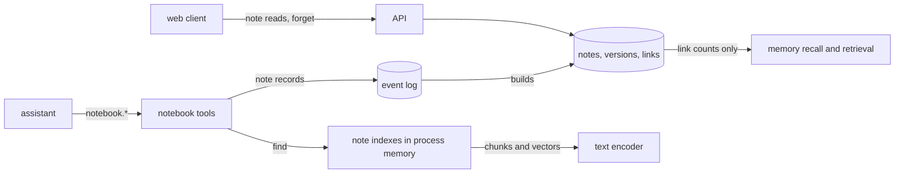

# The notebook

- **Status:** draft
- **Work items:**
  [the assistant keeps a notebook of linked notes](https://linear.app/zgeoff/issue/GEO-2726), with
  [images](https://linear.app/zgeoff/issue/GEO-2728) for the pictures a note shows

The assistant gets a notebook for thinking that is too long or too unsettled for memory: research, a
diary, an argument with one of its own items. Memory holds short facts that nixie puts in front of
the assistant each turn. A note is the assistant's own writing, and the assistant reads it only when
it opens or searches the notebook. nixie never puts a note in the context it builds for a turn.

A note has a short ID, a title, a markdown body of up to 50,000 characters, tags, versions, and a
private flag. A typed link from a note points at another note, a memory item, a moment or an event
of the log; the [glossary](../../glossary.md) defines these and the other nixie terms below. Recall
and retrieval show one fact about notes: a count on each item that a note disputes or supersedes.
You read every note in the web client, which shows the notebook read-only, with one control: Forget.
The assistant marks a note private to ask you not to read it. The web client folds its body until
you open it, and each opening leaves a mark the assistant sees.

## Shape



Memory never imports the notebook module. The server hands memory the notebook's link counts through
an interface that memory owns.

## Contracts

### The tools

```ts
notebook.write({
  title: 'Why the boiler keeps tripping',
  body: '## What I know\nThe trip happens after a cold night…',
  tags: ['home', 'boiler'],
});
// → { note: 'n4w8k2c6rd', version: 1 }

notebook.edit({
  note: 'n4w8k2c6rd',
  version: 1, // the version the assistant read
  changes: [{ find: 'after a cold night', replace: 'after a night under 2 °C' }],
});
// → { note: 'n4w8k2c6rd', version: 2 }

notebook.edit({ note: 'd8p3q1z6mw', append: '\n## 22 Nov\nTried the zine layout…' });
// → { note: 'd8p3q1z6mw', version: 15 }  // an append alone needs no version

notebook.read({ note: 'n4w8k2c6rd' });
// → { note: 'n4w8k2c6rd', version: 2, versionCount: 2, title: 'Why the boiler keeps tripping',
//     tags: ['home', 'boiler'], isPrivate: false, body: '## What I know\n…', part: 1, parts: 1,
//     updatedAt: '2026-11-21T08:10:00Z', readAt: '2026-11-20T19:02:00Z', // its read before this one
//     links: [{ type: 'cites', to: { event: '48213' }, reason: 'the engineer’s visit' }],
//     backlinks: [{ type: 'supersedes', from: 'h2m9t4x7qa', title: 'Boiler notes (old)' }],
//     linkCount: 1, backlinkCount: 1 }

notebook.read({ note: 'd8p3q1z6mw', find: 'zine layout' });
// → { …, isPrivate: true, ownerOpenedAt: null, part: 3, parts: 3, body: '…', // the part found
//     // ownerOpenedAt: your last opening of a private note in the web client, or null
//     matches: [{ part: 3, text: '…Tried the zine layout with two columns…' }] }

notebook.history({ note: 'n4w8k2c6rd' });
// → { note: 'n4w8k2c6rd', versions: [{ version: 2, at, writer: 'conversation', model, chars }, …],
//     next: null }

notebook.find({ query: 'heating cuts out in winter', tags: ['home'] });
// → { notes: [{ note: 'n4w8k2c6rd', title: 'Why the boiler keeps tripping', tags: ['home', 'boiler'],
//               version: 2, updatedAt, match: '…the trip happens after a night under 2 °C…',
//               score: { words: 4.1, meaning: 0.52 } }],
//     next: null, isMeaningPartial: false }

notebook.find({ order: 'oldest' });
// → the notes, oldest edit first, with no match or score

notebook.check({});
// → NotebookCheck, the same report the web client shows

notebook.link({
  from: 'n4w8k2c6rd',
  to: { memory: 'b7kq2m9xza' },
  type: 'disputes',
  reason: 'the item blames the thermostat; the trips say otherwise',
});
// → { linked: true }

notebook.unlink({ from: 'n4w8k2c6rd', to: { memory: 'b7kq2m9xza' }, type: 'disputes' });
// → { unlinked: true }, or { unlinked: false } when no such link existed

notebook.walk({ from: 'n4w8k2c6rd', hops: 2 });
// → { nodes: [{ note: 'n4w8k2c6rd', hops: 0, title: 'Why the boiler keeps tripping' },
//             { memory: 'b7kq2m9xza', hops: 1, gist: 'boiler serviced in March', state: 'active' },
//             { event: '48213', hops: 1, at: '2026-10-02T09:12:00Z', role: 'owner' },
//             { moment: 'm3c8v1k5wy', hops: 2, title: 'The engineer’s visit', state: 'active' }],
//     links: [{ from: 'n4w8k2c6rd', to: { memory: 'b7kq2m9xza' }, type: 'disputes', reason: '…' }, …],
//     gone: [{ moment: 'k1v6c3m8xe' }], isCut: false }
```

```ts
// notebook module
type LinkTarget = { note: string } | { memory: string } | { moment: string } | { event: string };
// note, memory and moment take a short ID, or a UUID, looked up in the declared kind's table; the
// link stores the UUID, and every result shows the short ID. event takes the decimal event ID that log.read shows: events have no
// short IDs, so this is the one target that breaks the short-ID rule.

type LinkType = 'supersedes' | 'disputes' | 'part-of' | 'cites' | 'related';

type NotebookWriteInput = {
  title: string; // one line, 1 to 200 characters
  body: string; // 1 character or more; past notebook.note_chars is NOTE_TOO_LONG
  tags?: string[]; // 0 to 10, each one line of 1 to 40 characters
  isPrivate?: boolean; // default false
};

type NotebookEditInput = {
  note: string;
  version?: number; // required unless append is the only field set
  body?: string; // a whole new body; never with changes or append
  changes?: { find: string; replace: string; all?: boolean }[]; // applied in order, each to the
  //   result of the last; all replaces every match, else a change needs exactly one match
  append?: string; // added to the end of the body, after any changes
  title?: string;
  tags?: string[]; // replaces the tags; [] clears them
  isPrivate?: boolean;
};

type NotebookReadInput = {
  note: string;
  version?: number; // default: the current version
  part?: number; // from 1; default 1; never with find
  find?: string; // plain text; returns the part where it first appears; never with part
};

type NotebookFindInput = {
  query?: string;
  tags?: string[]; // a note must hold every one
  by?: 'words' | 'meaning' | 'both'; // default 'both'
  order?: 'newest' | 'oldest'; // by last edit; only without query; default 'newest'
  after?: string; // the next cursor of the last result
};
// tags alone, or neither field, lists notes in order

type NotebookLinkInput = {
  from: string; // a note's short ID
  to: LinkTarget;
  type: LinkType;
  reason?: string; // one line, 1 to 200 characters; required for related
};

type WalkInput = { from: string; hops?: number; types?: LinkType[] };
// hops: 1 to 3, default 1. types narrows the links the walk follows

interface NotebookCheck {
  orphans: { note: string; title: string }[];
  dangling: { from: string; to: LinkTarget; type: LinkType }[]; // links whose target is gone
  repeatedReasons: { reason: string; count: number; links: { from: string; to: LinkTarget }[] }[];
  // each list holds at most 50 entries, oldest edit first; the counts give each total
  orphanCount: number;
  danglingCount: number;
  repeatedReasonCount: number;
}

// notebook.write, notebook.edit, notebook.link, notebook.unlink: effects ['note'], execution 'direct'
// notebook.read, notebook.history, notebook.find, notebook.check, notebook.walk: effects ['read'],
//   execution 'direct'
// every result field that holds note, title, tag, reason, gist or match text is 'untrusted';
//   IDs, versions, counts, flags and times are 'owner_data'
```

An input outside the shapes and limits above, such as a title over 200 characters, `hops` of 4 or
`order` with `query`, is a schema error that the tool layer returns before any refusal. Each tool
then checks its refusals in this order, and returns the first as a result with `refusalCode` and a
message that holds the ID the refusal is about. `notebook.find` and `notebook.check` have none.

| Tool               | Refusals, in order                                                                                                                        |
| ------------------ | ----------------------------------------------------------------------------------------------------------------------------------------- |
| `notebook.write`   | `NOTE_TOO_LONG`, `NOTEBOOK_FULL`                                                                                                          |
| `notebook.edit`    | `UNKNOWN_NOTE`, `NOTHING_TO_CHANGE`, `BODY_AND_CHANGES`, `VERSION_REQUIRED`, `STALE_VERSION`, `NO_MATCH`, `MANY_MATCHES`, `NOTE_TOO_LONG` |
| `notebook.read`    | `UNKNOWN_NOTE`, `UNKNOWN_VERSION`, `UNKNOWN_PART`, `NOT_FOUND`                                                                            |
| `notebook.history` | `UNKNOWN_NOTE`                                                                                                                            |
| `notebook.link`    | `UNKNOWN_NOTE`, `BAD_TARGET`, `UNKNOWN_TARGET`, `SELF_LINK`, `BAD_LINK`, `REASON_REQUIRED`, `PART_OF_CYCLE`                               |
| `notebook.unlink`  | `UNKNOWN_NOTE`, `BAD_TARGET`                                                                                                              |
| `notebook.walk`    | `UNKNOWN_NOTE`                                                                                                                            |

- `UNKNOWN_NOTE` covers a note that never existed, and one that is being forgotten or was forgotten.
- `BODY_AND_CHANGES` is a `body` with `changes` or `append`. `VERSION_REQUIRED` is an edit with no
  `version` that sets a field other than `append`.
- `STALE_VERSION` carries `currentVersion` beside `refusalCode`.
- `NO_MATCH` and `MANY_MATCHES` name the change by its index, and no change applies. A change with
  `all: true` is never `MANY_MATCHES`.
- `NOT_FOUND` is a `find` text that appears nowhere in the version, and carries `parts`.
- `BAD_TARGET` is an ID in no valid format. `UNKNOWN_TARGET` is a well-formed ID with no row of the
  declared kind, a target already forgotten or destroyed, or an event on a thread other than the
  caller's. A retired item is a valid target, so a note can supersede it. A note links to an event
  only on the caller's own thread: a message or tool result there. The refusal reads the same for
  each case, so a link never shows that a record on another thread exists.
- `BAD_LINK` is a type that the link kinds refuse between these kinds.

### Link kinds

| Type         | From | To                          | Meaning                                |
| ------------ | ---- | --------------------------- | -------------------------------------- |
| `supersedes` | note | note, memory                | this note replaces that one            |
| `disputes`   | note | note, memory                | this note argues with that; both stand |
| `part-of`    | note | note                        | this note belongs to that one          |
| `cites`      | note | note, memory, moment, event | this note rests on that                |
| `related`    | note | note, memory, moment, event | anything else, with its reason         |

A note holds at most one link of each type to each target. A second `notebook.link` with the same
source, target and type replaces the reason.

### The records

```text
notebook.note_written      -- the first version; no thread
  payload:  note (UUID), shortID, version 1, writer, model, chars, isPrivate
  erasable: title, body, tags
notebook.note_edited       -- each later version, written whole; no thread
  payload:  note, version, chars, writer, model, isPrivate
  erasable: title, body, tags
notebook.linked            -- a link, or a new reason for it; no thread
  payload:  from (UUID), to (LinkTarget), type
  erasable: reason, when present
notebook.unlinked          -- payload: from, to, type
notebook.note_read         -- payload: note; each notebook.read that returns a result
notebook.private_opened    -- payload: note; notebook.openPrivate in the web client
notebook.note_forgetting   -- payload: note, version; the forget's first part
notebook.note_forgotten    -- payload: note, shortID; the forget's end
```

`writer` is `'conversation'`, or the task ID of the task run whose turn called the tool. `model` is
the task run's model ID. The server sets both from the turn, never from the tool's input. The note
records sit on no thread, so a
[reset of the conversation](../../architecture/core/event-log.md#resetting-the-conversation) leaves
every note readable, as it leaves memory items.

Forgetting a record never erases a note's own records. Only forgetting the note erases them. The
notebook module exports `notebookErasableKinds`, as memory exports `memoryItemErasableKinds`, and
the [record forget](../../architecture/channels/api.md#forgetting-a-record) leaves those kinds out
as it leaves memory's.

### The tables

```text
notebook_notes                 -- notebook module
  note_id      text            -- primary key; the note's UUID
  short_id     text            -- from createShortID, carried in notebook.note_written
  state        text            -- 'active', 'forgetting' or 'forgotten'
  version      integer
  text_seq     integer         -- the record that holds the current title, body and tags
  is_private   integer
  created_at   integer
  edited_at    integer         -- the newest version
  read_at      integer null    -- the newest notebook.note_read record
  owner_opened_at integer null -- the newest notebook.private_opened record

notebook_versions
  note_id      text
  version      integer
  seq          integer         -- the record that holds this version's text
  writer       text            -- 'conversation' or a task ID
  model        text
  chars        integer
  created_at   integer

notebook_links
  from_note_id text
  target_kind  text            -- 'note', 'memory', 'moment' or 'event'
  target_id    text            -- the target's UUID, or an event ID; tools show the short ID
  type         text
  reason_seq   integer null    -- the notebook.linked record that holds the reason
  created_at   integer
  -- primary key (from_note_id, target_kind, target_id, type)
```

No table holds free text. At start, the notebook module decrypts the current version of every active
note, and keeps the titles, the tags, a keyword index and a vector index in process memory only,
built with the chunker, encoder and index code that memory exports for it, as the
[memory store's indexes](../../architecture/memory/store.md#the-indexes) do. An index on disk would
keep a forgotten note's words. The module encodes notes in the background after start, as memory
does, and meaning search reports `isMeaningPartial` until it finishes. The builder measures the
indexes' memory and the encoding time after a start with 1,000 notes of 50,000 characters, and
states both in the PR. When the indexes pass 512 MiB or the encoding passes 10 minutes, the builder
lowers the default `max_notes` until both fit.

### Memory's link counts

```ts
// memory module
interface ItemLinkCounts {
  readCounts(itemIDs: string[]): Promise<Map<string, { disputedBy: number; supersededBy: number }>>;
  // memory passes item UUIDs, the form links store
}
// the server passes the notebook module's implementation; memory imports nothing from notebook
// recall counts the two fields against its page budget

memory.recall({ query: 'boiler' });
// → { items: [{ item: 'b7kq2m9xza', text: 'The thermostat is faulty.', …existing fields,
//               disputedBy: 1 }] }   // a count above 0 only; never a note ID or title
```

Per-turn retrieval renders the same counts after the item's text, such as
`(disputed by 1 note · superseded by 1 note)`.

### The config

```yaml
# deployment config
notebook: # the notebook module reads it
  note_chars: 50000 # the most characters of one body
  max_notes: 1000 # active notes; a write past it is NOTEBOOK_FULL
  check_reason_repeats: 3 # a related reason on more links than this is repeated

forget_notices: # the server reads it; `forget_notices: false` turns every kind off
  note: true # default true
```

The [forget notices issue](https://linear.app/zgeoff/issue/GEO-2793) adds the `memory`, `moment` and
`message` keys.

### The events block

```text
22 Nov 14:05  Sam forgot note n4w8k2c6rd
```

The notebook module registers one entry in the
[events block](../../architecture/core/conversation-turns.md#the-events-block): one line for each
`notebook.note_forgotten` record, with the note's short ID. The name is `owner.name`, or "the owner"
when it is unset, as in the session prompt.

### The web client's calls

```ts
// contract lib
notebook.listNotes({ query?: string, tags?: string[], showPrivate?: boolean, after?: string });
// → { notes: [{ note, title, tags, version, updatedAt, backlinkCount, isPrivate, match? }], next,
//     isMeaningPartial }   // searches as notebook.find does with by 'both', 20 a page
notebook.readNote({ note: 'n4w8k2c6rd', version?: 2, showPrivate?: boolean, historyAfter?: string });
//   history: the notebook.history entries, 50 a page, with historyNext
// → { note, version, versionCount, title, tags, isPrivate, body, links, backlinks, history,
//     readAt, ownerOpenedAt }
//   each link carries its target's title or gist, or isGone
//   a private note leaves out body; a private note with showPrivate false returns
//   { note, isPrivate: true } alone
notebook.openPrivate({ clientActionID, note: 'd8p3q1z6mw', version?: 6 }); // a checked action
// → { body, previousBody, ownerOpenedAt }  // the version and the one before it, for the diff
//   appends one notebook.private_opened; UNKNOWN_NOTE | NOT_PRIVATE
notebook.readCheck({ showPrivate?: boolean }); // → NotebookCheck
notebook.previewForget({ note: 'n4w8k2c6rd' });
// → { version: 2, title, versionCount: 2, linkCount: 4, backlinkCount: 1 }
notebook.forget({ clientActionID, note: 'n4w8k2c6rd', version: 2 }); // a checked action
// → { forgottenAt, backup }  // backup: the backup sets staged at or after notebook.note_forgotten
//   or UNKNOWN_NOTE | STALE_VERSION
conversation.previewForget({ sequence });
// → { …existing fields, notes: { note, title }[] } // the active notes that link to the record
```

```ts
// connectors module: code.run gains a third kind of input file
code.run({ language: 'python', program: '…', files: [{ path: 'zine.md', note: 'd8p3q1z6mw' }] });
// the note's current body, as markdown

interface NoteBodies {
  readBody(shortID: string): Promise<string | null>; // null for an unknown or forgotten note
}
// connectors owns the interface, and the server passes the notebook module's implementation
```

## Constraints

Keeping notes out of context:

- Per-turn retrieval, the pinned core, the memory index, the session status and the compaction
  instruction never read a note's text, title or ID. The notebook module depends on memory, and
  memory never depends on the notebook module. Memory reads link counts only through
  `ItemLinkCounts`.
- The notebook registers no entry in the session status, and one entry in the events block, the
  forget line.
- The note indexes are the notebook module's own. A note never enters the item index, the trigger
  index or the moments' vector index, and a note has no trigger phrases.
- `memory.recall` and `moment.read` never list the notes that link to an item or a moment. Recall
  and retrieval show only the `disputedBy` and `supersededBy` counts, which count active notes,
  private ones included.
- A task gets the notebook tools only when its effective tool list holds them. The conversation's
  tool list holds all 9.
- A retrieval test holds that nixie adds no note text and no note ID to the blocks it builds, the
  session's opening, or any block before a turn's message, even when the message matches a note's
  title word for word. The test exempts an item's own text, which may hold a note ID the assistant
  wrote there, and the events block's forget line.
- The message of the `TEXT_TOO_LONG` refusal from `memory.remember` and `memory.edit` tells the
  assistant to write longer text as a note.

Records and text:

- The call record of every notebook tool leaves out the title, the body, the tags, the changes, the
  append, the find text, the reason and the query. The result record holds note short IDs and
  versions only, with each UUID under `hidden.uuids`
  ([tool calls](../../architecture/connectors/tool-calls.md#records)). So a note forget leaves no
  readable copy in a tool's records, and `log.read` shows a notebook result as IDs only.
- `notebook.read` reads `read_at` into its result, then appends `notebook.note_read` with the note's
  UUID alone. So `readAt` shows the read before this one. A refused read appends no record, and
  `read_at` stays as it was.
- A walk returns references and labels: a note's title, an item's gist and state, a moment's title
  and state as `moment.read` shows them, and an event's time and author role as `log.read` shows
  them. It never returns an item's text, a moment's text or a record's text.
- An event node shows its time and role only when the event sits on the calling task run's own
  thread and the run's tool list holds `log.read`. Otherwise the node holds the event ID alone. An
  item node shows its gist only when the run's tool list holds `memory.recall`.
- The web client is the user's own view, so `notebook.readNote` shows every target's title or gist.
- A body renders as a reply renders: markdown with no raw HTML and safe links only.
  `` shows a stored image, and the web client shows "image
  unavailable" for an image that is unknown or forgotten. `notebook.read` returns the body as
  written, and the assistant opens an image with `image.read`.
- The 4 write tools declare the `note` effect, which the starter `allow-notes` rule allows. Notes
  skip the memory gate, which checks claims about the user, because a note is the assistant's own
  writing.
- A `code.run` file with `note` copies the current body into the sandbox, which holds it unencrypted
  until the code run ends, as it holds fetched pages and files. `code.run` takes a `note` file only
  when the caller's effective tool list holds `notebook.read`, so it never reaches past that gate.
  It refuses an unknown or forgotten note, or a caller without `notebook.read`, with a message that
  holds the note's ID. `code.run` checks note files after file IDs and before page IDs.
- A note forget deletes the captured model requests in the
  [turn-input log](../../architecture/policy/turn-input-log.md) from the note's first record on, as
  a record forget does, because their tool results can hold the note's text. Notes sit on no thread,
  so the deletion names no threads and starts at the note's first record.
- A note forget never reaches a `code.run` result or a file its program wrote, as a forget of a
  message never reaches a reply that quoted it.

Versions and limits:

- Every edit writes the whole new version, title and tags included, so reading any version decrypts
  one record. No version is ever rewritten.
- An edit that changes only the title, the tags or the private flag makes a new version. An edit
  that sets no field is `NOTHING_TO_CHANGE`.
- An edit binds to the version it read, and the check and the record commit in one write
  transaction. An edit that sets only `append` binds to the current version at commit, so 2 tasks
  that append to one note never refuse each other. A link or an unlink never makes an edit stale.
- An edit applies its changes, then its append. `NOTE_TOO_LONG` checks the result.
- Tags that match ignoring case merge into one, with the first spelling kept.
- `notebook.read` pages a long body so that each whole result fits `recallPageLimitBytes`, 20,000
  bytes, cut at a paragraph break, then a line break, then a space. Every part repeats the title and
  the tags. Part 1 alone holds the links and the backlinks, at most 25 of each, and `linkCount` and
  `backlinkCount` give the totals; `notebook.walk` reaches the rest. A full note of plain English
  reads in about 3 parts, and text with many multi-byte characters in more.
- Every other result is cut to fit the tool output limit. A walk stops at 200 nodes, or sooner when
  its result would pass the limit, and sets `isCut` either way.
- `find` in `notebook.read` matches as `web_fetch` does: case-insensitive plain text over the body
  as stored, returning the part where the text first appears and up to 10 matches with about 50
  characters on each side.
- `notebook.history` lists versions newest first, 50 a call.
- `notebook.find` returns at most 20 notes a call. Its words search matches any query word, as the
  item keyword index does. Its meaning search encodes the title, the tags and the body in chunks
  with the encoder and chunking of the item vector index, and ranks a note by its best chunk above
  the 0.3 floor of `memory.recall`. Reciprocal rank fusion merges the two.
- Before each search, the module encodes every note written or edited since the last search, and
  waits up to 5 seconds. A note still unencoded then matches by words only, and the result sets
  `isMeaningPartial: true`.

Links and walks:

- A walk visits each node once, breadth first, and follows links both ways: a note's own links, and
  the links from other active notes to each node it reaches. So a walk passes through a memory item
  to the other notes that cite it.
- `gone` lists each target whose note, item or moment was forgotten or destroyed, and each event
  that a record forget or a conversation reset erased. A target in `gone` is never a node, and the
  walk goes no further from it.
- `PART_OF_CYCLE` checks the part-of links that exist when the link commits.
- A note ID written in a body is text. Only `notebook.link` makes a link, and the description of
  `notebook.check` says that a note named only in another note's text counts as an orphan.

Private notes:

- The private flag changes nothing for the assistant: every tool reads and finds a private note as
  any other. `ownerOpenedAt` shows in `notebook.read` on a private note only.
- With `showPrivate` false, the web client's calls leave out every private note, and every link to
  or from one, from the list, a note's links and backlinks, search and the check. No placeholder or
  count stands in.
- The web client keeps `showPrivate` in the URL, as `?private=1`. Turning it on writes no record.
- Only `notebook.openPrivate` appends `notebook.private_opened`. It is a
  [checked action](../../architecture/channels/api.md#checked-actions), so a refetch or a retry
  never moves the mark. Opening a note that isn't private writes nothing.
- With `showPrivate` false, the web client's check is built over every note, then has the private
  entries removed, so a note linked only from a private note never shows as an orphan.
- `notebook.previewForget` and `notebook.forget` work on a private note without opening it.

Forgets:

- Only `notebook.forget` in the web client forgets a note. No tool reaches it, so the assistant can
  supersede or rewrite a note and never destroy one.
- A note forget runs in 2 parts, as a
  [moment destroy](../../architecture/memory/moments.md#destroying-a-moment) does. One write
  transaction commits the client action, checks the version and appends `notebook.note_forgetting`,
  and from then on no tool or read reaches the note. The cleanup deletes the key of every version
  record and every `notebook.linked` record from the note, drops the note from the indexes, runs the
  [session cleanup](../../architecture/memory/context.md#forgetting-and-the-live-session) with
  `{ noteID }` as its cause, and appends `notebook.note_forgotten`. Each step is safe to run twice.
  When a crash cuts a forget short, the server finishes it at its next start.
- The session cleanup runs for the conversation and for each open task whose effective tool list
  holds any notebook tool. Memory's `CleanupCause`, the sessions module's `SessionCleanupCause` and
  the models module's `sessionCleanupCauseShape` each gain the `noteID` variant.
- The backup schedule counts `notebook.note_forgotten` as a forget record, beside the 4 kinds that
  [staging a set](../../architecture/deployment/backups.md#staging-a-set) lists, so it makes a
  forget set due. The backup module names the kind as a string, and imports nothing from the
  notebook module.
- A note forget drops the note's own links. A link from another note to it stays, and reads as gone
  in a walk and as dangling in the check.
- When you forget the item, moment or record a link points at, the link stays, and the walk lists
  the target in `gone`. A note's text that quotes the target also stays until you forget the note,
  so `conversation.previewForget` lists each note that links to the record, with a private note's
  title left out, and the confirmation shows that those notes keep their text. The API module reads
  those notes from the notebook module. The memory and moment previews stay as they are.
- The server parses `forget_notices`, and registers the notebook's events entry only when
  `forget_notices.note` is true.
- With `forget_notices.note` true, the events block lists each finished note forget once, at the
  time of `notebook.note_forgotten`, within the block's cap.

The check:

- The notebook module builds the check when it is read and stores nothing, so it holds no copy of a
  note's text. The web client's notebook view shows it on a tab of its own, and the assistant reads
  it only with `notebook.check`.
- A note is an orphan when it is active, holds no link, and no active note links to it.
- Two reasons are the same when they match after trimming, collapsing runs of spaces and ignoring
  case.

The web client:

- The bar gains a Notebook link after Moments. `/notebook` lists the notes newest edit first,
  searches by words, meaning and tags with `notebook.listNotes`, and opens each note at
  `/notebook/<note short ID>`. A "Show private notes" toggle sets `showPrivate`.
- A note shows its body, tags, versions with a word diff between each and the one before, its links
  grouped by type with their reasons and their targets' titles or gists, its backlinks, and when the
  assistant last read it. An event target shows its time, its role and the start of its text. A
  target links to its own view: a note, the memory view, a moment, or the record in its thread,
  through an anchor the conversation and task views gain where they lack one. A gone target shows as
  such. The diff reuses the memory view's word diff.
- A private note shows its title, links and marks, with its body folded under a line that says the
  assistant marked it private, and an Open button. The marks show when the assistant last read it
  and when you last opened it. Its versions and diffs show only after Open.
- A private note's path, opened with `showPrivate` false, shows "This note is private" with no
  title, and a button that turns the toggle on.
- The note view has no control that writes, except Forget, which opens a confirmation from
  `notebook.previewForget`.

Memory guidance:

- The descriptions of `memory.edit` and `memory.retire` gain one sentence: when you change your mind
  about an item, edit or retire it, and keep the argument in the notebook, linked to the item with
  `supersedes` or `disputes`.

## Decisions

- **Notes are records of the log with no thread.** The encrypted log, its backups and its history
  cover them, and neither a conversation reset nor a task's close shreds them.
- **The notebook is its own module, beside memory and never inside it.** A dependency that runs one
  way only keeps every path that builds context unable to read a note. Memory gets link counts
  through an interface it owns.
- **A link carries its target's kind.** A short ID alone does not show whether it belongs to a note,
  an item or a moment.
- **Only you forget a note.** The assistant's memory tools never forget an item either, so a misread
  "drop that" never destroys a note.
- **A walk returns labels, never text.** The text of an item, a moment or a record stays behind the
  tool that checks who may read it.
- **An item shows how many notes dispute or supersede it.** A count holds no text, and it drops on
  its own when a note is unlinked or forgotten. Without it, an item a note argues with still reads
  as settled when retrieval puts it in front of the assistant.
- **The check is a read.** nixie never pushes it: a pushed report would list notes the assistant
  never asked for. The assistant reads it with `notebook.check`, and sets itself a reminder when it
  wants to check on a schedule. The check lists only what the assistant can fix; `notebook.find`
  with `order: 'oldest'` finds old notes.
- **Every edit stores the whole version, and a body stops at 50,000 characters.** Reading any
  version stays one decrypt. The cost is accepted: a note that grows to the limit through 50 appends
  stores about 1.25 MB of versions, and only the note's forget reclaims it. A full note reads in
  about 3 parts, and a note that fills up continues in a new note linked `part-of`.
- **They are notes, not pages.** `web_fetch` and `code.run` already call a fetched web page a page,
  with a short ID that looks the same.
- **Forget is the one control in the web client.** The notebook is the assistant's own, so you ask
  the assistant to change a note. Forget stays because a note that quotes a forgotten message would
  otherwise keep that text until a full reset.
- **A private note is folded, not locked.** The user holds the keys, so a lock would promise what it
  can't keep. The fold makes not looking the default, and the mark on each opening means the
  assistant never has to take your word for it.

## Builder decides

- The tools' descriptions, beyond the memory guidance sentence and the orphan rule.
- The indexes on the tables, and the migration's number.
- The cursor format of `notebook.find`, `notebook.history` and `notebook.listNotes`, and the length
  of `match`.
- The refusal wording, and how the web client lays out the list, the note, the check tab and the
  fold.

## Out of scope

- Links that start from a memory item, a moment or an event.
- A note in retrieval, the pinned core or the memory index.
- Editing a note in the web client.
- Forgetting one version of a note. A forget takes the whole note.
- Links inside a body. A body's markdown links are text, and a walk follows only the links that
  `notebook.link` made.
- Forget notices for memory items, moments and messages, which the
  [forget notices issue](https://linear.app/zgeoff/issue/GEO-2793) adds.
- Showing a note on a device.
- Notes in the memory export.
