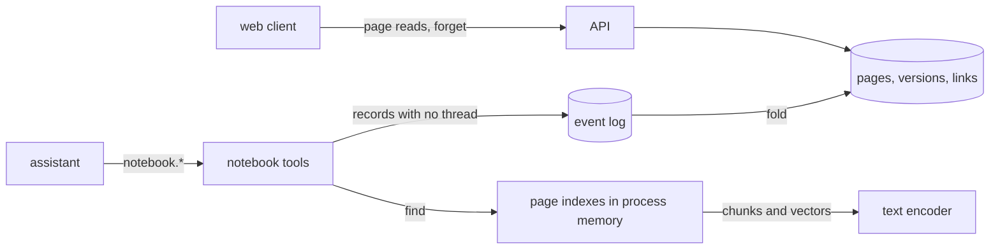

# The notebook

- **Status:** draft
- **Work items:**
  [the assistant keeps a notebook of linked pages](https://linear.app/zgeoff/issue/GEO-2726), with
  [images](https://linear.app/zgeoff/issue/GEO-2728) for the pictures a page shows

The assistant gets a notebook: pages it writes, edits, searches, links and walks, kept apart from
memory. A page has a short ID, a title, a markdown body of up to 50,000 characters, tags and
versions. A typed link from a page points at another page, a memory item, a moment or an event of
the log. A page never comes to the assistant on its own: no retrieval, opening or block shows one,
so the assistant reads a page only when it opens or searches the notebook. You read every page, its
links and its backlinks in the web client, which shows the notebook read-only and offers one
control, the forget of a page.

## Shape



Per-turn retrieval has no edge to the notebook: memory never depends on the notebook module.

## Contracts

### The tools

```ts
notebook.write({
  title: 'Why the boiler keeps tripping',
  body: '## What I know\nThe trip happens after a cold night…',
  tags: ['home', 'boiler'],
});
// → { page: 'n4w8k2c6rd', version: 1 }

notebook.edit({
  page: 'n4w8k2c6rd',
  version: 1, // the version the assistant read
  changes: [{ find: 'after a cold night', replace: 'after a night under 2 °C' }],
});
// → { page: 'n4w8k2c6rd', version: 2 }

notebook.read({ page: 'n4w8k2c6rd' });
// → { page: 'n4w8k2c6rd', version: 2, versionCount: 2, title: 'Why the boiler keeps tripping',
//     tags: ['home', 'boiler'], body: '## What I know\n…', part: 1, parts: 1,
//     updatedAt: '2026-11-21T08:10:00Z',
//     links: [{ type: 'cites', to: { event: '48213' }, reason: 'the engineer’s visit' }],
//     backlinks: [{ type: 'supersedes', from: 'h2m9t4x7qa', title: 'Boiler notes (old)' }],
//     linkCount: 1, backlinkCount: 1 }

notebook.history({ page: 'n4w8k2c6rd' });
// → { page: 'n4w8k2c6rd', versions: [{ version: 2, at, writer: 'conversation', model, chars }, …],
//     next: null }

notebook.find({ query: 'heating cuts out in winter', tags: ['home'] });
// → { pages: [{ page: 'n4w8k2c6rd', title: 'Why the boiler keeps tripping', tags: ['home', 'boiler'],
//               version: 2, updatedAt, match: '…the trip happens after a night under 2 °C…',
//               score: { words: 4.1, meaning: 0.52 } }],
//     next: null, isMeaningPartial: false }

notebook.tidy({});
// → TidyReport, the same report the web client shows

notebook.link({
  from: 'n4w8k2c6rd',
  to: { memory: 'b7kq2m9xza' },
  type: 'disputes',
  reason: 'the note blames the thermostat; the trips say otherwise',
});
// → { linked: true }

notebook.unlink({ from: 'n4w8k2c6rd', to: { memory: 'b7kq2m9xza' }, type: 'disputes' });
// → { unlinked: true }, or { unlinked: false } when no such link existed

notebook.walk({ from: 'n4w8k2c6rd', hops: 2 });
// → { nodes: [{ page: 'n4w8k2c6rd', hops: 0, title: 'Why the boiler keeps tripping' },
//             { memory: 'b7kq2m9xza', hops: 1, gist: 'boiler serviced in March', state: 'active' },
//             { event: '48213', hops: 1, at: '2026-10-02T09:12:00Z', role: 'user' },
//             { moment: 'm3c8v1k5wy', hops: 2, title: 'The engineer’s visit', state: 'active' }],
//     links: [{ from: 'n4w8k2c6rd', to: { memory: 'b7kq2m9xza' }, type: 'disputes', reason: '…' }, …],
//     gone: [{ moment: 'k1v6c3m8xe' }], isCut: false }
```

```ts
// notebook module
type LinkTarget = { page: string } | { memory: string } | { moment: string } | { event: string };
// page, memory and moment take a short ID. A UUID is looked up in the declared kind's table and
// stored as its short ID. event takes the decimal event ID that log.read shows: events have no
// short IDs, so this is the one target that breaks the short-ID rule.

type LinkType = 'supersedes' | 'disputes' | 'part-of' | 'cites' | 'related';

type NotebookWriteInput = {
  title: string; // one line, 1 to 200 characters
  body: string; // 1 to notebook.page_chars characters
  tags?: string[]; // 0 to 10, each one line of 1 to 40 characters
};

type NotebookEditInput = {
  page: string;
  version: number;
  body?: string; // a whole new body; never with changes
  changes?: { find: string; replace: string }[]; // applied in order, each to the result of the last
  title?: string;
  tags?: string[]; // replaces the tags; [] clears them
};

type NotebookReadInput = {
  page: string;
  version?: number; // default: the current version
  part?: number; // from 1; default 1
};

type NotebookFindInput = {
  query?: string;
  tags?: string[]; // a page must hold every one
  by?: 'words' | 'meaning' | 'both'; // default 'both'
  after?: string; // the next cursor of the last result
};
// tags alone, or neither field, lists pages newest edit first

type NotebookLinkInput = {
  from: string; // a page's short ID
  to: LinkTarget;
  type: LinkType;
  reason?: string; // one line, 1 to 200 characters; required for related
};

type WalkInput = { from: string; hops?: number; types?: LinkType[] };
// hops: 1 to 3, default 1. types narrows the links the walk follows

interface TidyReport {
  orphans: { page: string; title: string }[];
  dangling: { from: string; to: LinkTarget; type: LinkType }[]; // links whose target is gone
  untouched: { page: string; title: string; touchedAt: string }[];
  repeatedReasons: { reason: string; count: number; links: { from: string; to: LinkTarget }[] }[];
}

// notebook.write, notebook.edit, notebook.link, notebook.unlink: effects ['note'], execution 'direct'
// notebook.read, notebook.history, notebook.find, notebook.tidy, notebook.walk: effects ['read'],
//   execution 'direct'
// every result field that holds page, title, tag, reason, gist or match text is 'untrusted';
//   IDs, versions, counts and flags are 'owner_data'
```

Each tool checks its refusals in this order, and returns the first as a result with `refusalCode`
and a message that holds the ID it names:

| Tool               | Refusals, in order                                                                                                    |
| ------------------ | --------------------------------------------------------------------------------------------------------------------- |
| `notebook.write`   | `PAGE_TOO_LONG`, `NOTEBOOK_FULL`                                                                                      |
| `notebook.edit`    | `UNKNOWN_PAGE`, `NOTHING_TO_CHANGE`, `BODY_AND_CHANGES`, `STALE_VERSION`, `NO_MATCH`, `MANY_MATCHES`, `PAGE_TOO_LONG` |
| `notebook.read`    | `UNKNOWN_PAGE`, `UNKNOWN_VERSION`, `UNKNOWN_PART`                                                                     |
| `notebook.history` | `UNKNOWN_PAGE`                                                                                                        |
| `notebook.link`    | `UNKNOWN_PAGE`, `BAD_TARGET`, `UNKNOWN_TARGET`, `SELF_LINK`, `BAD_LINK`, `REASON_REQUIRED`, `PART_OF_CYCLE`           |
| `notebook.unlink`  | `UNKNOWN_PAGE`, `BAD_TARGET`                                                                                          |
| `notebook.walk`    | `UNKNOWN_PAGE`                                                                                                        |

- `UNKNOWN_PAGE` covers a page that never existed, and one that is being forgotten or was forgotten.
- `STALE_VERSION` carries `currentVersion` beside `refusalCode`.
- `NO_MATCH` and `MANY_MATCHES` name the change by its index, and no change applies.
- `BAD_TARGET` is an ID in no valid format. `UNKNOWN_TARGET` is a well-formed ID with no row of the
  declared kind, or an event with no record.
- `BAD_LINK` is a type that the link kinds refuse between these kinds.

### Link kinds

| Type         | From | To                          | Meaning                                |
| ------------ | ---- | --------------------------- | -------------------------------------- |
| `supersedes` | page | page, memory                | this page replaces that one            |
| `disputes`   | page | page, memory                | this page argues with that; both stand |
| `part-of`    | page | page                        | this page belongs to that one          |
| `cites`      | page | page, memory, moment, event | this page rests on that                |
| `related`    | page | page, memory, moment, event | anything else, with its reason         |

A page holds at most one link of each type to each target. A second `notebook.link` with the same
source, target and type replaces the reason.

### The records

```text
notebook.page_written      -- the first version; no thread
  payload:  page (UUID), shortID, version 1, writer, model, chars
  erasable: title, body, tags
notebook.page_edited       -- each later version, written whole; no thread
  payload:  page, version, chars, writer, model
  erasable: title, body, tags
notebook.linked            -- a link, or a new reason for it; no thread
  payload:  from (UUID), to (LinkTarget), type
  erasable: reason, when present
notebook.unlinked          -- payload: from, to, type
notebook.page_forgetting   -- payload: page, version; the forget's first part
notebook.page_forgotten    -- payload: page; the forget's end
```

`writer` is `'conversation'`, or the task ID of the task run whose turn called the tool. `model` is
the task run's model ID. The server sets both from the turn, never from the tool's input. The page
records sit on no thread, so a
[reset of the conversation](../../architecture/core/event-log.md#resetting-the-conversation) leaves
every page readable, as it leaves memory items.

A record forget never takes a page's own records: only the page's forget does. The notebook module
exports `notebookErasableKinds`, as memory exports `memoryItemErasableKinds`, and the
[record forget](../../architecture/channels/api.md#forgetting-a-record) leaves those kinds out as it
leaves memory's.

### The tables

```text
notebook_pages                 -- notebook module
  page_id      text            -- primary key; the page's UUID
  short_id     text            -- from createShortID, carried in notebook.page_written
  state        text            -- 'active', 'forgetting' or 'forgotten'
  version      integer
  text_seq     integer         -- the record that holds the current title, body and tags
  created_at   integer
  touched_at   integer         -- the newest version, or link added from or to the page

notebook_versions
  page_id      text
  version      integer
  seq          integer         -- the record that holds this version's text
  writer       text            -- 'conversation' or a task ID
  model        text
  chars        integer
  created_at   integer

notebook_links
  from_page_id text
  target_kind  text            -- 'page', 'memory', 'moment' or 'event'
  target_id    text            -- a short ID, or an event ID
  type         text
  reason_seq   integer null    -- the notebook.linked record that holds the reason
  created_at   integer
  -- primary key (from_page_id, target_kind, target_id, type)
```

No table holds free text. At start, the notebook module decrypts the current version of every active
page, and keeps the titles, the tags, a keyword index and a vector index in process memory only, as
the [memory store's indexes](../../architecture/memory/store.md#the-indexes) do. An index on disk
would keep a forgotten page's words.

### The config

```yaml
# deployment config; the notebook module reads it
notebook:
  page_chars: 50000 # the most characters of one body
  max_pages: 1000 # active pages; a write past it is NOTEBOOK_FULL
  tidy_untouched_days: 90
  tidy_reason_repeats: 3 # a related reason on more links than this is repeated
```

### The web client's calls

```ts
// contract lib
notebook.listPages({ query?: string, tags?: string[], after?: string });
// → { pages: [{ page, title, tags, version, updatedAt, backlinkCount }], next }
notebook.readPage({ page: 'n4w8k2c6rd', version?: 2 });
// → { page, version, versionCount, title, tags, body, links, backlinks, history }
//   each link carries its target's title or gist, or isGone
notebook.readTidy({}); // → TidyReport
notebook.previewForget({ page: 'n4w8k2c6rd' });
// → { version: 2, title, versionCount: 2, linkCount: 4, backlinkCount: 1 }
notebook.forget({ clientActionID, page: 'n4w8k2c6rd', version: 2 }); // a checked action
// → { forgottenAt, backup }  // backup read from the sets at or after notebook.page_forgotten
//   or UNKNOWN_PAGE | STALE_VERSION
conversation.previewForget({ sequence });
// → { …existing fields, pages: { page, title }[] } // the active pages that link to the record
```

## Constraints

Keeping pages out of context:

- Per-turn retrieval, the pinned core, the memory index, the events block, the session status and
  the compaction instruction never read the notebook. The notebook module depends on memory, and
  memory never depends on the notebook module. The notebook registers no entry in the events block
  or the session status.
- The page indexes are the notebook module's own. A page never enters the item index, the trigger
  index or the moments' vector index, and a page has no trigger phrases.
- `memory.recall` and `moment.read` never list the pages that link to an item or a moment. A
  backlink to an item shows only in `notebook.read`, `notebook.walk` and the web client.
- A task gets the notebook tools only when its tool list holds them. The conversation's tool list
  holds all 9.
- A retrieval test holds that the blocks nixie builds, the session's opening and every block before
  a turn's message, hold no page text and no page ID, even when the message matches a page's title
  word for word.

Records and text:

- The call record of every notebook tool leaves out the title, the body, the tags, the changes, the
  reason and the query. The result record holds page short IDs and versions only, with each UUID
  under `hidden.uuids` ([tool calls](../../architecture/connectors/tool-calls.md#records)). So a
  page forget leaves no readable copy in a tool's records, and `log.read` shows a notebook result as
  IDs only.
- A walk returns references and labels: a page's title, an item's gist and state, a moment's title
  and state as `moment.read` shows them, and an event's time and author role as `log.read` shows
  them. It never returns an item's text, a moment's text or a record's text.
- An event node shows its time and role only when the event sits on the calling task run's own
  thread and the run's tool list holds `log.read`. Otherwise the node holds the event ID alone. An
  item node shows its gist only when the run's tool list holds `memory.recall`.
- The web client is the user's own view, so `notebook.readPage` shows every target's title or gist.
- A body renders as a reply renders: markdown with no raw HTML and safe links only.
  `` shows a stored image, and the web client shows "image
  unavailable" for an image that is unknown or forgotten. `notebook.read` returns the body as
  written, and the assistant opens an image with `image.read`.
- The rules treat the `note` effect as they treat memory's writes: the 4 write tools run with no
  card.

Versions and limits:

- Every edit writes the whole new version, title and tags included, so reading any version decrypts
  one record. No version is ever rewritten.
- An edit that changes only the title or the tags makes a new version. An edit that sets no field is
  `NOTHING_TO_CHANGE`.
- An edit binds to the version it read, and the check and the record commit in one write
  transaction. A link or an unlink never makes an edit stale.
- Tags that match ignoring case merge into one, with the first spelling kept.
- `notebook.read` pages a long body in parts that fit `recallPageLimitBytes`, cut at a paragraph
  break, then a line break, then a space. Every part repeats the title and the tags. Part 1 alone
  holds the links and the backlinks, at most 100 of each, and `linkCount` and `backlinkCount` give
  the totals. `notebook.walk` reaches the rest.
- `notebook.history` lists versions newest first, 50 a call.
- `notebook.find` returns at most 20 pages a call. Its words search matches any query word, as the
  item keyword index does. Its meaning search encodes the title, the tags and the body in chunks
  with the encoder and chunking of the item vector index, and ranks a page by its best chunk above
  the 0.3 floor of `memory.recall`. Reciprocal rank fusion merges the two.
- Before each search, the module encodes every page written or edited since the last search, and
  waits up to 5 seconds. A page still unencoded then matches by words only, and the result sets
  `isMeaningPartial: true`.

Links and walks:

- A walk visits each node once, breadth first, and follows links both ways: a page's own links, and
  the links from other active pages to each node it reaches. So a walk passes through a memory item
  to the other pages that cite it.
- A walk stops at 200 nodes and sets `isCut`. `gone` lists each target whose page, item or moment
  was forgotten or destroyed, and each event whose key is gone, whether a record forget or a
  conversation reset took it. A target in `gone` is never a node, and the walk goes no further from
  it.
- `PART_OF_CYCLE` checks the part-of links that exist when the link commits.

Forgets:

- Only `notebook.forget` in the web client forgets a page. No tool reaches it, so the assistant can
  supersede or rewrite a page and never destroy one.
- A page forget runs in 2 parts, as a
  [moment destroy](../../architecture/memory/moments.md#destroying-a-moment) does. One write
  transaction commits the client action, checks the version and appends `notebook.page_forgetting`,
  and from then on no tool or read reaches the page. The cleanup deletes the key of every version
  record and every `notebook.linked` record from the page, drops the page from the indexes, runs the
  [session cleanup](../../architecture/memory/context.md#forgetting-and-the-live-session) with
  `{ pageID }` as its cause, and appends `notebook.page_forgotten`. Each step is safe to run twice,
  and the server's start finishes a forget that a crash cut short.
- The session cleanup runs for the conversation and for each open task whose tool list holds
  `notebook.read`, `notebook.find` or `notebook.walk`. Memory's `CleanupCause` gains the `pageID`
  variant.
- The backup schedule counts `notebook.page_forgotten` as a forget record, beside the 4 kinds that
  [staging a set](../../architecture/deployment/backups.md#staging-a-set) lists, so it makes a
  forget set due. The backup module names the kind as a string, and imports nothing from the
  notebook module.
- A page forget drops the page's own links. A link from another page to it stays, and reads as gone
  in a walk and as dangling in the tidy report.
- A forget of a link's target, an item, a moment or a record, leaves the link in place, and the walk
  lists the target in `gone`. A page's text that quotes the target stays until you forget the page.
  So `conversation.previewForget` lists each page that links to the record, and the confirmation
  shows that those pages keep their text. The API module reads those pages from the notebook module.

The tidy report:

- The notebook module builds the report when it is read and stores nothing, so it holds no copy of a
  page's text. The web client's notebook page shows it on a tab of its own, and the assistant reads
  it only with `notebook.tidy`.
- A page is an orphan when it is active, holds no link, and no active page links to it. A page is
  untouched when its `touched_at` is older than `notebook.tidy_untouched_days`. A read never counts
  as a touch.
- Two reasons are the same when they match after trimming, collapsing runs of spaces and ignoring
  case.

The web client:

- The bar gains a Notebook link after Moments. `/notebook` lists the pages newest edit first,
  searches by words, meaning and tags with `notebook.listPages`, and opens each page at
  `/notebook/<page short ID>`.
- A page shows its body, tags, versions with a word diff between each and the one before, its links
  grouped by type with their reasons and their targets' titles or gists, and its backlinks. A target
  links to its own view: a page, the memory view, a moment, or the record in its thread. A gone
  target shows as such.
- The page view has no control that writes, except Forget, which opens a confirmation from
  `notebook.previewForget`.

Memory guidance:

- The descriptions of `memory.edit` and `memory.retire` gain one sentence: when you change your mind
  about an item, edit or retire it, and keep the argument in the notebook, linked to the item with
  `supersedes` or `disputes`.

## Decisions

- **Pages are records of the log with no thread.** The encrypted log, its backups and its history
  cover them, and neither a conversation reset nor a task's close shreds them.
- **The notebook is its own module, beside memory and never inside it.** A dependency that runs one
  way only keeps every path that builds context unable to read a page.
- **A link carries its target's kind.** A short ID alone does not show whether it belongs to a page,
  an item or a moment.
- **Only you forget a page.** The assistant's memory tools never forget an item either, so a misread
  "drop that" never destroys a page.
- **A walk returns labels, never text.** The text of an item, a moment or a record stays behind the
  tool that checks who may read it.
- **The tidy report is a read.** A report that nixie pushed would list pages the assistant never
  asked for, so the report reaches the assistant only when it asks, or when a task definition you
  write asks on a schedule.

## Builder decides

- The tools' descriptions, beyond the memory guidance sentence.
- The indexes on the tables, and the migration's number.
- The cursor format of `notebook.find`, `notebook.history` and `notebook.listPages`, and the length
  of `match`.
- The refusal wording, and how the web client lays out the list, the page and the tidy tab.

## Out of scope

- Links that start from a memory item, a moment or an event.
- A page in retrieval, the pinned core or the memory index.
- Editing a page in the web client.
- Forgetting one version of a page. A forget takes the whole page.
- Links inside a body. A body's markdown links are text, and a walk follows only the links that
  `notebook.link` made.
- Showing a page on a device. The devices build adds it.

## Open questions

- **Should a weekly tidy report reach the assistant on its own?** The owner settles it, because a
  report that lists pages the assistant never asked for breaks the rule that a page never comes to
  it on its own. Until then, the report reaches the assistant only through `notebook.tidy`.
- **Is Forget the right one control in a read-only notebook view?** The owner settles it. Until
  then, the page view offers Forget, because without it a page that quotes a forgotten message keeps
  that text until a full reset.
