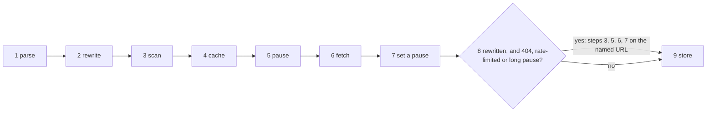

# The flow of a page fetch

- **Status:** draft
- **Work items:** the `retryAfterMs` wire field,
  [the step list and the URL rewrite](https://linear.app/zgeoff/issue/GEO-2243), the secret refusal
  in the fetch tool, the pause per host, the page cache

A `url` or `link` call of the web fetch tool runs one fixed list of 9 steps in `runPageFetch`. Four
work items each add steps to the list: the URL rewrite with its fallback, the secret scan, the pause
per host and the page cache. This doc holds the list, the 2 URLs that each step works on, the
rate-limit reply, and the wire field that the fallback and the pause both read.

In this doc, "the server" is the nixie server and "a host" is the host of a URL. The fetcher is the
program in the fetch sandbox that sends each request.

## Shape



## Contracts

### The 2 URLs and the hop

- **The named URL** is the URL in a call's `url`, or the URL that its link ID stands for.
- **The sent URL** is the URL that the server sends to the fetcher. In the first pass it is the
  rewritten URL when a rewrite rule matches the named URL, and the named URL otherwise. **A
  rewritten URL** is a sent URL that a rule made.
- **The first pass** is steps 3 to 7 on the sent URL of step 2. **The second pass** is step 8: steps
  3, 5, 6 and 7 once more, with the named URL as the sent URL.
- **A hop** is one URL of a fetch. Hop 0 is the sent URL, and each redirect adds 1.

### The steps

| Step | Name     | What nixie does                                            | Added by           |
| ---- | -------- | ---------------------------------------------------------- | ------------------ |
| 1    | Parse    | parses the call and reads the link's target: the named URL | the step list      |
| 2    | Rewrite  | calls `rewriteFetchURL` on the named URL: the sent URL     | the step list      |
| 3    | Scan     | refuses a sent URL that holds a secret                     | the secret refusal |
| 4    | Cache    | returns the stored copy of the sent URL                    | the page cache     |
| 5    | Pause    | reads the pause of the sent URL's host                     | the pause per host |
| 6    | Fetch    | calls `readPage` on the sent URL, which starts one sandbox | the step list      |
| 7    | Set      | sets a pause from the reply                                | the pause per host |
| 8    | Fallback | runs the second pass                                       | the step list      |
| 9    | Store    | writes the page and its links in one transaction           | the step list      |

```ts
// connectors module. One pass runs steps 3 to 7 on one sent URL and returns one of these.
// Each step is a call to a function in a file of its own, so an item adds a step as one line.
// A step and its member exist only once the item that adds it lands; the step list item
// builds `reply` and `ended`.
type PassOutcome =
  | { kind: 'reply'; reply: Extract<FetchReply, { kind: 'page' | 'image' }> }
  | { kind: 'ended'; reason: string } // a refusal, a refused hop, or a `refused` or `failed` reply
  | { kind: 'paused'; host: string; leftMs: number } // step 5; added by the pause item
  | { kind: 'cached'; page: StoredPage }; // step 4; added by the page cache item
```

### The rate-limit reply and its wire field

```ts
isRateLimitReply(reply); // a page reply: status 403, blocked null, retryAfterMs 42000 → true
isRateLimitReply(challenge); // a page reply: status 403, blocked 'bot challenge' → false

// connectors module
function isRateLimitReply(reply: FetchReply): boolean;
// true for a page or image reply with a null blocked reason whose status is 429 or 503, or 403
// with a retryAfterMs that is not null. A 2xx reply and a refused or failed reply are never one.
// An image reply carries no blocked reason, so it counts as null.
```

```ts
// wire lib: FetchReply
type FetchReply =
  | {
      kind: 'page';
      // …existing fields
      retryAfterMs: number | null; // the wait the reply's headers ask for; the decoder reads a missing field as null
    }
  | {
      kind: 'image';
      // …existing fields
      retryAfterMs: number | null;
    }
  | { kind: 'refused' /* …existing fields */ }
  | { kind: 'failed' /* …existing fields */ };
```

## Constraints

### Every step

- A `link` call takes the rewrite like a `url` call. The result's `url` is the URL the fetch ended
  at, in either pass.
- The tool runner writes the call record before step 1 and the result record after the last step. No
  step writes either.
- A `page` call reads a stored page and runs none of the steps.
- One rewrite rule applies, once, to the named URL. nixie never rewrites a redirect hop, and the
  second pass never rewrites.
- `readPage` takes the sent URL and rewrites nothing. The skill file reader's URLs take no rewrite.
- Step 7 runs for every reply that has a status, a 2xx reply included, and runs before step 8
  decides.
- Step 9 stores a row only for a page with text, never for an image. After a second pass, it stores
  the named URL's page.
- A stop of the server in steps 1 to 8 ends with a call record and no result record, and the sandbox
  module removes the fetch's sandbox. Step 9 is one transaction, so a stop there stores the page
  whole or not at all.
- When a forget ends the session while the fetch runs, step 9 writes no row, as built.

### The fallback

- nixie runs the second pass only when the sent URL of the first pass is a rewritten URL and one of
  these holds: the reply's status is 404; the reply is a rate-limit reply; step 5 met a pause longer
  than `backoff_wait_ms`, so the first pass sent nothing. The pause item adds the third trigger.
- A 200 never sets off the second pass, whatever its headers hold. Neither does a `failed` reply, a
  reply with a blocked reason, nor a refused hop.
- The second pass never sets off a third. Whatever it gives is the call's outcome: a 404, a
  rate-limit reply and a pause error included.
- Step 3 of the second pass scans the named URL, with the same exemption as the first pass.
- The second pass never runs step 4, so it never returns a stored copy.

### The wire field

- The fetcher sets `retryAfterMs` from `Retry-After`, as seconds or as a date, on a 429, a 503 or
  a 403.
- The fetcher sets it from `x-ratelimit-reset`, a time in seconds since 1970, when
  `x-ratelimit-remaining` is `0`, on any status.
- For a date or a reset time, the fetcher subtracts its own clock and sends the difference, never
  less than 0.
- A value that the fetcher cannot parse gives null, and so does a reply with neither header.
- A release before the field decodes a reply that holds it, and a server with the field reads a
  reply without it as null, so the server and the fetch image roll out in either order.

## Decisions

- **The steps form one list that every item extends.** Four items change `runPageFetch`, and a fixed
  order keeps each one's rule true: the scan runs before any network use, the cache before the
  pause, and the pause is set before the fallback decides.
- **A rewrite never hides a page that exists.** A 404 or a spent rate limit on the rewritten URL
  falls back to the named URL, so a wrong guess costs one request.

## Builder decides

- The internal names of each step's function and file.
- Test layout.

## Out of scope

- A port in front of `readPage`. The tool takes the `readPage` function of `startFetchSandbox`, as
  built. The skills module's `ReadPage` type belongs to the skill file reader, and a second page
  reader is separate work under the port rules.
- The skill file reader's URLs, which take no rewrite and no pause.

## Open questions

- **Which header gives `retryAfterMs` when a reply holds both `Retry-After` and a spent
  `x-ratelimit-reset`?** The owner settles it. Until then, the fetcher sends the longer of the 2
  waits, so nixie never sends a request inside either window.
