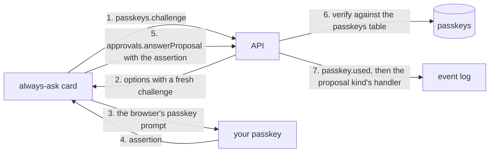

# Passkeys

- **Status:** draft
- **Work item:** [the passkey check for the always-ask set](https://linear.app/zgeoff/issue/GEO-310)

Your approval of a high-risk proposal needs your passkey. High-risk means the
[always-ask or lifting risk class](../platform/policy/approvals.md#risk-class): spending, a budget
raise, a mandate, a proposed rule or a known contact, and any rule that lifts the always-ask set.
The client asks your passkey for a WebAuthn assertion with user verification, bound to the one
answer you give. The server refuses the answer without it.

You register a passkey from a signed-in client. The first one needs a one-time code from a host
command, which runs on the machine nixie runs on. nixie keeps each passkey's public key in a table
of its own. You revoke a passkey from the client with another passkey check, or with a host command.

[Approvals in the client](../platform/channels/approvals.md#how-the-server-checks-an-answer) sets
the check itself. The approval record design (`docs/design/queue/approval-record.md`, not merged
yet) owns `approvals.answerProposal`, its numbered answer checks and its client action IDs, and this
design extends them. A passkey here is a WebAuthn discoverable credential, whether one device holds
it or a provider syncs it between your devices.

## Shape



## Contracts

### The answer check

```ts
// 1. The client asks for a challenge bound to the exact answer it will send.
const { options } = await client.passkeys.challenge({
  for: {
    kind: 'answer',
    proposalID: 'b3c1…',
    actionHash: 'sha256:9f2e…',
    choice: 'approve',
  },
});
// → { options: { challenge: 'q2V…', rpId: 'nixie.example.org', allowCredentials: [],
//                userVerification: 'required', timeout: 300000 } }
//   or NO_PASSKEY: no live passkey exists

// 2. The browser runs navigator.credentials.get({ publicKey: options }).
// 3. The answer carries the assertion.
const result = await client.approvals.answerProposal({
  proposalID: 'b3c1…',
  actionHash: 'sha256:9f2e…',
  choice: 'approve',
  clientActionID: crypto.randomUUID(),
  passkey: assertion, // the AuthenticationResponseJSON the browser returned
});
// → { proposalID: 'b3c1…', state: 'approved' }
//   or PASSKEY_REQUIRED, NO_PASSKEY or PASSKEY_FAILED, beside the refusals the approval record sets
```

```ts
// contract: passkeys. One challenge input for each kind of passkey check.
type ChallengeFor =
  | { kind: 'answer'; proposalID: string; actionHash: string; choice: Choice; ruleHash?: string }
  | { kind: 'register' } // the check before a passkey is added
  | { kind: 'revoke'; passkeyID: string };

// contract: approvals. Added to the approval record's types.
interface ProposalAnswer {
  // …existing fields
  passkey?: AuthenticationResponseJSON; // required when the row's passkeyChoices hold the choice
}

type ApprovalItem = /* …existing variants, and on each proposal item: */ {
  passkeyChoices: Choice[]; // the choices that take the passkey; the client asks before it sends
};
```

```ts
// api module: the one check every passkey-gated path calls, inside its write transaction.
// The actions module calls it too, for a retry of an always-ask action whose outcome is unknown.
interface PasskeyCheck {
  verify(
    tx: Transaction,
    caller: Identity,
    binding: ChallengeFor,
    assertion: AuthenticationResponseJSON,
  ): Promise<{ passkeyID: string } | { error: 'PASSKEY_FAILED'; reason: PasskeyFailure }>;
}

type PasskeyFailure =
  | 'unknown_challenge' // never issued, used, lapsed, or issued to another session
  | 'binding' // the challenge was issued for another answer
  | 'unknown_passkey' // no live passkey holds the credential ID
  | 'origin' // clientDataJSON.origin or the RP ID hash differs from the passkey's
  | 'no_user_verification' // the UV flag is not set
  | 'signature'
  | 'counter'; // either counter is nonzero and the new one is not greater
```

### Registration

```ts
// A host command prints a one-time code. It works with or without a live passkey.
// $ nixie passkey-code
// 7K4M-Q9TR
// works until 2026-11-14T08:15:00+11:00

const { options } = await client.passkeys.registrationOptions({ code: '7K4M-Q9TR' });
// or, while a live passkey exists:
//   await client.passkeys.registrationOptions({ passkey: assertion }) // from a 'register' challenge
// → { options: { rp: { id: 'nixie.example.org', name: 'nixie' },
//                user: { id: 'Zx3…', name: 'nixie', displayName: 'nixie' },
//                challenge: 'p8A…', excludeCredentials: [{ id: 'c1…', type: 'public-key' }],
//                authenticatorSelection: { residentKey: 'required', userVerification: 'required' },
//                attestation: 'none', timeout: 300000 } }
//   or CODE_REQUIRED, CODE_INVALID, PASSKEY_FAILED, TOO_MANY_PASSKEYS, ORIGIN_UNSUPPORTED,
//   or ORIGIN_CHANGED: live passkeys hold another origin

const { passkeyID } = await client.passkeys.register({
  clientActionID: crypto.randomUUID(),
  response: registration, // the RegistrationResponseJSON the browser returned
  label: 'Phone',
});
// → { passkeyID: '5d0e…' } or REGISTRATION_FAILED { reason }
```

```text
passkeys, a table that one appended migration adds; no record folds into it, as with the identity table
  passkey_id        text primary key   crypto.randomUUID()
  credential_id     text unique        base64url
  public_key        blob               the COSE key from the attestation object
  user_handle       blob               32 random bytes; every row shares one value
  rp_id             text               the host name of origin
  origin            text               scheme, host and port, such as https://nixie.example.org
  sign_count        integer
  backup_eligible   integer            the BE flag at registration
  backed_up         integer            the BS flag, updated on each use
  transports        text               JSON array from the response
  aaguid            text               the provider's ID; zeros when it gives none
  label             text               1 to 64 characters
  registered_by     text               the identity ID or 'host'; no foreign key
  registered_at     integer
  last_used_at      integer
  revoked_at        integer
```

### Listing and revoking

```ts
const { passkeys } = await client.passkeys.list();
// → { passkeys: [{ passkeyID: '5d0e…', label: 'Phone', synced: true,
//                  registeredAt, lastUsedAt, revokedAt: null }] }

await client.passkeys.revoke({ clientActionID, passkeyID: '5d0e…', passkey: assertion });
// → { revokedAt } or PASSKEY_FAILED, NOT_FOUND
```

```bash
nixie passkeys                  # every passkey, live and revoked, as JSON
nixie passkeys revoke 5d0e…     # needs no passkey: only nixie's user can open the control socket
nixie passkey-code              # a one-time registration code
```

### Records

```ts
// api module. The records belong to no thread, as session records do, so the live stream never
// carries them.
{ kind: 'passkey.registered', passkeyID, registeredBy } // the label sits in its erasable fields
{ kind: 'passkey.revoked', passkeyID, revokedBy } // revokedBy: an identity ID or 'host'
{ kind: 'passkey.used', passkeyID, binding: ChallengeFor } // in the transaction of the action it gates
{ kind: 'passkey_code.issued', expiresAt }
```

## Constraints

### Which answers take the passkey

- `approve` and `always_allow` on a row whose risk class is `always_ask` or `lifting` take the
  passkey. `defer` and `decline` never do.
- Always allow on a `routine` row needs no passkey, when the rule it creates is the rule the card
  shows. A rule wider than the card's, such as a proposed rule you edited, comes as its own
  `always_ask` or `lifting` row, so its approval needs the passkey.
- The server builds `passkeyChoices` with each row's choices, and checks the answer against the row,
  never against what the client sends.
- `answerProposals` has no field for an assertion, and refuses each row that needs the passkey with
  `PASSKEY_REQUIRED`.
- An answer through a host command needs no passkey, and `passkey.used` is not written. Whoever runs
  a host command can already read the database and the key store.
- When no live passkey exists, the client approves no always-ask or lifting row: the API refuses
  with `NO_PASSKEY`, and the card offers to add a passkey or points to the host command.

### The order of the checks

- The approval record design numbers its answer checks 1 to 5. The passkey check runs between check
  4, which checks the choice, and check 5, which hands the row to its kind's handler, in the same
  write transaction.
- A refusal from the passkey check writes nothing under the client action ID. The hash of the
  answer's input, which a retry must match, leaves out `passkey`, so a retry with the same ID and a
  fresh assertion runs the checks again.
- A passed check writes `passkey.used` and moves the passkey's `sign_count`, `backed_up` and
  `last_used_at` in the transaction that applies the answer. A handler that then fails rolls them
  back with it.

### Challenges

- Each challenge is SHA-256 over 32 random bytes, the session's identity ID and the canonical form
  of its `ChallengeFor`. The server keeps the random bytes and the binding until the challenge is
  used or lapses.
- A challenge works once. The first verification, passed or failed, removes it.
- A challenge lapses after 5 minutes, which the options' `timeout` matches.
- The server keeps challenges in memory, so a restart makes you tap again.
- The answer's `proposalID`, `actionHash`, `choice` and `ruleHash` must equal the challenge's
  binding, or the check fails with `binding`.

### Verification

- The server verifies each response with every step that WebAuthn sets for
  [registering a credential](https://www.w3.org/TR/webauthn-3/#sctn-registering-a-new-credential) or
  [verifying an assertion](https://www.w3.org/TR/webauthn-3/#sctn-verifying-assertion), with user
  verification required: a response without the UV flag fails.
- The expected origin is the passkey's `origin`, and the expected RP ID hash is SHA-256 of its
  `rp_id`.
- When the stored or the new signature counter is nonzero and the new one is not greater than the
  stored one, the check fails with `counter`, so a passkey that once counted and then reports 0
  fails. Two zeros pass, because a synced passkey reports 0 on every assertion
  ([verifying an assertion](https://www.w3.org/TR/webauthn-3/#sctn-verifying-assertion), the
  `signCount` step).
- The server reads the passkey row inside the answer's write transaction, so a revoke that commits
  first refuses the answer.

### Registration

- With no live passkey, `registrationOptions` needs a host code and refuses without one as
  `CODE_REQUIRED`. This covers the first passkey and recovery after every passkey is lost.
- While a live passkey exists, `registrationOptions` accepts either a host code or an assertion from
  a live passkey on a `register` challenge.
- A host code works once and lapses after 15 minutes. The server keeps only its hash, in memory, and
  a second `nixie passkey-code` replaces the first.
- The registration options bind to the session that asked, and `register` from another session
  fails. They lapse after 5 minutes and work once, as a challenge does.
- When a passkey's assertion authorized the options, `register` checks inside its write transaction
  that this passkey is still live, and fails with `REGISTRATION_FAILED` when a revoke committed
  first. A revoked passkey therefore never adds another.
- At most 10 passkeys are live at once. An 11th refuses as `TOO_MANY_PASSKEYS`.
- The options ask for a discoverable credential with user verification, `attestation: 'none'`, and
  every live passkey in `excludeCredentials`.
- The RP ID is the host of the call's `Origin` header. The origin must be `https` with a domain
  name. An IP address or plain `http` refuses as `ORIGIN_UNSUPPORTED`, because WebAuthn takes only a
  domain as the RP ID
  ([creating a credential](https://www.w3.org/TR/webauthn-3/#sctn-createCredential)) and runs only
  in a secure context.
- While a live passkey exists, a registration from another origin refuses as `ORIGIN_CHANGED`. To
  move nixie to a new host name, revoke every passkey from the host, then register with a host code
  on the new name.
- A new passkey gets the `user_handle` of the existing rows, live or revoked. With no row, the
  server draws 32 random bytes.
- A synced passkey and a passkey on one device are both accepted, and the list shows which from the
  BE flag ([authenticator data](https://www.w3.org/TR/webauthn-3/#sctn-authenticator-data)).

### Revoking

- A revoke from the client needs an assertion from any live passkey on a `revoke` challenge for that
  passkey, the passkey being revoked included.
- A revoke through a host command needs no passkey.
- A revoke changes no proposal. A waiting approval stays pending, and any live passkey can approve
  it.
- Revoking the last live passkey leaves the client unable to approve always-ask rows until a host
  code registers another.

### Reset, restore and the deployment

- A [reset](../../architecture/core/event-log.md#the-reset) keeps every live passkey and deletes
  every revoked one. The reset deletes the passkey records with the rest of the old log.
- A restore brings back the passkeys of the backup. A passkey revoked after that backup is live
  again, so revoke it again after a restore.
- WebAuthn needs HTTPS with a certificate the browser trusts. A self-signed certificate that the
  browser does not trust fails, and a click past the warning page does not help. Bug reports and
  forum posts show this for Chromium and Firefox
  ([Firefox bug 1954033](https://bugzilla.mozilla.org/show_bug.cgi?id=1954033)), and no browser
  documents it as a rule.
- A name on a private network works when the certificate is trusted, because the RP ID only has to
  be a domain that equals the page's host.

### Rollback

| Added                                           | The release before                                                                                                           |
| ----------------------------------------------- | ---------------------------------------------------------------------------------------------------------------------------- |
| The `passkeys` table and its migration          | Never reads it. The migration only adds a table, so the [oldest reader](../../architecture/core/database.md) does not change |
| The 4 `passkey` record kinds                    | Skips them                                                                                                                   |
| The `passkeys.*` procedures                     | Answers `NOT_FOUND`                                                                                                          |
| `passkey` on `answerProposal`, `passkeyChoices` | Strips the field, and approves an always-ask or lifting row with one tap                                                     |
| The host commands                               | Has none, and the server refuses the unknown control request                                                                 |

The rollback needs no step. The release before has no passkey check, and once the passkey release
returns, every passkey registered before the rollback works again.

## Decisions

- **The challenge holds random bytes beside the answer it binds.** An agent's call on 13 Nov 2026:
  WebAuthn requires a challenge with enough entropy that nobody can guess it
  ([cryptographic challenges](https://www.w3.org/TR/webauthn-3/#sctn-cryptographic-challenges)), and
  a hash of the proposal ID and the action hash alone is known in advance.
- **The challenge binds the choice and the session too.** An agent's call on 13 Nov 2026: an
  assertion for one answer from one session never approves another.
- **A failed passkey check stores no result under the client action ID.** An agent's call on 13 Nov
  2026: the client retries the same action with a fresh assertion.
- **The origin comes from the first passkey's registration, with no config key.** An agent's call on
  13 Nov 2026: the browser binds the passkey to the page's host, and a rollback needs no step.
- **Challenges and host codes stay in memory.** An agent's call on 13 Nov 2026: both last minutes,
  and a restart costs one more tap or one more code.
- **An answer or a revoke through a host command needs no passkey.** An agent's call on 13 Nov 2026:
  the [control socket](../../architecture/deployment/host-commands.md#the-control-socket) opens only
  to nixie's user on the host, who can read every key anyway.
- **Attestation is `none`, and synced passkeys count.** An agent's call on 13 Nov 2026: one person
  uses nixie, so a list of allowed providers protects nothing, and a synced passkey covers a lost
  device.
- **The credential is discoverable, with one stable user handle.** An agent's call on 13 Nov 2026: a
  later passkey sign-in of a new device needs both, and neither changes after registration.
- **At most 10 live passkeys.** An agent's call on 13 Nov 2026: a cap keeps a stolen session that
  gets one code from adding many, and 10 covers every device of one person.
- **The first passkey takes a host code.** The interim for the open question on the first passkey.
- **More than one passkey, each added with a live passkey or a host code.** The interim for the open
  question on several passkeys.
- **Recovery is a host code alone, with no remote fallback.** The interim for the open question on
  recovery.
- **A revoke takes a passkey check in the client, and leaves waiting approvals as they are.** The
  interim for the open question on revoking.
- **The server and the browser use SimpleWebAuthn.** The interim for the open question on the
  library: `@simplewebauthn/server` and `@simplewebauthn/browser` verify every step of both WebAuthn
  ceremonies, and run on Web Crypto.
- **The names are `passkeys.*`, `nixie passkeys` and `nixie passkey-code`.** The interim for the
  open question on names, modelled on `nixie sessions` and `nixie enrol-code`.

## Builder decides

- The wording of each refusal, and of the card's prompt when no passkey exists.
- Where the passkey list and the add form sit in the web client.
- The default label a passkey gets when the form leaves it empty.
- The layout of the tests, and how a test signs a WebAuthn response.

## Out of scope

- Signing a new device in with a passkey, which the
  [client design](../platform/channels/client.md#device-sessions) plans. Enrolment codes stay the
  one way in.
- The Android app's passkey, which needs the app's signing key as an allowed origin and an asset
  links file at the RP ID's host.
- Approving during a voice call, where the passkey prompt shows over the call screen.
- A retry of an always-ask action whose outcome is unknown. The
  [actions work item](https://linear.app/zgeoff/issue/GEO-1810) calls `PasskeyCheck` for it.

## Open questions

The owner settles 6 questions, kept in [the work item](https://linear.app/zgeoff/issue/GEO-310): how
the first passkey is registered, whether you may have several, how you recover when every passkey is
lost, what a revoke takes, the WebAuthn library, and the names. Until then the code follows the
interims in [Decisions](#decisions).
