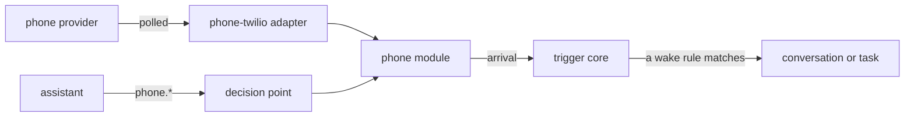

# The assistant's phone

- **Status:** agreed
- **Decision records:** [0057](../../decisions/0057-every-optional-feature-has-a-switch.md)
- **Work items:** [the assistant's phone](https://linear.app/zgeoff/issue/GEO-2731)

The assistant has a mobile number of its own that takes texts. It lists, reads and sends texts, and
a sign-up code reaches it by text. A new text wakes the conversation or a task only when a wake rule
matches it, as new mail does in the [mail design](mail/README.md). The phone is an optional feature:
with no `phone` section in the deployment config, nixie offers no phone tools and polls nothing.
Calls go through the app, as the [voice design](../../architecture/channels/calls.md) says, and
never through the phone provider.

## Shape



## Contracts

```ts
// phone module; PhoneProvider interface, adapter phone-twilio, against the provider's API with fetch
phone.list({ from: '+61400000000' }); // from: optional
// → { number: '+61411111111', texts: [{ text: 'tx8k2m4q9w', from: 'Example', body: 'Your code is 5521',
//     at }], next: null }   number: the assistant's own
phone.read({ text: 'tx8k2m4q9w' }); // → { from, body, at }
phone.send({ to: '+61400000000', body: 'Running 10 minutes late.' }); // → { text: 'tx2w9q4k8m' }
// refusals: UNKNOWN_TEXT, BAD_NUMBER, TOO_LONG (over 640 characters), SEND_FAILED
phone.wake_set({ from: ['Example'], seconds: 900 }); // a wake rule on the phone's arrivals, as mail.wake_set
```

| Tool                       | Effect  | Runs   | Destination |
| -------------------------- | ------- | ------ | ----------- |
| `phone.list`, `phone.read` | `read`  | direct | none        |
| `phone.wake_set`           | `write` | direct | none        |
| `phone.send`               | `send`  | queued | the number  |

```yaml
# deployment config. Absent: the phone is off.
phone:
  number: '+61411111111'
  poll_interval: 20s
  twilio: # the adapter's own section; the phone module never reads it
    account_sid: AC0000
    api_key_sid: SK0000
    credential: deployment:phone # the API key secret alone, sent as HTTP Basic with the key SID
```

```text
phone_texts            -- phone module; short ID → the provider's message ID
phone.text_received    -- one per new text, keyed by the provider's message ID; from and body erasable
```

## Constraints

- The phone module owns `PhoneProvider`, and `adapters/phone-twilio` is its one adapter. No core
  module names the phone or the provider.
- Each new text is one arrival in the trigger core, from a source the phone part fills into the
  core's list of wake sources. A text that no wake rule matches wakes nothing, and `phone.list`
  still finds it.
- A wake rule matches `from` as a number in E.164 form, or as a sender name without case. Anyone can
  send a text under any sender name, so a code from a named sender is only as good as a code from a
  stranger.
- Every field of a text comes back marked as outside content. A one-time code is visible to the
  assistant, which types it with `computer.browser_fill`.
- The adapter reads the provider's message list every `poll_interval`, so nixie needs no address the
  internet can reach. At its first start it records the provider's state and writes no record for
  older texts. After an outage it writes a record for each text it missed, and only those from the
  last hour make arrivals.
- The number takes texts only. The provider's settings refuse calls, and nixie places none.
- The always-allow rule of `phone.send` pins `to`. The configured number is a `nixie_own` place at
  `act` in [trusted places](trusted-places.md), and `phone.send`'s destination parses as a phone
  place.
- A send reconciles an unknown outcome by finding a message to the same number with the same body,
  created during the attempt and recorded by no other send. With no message found, it asks the user
  through `answerUnknownOutcome`.
- `phone.text_received` declares `from` and `body` in `ErasableRecordKinds`, the server record-kind
  map and one descriptor list. Forgetting it erases nixie's copy and leaves the text at the
  provider.
- When a sign-up asks for a phone number and the phone is on, the assistant gives its own number and
  reads the code from the text. With the phone off, it hands the step to the user.

## Builder decides

- The provider's API calls, and how `phone.list` pages.
- The tools' descriptions and the refusal wording.

## Out of scope

- Phone calls, in and out.
- Sending a real text from a test: tests run against a fake provider.
