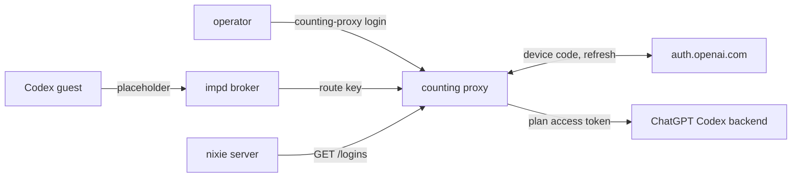

# The ChatGPT plan login

- **Status:** draft
- **Work items:** [Codex tasks on a ChatGPT plan login](https://linear.app/zgeoff/issue/GEO-2238)

A task on the Codex harness can run on your ChatGPT plan in place of an OpenAI API key. The counting
proxy, the process on the host that counts and limits every model request, holds the plan's refresh
token in a file of its own. The proxy refreshes the token and sets the access token on each plan
request itself. The nixie server and every sandbox hold only placeholders, so each plan request goes
through the proxy's count and its spending stop.

Terms:

- A **plan login** is one sign-in to a ChatGPT account.
- A **plan route** is a counting proxy route whose config holds a plan login.
- A **plan profile** is a `codex` model profile whose requests go to a plan route.
- The **login file** is the file in which the proxy keeps a plan route's login.
- The **operator** is the person who runs commands on the host.
- The **earlier release** is the nixie release, or the proxy release, that a rollback returns to.
- **impd** is the daemon that runs each sandbox as an imp. Its **broker** adds a granted secret to a
  sandbox's requests for one host, and a **grant**'s path filter limits the paths it covers
  ([sandboxes](../../architecture/connectors/sandboxes.md#the-imp-adapter)).
- A **turn profile** is the part of a turn frame, the host's message that starts a guest's turn,
  that names the model and its settings
  ([conversation turns](../../architecture/core/conversation-turns.md)).

The proxy's control listener, its model listener, the server's watcher, the `spendStop` config and
the base URL of each sandbox are in the budgets design,
`docs/design/queue/budgets-and-hard-stop.md`. The proxy as built is in
[the counting proxy](../../architecture/policy/counting-proxy.md). The Codex guest, its config and
the `codex` profile are in [the Codex harness](https://linear.app/zgeoff/issue/GEO-2237) work item.

## Shape



## Contracts

### The plan route

```yaml
# counting proxy config, under routes
codex-plan:
  api: openai-responses
  upstream: https://chatgpt.com/backend-api/codex # the proxy adds the rest of the path
  model: gpt-6-luna
  prices: { … } # equal to the plan profile's prices
  login: # present only on a plan route
    file: /var/lib/counting-proxy/logins/codex-plan.json
    routeKeyFile: /run/secrets/codex-plan-route-key # one line: the route key
```

```ts
// wire library, the endpoint table of the counting proxy. Codex sends /responses after its
// base URL, and an API client sends /v1/responses.
'openai-responses': [
  { name: 'responses', method: 'POST', path: /^(?:\/v1)?\/responses$/u },
  modelsEndpoint,
],
```

### The login file

```ts
// counting proxy: the login file, mode 0600, which only the proxy's user reads
interface LoginFile {
  version: 1;
  loginID: string; // random; each login writes a new one
  refreshToken: string;
  accountID: string; // the ChatGPT account ID, from the ID token
  planType: string; // such as 'plus', from the ID token
  email: string; // from the ID token
  status: 'active' | 'failing' | 'needs_login';
  reason: 'refused' | 'service_error' | 'no_answer' | null; // null while active
  statusSince: string; // ISO time
  lastRefreshAt: string | null;
}
```

The access token lives only in the proxy's memory, with the time the proxy got it.

### The host commands

```bash
counting-proxy login --config <config file> --route codex-plan
# → Open https://auth.openai.com/codex/device and enter the code ABCD-1234 (expires in 15 minutes).
#   Signed in: someone@example.com, plan plus. Stored for codex-plan.
counting-proxy logout --config <config file> --route codex-plan
# → Removed the login for codex-plan. Sign this device out in ChatGPT's security settings.
```

### The control listener

```http
GET /logins
Authorization: Bearer <control token>

200 {
  "codex-plan": { "status": "active", "reason": null, "since": "2026-11-13T09:12:00Z",
                  "accountID": "…", "planType": "plus" }
}
```

An entry holds no token and no email. A plan route with no login file shows
`{ "status": "needs_login", "reason": null, … }`.

### nixie's config and the guest

```yaml
# deployment config, under models.profiles: the codex profile of the Codex harness, with plan_login
codex-plan:
  harness: codex
  base_url: https://chatgpt.com
  credential: deployment:codex-plan # names the impd secret, as every model profile does
  plan_login: true # its requests go to the plan route whose ID is this profile's ID
  model: gpt-6-luna
  effort: low
  prices: { … }
```

```ts
// wire library, the codex member of the turn profile
chatgptLogin: { accountID: string; planType: string } | null; // null on an API key profile

// codex guest: the login before the first thread
await appServer.request('account/login/start', {
  type: 'chatgptAuthTokens',
  accessToken: placeholderJWT, // unsigned; claims: account ID, plan type, exp a day ahead
  chatgptAccountId: profile.chatgptLogin.accountID,
  chatgptPlanType: profile.chatgptLogin.planType,
});
// When Codex sends the guest account/chatgptAuthTokens/refresh, the guest answers at once with
// a new placeholderJWT in the same 3 fields.
```

```ts
// spend module: the server's read of the logins, at each read of the proxy's /status
const logins = await readPlanLogins(context);
// → { 'codex-plan': { status: 'active', accountID: '…', planType: 'plus' } }
//   or { state: 'unreachable' }
```

## Constraints

### The path of a plan request

`<sandbox>` is the sandbox's imp name, such as `nixie-3f9a0c1b7d2e4f60a1b2c3d4`.

| Hop                | What it receives                                    | What it sends on                                                                  |
| ------------------ | --------------------------------------------------- | --------------------------------------------------------------------------------- |
| The Codex guest    | nothing                                             | `https://chatgpt.com/<sandbox>/codex-plan/responses`, with a placeholder          |
| The broker         | that request, checked against `/<sandbox>/**`       | the same path to the proxy's model listener, with `Authorization: Bearer <key>`   |
| The counting proxy | `/<sandbox>/codex-plan/responses` and the route key | `/responses` to the route's upstream, with `Authorization: Bearer <access token>` |
| The upstream       | `https://chatgpt.com/backend-api/codex/responses`   | the reply, which the proxy counts                                                 |

- A plan profile's `base_url` is `https://chatgpt.com`, and the schema refuses another value. The
  server builds the turn's base URL as `https://chatgpt.com/<sandbox>/<profile ID>`.
- The route key is 32 random bytes in hex. The operator adds it as the plan profile's impd secret,
  with impd's root access, as for every model secret: host `chatgpt.com`, header `authorization`,
  scheme `bearer`, and the proxy's model listener as its upstream. The same value goes in the
  route's `routeKeyFile`.
- The proxy refuses with a 403 a request on a plan route whose `Authorization` is not
  `Bearer <route key>`, compared in constant time, and sends nothing upstream. Only a sandbox
  granted the plan profile's secret gets that header from the broker, so another sandbox cannot use
  the plan route by naming it in its path.
- The broker refuses with a 403 every other ChatGPT path that Codex calls, such as
  `/backend-api/wham/accounts/check`, because the grant's path filter does not cover it.

### The proxy

- On a plan route, after the route key check, the proxy removes the `Authorization` header and sets
  `Authorization: Bearer <access token>`. The proxy sets a credential on no other route.
- The proxy reads the refresh token only to refresh it, and sends it only to the token endpoint. It
  sends the access token only to its plan route's upstream.
- The proxy answers a request on a plan route whose login is not `active` with a 401 in the
  Responses error shape, and sends nothing upstream.
- The proxy refreshes a login at its own start, 5 minutes before the access token's expiry, and at
  least every 7 days, one refresh per login at a time. A request on the route waits for a refresh in
  flight.
- When the upstream answers 401, the proxy starts a refresh before it passes the 401 on, so the
  request that Codex sends again waits for the new token. The proxy refreshes after a 401 only when
  it got the current access token at least 5 minutes before.
- The refresh posts to the token endpoint of the Codex CLI that the `codex` image pins, with that
  CLI's client ID.
- The proxy writes a rotated refresh token to the login file, through a second file and a rename,
  before it uses the new access token. It writes only while the file's `loginID` is the one it read
  before the refresh, under a lock on the file that `login` and `logout` take too.
- Before it admits each request on a plan route, the proxy reads the login file's `loginID`. When
  that ID differs from the one its access token came from, the proxy drops the token and refreshes.
  When the file is gone, the proxy answers 401.
- The model listener serves no login path, and the control listener serves `GET /logins` and no
  other login path.

The status and the reason follow each refresh's answer:

| The answer to a refresh                                                                         | Status        | Reason          |
| ----------------------------------------------------------------------------------------------- | ------------- | --------------- |
| a token                                                                                         | `active`      | null            |
| `refresh_token_expired`, `refresh_token_reused`, `refresh_token_invalidated` or `invalid_grant` | `needs_login` | `refused`       |
| a 5xx or no answer within 10 s, 3 times in a row, counted together                              | `failing`     | the last answer |

- A `failing` login keeps its retries, with backoff, and returns to `active` on the first token.
- A `needs_login` login stops its refreshes until the next `counting-proxy login`.
- When an answer is lost, or the proxy stops after OpenAI answers and before the rename, OpenAI may
  have spent the stored refresh token. The next refresh then gets a refusal, and the login becomes
  `needs_login`. A test checks that the login file then still holds the earlier refresh token and
  parses.

### The login

- `counting-proxy login` runs OpenAI's device code flow, with the endpoints and the client ID of the
  pinned Codex CLI. It prints the URL, the code and its expiry, and opens no browser.
- When the sign-in ends, the command writes the login file with a new `loginID`, replacing any file
  the route has, and prints the email and the plan. It prints no token.
- `counting-proxy logout` removes the login file. OpenAI documents no revocation endpoint for this
  sign-in, so the command tells the operator to sign the device out in ChatGPT.
- Device code login must be on in the account's ChatGPT security settings. When OpenAI refuses the
  code request, the command prints that this setting is off.

### nixie

- The server never holds a plan token. At each read of the proxy's `/status`, the server reads
  `GET /logins`, and puts the route's account ID and plan type in each turn profile it sends on the
  plan profile.
- The schema refuses `plan_login: true` when nixie's config has no `spendStop` section, because the
  server reaches the control listener through that section.
- When the plan profile's login is not `active`, the runner fails each step on that profile with
  `model_auth`, and the client shows that the operator must run `counting-proxy login`.
- The Codex guest logs in with `chatgptAuthTokens` before its first `thread/start`, and writes no
  `auth.json`. Its config sets `cli_auth_credentials_store = "ephemeral"`,
  `forced_login_method = "chatgpt"`, and `requires_openai_auth = true` on its model provider.
- The placeholder JWT holds the account ID, the plan type and an `exp` a day ahead. It holds no
  email and no signature.

### Spending

- Each plan request goes through the proxy, so the day and month counts, the sandbox limits and the
  stop cover plan turns as they cover every other profile.
- On a plan route, the proxy refuses with a 400 a body that sets `service_tier`. A faster tier
  spends bought credits at a higher rate than the route's prices count. The guest sets no tier.
- The operator sets the plan profile's prices, and the route's equal prices, to the API prices of
  the same model. A plan has no price per token, but Codex usage past the plan's limit can draw on
  bought credits, so the dollar limit bounds that spend.

### A rollback

| The change                         | The earlier release                                      |
| ---------------------------------- | -------------------------------------------------------- |
| a route's `login` key              | the earlier proxy refuses to start: its schema is strict |
| the login file                     | the earlier proxy never reads it                         |
| `/responses` in the endpoint table | the earlier proxy refuses that path with a 403           |
| `GET /logins`                      | earlier nixie never calls it                             |
| a profile's `plan_login` key       | earlier nixie refuses to start: its schema is strict     |
| `chatgptLogin` in the turn profile | earlier nixie never sends it                             |

To roll back:

1. Remove each plan profile from nixie's config, and each `selectable` entry under `models` that
   names it.
2. Remove each route's `login` key from the proxy's config.
3. Delete each plan profile's impd secret with impd's root token, through impd's secret delete call.
   The [names in impd](../../architecture/deployment/impd-names.md#model-secrets) rules give the
   secret's name. Expect: impd's secret list no longer names it.
4. Start the earlier proxy. Expect: it starts and serves the other routes.
5. Start earlier nixie. Expect: it starts.

Each login file stays on disk, so a release that reads it again keeps the login. Run
`counting-proxy logout` before step 4 to end the login.

## Decisions

- **The counting proxy holds the plan login.** Interim, until the owner answers the first open
  question below. While the spending stop is set, the server holds no model credential, so a plan
  login in the server would let nixie's own code reach ChatGPT past the count. The proxy already
  sits on every plan request.
- **The proxy sets the access token itself, and impd holds only the route key.** An agent's call on
  13 Nov 2026: in impd, only a host-wide token can replace a secret's value, and that token reaches
  every imp on the host.
- **The login runs as a proxy host command, with a device code.** An agent's call on 13 Nov 2026: a
  device code needs no redirect to the host, so no token passes through the server. A login in a
  sandbox would put the refresh token in an imp.
- **Codex runs in external token mode, with no `auth.json`.** An agent's call on 13 Nov 2026: in its
  own mode, the CLI sends a refresh with the placeholder refresh token when the access token's `exp`
  is near, or after two 401 answers in a row, and then fails the turn, as the
  [app-server spike](../../../research/codex-app-server/results.md#a-chatgpt-plan-login) measured.
  In external mode, the CLI asks the guest for a token instead.
- **impd's own token refresh is unused.** impd has an `oauth` secret kind that refreshes its token
  on the host, but such a secret takes no upstream, so its requests would reach ChatGPT past the
  count.
- **A refresh after a 401 waits 5 minutes since the last one.** An agent's call on 13 Nov 2026:
  ChatGPT can refuse a token before its expiry, and the wait keeps a guest from driving refreshes.
- **One plan login per route, and one route per plan profile.** An agent's call on 13 Nov 2026:
  OpenAI rotates the refresh token on each refresh, so 2 holders of one login spend each other's
  token.

## Builder decides

- The internal names of the refresh loop and the file lock.
- How the guest builds the placeholder JWT, within its claims.
- The wording of the commands' output, the errors and the client's notice.
- The layout of the tests.

## Out of scope

- An API key profile and the Codex guest itself, which the Codex harness work item builds.
- A change to imp.
- A plan login for the conversation role, which a `codex` profile cannot hold.
- A login from the web client.

## Open questions

The owner settles each one in [the plan login work item](https://linear.app/zgeoff/issue/GEO-2238),
and the interim stands until then:

- **The counting proxy holds the plan login, where decision 8 of the
  [models decision](https://linear.app/zgeoff/document/decision-how-nixie-chooses-and-calls-models-beyond-claude-geo-2231-39da60c58643)
  named nixie's credential store.** Interim: the proxy, so every model request goes through the
  stop.
- **Where does the one-time login run, and what does it show?** Interim:
  `counting-proxy login --config <config file> --route <route ID>`, which shows the URL, the code
  and its expiry, then the account's email and plan.
- **The names `plan_login`, `login`, `GET /logins` and `counting-proxy login`.** Interim: those
  names.
