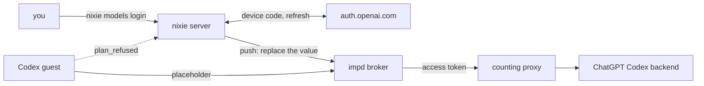

# The ChatGPT plan login

- **Status:** draft
- **Work items:** [Codex tasks on a ChatGPT plan login](https://linear.app/zgeoff/issue/GEO-2238)

A task on the Codex harness can run on your ChatGPT plan in place of an OpenAI API key. nixie keeps
the plan's refresh token in its database on the host, refreshes it there, and puts each new access
token into impd's broker, so a guest only ever holds a placeholder. Every request still passes the
counting proxy, so the spending stop covers plan turns too.

Terms:

- A **plan login** is one sign-in to a ChatGPT account, which nixie holds for one model profile.
- A **plan profile** is a `codex` model profile whose credential is a plan login.
- The **plan secret** is the impd secret that carries the plan login's current access token to the
  broker.
- The **push** replaces the plan secret's value in impd with a new access token.
- The **release before** is the release that a rollback returns to.

Other terms are in the [glossary](../../glossary.md) and in
`docs/design/queue/budgets-and-hard-stop.md`, which owns the counting proxy, the model secrets'
upstream and the spending stop.

## Shape



## Contracts

### The profile

```yaml
# deployment config, under models.profiles. The codex profile shape of the Codex harness work item.
codex-plan:
  harness: codex
  base_url: https://chatgpt.com # an origin with no path; the guest adds /<sandbox>/<profile ID>
  credential: login:codex-plan # a plan login; the ID is the profile's own ID
  model: gpt-6-luna
  effort: low
  prices: { … } # required, as on every codex profile
```

- The schema takes `login:<profile ID>` only on a `codex` profile, and only with the profile's own
  ID, so one plan login serves one profile.
- A plan profile's `base_url` is `https://chatgpt.com`. The schema refuses another value, and any
  path.

### The counting proxy's route

```yaml
# counting proxy config, under routes: the plan profile's route
codex-plan:
  api: openai-responses
  upstream: https://chatgpt.com/backend-api/codex # the proxy adds the rest of the path
  model: gpt-6-luna
  prices: { … } # the profile's prices
```

```ts
// wire library, the endpoint table: openai-responses also takes the path Codex sends
'openai-responses': [
  { name: 'responses', method: 'POST', path: /^(?:\/v1)?\/responses$/u },
  modelsEndpoint,
],
```

### The stored login

```text
model_logins             plain table, models module: the credential store's rows of kind model_login
  profile_id             text  the plan profile's ID; primary key
  key_id                 text  random UUID in the key store; seals every *_sealed column
  refresh_token_sealed   blob
  token_fingerprint      text  8 hex digits of SHA-256 of the refresh token; changes on rotation
  account_id             text  plain; the ChatGPT account ID, which the guest sends as a header
  plan_type              text  plain, such as 'plus'; from the ID token's claims
  label_sealed           blob  the account's email, from the ID token
  access_expires_at      int   when the access token in the plan secret expires
  access_fingerprint     text  of the access token in the plan secret
  status                 text  active | failing | needs_consent | forgotten
  status_reason          text? unauthorised | service_error | no_answer
  status_since           int
  last_success_at        int?
  created_at             int
```

- Each sealed value binds its key ID, its table and its column as additional data, as
  [erasable fields](../../architecture/core/erasable-fields.md#keys) do.
- The access token is in no table, record or log. It lives in the server's memory from the refresh
  to the push, and then only in impd.

```ts
// models module. Each kind is on no thread and holds no token.
type ModelLoginRecord =
  | { kind: 'model_login.stored'; profileID: string; fingerprint: string; planType: string }
  | { kind: 'model_login.refreshed'; profileID: string; fingerprint: string; rotated: boolean }
  | { kind: 'model_login.pushed'; profileID: string; accessFingerprint: string }
  | {
      kind: 'model_login.status_changed';
      profileID: string;
      status: 'active' | 'failing' | 'needs_consent';
      reason: 'unauthorised' | 'service_error' | 'no_answer' | null;
    }
  | { kind: 'model_login.forgotten'; profileID: string };
```

### The login command

```bash
nixie models login codex-plan
# → Open https://auth.openai.com/codex/device and enter the code ABCD-1234 (expires in 15 minutes).
#   Signed in: someone@example.com, plan plus. Refresh token 3f9a0c1b. Stored for codex-plan.
nixie models login codex-plan --forget
# → Forgot the plan login for codex-plan. Sign this device out in ChatGPT's security settings.
```

```ts
// libs/contract, the host contract over the control socket
models.startLogin({ profileID: 'codex-plan' });
// → { verificationURL: 'https://auth.openai.com/codex/device', userCode: 'ABCD-1234',
//     expiresAt: 1794614400000, loginID: '…' }
//   or { error: 'not_plan_profile' }
models.finishLogin({ loginID: '…' }); // waits for the sign-in, up to the code's expiry
// → { email: 'someone@example.com', planType: 'plus', fingerprint: '3f9a0c1b' }
//   or { error: 'expired' }, { error: 'refused', reason: 'access_denied' }
models.forgetLogin({ profileID: 'codex-plan' }); // → { forgotten: true }
```

### The push into impd

```ts
// sandbox module, SandboxAdapter: one more call. Adapter: imp, through secrets.add with replace.
replaceSecretValue(secret: { name: string; value: string }): Promise<void>;
// the imp adapter sends the binding the plan secret was added with, so impd rotates the value
// and every grant keeps working
```

```yaml
# server secrets file: one more key
impd_secrets_token: … # a host-wide manage token; only the push and the plan secret's add use it
```

### The turn profile and the frames

```ts
// wire library, the codex member of the turn profile: one more field
chatgptLogin: { accountID: string; planType: string } | null; // null: an API key profile

// wire library, guest frame: Codex asked for a new token after a 401
{ type: 'plan_refused' }
// wire library, host frame: the answer, after the refresh and the push or after a refusal
{ type: 'plan_ready'; pushed: boolean } // pushed false: the host refreshed nothing
```

```ts
// codex guest: the login before the first thread, and the answer to Codex's refresh request
await appServer.request('account/login/start', {
  type: 'chatgptAuthTokens',
  accessToken: placeholderJWT, // unsigned; claims: account ID, plan type, exp a day ahead
  chatgptAccountId: profile.chatgptLogin.accountID,
  chatgptPlanType: profile.chatgptLogin.planType,
});
// on the server request account/chatgptAuthTokens/refresh: send plan_refused, wait for
// plan_ready up to 8 s, then answer with a new placeholderJWT in the same fields
```

## Constraints

### The login

- `startLogin` runs OpenAI's device code flow from the server, with the endpoints and the client ID
  of the Codex CLI that the `codex` image pins. The command prints the URL and the code, and never
  opens a browser.
- `finishLogin` stores the refresh token, the account ID, the plan type and the email, writes
  `model_login.stored`, and pushes the access token, in that order. It prints no token.
- A login for a profile that already has one replaces the row and its key in one transaction. The
  old key goes as
  [forgetting a record](../../architecture/core/erasable-fields.md#forgetting-a-record) does.
- `forgetLogin` deletes the plan secret from impd, which revokes it from every sandbox, then
  destroys the row's key and writes `model_login.forgotten`. OpenAI documents no revocation endpoint
  for this sign-in, so the command tells you to sign the device out in ChatGPT.
- Device code login must be on in the account's ChatGPT security settings. When OpenAI refuses the
  code request, the command says so and names that setting.

### Refresh and push

- [Refresh](../platform/connectors/credentials.md#refresh) holds as written: 5 minutes before
  `access_expires_at`, at least every 7 days, one refresh per login at a time, and a rotated refresh
  token in the same transaction as `model_login.refreshed`.
- The refresh posts to the token endpoint of the pinned Codex CLI. The answer's
  `refresh_token_expired`, `refresh_token_reused`, `refresh_token_invalidated` and `invalid_grant`
  mark the login `needs_consent`. A 5xx or no answer within 10 s backs off, and makes the login
  `failing` after 3 in a row.
- Each refresh pushes. A push that fails retries with backoff while the old access token holds, and
  the login turns `failing` with `service_error` when the old token expires first.
- After a crash between a refresh's commit and its push, the server's start refreshes the login once
  and pushes, because the new access token was only in memory.
- The login's fetcher reaches only the token endpoint's host. No nixie code sends the access token
  anywhere but the push.
- The server refreshes on `plan_refused` only when the access token in the plan secret is at least 5
  minutes old, and answers `plan_ready` with `pushed: false` otherwise. A guest therefore drives at
  most one refresh per login every 5 minutes, however many sandboxes share it.
- A `needs_consent` login makes each task step on its profile fail with `model_auth`, and the client
  shows an item that says to run `nixie models login` again.

### impd

- The plan secret is a `static` secret on the host `chatgpt.com`, header `authorization`, scheme
  `bearer`, with the proxy's model address as its upstream, as every model secret has.
- Its name is the model secret name of the
  [names in impd](../../architecture/deployment/impd-names.md#model-secrets) rules, with the profile
  ID, `bearer` and `chatgpt.com`, and no credential line, because the value changes in place.
- The server adds the plan secret on the first push, and from then on only replaces its value. The
  imp adapter checks `system.info().features.secretRebind` first, and refuses the push without it,
  because an older impd takes a changed binding with a plain replace.
- Only the push and that add use `impd_secrets_token`. The sandbox adapter keeps its scoped
  `impd_token` for every other call.
- With a plan profile in the config, the server refuses to start without `impd_secrets_token`, or
  when `tokens.whoami` shows it is not host-wide `manage`.
- The grant's path filter is `/<sandbox name>/**`, as for every model grant. Codex's calls to other
  ChatGPT backend paths, such as `/backend-api/wham/accounts/check`, therefore get the broker's 403
  and never carry the token past it.

### The guest

- The guest logs in with `chatgptAuthTokens` before its first `thread/start`, and writes no
  `auth.json`. Its config sets `cli_auth_credentials_store = "ephemeral"` and
  `forced_login_method = "chatgpt"`.
- The model provider is the Codex harness work item's custom provider, with
  `requires_openai_auth = true` on a plan profile and the turn frame's base URL.
- The placeholder JWT holds the account ID, the plan type and an `exp` a day ahead, and no email and
  no signature. The broker drops the guest's `Authorization` header and sets the real one.
- Codex gives the client 10 s to answer a refresh request. The guest answers by 8 s with a new
  placeholder, whether or not `plan_ready` came, and Codex sends the refused request again with it.
  A turn whose model calls still get a 401 ends `failed` with `model_auth`.
- The guest never sends the account ID anywhere but the header Codex adds.
- When a 403 from the broker on a ChatGPT backend path fails a turn of the pinned CLI, the builder
  stops and reports to the owner.

### Spending

- Every plan turn passes the counting proxy, which prices it with the profile's prices. A plan has
  no price per token, but once its usage limit is reached, Codex usage can draw on bought credits,
  so the dollar limit bounds that spend too.
- The server holds the plan login, which makes it the one model credential that the server holds
  while the spending stop is set. The budgets design's rule that the server holds no model
  credential covers every other profile.

### A rollback

| The change                               | The release before                                        |
| ---------------------------------------- | --------------------------------------------------------- |
| a `login:` credential on a profile       | refuses to start: the schema takes only `deployment:`     |
| `impd_secrets_token` in the secrets file | refuses to start: the secrets schema is strict            |
| the migration adding `model_logins`      | never selects the table                                   |
| `model_login.*` records                  | never meets them on a thread: each is on no thread        |
| the plan secret in impd                  | never grants it, because no profile names it              |
| `/responses` in the endpoint table       | the proxy before refuses it with a 403, so no turn spends |

To roll back:

1. Remove each plan profile and its `selectable` entries from the config, and `impd_secrets_token`
   from the secrets file.
2. Delete the plan secret with impd's root access. Expect: `impz secret ls` no longer lists it.
3. Start the release before. Expect: nixie starts. The `model_logins` row stays until a later
   release that reads it, so a rollforward keeps the login.

## Decisions

- **Codex runs in external token mode, with no `auth.json`.** An agent's call on 13 Nov 2026: in its
  own mode the CLI refreshes a placeholder `auth.json` when the token nears its `exp` or after 2
  401s, as the
  [app-server spike](../../../research/codex-app-server/results.md#a-chatgpt-plan-login) measured,
  and in external mode it only asks the client.
- **nixie refreshes, never impd.** impd's own `oauth` secret takes no upstream, so its requests
  would reach ChatGPT past the counting proxy.
- **A second impd token does the push.** An agent's call on 13 Nov 2026: only a host-wide `manage`
  token can replace a secret's value, and a separate token keeps the sandbox adapter on its scoped
  one. That token reaches every imp on the impd, so a deployment that shares its impd with other
  work gives nixie that reach.
- **The host command logs in, with a device code.** An agent's call on 13 Nov 2026: a code works
  from any device and needs no redirect to the host, and a login in a sandbox would put the refresh
  token in an imp. The owner settles where the flow runs, in the open question below.
- **A refresh after a 401 waits 5 minutes since the last one.** An agent's call on 13 Nov 2026:
  ChatGPT can refuse a token before its expiry, and the floor keeps a guest from driving refreshes.
- **The plan login is a table of the models module.** An agent's call on 13 Nov 2026: only the
  models module reads it, and it serves one profile, so it waits on no connector work.
- **One plan login per profile.** An agent's call on 13 Nov 2026: OpenAI rotates the refresh token
  on each refresh, so 2 holders of one login would spend each other's token.

## Builder decides

- The internal names of the refresh loop, the push and the guest's refresh answer.
- How the guest builds the placeholder JWT, within its claims.
- The wording of the command's output, its errors and the client's item.
- The layout of the tests.

## Out of scope

- An API key profile and the Codex guest itself: the
  [Codex harness](https://linear.app/zgeoff/issue/GEO-2237).
- A change to imp.
- A plan login for the conversation role, which a `codex` profile cannot hold.
- A login from the web client.

## Open questions

The owner settles each one in [the plan login work item](https://linear.app/zgeoff/issue/GEO-2238),
and the interim stands until then:

- **Where does the one-time login run, and what does it show?** Interim: the host command
  `nixie models login <profile ID>`, which shows the URL, the code and its expiry, then the
  account's email, its plan and the refresh token's fingerprint.
- **The names `login:`, `model_logins`, `model_login.*`, `plan_refused` and `nixie models login`.**
  Interim: those names.
