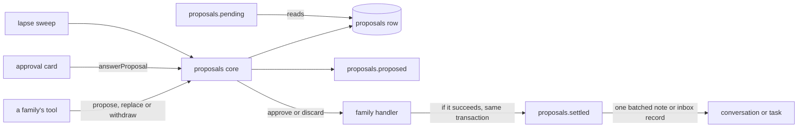

# One proposal lifecycle

- **Status:** draft

Every family of proposal goes through one lifecycle: one row, one lapse sweep, one set of records
for its outcome, and one message that tells the proposer how it ended. Today memory keeps its own
table and sweep, prompt overrides live outside the shared table, each family names its outcomes
differently, and a task that proposed something hears only some outcomes. After this design, a
memory write, a skill write, a rule change, a held action and a prompt override all show in your
approvals list, can all be deferred, lapse on the same schedule rules, and all report back the same
way. A held action is the one exception to the message: its task hears the action's own outcome. The
proposer can list its open proposals and those of the tasks it started, withdraw its own, and
replace one by proposing the same thing again.

Once the owner approves this design, build each of its work items from it and the built
[approvals](../../architecture/policy/approvals.md) it extends.

## Shape



## Terms

- A **family** is a type of proposal with its own body and its own effect: `action`, `memory`,
  `skill`, `rule_change` or `prompt`. The row's separate `kind` column (`action`, `memory_write`,
  `internal_change`) keeps its meaning; a prompt override takes `internal_change`, with the cause
  `prompt_override`.
- The **proposer** is the conversation or the task whose thread the proposal was made on. A proposal
  that nixie makes on its own has no proposer, such as a rule nixie suggested after you approved the
  same kind of action several times. This design calls those **suggested rules**. A memory proposal
  has one proposer for each write that merged into it, as well as the first.
- A proposal **settles** when it is approved, declined, lapses or is withdrawn. A settled proposal
  never reopens.
- Two proposals are **the same thing** when they share a family, a proposer and the key in this
  table. A new proposal that is the same thing as an open one replaces it.

| Family        | Same thing when                                    |
| ------------- | -------------------------------------------------- |
| `skill`       | it writes the same skill, by the skill's name      |
| `prompt`      | it overrides the same prompt, by the prompt's name |
| `rule_change` | it changes the same rule, by `ruleHash`            |
| `memory`      | never: a matching memory proposal merges, as today |
| `action`      | never: each held action is its own proposal        |

## Contracts

### The core and its handlers

```ts
const proposal = await proposals.proposeInTransaction(tx, {
  family: 'skill',
  kind: 'internal_change',
  cause: 'skill_write',
  riskClass: 'routine', // …as the row holds today
  actionHash, // …as the row holds today
  ruleHash, // …as the row holds today
  thread: taskThread, // null for a proposal with no proposer
  taskID,
  deadlineAt: null,
  shortID: undefined, // memory passes its UUID-derived ID until release N+2; the parameter then goes
});
// → { proposalID: '0c1d…', shortID: 'K9', lapsesAt: 1796548800000, replaced: 'K7' }
// replaced is the short ID of the open proposal this one withdrew, or null

await proposals.withdrawInTransaction(tx, proposalID); // settles it as withdrawn
```

```ts
// proposals module. discard replaces the decline and lapse members; the rest stay as they are.
interface ProposalKindHandler {
  family: ProposalFamily; // …existing families, plus 'prompt'
  // Replaces the lapseIntervalMs constant. Read from the loaded config at each use, so a changed
  // value applies after a restart, to the next proposal and the next defer. An open proposal keeps
  // its lapsesAt. Returns null for a cause that lapses only at its deadline, such as a mandate.
  lapseIntervalMs(config: ProposalConfig, cause: string): number | null;
  // The key from the "same thing" table, read from the body the family writes in the same
  // transaction. null for memory and action, which never replace.
  sameThingKey(row: SharedProposal): string | null;
  ownsTransaction: boolean; // …existing
  approve(run: ApplyRun, row: SharedProposal, answer: ProposalAnswerInput): Promise<ApplyOutcome>; // …existing
  // Undoes what the proposal held, such as a held action or a sealed body. It runs where approve
  // runs: in the answer's transaction, or in the family's own when ownsTransaction is set. On a
  // decline it may refuse, and a refusal leaves the row open; on a lapse or a withdrawal it never
  // refuses. answer is null on a lapse or a withdrawal.
  discard(
    run: ApplyRun,
    row: SharedProposal,
    outcome: 'declined' | 'lapsed' | 'withdrawn',
    answer: ProposalAnswerInput | null,
  ): Promise<ApplyOutcome>;
}

// …existing ApplyOutcome, which keeps its afterCommit, such as suggested rules after an action decline
type ApplyOutcome = {
  usedBy: string | null; // the ID the apply made, such as memory's approval; goes into the settlement
  detail: string | null; // the family's own line for the proposer, such as a skill's PR link
};

// Replaces the older ProposalOutcome ('approved' | 'rejected' | 'lapsed') and the canMoveProposal
// state machine: the shared row's states are the only states. A family's old rejection records
// fold as 'declined'.
type ProposalOutcome = 'approved' | 'declined' | 'lapsed' | 'withdrawn';
```

The core writes these records for every family:

```text
proposals.proposed  { proposalID, shortID, family, kind, cause, riskClass, actionHash, ruleHash,
                      thread, taskID, lapsesAt, deadlineAt, replaces }
                    // replaces: the proposal ID this one withdrew, or null
proposals.settled   { proposalID, shortID, family, outcome, answeredBy, usedBy, reason, detail,
                      task }
                    // reason erasable; answeredBy and usedBy null on a lapse or withdrawal;
                    // task: the proposing task's name when the record goes to its report target
proposals.deferred  …existing
proposals.returned  …existing
proposals.withdrawn …existing; written beside proposals.settled until release N+2, then stops
```

- `proposals.proposed` creates the row, and its sequence is the row's `created_sequence`. A family
  writes its body record in the same transaction, such as `skills.write_proposed` with the files.
  Handlers find a body by proposal ID.
- A body record creates a row only when no `proposals.proposed` for that proposal came before it,
  which holds only for records written before this design. A rebuild over a log that mixes old and
  new records creates exactly one row per proposal, and a test checks it.
- When a family's approval record carries data the apply needs, such as `skills.write_approved` with
  edited files, an approval still writes it, beside `proposals.settled`.
- The family records for a decline, a lapse and a withdrawal stop at release N+2 of the
  [release order](#release-order). Until then `discard` writes them as well, with the answer's
  identity and note. Their codecs and mappers stay, so a rebuild still folds every old record.
- Folding a close onto a row that is already closed changes nothing, so the old and new records can
  land together.

### Withdrawing and replacing

```ts
const result = await tools.call('proposals.withdraw', { shortID: 'K7' });
// → { shortID: 'K7', outcome: 'withdrawn' }
```

- `proposals.withdraw` settles one of the caller's own open proposals, pending or deferred, as
  withdrawn, through `withdrawInTransaction`. The tool refuses a short ID of a settled proposal or
  of a proposal the caller isn't a proposer of, and nothing changes.
- Withdrawing a memory proposal withdraws it for every proposer whose write merged into it. Each of
  the others hears the withdrawal in its settlement note.
- When `proposeInTransaction` finds an open proposal that is the same thing, it withdraws that
  proposal in the same transaction, then writes the new one with `replaces` set. Both commit or
  neither does.
- When the new proposal settles, its line in the settlement note gives the short ID of the proposal
  it replaced.
- A withdrawal that the proposer made itself, by `proposals.withdraw` or by a replacement, sends the
  proposer no note, because the call's result holds the outcome.

### The lapse schedule

```yaml
# The server config, in the existing approvals section. Each value is in days, per family.
approvals:
  lapse_days:
    action: 3
    memory: 14 # replaces memory.proposal_lapse_days; when both are set, this one wins
    skill: 14
    rule_change: 14 # rule widenings and suggested rules; a mandate lapses at its deadline only
    prompt: 14
```

- A new proposal lapses at its deadline or at its creation plus its family's `lapse_days`, whichever
  comes first. A defer sets a new lapse by the same rule, counted from the defer. A mandate lapses
  only at its deadline, which is its expiry, and keeps its own expiry timer.
- A memory merge extends the shared row's lapse by `lapse_days.memory`, recorded in the merge record
  as today.
- One sweep in the core lapses every family's open proposals once their lapse passes. Memory's own
  sweep keeps only its item lapses and the key-store cleanup of closed proposals, after the commit.
  Delete the prompt sweep.

### Telling the proposer

```ts
// One settlement, for every outcome of every family but action.
type ProposalSettledNote = {
  shortID: string;
  family: ProposalFamily;
  outcome: ProposalOutcome;
  reason: string | null; // the answer's note, when you wrote one
  sentence: string; // the card's one-line sentence, or a plain family line when a forget took it
  detail: string | null; // the family's own line, such as "call skill_reload" with the PR link
  task: string | null; // the proposing task's name, when it had closed and this went to its report target
  replaced: string | null; // the short ID of the proposal this one replaced
};
```

A conversation reads every settlement that lands before its next turn as one turn note, and a task
reads every settlement that lands before its next wake as one inbox record:

```text
Proposals that settled since your last turn:
- Your skill write K9 was approved. It replaced K7. Call skill_reload: <pull request link>
- Your memory proposal M3 was declined: not this week.
- The task Weekly digest proposed rule change R2. It lapsed.
- nixie suggested a rule, R5. It lapsed.
```

A prompt override's export after approval stays a note of its own: it isn't a settlement.

- The core writes `proposals.settled` on each proposer's thread. Outside the action family, it
  reaches a task as an inbox record that wakes it, and the conversation as a turn note.
- When the proposing task has closed, the core writes `proposals.settled` on the thread of the task
  run's report target instead, with `task` set: the report target the task run pinned, else the
  starter of a started task. When the task has no report target, the record stays on the task's
  thread and sends no message.
- The turn-note builder folds every `proposals.settled` since the conversation's last turn into one
  note, in log order. The inbox renderer does the same for every one since the task's last wake, and
  they wake the task once.
- A proposal with no proposer writes `proposals.settled` with no thread, and sends no message. A
  lapse is the exception: the core writes it on the conversation's thread, so the batched note
  carries it.
- An action proposal's settlement is never an inbox record. The task hears `action.outcome`, which
  the action module already writes when an approval queues the action, or when a decline or a lapse
  fails the held action.
- The inbox predicate, the inbox renderer and the turn-note kinds read `proposals.settled` from
  release N+1 of the [release order](#release-order). The same change drops the old decline kinds
  from them, so a proposer never hears one outcome twice.
- The inbox predicate reads `family` from the payload to leave out action settlements.

### The pending tool

```ts
const open = await tools.call('proposals.pending', { by: 'tasks' });
// → [{ shortID: 'M3', family: 'memory', task: 'Weekly digest', change: 'add',
//      gist: 'Dentist moved to Tuesdays', topic: 'health', reason: 'a new fact about you',
//      state: 'deferred', lapsesAt: '2026-12-01T09:00:00Z' },
//    { shortID: 'K7', family: 'skill', task: 'Weekly digest',
//      sentence: 'Update the trip-planning skill', state: 'pending',
//      lapsesAt: '2026-12-03T09:00:00Z' }]

type PendingInput = {
  by?: 'me' | 'tasks'; // me: the caller's own; tasks: those of tasks it started; both when omitted
  family?: ProposalFamily;
  text?: boolean; // true adds the full proposed text to memory rows
};

type PendingRow = {
  shortID: string;
  family: ProposalFamily;
  task: string | null; // the proposing task's name; null for the caller's own
  state: 'pending' | 'deferred';
  lapsesAt: string;
} & (
  | {
      family: 'memory';
      // memory's change for a new item, 'new', shows as 'add'; edit, retire and pin keep their names
      change: 'add' | 'edit' | 'retire' | 'pin';
      gist: string | null;
      topic: string | null;
      reason: string; // why it waits for review
      text?: string; // only with text: true
    }
  | { family: Exclude<ProposalFamily, 'memory'>; sentence: string } // the card's one-line sentence
);
```

- `proposals.pending` lists open proposals, pending or deferred: those the caller is a proposer of,
  and those of every task the caller started, open or closed.
- It replaces `memory.pending` and `skill_pending`.

### Short IDs

- `proposeInTransaction` stores every new proposal's short ID in `proposals.proposed`, so a rebuild
  keeps it. It creates the short ID with `createShortID`.
- Memory draws its short ID like every other family from release N+2. Before then it passes one
  derived from the UUID, because a release before N+1 derives it again at read time and must show
  the same ID. From N+1, every reader of a memory proposal takes its short ID from the shared row.
- Every proposal's ID is a UUID, skills and prompts included. A release before this design shows the
  UUID of a new skill or prompt proposal in place of its short ID.
- A proposal's UUID never reaches the model. The answer path, `proposals.withdraw` and
  `approvals.readProposals` find a proposal by its short ID, and return the newest row that holds
  it. The approval card sends the UUID, so an older row that shares a short ID stays answerable.
- Old proposals keep the short IDs their rows already hold, shared or not.
- Notices to the model mark a record with `[#n]`, an event number that `log.read` accepts. Today the
  take-over notices put a random short ID in that slot, which nothing can look up. Make them print
  their record's event number instead. `[#n]` means an event number and nothing else.

## Constraints

- The `family` column accepts `prompt`. A migration adds it and backfills every prompt override,
  open and closed, from its records, as the shared table's first migration did for the other
  families. A test checks that the backfill equals a rebuild. A backfilled row keeps its old
  proposal ID as `short_id`.
- A prompt row takes `kind` `internal_change`, cause `prompt_override` and risk class `always_ask`,
  so approving it needs a passkey. Its `action_hash` is the proposed override's hash, and
  `readHashes` folds in the base it replaces, so a stale base refuses.
- The host prompt route answers through `answerProposal` and keeps its edits. A prompt approval
  records the answering identity and the channel it came on.
- Every family's proposals show in the approvals list and take every answer the core offers:
  approve, decline and defer, and always allow where the family supports it. Prompt overrides gain
  defer.
- A deferred proposal's lapse uses its family's `lapse_days`, the same value as a fresh one.
- A new short ID is never reused: it differs from the short ID of every proposal ever made, open or
  settled. `proposeInTransaction` draws again on a clash. Before release N+2, a clash of a derived
  memory short ID fails the write.
- The core calls `approve` or `discard` first, and writes `proposals.settled` only when it succeeds,
  in the same transaction. For a family that owns its transaction, such as memory, the core writes
  it in a hook the family calls after its apply, inside that transaction. A refusal, or a memory
  close match that sends the card back, writes no settlement, and the row stays open.
- `memory_proposals` keeps each memory proposal's sealed body and its merges. Its `status` and
  `lapse_at` columns stay but are no longer written; memory reads the state from the shared row.
- `proposals.settled.reason` is an erasable field, and the forgettable kinds list in the published
  contract gains `proposals.settled`. The change is additive, so it ships in a minor release.
- Delete the skill, rule and action lapse writers, the test-only action answer writer, and the
  prompt lapse sweep. Move the action answer types to the module that uses them.
- The code, tables and records that carry the name "gap check" take the name "suggested rules" as
  part of this work. The old record codecs stay, so a rebuild still reads every old record.

## Release order

Each step ships in its own release, so a rollback by one release still reads every row. The one
exception is a rollback from N+2 to N+1: release N+1 reads a `prompt` row as an unknown family and
fails to load it, so that rollback needs a restore from a backup taken before N+2.

| Release | Ships                                                                                                                 |
| ------- | --------------------------------------------------------------------------------------------------------------------- |
| N       | `proposals.proposed` and `proposals.settled` for every family but prompt, beside the old records                      |
| N+1     | the readers switch to the new records and to stored short IDs; `memory.proposal_lapse_days` is read with a warning    |
| N+2     | the old outcome records and the memory key stop; the prompt family joins the shared table; memory draws its short IDs |

## Builder decides

- How the work splits into pull requests.
- The batched note's exact wording.
- How the prompt override card renders its body.

## Out of scope

- A digest of settled proposals. The [push notice design](push-notice.md) owns the digest.
- Changes to what each family proposes or applies.
