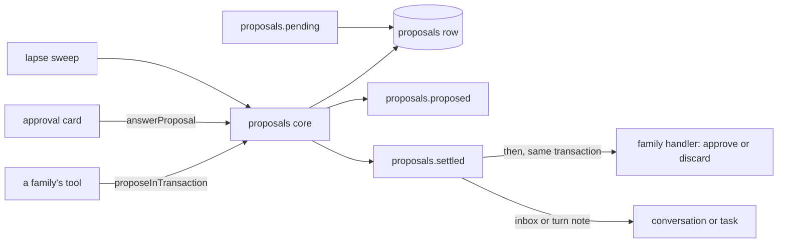

# One proposal lifecycle

- **Status:** draft

Every family of proposal goes through one lifecycle: one row, one lapse sweep, one set of records
for its outcome, and one message that tells the proposer how it ended. Today memory keeps its own
table and sweep, prompt overrides live outside the shared table, each family names its outcomes
differently, and a task that proposed something hears only some outcomes. After this design, a
memory write, a skill write, a rule change, a held action and a prompt override all show in your
approvals list, can all be deferred, lapse on the same schedule rules, and all report back the same
way.

The owner approves this design. The builder of each work item it files starts from it, together with
the built [approvals](../../architecture/policy/approvals.md) it extends.

## Shape



## Terms

- A **family** is a type of proposal with its own body and its own effect: `action`, `memory`,
  `skill`, `rule_change` or `prompt`. The row's separate `kind` column (`action`, `memory_write`,
  `internal_change`) keeps its meaning; a prompt override takes `internal_change`, with the cause
  `prompt_override`.
- The **proposer** is the conversation or the task whose thread the proposal was made on. A proposal
  that nixie makes on its own, such as a proposed rule from the gap check, has no proposer.
- A proposal **settles** when it is approved, declined, lapses or is withdrawn. A settled proposal
  never reopens.

## Contracts

### The core and its handlers

```ts
const proposal = await proposals.proposeInTransaction(tx, {
  family: 'skill',
  kind: 'internal_change',
  cause: 'skill_write',
  riskClass: 'routine', // …as the row holds today
  actionHash, // …as the row holds today
  ruleHash, // …as the row holds today
  thread: taskThread, // null for a proposal with no proposer
  taskID,
  deadlineAt: null,
});
// → { proposalID: '0c1d…', shortID: 'K7', lapsesAt: 1796548800000 }
```

```ts
// proposals module. discard replaces today's decline and lapse members; the rest stay.
interface ProposalKindHandler {
  family: ProposalFamily; // …existing families, plus 'prompt'
  // Read through the server's config reader at each use, so a changed value applies to the next
  // proposal and the next defer. An open proposal keeps the lapsesAt it has.
  lapseAfterMs(config: ProposalConfig): number;
  ownsTransaction: boolean; // …existing
  readBodies: ReadBodies; // …existing
  readHashes: ReadHashes; // …existing
  approve(run: AnswerRun, row: ProposalRow, answer: ProposalAnswer): Promise<ApproveResult>; // …existing
  // Called after the core wrote the settlement. Undoes what the proposal held, such as a held
  // action or a sealed body. Writes no outcome record of its own.
  discard(
    tx: Transaction,
    row: ProposalRow,
    outcome: 'declined' | 'lapsed' | 'withdrawn',
  ): Promise<void>;
}

// Replaces today's ProposalOutcome ('approved' | 'rejected' | 'lapsed') and its state machine:
// the shared row's states are the only states.
type ProposalOutcome = 'approved' | 'declined' | 'lapsed' | 'withdrawn';
```

Records, written by the core for every family:

```text
proposals.proposed  { proposalID, shortID, family, kind, cause, riskClass, actionHash, ruleHash,
                      thread, taskID, lapsesAt, deadlineAt }
proposals.settled   { proposalID, shortID, outcome, answeredBy, usedBy, reason }
                    // reason erasable; answeredBy and usedBy null on a lapse or withdrawal
proposals.deferred  …existing
proposals.returned  …existing
proposals.withdrawn …existing; new withdrawals write proposals.settled instead
```

- `proposals.proposed` creates the row, and its sequence is the row's `created_sequence`. A family
  writes its body record in the same transaction, such as `skills.write_proposed` with the files. A
  body record written after `proposals.proposed` creates no row; the mappers create rows only from
  body records with no `proposals.proposed` before them. Handlers find a body by proposal ID.
- An approval keeps the family's own approval record when it carries data the apply needs, such as
  `skills.write_approved` with edited files, beside `proposals.settled`.
- The family records for a decline, a lapse and a withdrawal stop. Their codecs and mappers stay, so
  a rebuild still folds every old record.
- For one release, the core also writes each family's old decline and lapse record, so the release
  before still closes the rows. The release after drops them.

### The lapse schedule

```yaml
# The server config, in the existing approvals section. Each value is in days, per family.
approvals:
  lapse_days:
    action: 3
    memory: 14 # memory.proposal_lapse_days still works for one release, with a warning
    skill: 14
    rule_change: 14 # rule widenings and proposed rules; a mandate lapses at its deadline
    prompt: 14
```

- A proposal lapses at the earlier of its creation plus its family's `lapse_days` and its deadline.
  A mandate's deadline is its expiry, as today, and its own expiry timer stays.
- One sweep lapses every family: the core's sweep, on the shared sweep helper. Memory's own sweep
  keeps only its item lapses and the key-store cleanup of closed proposals, after the commit. The
  prompt sweep is deleted.

### Telling the proposer

```ts
// The message a proposer reads, for every family and every outcome.
// Conversation: a turn note. Task: an inbox record that wakes the task.
// "Your skill write K7 was declined: not this week."
type ProposalSettledNote = {
  shortID: string;
  family: ProposalFamily;
  outcome: ProposalOutcome;
  reason: string | null; // the answer's note, when you wrote one
  sentence: string; // the card's one-line sentence
};
```

- `proposals.settled` is written on the proposal's thread. It is an inbox record for a task and a
  turn note for the conversation.
- An action proposal's settlement is never an inbox record. The task hears `action.outcome`, which
  the action module already writes when an approval queues the action, or when a decline or a lapse
  fails the held action.
- The readers switch in the same work item that stops the old records: the inbox predicate, the
  inbox renderer and the turn-note kinds read `proposals.settled`.
- A proposal with no proposer settles with no message.
- A task that has closed gets no message. The record still lands on its thread.

### The pending tool

```ts
const open = await tools.call('proposals.pending', { family: 'memory' }); // family is optional
// → [{ shortID: 'M3', family: 'memory', sentence: 'Remember that the dentist moved to Tuesdays',
//      state: 'deferred', lapsesAt: '2026-12-01T09:00:00Z' }]
```

`proposals.pending` lists the caller's own open proposals: those on its thread, pending or deferred.
It replaces `memory.pending` and `skill_pending`.

### Short IDs

- `proposeInTransaction` creates every new proposal's short ID with `createShortID` and stores it in
  `proposals.proposed`, so a rebuild keeps it.
- A proposal's UUID never reaches the model. The answer path finds a proposal by its short ID among
  open proposals only.
- Old proposals keep the short IDs their rows already hold.
- Notices to the model mark a record with `[#n]`, an event number that `log.read` accepts. The
  take-over notices put a random short ID in that slot today, which nothing can look up, so they
  print their record's event number instead. `[#n]` means an event number and nothing else.

## Constraints

- The `family` column accepts `prompt`. A migration adds it, and backfills open prompt overrides
  from their records, as the shared table's first migration did for the other families. A prompt
  override's own proposal ID is already a short ID, and its row keeps it as `short_id`.
- A prompt row takes `kind` `internal_change`, cause `prompt_override`, risk class `always_ask`, so
  approving it needs a passkey, and the override's hash as `action_hash`. The host prompt route
  answers through `answerProposal`.
- Every family's proposals show in the approvals list and take every answer the core offers:
  approve, decline and defer, and always allow where the family supports it. Prompt overrides gain
  defer, as the owner asked for every card.
- A deferred proposal's lapse uses its family's `lapse_days`, the same value as a fresh one.
- An open short ID is unique among open proposals. `proposeInTransaction` draws again on a clash.
- The core writes `proposals.settled` before it calls `discard`, in one transaction.
- On an approval, the core writes `proposals.settled` after the family's apply succeeds, in the same
  transaction. For a family that owns its transaction, such as memory, the core writes it through
  the family's guard. An apply that refuses writes no settlement, and the row stays open.
- `memory_proposals` keeps each memory proposal's sealed body and its merges. Its `status` and
  `lapse_at` columns stay but are no longer written; memory reads the state from the shared row.
- `proposals.settled.reason` is an erasable field, and the forgettable kinds list in the published
  contract gains `proposals.settled`, an additive change in a minor release.
- These writers are deleted: the skill, rule and action lapse writers, the test-only action answer
  writer, and the prompt lapse sweep. The action answer types move to the module that uses them.

## Builder decides

- How the work splits into pull requests.
- The turn note's exact wording.
- Whether `proposals.pending` shows the body's sentence or a shorter title.
- How the prompt override card renders its body.

## Out of scope

- A digest of settled proposals. The [push notice design](push-notice.md) owns the digest.
- Changes to what each family proposes or applies.

## Open questions

- **Rolling back past the prompt migration.** The release before reads a `prompt` row as an unknown
  family and fails to load it. The owner may accept that a rollback past this release needs a
  restore, or keep prompts off the shared table for one more release. Until the owner decides, the
  prompt family ships in a release of its own, after the rest.

- **A proposal with no proposer.** The gap check's proposed rules settle silently. The owner may
  want the conversation told when one lapses. Until the owner decides, they settle silently.
