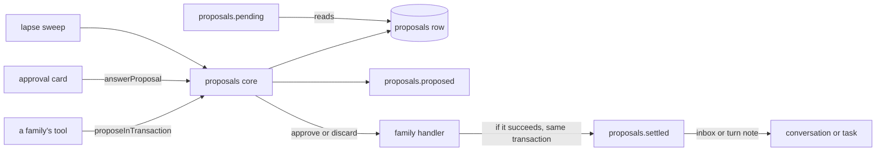

# One proposal lifecycle

- **Status:** draft

Every family of proposal goes through one lifecycle: one row, one lapse sweep, one set of records
for its outcome, and one message that tells the proposer how it ended. Today memory keeps its own
table and sweep, prompt overrides live outside the shared table, each family names its outcomes
differently, and a task that proposed something hears only some outcomes. After this design, a
memory write, a skill write, a rule change, a held action and a prompt override all show in your
approvals list, can all be deferred, lapse on the same schedule rules, and all report back the same
way. A held action is the one exception to the message: its task hears the action's own outcome.

The owner approves this design. The builder of each work item it files starts from it, together with
the built [approvals](../../architecture/policy/approvals.md) it extends.

## Shape



## Terms

- A **family** is a type of proposal with its own body and its own effect: `action`, `memory`,
  `skill`, `rule_change` or `prompt`. The row's separate `kind` column (`action`, `memory_write`,
  `internal_change`) keeps its meaning; a prompt override takes `internal_change`, with the cause
  `prompt_override`.
- The **proposer** is the conversation or the task whose thread the proposal was made on. A proposal
  that nixie makes on its own, such as a proposed rule from the gap check, has no proposer.
- A proposal **settles** when it is approved, declined, lapses or is withdrawn. A settled proposal
  never reopens.

## Contracts

### The core and its handlers

```ts
const proposal = await proposals.proposeInTransaction(tx, {
  family: 'skill',
  kind: 'internal_change',
  cause: 'skill_write',
  riskClass: 'routine', // …as the row holds today
  actionHash, // …as the row holds today
  ruleHash, // …as the row holds today
  thread: taskThread, // null for a proposal with no proposer
  taskID,
  deadlineAt: null,
  shortID: undefined, // memory alone passes one, derived from the UUID, as it does today
});
// → { proposalID: '0c1d…', shortID: 'K7', lapsesAt: 1796548800000 }

await proposals.withdrawInTransaction(tx, proposalID); // settles it as withdrawn
```

```ts
// proposals module. discard replaces the decline and lapse members; the rest stay as they are.
interface ProposalKindHandler {
  family: ProposalFamily; // …existing families, plus 'prompt'
  // Replaces the lapseIntervalMs constant. Read from the loaded config at each use, so a changed
  // value applies after a restart, to the next proposal and the next defer. An open proposal keeps
  // its lapsesAt. Returns null for a cause that lapses only at its deadline, such as a mandate.
  lapseIntervalMs(config: ProposalConfig, cause: string): number | null;
  ownsTransaction: boolean; // …existing
  approve(run: ApplyRun, row: SharedProposal, answer: ProposalAnswerInput): Promise<ApplyOutcome>; // …existing
  // Undoes what the proposal held, such as a held action or a sealed body. It runs where approve
  // runs: in the answer's transaction, or in the family's own when ownsTransaction is set. On a
  // decline it may refuse, and a refusal leaves the row open; on a lapse or a withdrawal it never
  // refuses. answer is null on a lapse or a withdrawal.
  discard(
    run: ApplyRun,
    row: SharedProposal,
    outcome: 'declined' | 'lapsed' | 'withdrawn',
    answer: ProposalAnswerInput | null,
  ): Promise<ApplyOutcome>;
}

// …existing ApplyOutcome, which keeps its afterCommit, such as the gap check after an action decline
type ApplyOutcome = {
  usedBy: string | null; // the ID the apply made, such as memory's approval; goes into the settlement
  detail: string | null; // the family's own line for the proposer, such as a skill's PR link
};

// Replaces the older ProposalOutcome ('approved' | 'rejected' | 'lapsed') and the canMoveProposal
// state machine: the shared row's states are the only states. A family's old rejection records
// fold as 'declined'.
type ProposalOutcome = 'approved' | 'declined' | 'lapsed' | 'withdrawn';
```

Records, written by the core for every family:

```text
proposals.proposed  { proposalID, shortID, family, kind, cause, riskClass, actionHash, ruleHash,
                      thread, taskID, lapsesAt, deadlineAt }
proposals.settled   { proposalID, shortID, family, outcome, answeredBy, usedBy, reason, detail }
                    // reason erasable; answeredBy and usedBy null on a lapse or withdrawal
proposals.deferred  …existing
proposals.returned  …existing
proposals.withdrawn …existing; new withdrawals write proposals.settled instead
```

- `proposals.proposed` creates the row, and its sequence is the row's `created_sequence`. A family
  writes its body record in the same transaction, such as `skills.write_proposed` with the files.
  Handlers find a body by proposal ID.
- A body record creates a row only when no `proposals.proposed` for that proposal came before it,
  which holds only for records written before this design. A rebuild over a log that mixes old and
  new records creates exactly one row per proposal, and a test holds that.
- An approval keeps the family's own approval record when it carries data the apply needs, such as
  `skills.write_approved` with edited files, beside `proposals.settled`.
- The family records for a decline, a lapse and a withdrawal stop at release N+2 of the
  [release order](#release-order). Until then `discard` writes them as well, with the answer's
  identity and note. Their codecs and mappers stay, so a rebuild still folds every old record.
- Folding a close onto a row that is already closed changes nothing, so the old and new records can
  land together.

### The lapse schedule

```yaml
# The server config, in the existing approvals section. Each value is in days, per family.
approvals:
  lapse_days:
    action: 3
    memory: 14 # replaces memory.proposal_lapse_days; when both are set, this one wins
    skill: 14
    rule_change: 14 # rule widenings and proposed rules; a mandate lapses at its deadline only
    prompt: 14
```

- A proposal lapses at the earlier of its creation plus its family's `lapse_days` and its deadline.
  A mandate lapses at its deadline, its expiry, and its own expiry timer stays.
- A memory merge extends the shared row's lapse by `lapse_days.memory`, recorded in the merge record
  as today.
- One sweep lapses every family: the core's sweep, on the shared sweep helper. Memory's own sweep
  keeps only its item lapses and the key-store cleanup of closed proposals, after the commit. The
  prompt sweep is deleted.

### Telling the proposer

```ts
// The message a proposer reads, for every family and every outcome.
// Conversation: a turn note. Task: an inbox record that wakes the task.
// "Your skill write K7 was declined: not this week."
type ProposalSettledNote = {
  shortID: string;
  family: ProposalFamily;
  outcome: ProposalOutcome;
  reason: string | null; // the answer's note, when you wrote one
  sentence: string; // the card's one-line sentence, or a plain family line when a forget took it
  detail: string | null; // the family's own line, such as "call skill_reload" with the PR link
};
```

A prompt override's export after approval stays a note of its own: it isn't a settlement.

- `proposals.settled` is written on the proposal's thread. It is an inbox record for a task and a
  turn note for the conversation.
- An action proposal's settlement is never an inbox record. The task hears `action.outcome`, which
  the action module already writes when an approval queues the action, or when a decline or a lapse
  fails the held action.
- The inbox predicate, the inbox renderer and the turn-note kinds read `proposals.settled` from
  release N+1 of the [release order](#release-order). The same change drops the old decline kinds
  from them, so a proposer never hears one outcome twice.
- The inbox predicate reads `family` from the payload to leave out action settlements.
- A proposal with no proposer settles with no message.
- A task that has closed gets no message. The record still lands on its thread.

### The pending tool

```ts
const open = await tools.call('proposals.pending', { family: 'memory' }); // family is optional
// → [{ shortID: 'M3', family: 'memory', sentence: 'Remember that the dentist moved to Tuesdays',
//      state: 'deferred', lapsesAt: '2026-12-01T09:00:00Z' }]
```

`proposals.pending` lists the caller's own open proposals: those on its thread, pending or deferred.
It replaces `memory.pending` and `skill_pending`.

### Short IDs

- `proposeInTransaction` creates every new proposal's short ID with `createShortID` and stores it in
  `proposals.proposed`, so a rebuild keeps it. Memory passes the short ID it derives from the UUID,
  so a rollback rebuilds the same IDs.
- Every proposal's ID is a UUID, skills and prompts included. A release before this design shows a
  new skill or prompt proposal's UUID where it shows a short ID.
- A proposal's UUID never reaches the model. The answer path finds a proposal by its short ID among
  open proposals only. `approvals.readProposals` matches a short ID among open rows first, then the
  newest closed row.
- Old proposals keep the short IDs their rows already hold.
- Notices to the model mark a record with `[#n]`, an event number that `log.read` accepts. The
  take-over notices put a random short ID in that slot today, which nothing can look up, so they
  print their record's event number instead. `[#n]` means an event number and nothing else.

## Constraints

- The `family` column accepts `prompt`. A migration adds it, and backfills every prompt override,
  open and closed, from its records, as the shared table's first migration did for the other
  families; a test holds the backfill equal to a rebuild. A backfilled row keeps its old proposal ID
  as `short_id`.
- A prompt row takes `kind` `internal_change`, cause `prompt_override` and risk class `always_ask`,
  so approving it needs a passkey. Its `action_hash` is the proposed override's hash, and
  `readHashes` folds in the base it replaces, so a stale base refuses.
- The host prompt route answers through `answerProposal` and keeps its edits. A prompt approval
  records the answering identity and the channel it came on.
- Every family's proposals show in the approvals list and take every answer the core offers:
  approve, decline and defer, and always allow where the family supports it. Prompt overrides gain
  defer, as the owner asked for every card.
- A deferred proposal's lapse uses its family's `lapse_days`, the same value as a fresh one.
- An open short ID is unique among open proposals. `proposeInTransaction` draws again on a clash.
- The core calls `approve` or `discard` first, and writes `proposals.settled` only when it succeeds,
  in the same transaction. For a family that owns its transaction, such as memory, the core writes
  it in a hook the family calls after its apply, inside that transaction. A refusal, or a memory
  close match that sends the card back, writes no settlement, and the row stays open.
- `memory_proposals` keeps each memory proposal's sealed body and its merges. Its `status` and
  `lapse_at` columns stay but are no longer written; memory reads the state from the shared row.
- `proposals.settled.reason` is an erasable field, and the forgettable kinds list in the published
  contract gains `proposals.settled`, an additive change in a minor release.
- These writers are deleted: the skill, rule and action lapse writers, the test-only action answer
  writer, and the prompt lapse sweep. The action answer types move to the module that uses them.

## Release order

Each step ships in its own release, so a rollback by one release still reads every row.

| Release | Ships                                                                                      |
| ------- | ------------------------------------------------------------------------------------------ |
| N       | `proposals.proposed` and `proposals.settled`, written beside each family's old records     |
| N+1     | the readers switch to the new records; `memory.proposal_lapse_days` is read with a warning |
| N+2     | the old outcome records and the memory key stop; the prompt family joins the shared table  |

## Builder decides

- How the work splits into pull requests.
- The turn note's exact wording.
- Whether `proposals.pending` shows the body's sentence or a shorter title.
- How the prompt override card renders its body.

## Out of scope

- A digest of settled proposals. The [push notice design](push-notice.md) owns the digest.
- Changes to what each family proposes or applies.

## Open questions

- **Rolling back past the prompt migration.** The release before N+2 reads a `prompt` row as an
  unknown family and fails to load it. The owner may accept that this one rollback needs a restore,
  or ask for a release that reads `prompt` rows before any are written. Until the owner decides, the
  release order above stands.
- **A proposal with no proposer.** The gap check's proposed rules settle silently. The owner may
  want the conversation told when one lapses. Until the owner decides, they settle silently.
