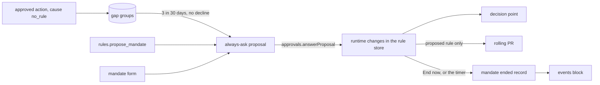

# Proposed rules and mandates

- **Status:** draft
- **Work items:** [proposed rules and mandates](https://linear.app/zgeoff/issue/GEO-1806)

Two kinds of rule come from nixie, and you approve each one before it is in force. A **proposed
rule** turns a habit into a rule: when you approve the same kind of call 3 times in 30 days and
reject none, nixie proposes the narrowest allow rule that covers those calls. A **mandate** is
authority for a period, such as "full authority over my calendar invites today": one or more allow
rules that share a mandate ID and an expiry, which you state in the conversation or in the mandate
form. Each one waits as an always-ask proposal on the approval record
(`docs/design/queue/approval-record.md`), and an approval puts its rules in force as runtime changes
in [the rule store](../../architecture/policy/rules.md#rules-in-force). A proposed rule then joins
[the rule export](../../architecture/policy/rules.md#the-rule-export). A mandate never exports, and
it ends at its expiry or when you end it.

The [rules design](../platform/policy/rules.md#gaps-and-proposed-rules) holds what these rules mean.
This doc holds the records, the calls and the rules the code keeps. The action proposals that feed
the gap count come from the decision point cutover (`docs/design/queue/decision-point-cutover.md`).

## Shape



The rule store, in the definitions module, owns both families of proposal. Each family registers one
handler of the `internal_change` kind on the proposals module.

## Contracts

### Gap groups

A gap is an action proposal whose cause is `no_rule`, stage 9 of the
[pipeline](../platform/policy/decision-point.md#the-pipeline). Each answer to one joins its group.

```ts
// definitions module. The group key; its SHA-256 over the canonical JSON is the group hash.
interface GapGroupKey {
  tool: string; // the exact tool name, with its variant, such as task.start/atc
  context: RuleContext; // policy module, existing
  destinations: string[]; // the call's destination values in NFC, sorted, duplicates dropped
}
```

```text
gap_answers, a projection that one appended migration adds
  proposal_id   text primary key  -- the action proposal's UUID
  group_hash    text not null
  answer        text not null     -- 'approved' or 'declined'
  answered_at   integer not null

gap_groups, from the same migration
  group_hash    text primary key
  quiet_until   integer           -- set by Not now or a lapse of the group's proposed rule
  proposal_id   text              -- the group's open proposed rule, if any
```

- The tables hold the group hash, never a destination or an argument. The proposed rule reads those
  from each action proposal's erasable fields when it is built.
- An Approve answer counts as `approved`, and a Decline answer counts as `declined`. An Always allow
  answer, a lapse, a defer and a withdrawal add nothing, because Always allow already creates a rule
  for the group.

### The proposed rule

After each answer that joins a group, the rule store checks the group in its own transaction. It
proposes a rule when all of these hold:

1. The group has at least `policy.proposed_rules.approvals` approved answers whose `answered_at`
   lies within `policy.proposed_rules.window_days` before now.
2. The group has no declined answer in that window.
3. The group has no open proposed rule, and its `quiet_until` lies before now.
4. Every approved action proposal in the window still has its erasable fields. An answer whose
   fields a record forget removed counts for nothing.

The rule covers exactly the approved calls of the window, and nothing a field could leave out:

```yaml
# The proposed rule for 3 approved sends to one address from one job
outcome: allow
tools: [mail.send]
contexts: [task]
jobs: [weekly-report] # only when every call came from this one definition
destinations: [sam@example.org] # the group's destinations, exact, with no wildcard
sources: [own_data] # the union of the calls' sources, left out when no call had one
checks:
  - { arg: subject, op: eq, value: Q3 numbers } # each scalar argument with one value in every call
```

- A check is `eq`, on a scalar argument or a scalar inside an object argument, by its argument path.
  A list argument gets no check.
- An argument that the tool's declaration names in `freeText`, such as an email body, never gets a
  check. Always allow builds its rule with the same list.
- The rule renders with the existing rule renderer, and the parser checks it, as for any rule.

```ts
// definitions module. A record kind of its own, so the release before skips it.
interface RulesRuleProposed {
  // kind rules.rule_proposed
  proposalID: string; // crypto.randomUUID()
  shortID: string; // from createShortID
  groupHash: string;
  ruleHash: string; // the hash of the rule's canonical form, which the action hash covers
  approvals: string[]; // the action proposal UUIDs the rule covers
  editOf: string | null; // the proposal an Edit withdrew, or null
  // erasable: { rule: RuleForm }, so a declined rule leaves no address in a plain column
}
```

The shared row and its card:

```ts
// The shared row (approval record design), for a proposed rule
{ kind: 'internal_change', riskClass: 'always_ask', cause: 'proposed_rule', taskID: null,
  thread: null, rule: null, deadlineAt: null }

// Its body, from the handler's describe()
{ sentence: '**Allow** `mail.send` in a task of `weekly-report` when every destination matches `sam@example.org` …',
  fields: { covers: '3 approvals: 2 Nov, 6 Nov, 11 Nov', group: 'mail.send to sam@example.org' },
  ruleSentence: null }
// choices: ['approve', 'defer', 'decline']; the card labels decline "Not now"
```

Edit is a checked action of its own, because a row keeps its hash and its risk class for life:

```ts
const edited = await client.rules.editProposedRule({
  proposalID: 'm8t2q9wd4e', // the UUID or the short ID
  actionHash: 'sha256:9f2e…', // the hash the card showed
  rule: { outcome: 'allow', tools: ['mail.send'], destinations: ['*@example.org'] },
  clientActionID: crypto.randomUUID(),
});
// → { proposalID: 'p4k7c1x8ve' }: the new proposal, which you approve as any other
//   or ORPCError CONFLICT { current: { actionHash } }, CLOSED { state }, INVALID { faults }
```

- The edit withdraws the old row with `proposals.withdrawn` and writes a new `rules.rule_proposed`
  with `editOf`, in one transaction. The new row keeps the group and its approvals.
- The edited rule stays an `allow` rule, and may hold any other field the rule format allows. When
  it holds `lift`, the new row takes the `lifting` risk class.
- The parser checks the edited rule, and `INVALID` lists each fault.

The answers:

| Answer                 | What happens                                                                                          |
| ---------------------- | ----------------------------------------------------------------------------------------------------- |
| Approve                | One runtime change adds the rule under a new runtime ID, with you as its changer, and it joins the PR |
| Decline ("Not now")    | The group's `quiet_until` becomes now plus `policy.proposed_rules.quiet_days`                         |
| A lapse                | The same as Not now                                                                                   |
| Defer                  | As the approval record design defines it                                                              |
| A decline in the group | nixie withdraws the group's open proposed rule, because the habit no longer holds                     |

### Mandates

```ts
// The chat tool. Only the conversation's tool list holds it. It declares `note`, and its call
// only writes a proposal, as skill_write does.
// rules.propose_mandate({
//   title: 'Full authority over my calendar invites',
//   rules: [{ outcome: 'allow', tools: ['calendar.respond', 'calendar.invite'] }],
// })
// → { status: 'pending', proposalID: 'k3x9m2p7qa', mandateID: 'h7d2n5r9wb',
//     expires: '2026-11-14T00:00:00+11:00',
//     sentences: ['**Allow** `calendar.respond` or `calendar.invite`, until 2026-11-13T13:00:00Z.'] }

// The mandate form, a checked action with the same input
const proposed = await client.rules.proposeMandate({ ...input, clientActionID });
// → { proposalID, mandateID, expires }

// definitions module
interface MandateInput {
  title: string; // 1 to 120 characters; a label on the card, never in a rule
  rules: Array<Omit<Rule, 'id' | 'mandate' | 'expires'> & { outcome: 'allow' }>; // 1 to 10
  expires?: string; // ISO date and time with an offset; default the end of your day
}
```

```ts
// definitions module. Record kinds of their own, so the release before skips them.
interface RulesMandateProposed {
  // kind rules.mandate_proposed
  proposalID: string; // crypto.randomUUID()
  shortID: string; // from createShortID
  mandateID: string; // from createShortID; it matches the rule ID pattern
  ruleHashes: string[]; // each rule's canonical form, with mandate and expires filled in
  expires: number;
  proposedBy: 'owner' | 'nixie'; // the form, or the chat tool
  // erasable: { title, rules: RuleForm[] }
}
interface RulesMandateStarted {
  // kind rules.mandate_started, in the approval's transaction
  mandateID: string;
  proposalID: string;
  changeIDs: string[]; // one runtime change per rule
  expires: number;
}
interface RulesMandateEnded {
  // kind rules.mandate_ended
  mandateID: string;
  reason: 'ended' | 'expired'; // End now, or the timer
  changeIDs: string[]; // the runtime changes it retired
}
```

The shared row for a mandate is `kind: 'internal_change'`, `cause: 'mandate'`, and
`riskClass: 'lifting'` when a rule holds `lift`, else `'always_ask'`. Its `deadlineAt` is the
mandate's `expires`, so the row lapses when the mandate would end. Its action hash covers the
mandate ID, each rule hash and `expires`. Its body shows `title`, each rule's sentence and the time
it ends, and its choices are approve, defer and decline.

```ts
const { mandates } = await client.rules.listMandates();
// → { mandates: [{ mandateID: 'h7d2n5r9wb', title: 'Full authority over my calendar invites',
//       rules: [{ ruleID: 'h7d2n5r9wb-1', sentence: '…' }], startedAt, expires }] }
// The client shows the time left from expires.

await client.rules.endMandate({ mandateID: 'h7d2n5r9wb', clientActionID });
// → { mandateID: 'h7d2n5r9wb', state: 'ended' }; a mandate already over returns its state
```

```bash
nixie mandates list                # each active mandate: ID, title, rules, expires
nixie mandates end h7d2n5r9wb      # the same as End now
```

The conversation hears both records through 2 entries in the
[events block](../../architecture/core/conversation-turns.md#the-events-block):

```text
Mandate h7d2n5r9wb started: Full authority over my calendar invites, until 00:00.
Mandate h7d2n5r9wb ended (expired): Full authority over my calendar invites.
```

### Settings

```yaml
# config.yaml: keys under the policy section that the decision point cutover adds
policy:
  proposed_rules:
    approvals: 3 # approved answers in one group before nixie proposes a rule
    window_days: 30 # how far back those answers count
    quiet_days: 30 # how long Not now or a lapse keeps the group quiet
  mandates:
    max_hours: 24 # the latest expires, counted from the proposal
```

## Constraints

### Proposed rules

- nixie proposes at most one open rule per group.
- Every approved call that the proposal lists matches the proposed rule. A call with another tool or
  context, a destination outside the group's set, or another value of a checked argument does not
  match it. A call to only some of the group's destinations matches, because an allow rule covers a
  call whose every destination matches one of its patterns.
- An Approve, Decline, lapse or withdrawal of the proposal sets the group's `proposal_id` back to
  null in the same transaction.
- The group check runs again at start for every answer that joined a group since the check last ran,
  so a crash between an answer and its check loses no proposal.
- An approved proposed rule exports, with its sentence and the reason "proposed after 3 approvals".
  Undo of it removes an allow rule, a narrowing.

### Mandates

- Every rule of a mandate is a new runtime rule: its ID is the mandate ID and its number, such as
  `h7d2n5r9wb-1`, which no rule in the definitions, the seeded rules or the store has held. A
  mandate never edits or removes another rule.
- Every rule of a mandate holds the mandate's `mandate` and `expires`, and only `allow`.
- An approval writes every rule of the mandate and `rules.mandate_started` in one transaction, then
  runs one seed of the definitions in force.
- The proposal refuses an `expires` before now, or more than `policy.mandates.max_hours` after it.
  The default `expires` is the next midnight in your zone, read as the
  [time tool](../../architecture/connectors/time.md) reads it.
- A runtime edit of a mandate rule refuses, and "always allow" never offers one. End the mandate and
  propose a new one.
- A non-mandate runtime change never supersedes a mandate rule, because no other change takes its
  ID.

### Ending a mandate

- End now and the timer each move every in-force runtime change of the mandate from `in_force` to
  `retired`, write `rules.mandate_ended`, and run one seed of the definitions in force. Neither
  writes a runtime removal (`rule: null`).
- Each rule then leaves force with a new revision and no hash, and its ID is never reused.
- The decision point checks `expires` against the call's time, so a rule stops matching at its
  expiry whether the timer has run or not. A replay of a call made before the expiry decides as the
  record did, from the snapshot the record names.
- The timer ends each mandate within 1 minute of its `expires`, and at start it ends every mandate
  whose `expires` has passed.
- End now of a mandate that the timer ended changes nothing, and the reverse holds too. Only one
  `rules.mandate_ended` exists per mandate.
- A rule with `mandate` that your definitions hold is an ordinary seeded rule. End now and the timer
  never touch it.

### The export

- A runtime change of a mandate rule never exports, in force or after it leaves force.
- A mandate that starts or ends runs a seed, which makes a new export ID, so the rolling pull
  request rebuilds with the same changes. A test ends a mandate beside an exported change and checks
  that the export holds the same changes, no removal and no mandate rule.

### Rollback

| Added                                                                            | The release before                                                                                      |
| -------------------------------------------------------------------------------- | ------------------------------------------------------------------------------------------------------- |
| `rules.rule_proposed`, `.mandate_proposed`, `.mandate_started`, `.mandate_ended` | Skips each record kind it does not know                                                                 |
| Shared rows of the 2 new families                                                | Has no handler for them, so lists none and refuses each answer as `NOT_ALLOWED`                         |
| The `gap_answers` and `gap_groups` migration                                     | Starts, because the migration only adds tables; reads no row of them                                    |
| A mandate's runtime changes in force                                             | Keeps them in force. Each stops matching at its `expires`, never exports, and waits for the timer       |
| `policy.proposed_rules` and `policy.mandates` in config                          | Refuses to start, because the schema is strict. Remove both keys from `config.yaml` before the rollback |
| `rules.propose_mandate` and the `rules.*` procedures                             | Has neither tool nor procedure; a client call answers `NOT_FOUND`                                       |

After a roll forward, the timer's start check ends every mandate whose `expires` passed while the
release before ran.

## Decisions

- **A mandate holds only new allow rules, and ending it retires their runtime changes.** An agent's
  call on 13 Nov 2026: the export reads a removal over a definitions rule as "remove this rule", and
  a retired change with no definitions version beneath it leaves nothing to export.
- **The chat tool writes the proposal itself, declares `note`, and only the conversation holds it.**
  An agent's call on 13 Nov 2026: you get one prompt, the card shows each rule's sentence, and an
  ask at stage 4 would wait on running approved actions, which is not built.
- **A gap counts only Approve and Decline on a `no_rule` action proposal.** An agent's call on 13
  Nov 2026: Always allow already makes a rule, and the rules design calls only a prompt with no rule
  a gap.
- **A group's destinations are the exact set, and the rule names them with no wildcard.** An agent's
  call on 13 Nov 2026: the narrowest rule covers only the addresses you approved.
- **A lapse counts as Not now, and a decline in the group withdraws its open proposal.** An agent's
  call on 13 Nov 2026: a proposal you leave unanswered should not come back the next day, and a
  rejection ends the habit the proposal rests on.
- **Edit writes a new proposal.** An agent's call on 13 Nov 2026: a row keeps its hash and risk
  class for life, and an edit can add a lift.
- **A pending proposal's rule sits in erasable fields.** An agent's call on 13 Nov 2026: a rule you
  decline can name a contact, and a record forget then removes it.
- **A mandate's proposal lapses at its `expires`.** An agent's call on 13 Nov 2026: a late approval
  never starts a mandate that is already over.
- **A mandate holds 1 to 10 rules.** An agent's call on 13 Nov 2026: the card stays readable, and a
  larger authority belongs in your definitions.
- **The interims for the open questions:** the tool name `rules.propose_mandate`, the end of your
  day at midnight, and at most 24 hours per mandate.

## Builder decides

- The internal names, the shape of the timer, and how the group check finds the answers it missed.
- The order of the 2 new projections among the others.
- The wording of each sentence on the cards, of each events block line, and of each refusal.
- The layout of the mandate form, within the field controls the rules design sets.
- The layout of the tests.

## Out of scope

- The passkey on always-ask approvals, in
  [the passkey check](https://linear.app/zgeoff/issue/GEO-310).
- The cards and the digest layout, in
  [the approval cards](https://linear.app/zgeoff/issue/GEO-1805).
- A tool for the model to end a mandate. You end one with End now or the host command.
- A mandate that holds an ask or deny rule, or edits a rule you already have.

## Open questions

The owner settles 3 questions, kept in [the work item](https://linear.app/zgeoff/issue/GEO-1806):
the chat tool's name, when "the end of your day" falls, and how long a mandate may last. Until then
the code follows the interims in [Decisions](#decisions).
