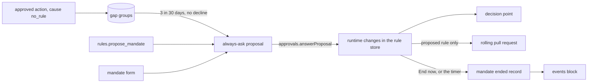

# Proposed rules and mandates

- **Status:** draft
- **Work items:** [proposed rules and mandates](https://linear.app/zgeoff/issue/GEO-1806)

nixie proposes 2 kinds of allow rule, and each takes effect only once you approve it:

- **A proposed rule** turns a habit into a rule. When you approve the same kind of call 3 times in
  30 days and decline none, nixie proposes the narrowest allow rule that covers those calls.
- **A mandate** gives nixie authority for a period, such as "full authority over my calendar invites
  today". It is a set of allow rules that share a mandate ID and an expiry. You fill in the mandate
  form in the client, or nixie proposes one from the conversation when you ask for it there.

Each one waits for you as an always-ask proposal on the shared approval record
(`docs/design/queue/approval-record.md`). Your approval adds its rules to
[the rule store](../../architecture/policy/rules.md#rules-in-force) as runtime changes: rules that
nixie holds beside the ones your definitions repo holds. A proposed rule then goes into the rolling
pull request of [the rule export](../../architecture/policy/rules.md#the-rule-export), which offers
each runtime change to your definitions repo. A mandate never goes there, and it ends at its expiry
or when you end it.

The [rules design](../platform/policy/rules.md#gaps-and-proposed-rules) holds what these rules mean
for you. This doc holds the record kinds, the calls, and the constraints the code must keep. The
action proposals that a proposed rule counts come from the decision point cutover
(`docs/design/queue/decision-point-cutover.md`).

Some terms this doc uses:

- **Erasable fields** hold a record's text under the record's own key, so a
  [record forget](redaction.md) of the record removes them
  ([erasable fields](../../architecture/core/erasable-fields.md)).
- **A checked action** is a client call that the server checks against your session
  ([checked actions](../../architecture/channels/api.md#checked-actions)).
- **A seed of the definitions in force** rebuilds the rules in force from the 3 layers of the rule
  store (the rules your definitions hold, the version of each that nixie applied, and the runtime
  changes), and writes a new snapshot when they changed. Every runtime change takes effect through
  one.
- **A lift** is the `lift` field on an allow rule, which lets a `spend` call past the always-ask set
  within a budget ([lifting rules](../platform/policy/budgets.md#lifting-rules)). A proposal that
  creates a lift takes the `lifting` risk class.

## Shape



The rule store, in the definitions module, owns both kinds of proposal. Each registers one handler
of the `internal_change` kind on the proposals module.

## Contracts

### Gap groups

The decision point asks with the cause `no_rule` when no rule matches a call, stage 9 of the
[pipeline](../platform/policy/decision-point.md#the-pipeline). In the rules design, such a call is a
gap. When you answer its action proposal, the rule store adds the answer to the call's group.

```ts
// definitions module. The group hash is the SHA-256 of this key's canonical JSON.
interface GapGroupKey {
  tool: string; // the exact tool name, with its variant, such as task.start/atc
  context: RuleContext; // policy module, existing
  destinations: string[]; // the call's destination values in NFC, sorted, duplicates dropped
}
```

```text
gap_answers, a projection that one appended migration adds
  proposal_id   text primary key  -- the action proposal's UUID
  group_hash    text not null
  answer        text not null     -- 'approved' or 'declined'
  answered_at   integer not null

gap_groups, from the same migration
  group_hash    text primary key
  quiet_until   integer           -- set by Not now, or by a lapse of the group's proposed rule
  proposal_id   text              -- the group's open proposed rule, if any
```

- The tables hold the group hash, and never a destination or an argument. When the rule store builds
  a proposed rule, it reads those from each action proposal's erasable fields.
- Approve on an action proposal adds `approved`, and Decline adds `declined`.
- Always allow adds nothing, because it already creates a rule for the group.
- A lapse and a withdrawal add nothing, because you gave no answer.
- A defer adds nothing until you answer the proposal later.

### The proposed rule

After each answer that joins a group, the rule store checks the group in a transaction of its own.
It proposes a rule when all of these hold:

1. The group has at least `policy.proposed_rules.approvals` approved answers within
   `policy.proposed_rules.window_days` before now. An approved answer whose action proposal lost its
   erasable fields to a record forget does not count.
2. The group has no declined answer in that window.
3. The group has no open proposed rule, and its `quiet_until` lies before now.

The rule store builds the narrowest rule that the rule format can write for the approved answers it
counted:

```yaml
# The proposed rule after 3 approved sends to one address from one task definition
outcome: allow
tools: [mail.send]
contexts: [task]
jobs: [weekly-report] # only when every call came from this one definition
destinations: [sam@example.org] # the group's destinations, exact, with no wildcard
sources: [own_data] # the union of the calls' sources; left out when no call had one
checks:
  - { arg: account, op: eq, value: work } # each scalar argument with one value in every call
```

- Each check is `eq`, by argument path, on a scalar argument or a scalar inside an object argument.
  A list argument gets no check.
- An argument that the tool's declaration lists in `content`, its free-text arguments, such as an
  email body, never gets a check. Always allow builds its rule from the same list.
- The rule renders with the existing rule renderer, and the parser checks it, as for every rule.

```ts
// definitions module. A record kind of its own, so the release before skips it.
interface RulesRuleProposed {
  // kind rules.rule_proposed
  proposalID: string; // crypto.randomUUID()
  shortID: string; // from createShortID
  groupHash: string;
  ruleHash: string; // the hash of the rule's canonical form, which the action hash covers
  approvals: string[]; // the UUIDs of the action proposals the rule covers
  editOf: string | null; // the proposal that an Edit withdrew, or null
  // erasable: { rule: RuleForm }, so a rule you turn down leaves no address in a plain column
}
```

The shared row and the card's body for a proposed rule:

```ts
// The shared row (approval record design)
{ kind: 'internal_change', riskClass: 'always_ask', cause: 'proposed_rule', taskID: null,
  thread: null, deadlineAt: null,
  rule: null } // rule: the rule Always allow would create, which this row never offers

// The body, from the handler's describe()
{ sentence: '**Allow** `mail.send` in a task of `weekly-report` when every destination matches `sam@example.org` …',
  fields: { covers: '3 approvals: 2 Nov, 6 Nov, 11 Nov', group: 'mail.send to sam@example.org' },
  ruleSentence: null }
// choices: ['approve', 'defer', 'decline']. The card labels decline "Not now", and adds Edit.
```

The card has 4 controls. Approve, Defer and Not now send the row's choices through
`approvals.answerProposal`:

| Control | What happens                                                                                        |
| ------- | --------------------------------------------------------------------------------------------------- |
| Approve | One runtime change adds the rule under a new runtime ID, recorded as changed by you                 |
| Not now | The `decline` choice: the group's `quiet_until` becomes now plus `policy.proposed_rules.quiet_days` |
| Defer   | As the approval record design defines it                                                            |
| Edit    | Opens the rule form on the card's rule, and sends `rules.editProposedRule` when you save it         |

A lapse of the proposal sets `quiet_until` as Not now does. A Decline of a new action proposal in
the group withdraws the group's open proposed rule.

Edit writes a new proposal through a checked action of its own. A row keeps its hash and its risk
class for life, so an edited rule cannot stay on the old row:

```ts
const edited = await client.rules.editProposedRule({
  proposalID: 'm8t2q9wd4e', // the UUID or the short ID
  actionHash: 'sha256:9f2e…', // the hash the card showed
  rule: { outcome: 'allow', tools: ['mail.send'], destinations: ['*@example.org'] },
  clientActionID: crypto.randomUUID(),
});
// → { proposalID: 'p4k7c1x8ve' }: the new proposal, which you approve as any other
//   or ORPCError CONFLICT { current: { actionHash } }, CLOSED { state }, INVALID { faults }
```

- In one transaction, the edit withdraws the old row with `proposals.withdrawn` and writes a new
  `rules.rule_proposed` with `editOf`. The new row keeps the group and its approvals.
- The edited rule stays an `allow` rule, and may hold any other field of the rule format. When it
  holds `lift`, the new row takes the `lifting` risk class.
- The parser checks the edited rule, and `INVALID` lists each fault.

### Mandates

The rule format already holds `mandate` and `expires`, and the decision point already stops a rule
at its `expires`. This design adds the way a mandate starts and ends.

```ts
// The chat tool. It declares the `note` effect (decision point design, Effects), which the starter rule allow-notes allows, because
// its call only writes a proposal. It sits on the conversation's tool list alone, so no task or
// job can call it.
// rules.propose_mandate({
//   title: 'Full authority over my calendar invites',
//   rules: [{ outcome: 'allow', tools: ['calendar.respond', 'calendar.invite'] }],
// })
// → { status: 'pending', proposalID: 'k3x9m2p7qa', mandateID: 'h7d2n5r9wb',
//     expires: '2026-11-14T00:00:00+11:00',
//     sentences: ['**Allow** `calendar.respond` or `calendar.invite`, until 2026-11-13T13:00:00Z.'] }

// The mandate form sends a checked action with the same input
const proposed = await client.rules.proposeMandate({ ...input, clientActionID });
// → { proposalID, mandateID, expires }

// definitions module
interface MandateInput {
  title: string; // 1 to 120 characters; a label on the card, never part of a rule
  rules: Array<Omit<Rule, 'id' | 'mandate' | 'expires'> & { outcome: 'allow' }>; // 1 to 10
  expires?: string; // ISO date and time with an offset; default the end of your day
}
```

```ts
// definitions module. Record kinds of their own, so the release before skips them.
interface RulesMandateProposed {
  // kind rules.mandate_proposed
  proposalID: string; // crypto.randomUUID()
  shortID: string; // from createShortID
  mandateID: string; // from createShortID, which fits the rule ID pattern
  ruleHashes: string[]; // each rule's canonical form, with mandate and expires filled in
  expires: number; // milliseconds since the epoch, as every time in the log
  proposedBy: 'owner' | 'nixie'; // the form, or the chat tool
  // erasable: { title, rules: RuleForm[] }
}
interface RulesMandateStarted {
  // kind rules.mandate_started, in the approval's transaction
  mandateID: string;
  proposalID: string;
  changeIDs: string[]; // one runtime change per rule
  expires: number;
}
interface RulesMandateEnded {
  // kind rules.mandate_ended
  mandateID: string;
  reason: 'ended' | 'expired'; // End now, or the timer
  changeIDs: string[]; // the runtime changes it retired
}
```

The shared row for a mandate has `kind: 'internal_change'` and `cause: 'mandate'`. Its risk class is
`lifting` when a rule holds `lift`, and `always_ask` otherwise. Its `deadlineAt` is the mandate's
`expires`, so the row lapses when the mandate would end. Its action hash covers the mandate ID, each
rule hash and `expires`. The card shows the title, each rule's sentence and the time the mandate
ends, with the choices approve, defer and decline.

```ts
const { mandates } = await client.rules.listMandates();
// → { mandates: [{ mandateID: 'h7d2n5r9wb', title: 'Full authority over my calendar invites',
//       rules: [{ ruleID: 'h7d2n5r9wb-1', sentence: '…' }], startedAt, expires }] }
// The client shows the time left from expires.

await client.rules.endMandate({ mandateID: 'h7d2n5r9wb', clientActionID });
// → { mandateID: 'h7d2n5r9wb', state: 'ended' }. For a mandate the timer ended, state is 'expired'.
```

```bash
nixie mandates list                # each active mandate: ID, title, rules, expires
nixie mandates end h7d2n5r9wb      # the same as End now
```

The server adds 2 entries to the
[events block](../../architecture/core/conversation-turns.md#the-events-block), one for each of
`rules.mandate_started` and `rules.mandate_ended`, so the conversation's next turn reads lines such
as these:

```text
Mandate h7d2n5r9wb started: Full authority over my calendar invites, until 00:00 Sydney.
Mandate h7d2n5r9wb ended (expired): Full authority over my calendar invites.
```

### Settings

```yaml
# config.yaml. The decision point cutover adds the policy section; this design adds these 2 sections.
policy:
  proposed_rules:
    approvals: 3 # approved answers in one group before nixie proposes a rule
    window_days: 30 # how far back those answers count
    quiet_days: 30 # how long Not now, or a lapse, keeps the group quiet
  mandates:
    max_hours: 24 # the latest expires, counted from the proposal
```

## Constraints

### Proposed rules

- nixie keeps at most one open proposed rule per group.
- Every approved call that the proposal counts matches the proposed rule. A call with another tool
  or context, a destination outside the group's set, or another value of a checked argument does not
  match it. A call to only some of the group's destinations matches, because an allow rule covers a
  call whose every destination matches one of its patterns.
- An answer, a lapse or a withdrawal of the proposal sets the group's `proposal_id` back to null in
  the same transaction.
- At start, the rule store checks each group that gained an answer since its last check, so a crash
  between an answer and its check loses no proposal.
- An approved proposed rule goes into the rolling pull request, with its sentence and the reason
  "proposed after 3 approvals". Undo on the rule's notice removes it. Removing an allow rule
  narrows, so the undo needs no approval.

### Mandates

- Every rule of a mandate is a new runtime rule. Its ID is the mandate ID and its number, such as
  `h7d2n5r9wb-1`, an ID that the rule store has never held. A mandate never edits or removes another
  rule.
- Every rule of a mandate holds the mandate's `mandate` and `expires`, and the outcome `allow`.
- An approval writes every rule of the mandate and `rules.mandate_started` in one transaction, then
  runs one seed of the definitions in force, which puts the rules in force.
- The rule store refuses a proposal whose `expires` lies before now, or more than
  `policy.mandates.max_hours` after it. The default `expires` is the next midnight in your zone,
  read as the [time tool](../../architecture/connectors/time.md) reads it.
- The rule store refuses a runtime edit of a mandate rule. To change a mandate, end it and propose a
  new one.
- A non-mandate runtime change never replaces a mandate rule, because each mandate rule ID belongs
  to its mandate alone.

### Ending a mandate

- End now and the timer each retire every in-force runtime change of the mandate (`in_force` to
  `retired`), write `rules.mandate_ended`, and run one seed of the definitions in force. Neither
  writes a runtime removal (`rule: null`).
- That seed takes each rule out of force. The rule's revision number goes up by one, the store keeps
  the rule's row with no rule text in force, and nixie never gives its ID to another rule.
- The decision point checks `expires` against the call's time, so a rule stops matching at its
  expiry whether the timer has run or not. A replay of a call made before the expiry decides as the
  record did, from the snapshot that the record names.
- The timer ends each mandate within 1 minute of its `expires`. At start, it ends every mandate
  whose `expires` has passed.
- End now of a mandate that the timer ended changes nothing, and the reverse holds too. Each mandate
  has at most one `rules.mandate_ended`.
- A rule with `mandate` in your definitions is an ordinary seeded rule. End now and the timer never
  touch it.

### The export

- The export filters out every runtime change whose rule holds `mandate`, so a mandate rule never
  reaches the rolling pull request. A retired change has no rule in force, so the export never reads
  an ended mandate. A removal over one of your definitions' rules would export as "remove this
  rule", which is why a mandate never writes one.
- The export takes its ID from its changes and from the seed in force. Each mandate start and end
  runs a seed, so the rolling pull request rebuilds with the same changes. A test ends a mandate
  beside an exported change, and checks that the export holds the same changes, no removal and no
  mandate rule.

### Rollback

| Added                                                                                         | The release before                                                                                    |
| --------------------------------------------------------------------------------------------- | ----------------------------------------------------------------------------------------------------- |
| `rules.rule_proposed`, `.mandate_proposed`, `.mandate_started`, `.mandate_ended`              | Skips each record kind it does not know                                                               |
| Shared rows of the 2 new proposal kinds                                                       | Has no handler for them, so lists none and refuses each answer as `NOT_ALLOWED`                       |
| The `gap_answers` and `gap_groups` migration                                                  | Starts, because the migration only adds tables, and reads no row of them                              |
| A mandate's runtime changes in force                                                          | Keeps them in force. Each stops matching at its `expires`, never exports, and waits for the timer     |
| `policy.proposed_rules` and `policy.mandates` in config                                       | Refuses to start, because the schema is strict. Remove both keys from `config.yaml` before a rollback |
| The tool `rules.propose_mandate`                                                              | Has no such tool, so the conversation cannot call it                                                  |
| `rules.editProposedRule`, `rules.proposeMandate`, `rules.listMandates` and `rules.endMandate` | Answers `NOT_FOUND`                                                                                   |

After a roll forward, the timer's check at start ends every mandate whose `expires` passed while the
release before ran.

## Decisions

- **A mandate holds only new allow rules, and ending it retires their runtime changes.** An agent's
  call on 13 Nov 2026: a retired change leaves nothing for the export to read, so ending a mandate
  can never propose that you remove a rule of yours.
- **The chat tool writes the proposal itself, declares `note`, and only the conversation holds it.**
  An agent's call on 13 Nov 2026: you answer one prompt, and the card shows each rule's sentence. A
  tool that declared `policy_widen` would ask at
  [stage 4](../platform/policy/decision-point.md#the-pipeline) as an action, and an approved action
  cannot run until [actions under policy](https://linear.app/zgeoff/issue/GEO-1810) is built.
- **A gap counts only Approve and Decline on a `no_rule` action proposal.** An agent's call on 13
  Nov 2026: in the rules design, only a prompt with no matching rule is a gap.
- **A group's destinations are the exact set, and the rule names them with no wildcard.** An agent's
  call on 13 Nov 2026: the narrowest rule covers only the addresses you approved.
- **A lapse counts as Not now, and a Decline in the group withdraws its open proposed rule.** An
  agent's call on 13 Nov 2026: a proposal you leave unanswered should not come back the next day,
  and a decline ends the habit the proposal rests on.
- **Edit writes a new proposal.** An agent's call on 13 Nov 2026: a row keeps its hash and risk
  class for life, and an edit can add a lift.
- **A pending proposal's rule sits in erasable fields.** An agent's call on 13 Nov 2026: a rule you
  turn down can name a contact, and a record forget then removes it.
- **A mandate's proposal lapses at its `expires`.** An agent's call on 13 Nov 2026: a late approval
  never starts a mandate that has already ended.
- **A mandate holds 1 to 10 rules.** An agent's call on 13 Nov 2026: the card stays readable, and a
  larger authority belongs in your definitions.
- **The code uses an interim for each open question.** The tool is named `rules.propose_mandate`,
  your day ends at midnight, and a mandate lasts at most 24 hours.

## Builder decides

- The internal names, the shape of the timer, and how the check at start finds the answers it
  missed.
- The order of the 2 new projections among the others.
- The wording of each sentence on the cards, of each events block line, and of each refusal.
- The layout of the mandate form, within the field controls the rules design sets.
- The layout of the tests.

## Out of scope

- The passkey on always-ask approvals, in
  [the passkey check](https://linear.app/zgeoff/issue/GEO-310).
- The cards and the digest layout, in
  [the approval cards](https://linear.app/zgeoff/issue/GEO-1805).
- A tool for the model to end a mandate. You end one with End now or the host command.
- A mandate that holds an ask or deny rule, or that edits a rule you already have.

## Open questions

The owner settles 3 questions, kept in [the work item](https://linear.app/zgeoff/issue/GEO-1806):
the chat tool's name, when "the end of your day" falls, and how long a mandate may last. Until then
the code follows the interims in [Decisions](#decisions).
