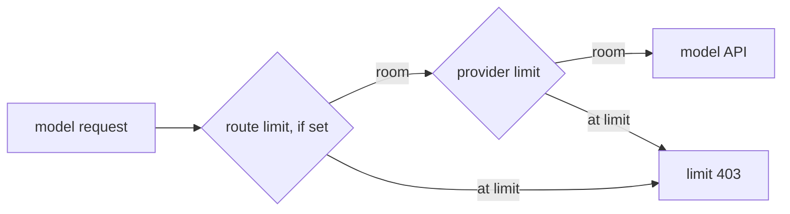

# Provider limits

- **Status:** draft
- **Work items:** [provider limits](https://linear.app/zgeoff/issue/GEO-2875)

The model gateway limits spend per provider, and a model's own limit becomes optional. A provider is
one place nixie's model requests go, such as Anthropic, OpenRouter or the ChatGPT plan. Each
provider has a required day and month limit in US dollars. A route, which is one model, may add its
own limit under its provider's. The gateway admits a request only when its provider's limits and its
route's limits, where it has any, all have room. A subscription provider's dollars are what the same
use would cost on the pay-per-use API, so its limit works as a brake on a runaway, and a pay-per-use
provider's limit caps real spend.

Build it from this doc and the
[model gateway architecture](../../architecture/policy/model-gateway.md), whose periods, store,
control listener and override it extends.

## Shape



## Contracts

```yaml
# The gateway's config. Every route names its provider, and only a provider must hold limits.
providers:
  anthropic:
    limits: { day: 200, month: 3000 } # dollars; dayCap defaults to twice day, as for a route
  openrouter:
    limits: { day: 10, month: 100 }
  chatgpt-plan:
    limits: { day: 200, month: 3000 }
routes:
  fable-5-2:
    provider: anthropic # required; names a key of providers
    # api, upstream, model and prices as today
  gpt-6-2-sol:
    provider: openrouter
    limits: { day: 5, month: 50 } # optional; caps this route inside its provider
```

```ts
// spend-model-gateway adapter. GET /status gains one entry per provider, and each route its provider.
type GatewayStatus = {
  // …existing fields
  providers: Record<string, { day: PeriodStatus; month: PeriodStatus }>;
  routes: Record<string, { provider: string; day: PeriodStatus; month: PeriodStatus }>;
  // a route with no limits of its own has limit null on each period
};
```

```ts
// The limit 403 body. counter gains two values, and provider names the provider of the route.
type LimitReached = {
  type: 'limit_reached';
  counter: 'route_day' | 'route_month' | 'provider_day' | 'provider_month' | 'sandbox';
  route: string;
  provider: string;
};
```

```ts
// contract (libs/contract). The spending counts gain the providers, and a raise may name one.
const spendCountsSchema = z.object({
  providers: z.array(
    z.object({ provider: z.string(), day: periodCountSchema, month: periodCountSchema }),
  ),
  routes: z.array(routeCountsSchema.extend({ provider: z.string() })),
  display: displaySchema.nullable(),
});
// spendRaiseInputSchema: exactly one of route or provider, with dollars
```

## Constraints

- The config refuses a route with no `provider`, a `provider` that names no key of `providers`, and
  a provider with no `limits`. It drops today's rule that every route holds `limits`.
- A route with no `limits` of its own is limited by its provider alone, and its status shows a limit
  of null.
- A reply adds its dollars to its route's day and month and to its provider's day and month, in the
  one write that counts it today.
- Admission checks the route's limits first, where it has any, then the provider's, and answers the
  first one at its limit, with its counter.
- A provider's periods reset at local midnight in `periods.zone`, as a route's do, and trip and
  clear the same way.
- `POST /raise` takes `{ provider, start, dollars }` as well as `{ route, start, dollars }`, raises
  that day only, within its cap, and answers `above_cap` with the provider and its cap.
- `model-gateway raise` takes `--provider <id>` as well as `--route <id>`, and writes that
  provider's entry in the override file.
- The store moves from version 3 to version 4 at start, in one write. Each provider takes the sum of
  its routes' counts for each period still under way, with no raise and no trip, so a restart never
  reopens a limit.
- The spending page shows each provider's day and month with its routes under it, in the display
  currency. A route with no limit of its own shows its count and no limit.
- A limit notice names the provider when the provider's limit refused, and the route when the
  route's did. A raise offer on a provider's refusal raises the provider.
- The release that ships this pins the host's gateway to the same nixie release, and its cloud
  config sets the three providers at the numbers in the config sketch above, with each route's own
  limit removed except where the owner sets one.

## Builder decides

- The store's field names, and how the migration test builds an old store.
- The layout of the providers on the spending page.
- The wording of the limit notice and the raise offer.
- The tests, and the verify journey's steps.

## Out of scope

- A limit that spans providers.
- Token limits; every limit stays in dollars.
- A provider's own usage cap, such as a subscription's, which the gateway can't read.
