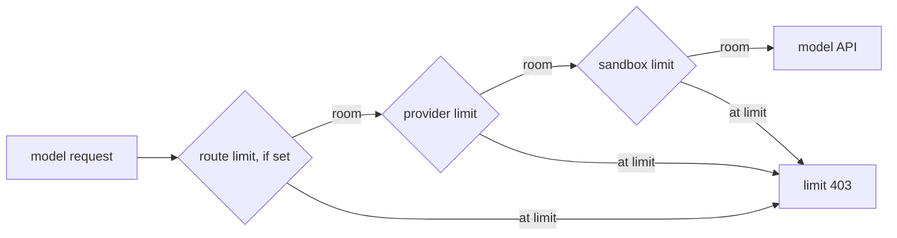

# Provider limits

- **Status:** draft
- **Work items:** [provider limits](https://linear.app/zgeoff/issue/GEO-2875)

The model gateway limits spend per provider, and a model's own limit becomes optional. A provider is
one place nixie's model requests go, such as Anthropic, OpenRouter or the ChatGPT plan. Each
provider has a required day and month limit in US dollars. A route, which is one model, may add its
own limit under its provider's. The gateway admits a request only when its provider's limits, and
its route's limits where it has any, all have room. A provider limit keeps the most nixie can spend
fixed as models are added.

Build it from this doc and the [model gateway](../../architecture/policy/model-gateway.md),
[metering](../../architecture/policy/metering.md) and
[spending stop](../../architecture/policy/spending-stop.md) architecture docs. This design replaces
their rule that no gateway limit spans routes, so the builder updates each of them.

## Shape



## Contracts

```yaml
# The gateway's config. Every route names its provider, and only a provider must hold limits.
providers:
  anthropic:
    limits: { day: 200, month: 3000 } # dollars; dayCap defaults to twice day, as for a route
  openrouter:
    limits: { day: 10, month: 100, dayCap: 20 }
routes:
  fable-5-2:
    provider: anthropic # required; a key of providers. providerPin stays OpenRouter's own upstream pin
    # api, upstream, model and prices as for every route
  gpt-6-2-sol:
    provider: openrouter
    limits: { day: 5, month: 50 } # optional; caps this route inside its provider
```

```ts
// model gateway. GET /status gains one entry per provider, and each route names its provider.
type GatewayStatus = {
  // …existing fields
  providers: Record<string, { day: PeriodStatus; month: PeriodStatus }>;
  routes: Record<string, { provider: string; day: PeriodStatus; month: PeriodStatus }>;
};
// On a route with no limits of its own, each period's limit and cap are null and tripped is false.
```

```ts
// The limit 403 body, a sandbox's last refusal and worker.run_ended all carry the provider.
type Refusal = {
  counter: 'route_day' | 'route_month' | 'provider_day' | 'provider_month' | 'sandbox';
  route: string;
  provider: string;
};
```

```ts
// POST /raise and model-gateway raise take a route or a provider, never both.
await control.raise({ provider: 'openrouter', start: '2026-11-27', dollars: 15 });
// → 204, or 409 { error: 'above_cap', route: null, provider: 'openrouter', cap: 20 }
//   or 409 { error: 'no_route_limit', route: 'fable-5-2' }   // a route with no limit of its own
//   or 404 { error: 'unknown_provider' } or 400 { error: 'bad_target' }   // both or neither
```

```ts
// contract (libs/contract). The spending counts gain the providers, and a raise may name one.
const spendCountsSchema = z.object({
  providers: z.array(
    z.object({ provider: z.string(), day: periodCountSchema, month: periodCountSchema }),
  ),
  routes: z.array(routeCountsSchema.extend({ provider: z.string() })),
  display: displaySchema.nullable(),
});
// spendRaiseInputSchema takes provider beside route; aboveCap and spend.limit_raised carry it too
```

## Constraints

- The config refuses a route with no `provider`, a `provider` that names no key of `providers`, a
  provider with no `limits`, and a provider `dayCap` below its `day`. A provider ID matches
  `^[a-z0-9][a-z0-9-]*$`, as a route ID does.
- A route with no `limits` of its own is limited by its provider alone. No admission answers 503 for
  a missing limit any more, because every route has a provider and every provider has limits.
- A reply adds its dollars to its route's day and month and to its provider's day and month, in the
  one write that counts it.
- Admission answers, in this order: the lost mark, a sandbox the store lacks, the route's day and
  month where it has limits, the provider's day and month, then the sandbox's own limit. It answers
  the first one at its limit, with that counter.
- A provider's periods reset at local midnight in `periods.zone`, and trip and clear as a route's
  do. A route shows `tripped` only for its own limit, never for its provider's.
- The override file holds a `routes` map and a `providers` map, so a route and a provider may share
  an ID. `model-gateway raise --provider <id>` writes the provider's entry.
- The store moves from version 3 to version 4 at start, in one write. A version 2 or single-total
  store moves through version 3 first. Each provider takes the sum of its configured routes' counts
  for each period still under way, with no raise. When that sum is at its limit, the period trips at
  the time of the move. A route the config dropped adds to no provider, and a provider the config
  gains later starts at zero.
- The gateway logs `limit.reached` for a provider period as it does for a route period.
- The server holds a task that a provider's limit refused, as it holds one for a route's limit. A
  provider's trip is a stop of its own, with records that name the provider, and it stops every
  route of that provider.
- The spending page shows each provider's day and month, with its routes under it, in the display
  currency. A route with no limit of its own shows its count and no limit.
- A limit notice names the provider when the provider's limit refused, and the route when the
  route's did. A raise offer on a provider's refusal raises the provider.
- The server reads a status with no `providers`, from an older gateway, as having none. An older
  server that meets a `provider_*` counter reads the gateway as unreachable, so a release ships the
  server and the gateway together.
- An older gateway can't read a version 4 store, so the gateway keeps a copy of the version 3 store
  beside it when it moves, for a rollback.
- Every gateway config in this repo gains providers: the test gateway starters, the integration
  suites, the verify harness and the preview recipe.
- The contract change is breaking, so the PR title carries `!`.

## Builder decides

- The store's field names, and how the migration test builds an old store.
- The tables and record names for a provider's stop.
- The layout of the providers on the spending page.
- The wording of the limit notice, the raise offer and the 403 message.
- The tests, and the verify journey's steps.

## Out of scope

- A limit that spans providers.
- Token limits; every limit stays in dollars.
- A provider's own usage cap, such as a subscription's, which the gateway can't read.
