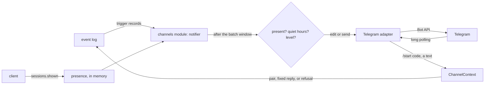

# The push notice

- **Status:** draft
- **Work items:** [the Telegram push notifier](https://linear.app/zgeoff/issue/GEO-1812), after
  [the Telegram round-trip spike](https://linear.app/zgeoff/issue/GEO-252)

When a proposal or an unknown outcome waits for your answer and no client has nixie on screen, a
Telegram bot that you register sends a notice. The notice holds a count, a fixed sentence and a link
to the client, and nothing else, because Telegram keeps a bot chat's history on its servers. The
channels module follows the event log, decides when a notice goes out and whether it buzzes, and
hands it to the Telegram adapter. The adapter does nothing but call the Bot API.

[The channel adapter](../platform/channels/channel-adapter.md) holds the interface, the identity
record and the reasons for the push notifier. This design gives the contracts that the push notifier
is built from.

Terms:

- A **proposal** is a tool call or a change that waits for your answer, with one row in the approval
  record ([approval record](approval-record.md)). Its risk class is `routine`, `always_ask` or
  `lifting`, as [risk class](../platform/policy/approvals.md#risk-class) defines, and a memory write
  is a proposal of the kind `memory_write`.
- A **defer** puts a proposal aside until a time you pick. The proposal then returns as new.
- An **item** is one waiting proposal or unknown outcome, as `approvals.listItems` lists them. A
  deferred proposal becomes an item again only when it returns.
- An **unknown outcome** is an action that may or may not have reached its provider, as
  [actions](../../architecture/core/actions.md#outcomes) defines.
- **The stop** is the hard spending stop of [budgets and hard stop](budgets-and-hard-stop.md): at a
  spending limit, nixie pauses every task until the limit resets or you raise it.
- A **trigger** is a record that can change a notice: a proposal created, answered, deferred,
  returned, lapsed or withdrawn; an `action.outcome` with the outcome `unknown`; and
  `spend.stop_tripped` and `spend.stop_cleared`.
- The **live notice** is the newest notice the bot sent. nixie edits it, or sends a new one that
  takes its place.
- The **Telegram row** is the paired, unrevoked row of the identity record, the `identities` table
  of [device sessions](../../architecture/channels/api.md#device-sessions), for the paired Telegram
  account.
- A record **on no thread** belongs to no task's thread, so no task reads it and the live stream
  never shows it ([the event log](../../architecture/core/event-log.md)).

## Shape



## Contracts

### The notice and its result

```ts
// channels module: what the notifier hands the adapter
const result = await telegram.push(
  { identityID, externalID: '81234567:81234567' },
  {
    level: 'loud',
    count: 3,
    sentence: 'items',
    link: 'https://nixie.example.org/digest',
    edit: null, // null sends a new message; a message ID edits that message
  },
);
// → { status: 'sent', messageID: '4417' }
//   or { status: 'edited', messageID: '4417' }, { status: 'unchanged' },
//   { status: 'edit_failed' }, { status: 'gone' } or { status: 'retry', afterMs: 3000 }
```

```ts
// channels module. The adapter renders the text with renderNoticeText and sends exactly that.
interface PushNotice {
  level: 'quiet' | 'loud'; // loud sends with a buzz; quiet sends with disable_notification
  count: number; // the items that wait, 0 or more
  sentence: NoticeSentence;
  link: string; // client_url with /digest, or client_url with / while the stop stands
  edit: string | null; // the live notice's message ID; a loud notice always sends new
}

// The only sentences a notice holds. No field of a notice comes from a model, a task, a record's
// payload or its erasable fields.
type NoticeSentence = 'items' | 'nothing' | 'stop';

declare function renderNoticeText(notice: PushNotice): string;
// 'items', 3   → "nixie has 3 things for you. https://nixie.example.org/digest"
// 'nothing', 0 → "Nothing waits for you now. https://nixie.example.org/digest"
// 'stop', 2    → "Model spending stopped, and every task is paused. 2 things wait for you.
//                 https://nixie.example.org/"

type PushResult =
  | { status: 'sent' | 'edited'; messageID: string } // the message is now the live notice
  | { status: 'unchanged' } // the edit's text equals the message's text
  | { status: 'edit_failed' } // the message to edit is gone or can no longer take an edit
  | { status: 'gone' } // 403: you blocked the bot or deleted the chat
  | { status: 'retry'; afterMs: number }; // 429 with retry_after, a 5xx, or no answer
```

```ts
// channels module: the ChannelAdapter of channel-adapter.md, with push taking the row it targets
interface ChannelAdapter {
  // …existing fields
  push?(target: PushTarget, notice: PushNotice): Promise<PushResult>;
}

// channels module: the notifier reads it from the live Telegram row
interface PushTarget {
  identityID: string;
  externalID: string; // the row's external_id; the adapter sends to its chat ID part
}

// channels module: ChannelContext gains the pairing claim
interface ChannelContext {
  // …existing fields
  claimPairing(claim: PairingClaim): Promise<{ confirmCode: string } | 'refused'>;
}

interface PairingClaim {
  channel: 'telegram';
  code: string; // the /start payload
  externalID: string; // `${from.id}:${chat.id}`, from a private chat only
}
```

### The live notice

```sql
-- One migration appended to nixieSchema. A plain table: nixie rewrites the row on each send or
-- edit, and no audit needs the history.
create table push_notices (
  identity_id   text primary key references identities (identity_id),
  message_id    text not null,
  level         text not null check (level in ('quiet', 'loud')),
  count         integer not null,
  sentence      text not null,
  sent_at       integer not null,
  edited_at     integer
) strict;
```

### Pairing

```ts
// contract: channels, a checked action from a signed-in client, as
// docs/architecture/channels/api.md#checked-actions defines: a retry with the same
// clientActionID gets the first result
const pairing = await client.channels.pair({ channel: 'telegram', clientActionID });
// → { pairingID: 'c41f…', link: 'https://t.me/nixie_home_bot?start=Qx7…',
//     lapsesAt: '2026-11-13T10:25:00Z' }
//   or ORPCError NOT_CONFIGURED when the config has no channels.telegram

// The bot sends the confirm code into the chat that claimed the link. You type it into the client.
const paired = await client.channels.confirmPairing({
  pairingID: pairing.pairingID, // from channels.pair; only the session that started the pairing confirms it
  confirmCode: '402917',
  clientActionID,
});
// → { identityID: '9c1e…', channel: 'telegram' }
//   or ORPCError PAIRING_REFUSED for a wrong, lapsed or spent confirm code
```

```bash
nixie channels pair telegram                # prints the pairing ID, the link and its lapse time
nixie channels confirm <pairing_id> <code>  # the confirm code the bot sent; pairs the account
nixie channels list            # each Telegram row: ID, label, paired, last seen, as JSON
nixie channels revoke <id>     # revokes one Telegram row; the ID of a device session gets NOT_FOUND
```

```sql
-- The same migration. A table of its own, kept separate from the device enrolment codes, so a
-- pairing code never enrols a device.
create table pairing_codes (
  pairing_id   text primary key,           -- random, from crypto.randomUUID()
  code_hash    text not null unique,       -- SHA-256 of the code; nixie never keeps the code
  channel      text not null,
  issued_at    integer not null,
  expires_at   integer not null,           -- issued_at plus 10 minutes
  issued_by    text references identities (identity_id), -- null from nixie channels pair
  claimed_external_id text,                -- the first private chat that sent /start with the code
  confirm_hash text,                       -- SHA-256 of the confirm code the bot sent that chat
  confirm_tries integer not null default 0,
  used_at      integer,                    -- set by the confirm that pairs
  identity_id  text references identities (identity_id),
  check ((used_at is null) = (identity_id is null))
) strict;
```

```ts
// channels module: the 3 record kinds, each on no thread
type ChannelsRecord =
  | {
      kind: 'channels.code_issued';
      payload: { channel: 'telegram'; expiresAt: number; issuedBy: string | null };
    }
  | {
      kind: 'channels.paired';
      payload: { identityID: string; channel: 'telegram'; externalID: string };
    }
  | {
      kind: 'channels.revoked';
      payload: { identityID: string; by: string | null; reason: 'command' | 'repaired' };
    };
```

### Presence

```ts
// contract: sessions. The client calls it when it becomes visible, and every 60 s while visible.
await client.sessions.shown({});
// → {}
```

- Only a client that shows nixie on screen calls `sessions.shown`: a web page whose visibility state
  is `visible`, or the app in the foreground. A background tab with an open live stream never calls
  it.
- The channels module keeps, in memory, the newest `shown` time of each device session. It writes
  nothing to the database, so a restart forgets it.
- A client is present while its newest `shown` lies within `presence_seconds`.

### Settings

```yaml
# config.yaml. The channels module owns channels.telegram.
channels:
  telegram:
    credential: deployment:telegram-bot # the bot token, an entry in the server's secrets file
    client_url: https://nixie.example.org # the origin every notice links to
    presence_seconds: 120
    batch_seconds: 30
```

- With `channels.telegram` left out, no Telegram adapter starts, and `channels.pair` answers
  `NOT_CONFIGURED`.
- The config schema accepts only the `deployment:<name>` form for `credential`, which names an entry
  in the secrets file, as
  [configuration and secrets](../../architecture/deployment/server.md#configuration-and-secrets)
  describes.
- The notifier reads quiet hours from the top-level `quiet_hours` that
  [approval record](approval-record.md) owns, and has no quiet hours of its own.

## Constraints

### The notice

- A notice holds only the count, one sentence from `NoticeSentence` and the link. A test renders
  every notice the notifier can build and finds no task name, person, action, amount, time or record
  text in it.
- The count is the number of items, so a deferred proposal never counts.
- While the stop stands, the sentence is `stop` and the link is the client's root, whatever the
  count. When the count drops to 0 with no stop, the sentence is `nothing`.
- The link never carries an item ID, so the bot's chat never holds an ID of one item.

### When nixie pushes

At start, the notifier follows the event log from its newest record. It sends nothing for records
written before the start, so a restart never repeats a notice. Each trigger opens a batch window of
`batch_seconds`, unless one is open. When the window closes, the notifier reads the items once and
acts on what it finds then:

| What arrived in the window                                      | Level | Through quiet hours |
| --------------------------------------------------------------- | ----- | ------------------- |
| An `action.outcome` with the outcome `unknown`                  | loud  | yes                 |
| `spend.stop_tripped`                                            | loud  | yes                 |
| A new `always_ask` or `lifting` proposal                        | loud  | no                  |
| `proposals.returned`, a proposal back from a defer              | loud  | no                  |
| A new `routine` proposal, or a new `memory_write` proposal      | quiet | n/a                 |
| An answer, a lapse, a withdrawal, a defer, `spend.stop_cleared` | quiet | n/a                 |

- A window takes the loudest level among its triggers. A loud window breaks through quiet hours when
  any of its triggers does.
- A loud notice sends a new, buzzing message, which becomes the live notice.
- A quiet notice edits the live notice. When no live notice exists, a quiet notice for a new item
  sends a new message with `disable_notification`. A quiet notice that only lowers the count never
  sends a new message.
- When a client is present at the close of the window, the notifier sends nothing new and only edits
  the live notice. A loud window waits until no client is present. The notifier then sends the loud
  notice when an item of that window still waits, or the stop still stands, and otherwise sends
  nothing.
- Inside quiet hours, the notifier treats a loud window that does not break through quiet hours as a
  quiet one. When quiet hours end, the notifier sends one loud notice if any item from those windows
  still waits.
- nixie sends no reminder: an item that a notice has counted never causes a second loud notice.
  There are 2 exceptions:
  - the item returns from a defer;
  - quiet hours held the item's loud notice, and the notice at the end of quiet hours counts it.
- With no Telegram row, the notifier reads no items and sends nothing.
- A window that waits, for quiet hours, for presence or for a retry, lives in memory. A restart
  drops it. After the start, the notifier compares the items with the live notice and edits the live
  notice once, with no sound, when they differ.

### Telegram failures

- On `edit_failed`, the notifier deletes the live notice row. When the notice raised the count, the
  notifier sends it as a new quiet message, which becomes the live notice. Otherwise it sends
  nothing.
- On `retry`, the notifier waits `afterMs` and tries again, until the send lands or a newer window
  replaces the notice. A burst of failures therefore never sends a stale count.
- On `gone`, the notifier deletes the live notice row and logs a warning. The Telegram row stays
  paired, so you can unblock the bot without a new pairing.
- The adapter refuses to start when `getMe` answers 401, and logs the error without the token. The
  server starts without the Telegram adapter.

### The bot token

- The token reaches the adapter and no other part of nixie.
- The Bot API puts the token in the request path, so the adapter never logs a request URL, and each
  error it logs or returns holds the method name and the status only.
- The token never appears in a record, an error, a health report or a notice.

### Inbound updates

- The adapter calls `getUpdates` with a long-poll timeout, one call at a time, and asks only for
  `message` updates. Telegram therefore needs no inbound route to nixie.
- The adapter keeps the update offset in memory. After a restart, Telegram sends again each update
  the adapter had not confirmed. nixie refuses a replayed `/start`, because its code is already
  claimed, and the bot sends a replayed text the fixed reply again.
- Every refusal below is an `identity.refused` record with the channel `telegram` and no content.
  nixie writes at most one per external ID per hour, as
  [refusals](../../architecture/channels/api.md#refusals) describes, and the bot never replies to a
  refused update.
- The external ID of an update is `${from.id}:${chat.id}`.
- nixie refuses an update from any chat other than a private chat.
- `/start <code>` from a private chat calls `claimPairing`. When the claim returns a confirm code,
  the bot replies with the fixed text "Type this code into nixie to pair: " and the code. When it
  returns `refused`, the adapter writes a refusal.
- The bot answers any other text from the Telegram row's account with one fixed reply: "nixie reads
  messages only in the app:" and the client's link. The adapter keeps none of the text. Each reply
  moves the row's last seen time.
- nixie refuses a text from any other account.

### Pairing

- A code is 32 random characters from the base64url alphabet, so the `start` payload fits Telegram's
  limit of 64 characters from `A-Z`, `a-z`, `0-9`, `_` and `-`.
- Pairing takes 2 steps, so a leaked link alone never pairs an account. nixie records the first chat
  that sends `/start` with the code, and sends the confirm code to that chat alone. Typing the
  confirm code into a signed-in client shows that the person at the client reads that chat.
- A code lapses 10 minutes after its issue, and the confirm must land within the same 10 minutes.
  nixie refuses a claim with a lapsed, used or unknown code.
- The first claim of a code wins. nixie stores the chat's external ID and the hash of a 6-digit
  confirm code from a random source. nixie refuses every later claim of the same code, from any
  chat.
- A confirm names its pairing ID, and nixie checks the confirm code against that pairing alone. A
  confirm code takes at most 5 tries. A wrong try counts, and the fifth wrong try spends the code,
  so a new pairing needs a new link.
- Only the device session that started a pairing confirms it through `confirmPairing`, and only
  `nixie channels confirm` on the host confirms a pairing that `nixie channels pair` started. nixie
  refuses any other confirm as `PAIRING_REFUSED`, because another live session could be another
  person's device. The confirm pairs the claimed chat. The columns it sets are those of
  [device sessions](../../architecture/channels/api.md#device-sessions). In one transaction, nixie
  marks the code used, creates the Telegram row or reuses the row with the same external ID, sets
  `paired_at`, clears `revoked_at`, points `paired_sequence` at the new `channels.paired` record,
  and labels the row "Telegram". The bot then sends the fixed text "Paired. nixie sends its notices
  here."
- A claim alone changes nothing: it writes no identity row and revokes nothing.
- One Telegram row is live at a time. A confirm that pairs another account revokes the live row in
  the same transaction, with the reason `repaired`.
- A Telegram row has no token hash, and nixie never lapses it after the idle limit of device
  sessions. The API's code that lists, labels and revokes device sessions, and the code that issues
  a sign-in code while no device has a session, keeps reading only rows whose channel is `client`,
  the channel of every device session.
- `nixie channels revoke` sets `revoked_at` and writes `channels.revoked`. A revoked row resolves to
  nobody, so nixie refuses its next text and the notifier sends it nothing.
- A retry of `channels.pair` with the same client action ID answers with a fresh code that keeps the
  first code's lapse time, and the first code stops working. Once a chat has claimed a code, the
  action is over, and a retry gets `CLIENT_ACTION_ID_REUSED`, as the enrolment code issue does in
  [checked actions](../../architecture/channels/api.md#checked-actions).

### Resets

- A [reset](../../architecture/core/event-log.md#the-reset) empties the log and keeps each live
  device session. It keeps each live Telegram row too, whatever the row's last seen time.
- A reset deletes every pairing code and every `push_notices` row, so the next push sends a new
  message.

### Rollback

The release before is the nixie release that a rollback returns to. It reads this design's changes
this way:

| The change                                                    | The release before                                                  |
| ------------------------------------------------------------- | ------------------------------------------------------------------- |
| `channels.telegram` in `config.yaml`                          | refuses to start, because the config schema is strict               |
| the migration: `push_notices` and `pairing_codes`             | never reads either table                                            |
| a Telegram row in `identities`                                | never meets it in its session reads                                 |
| a Telegram row at a reset                                     | keeps it only when it was last seen within the idle limit           |
| `channels.code_issued`, `channels.paired`, `channels.revoked` | never meets them on a thread, since each is on no thread            |
| `identity.refused` with the channel `telegram`                | reads it as it reads any refusal                                    |
| a reset on the release before                                 | empties both new tables, as it empties every table it does not keep |
| `sessions.shown`                                              | answers `NOT_FOUND`, which the client ignores                       |
| `channels.pair`, `channels.confirmPairing`                    | answers `NOT_FOUND`                                                 |

- The migration adds tables and changes none, so the
  [oldest reader](../../architecture/core/database.md) of the database does not change.
- Before the rollback, remove the `channels` key from `config.yaml`. Expect: the release before
  starts, and no notice goes out.

## Decisions

- **The notifier reads quiet hours from the top-level `quiet_hours`.** An agent's call on 13 Nov
  2026: the proposals module reads the same key to move a defer's return out of quiet hours, and 2
  keys would split one setting.
  [The approval record work item](https://linear.app/zgeoff/issue/GEO-1804) holds the owner's
  question on where quiet hours live. If the owner decides to put quiet hours under Telegram, only
  the key path changes, to `channels.telegram.quiet_hours`.
- **The channels module decides every notice, and the adapter does nothing but call the Bot API.**
  An agent's call on 13 Nov 2026: a module never imports an adapter, and the content-free rule then
  lives in one module with one test.
- **The notifier follows the log, and no module calls it.** An agent's call on 13 Nov 2026: the stop
  records are on no thread and the proposals have several writers, and the log already carries each
  trigger.
- **Presence is a beat from a visible client, held in memory.** An agent's call on 13 Nov 2026: the
  last seen time moves on any call, and an open stream in a background tab would hold back every
  push. A restart that forgets presence at worst sends one notice too many.
- **Pairing codes have their own table.** An agent's call on 13 Nov 2026: in `enrolment_codes`, a
  pairing code would claim a device session through enrolment.
- **Pairing confirms in the client with a code the bot sends.** An agent's call on 13 Nov 2026: a
  link shown on a screen can leak, and with one step a stranger who opened it first would take every
  notice.
- **A new pairing revokes the live Telegram row.** An agent's call on 13 Nov 2026: the confirm
  proves that whoever holds the signed-in client reads the new chat, and one live row keeps every
  notice on one chat.
- **The bot token is `credential: deployment:<name>`.** An agent's call on 13 Nov 2026: the config
  file names every secret reference that way, as the search key does.
- **`client_url` sits under `channels.telegram`.** An agent's call on 13 Nov 2026: the notice is the
  only reader of a public origin, and a server-wide key can move there when a second reader comes.
- **The update offset stays in memory.** An agent's call on 13 Nov 2026: a replayed update meets a
  claimed code or gets the fixed reply again, and neither harms anything.
- **The Telegram row's label is "Telegram".** An agent's call on 13 Nov 2026: a Telegram display
  name is a person's name, which the plain-text row would keep.

## Builder decides

- The internal names and files of the notifier, the adapter and their tests.
- How the notifier reads the items: through the read that backs `approvals.listItems`, or a count
  beside it.
- The long-poll timeout, the backoff after a failed `getUpdates`, and the log lines.
- How the web client and the app detect that they show nixie.

## Out of scope

- Telegram as a full channel, and native push for the app, in later stages of
  [the channel adapter](../platform/channels/channel-adapter.md#room-for-later-channels).
- The notice of a failed backup, which [backup health](https://linear.app/zgeoff/issue/GEO-1815)
  adds as a trigger.
- The "budget reached" notice of a paid tool, which the client shows.
- A revoke from the client. The host command revokes.

## Open questions

The owner settles these in [the push notifier work item](https://linear.app/zgeoff/issue/GEO-1812),
and the interim stands until then:

- **Pairing ends with a confirm code that the bot sends and you type into the client.** Interim: the
  2 steps, so a leaked link alone never pairs an account.
- **The names `nixie channels confirm`, `credential`, `client_url`, `presence_seconds`,
  `batch_seconds` and `sessions.shown`.** Interim: those names.
- **The wording of the 3 sentences and the fixed replies.** Interim: the wording above.
- **Does a notice that counts one item link that item's card?** Interim: every notice links the
  digest, so the chat never holds an item's ID.

[The round-trip spike](https://linear.app/zgeoff/issue/GEO-252) settles each assumption below. Until
it lands, the code follows the assumption, and the fallback applies when the spike disproves it:

- **The `start` payload arrives as `/start <code>` in a private chat, with up to 64 characters.**
  Fallback: the client shows the code, and you send it to the bot as a plain message.
- **An edit of the bot's own message makes no sound and no notification, at any age.** Fallback:
  every notice sends a new message, quiet ones with `disable_notification`.
- **A message with `disable_notification` arrives with no sound.** Fallback: a quiet notice that
  finds no live notice waits for the next loud one.
- **The bot can send to a chat right after that chat's `/start`.** Fallback: the client shows the
  confirm code, and you send it to the bot as a plain message.
- **A second account's update carries `from.id` and `chat.id`, so nixie refuses it without a
  reply.** Fallback: refuse on `chat.id` alone.
- **One long poller gets each update once, and a block of the bot answers 403 on the next send.**
  Fallback: a `gone` result also comes from a 400 that names a missing chat.
