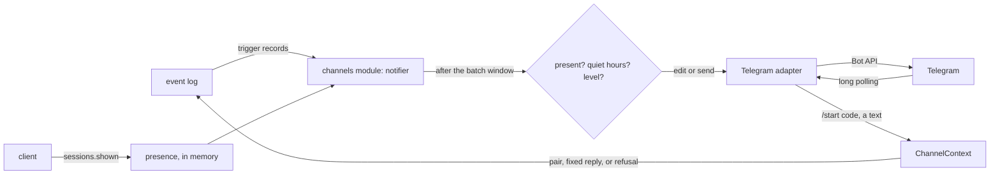

# The push notice

- **Status:** draft
- **Work items:** [the Telegram push notifier](https://linear.app/zgeoff/issue/GEO-1812), after
  [the Telegram round-trip spike](https://linear.app/zgeoff/issue/GEO-252)

When something waits for you and no client shows nixie, a Telegram bot that you register tells you
so. The notice holds a count, a fixed sentence and a link to the client, and nothing else, because
Telegram keeps a bot chat's history on its servers. The channels module follows the event log,
decides when a notice goes out and how loud it is, and hands the notice to the Telegram adapter,
which only talks to the Bot API.

[The channel adapter](../platform/channels/channel-adapter.md) holds the interface, the identity
record and the reasons for the push notifier. This design gives the contracts that build it.

Terms:

- An **item** is one entry of `approvals.listItems` outside the deferred group, as
  `docs/design/queue/approval-record.md` defines the list.
- A **trigger** is a record that can change what a notice says: a proposal created, answered,
  lapsed, withdrawn or returned from a defer, an `action.outcome` with the outcome `unknown`, and
  `spend.stop_tripped` and `spend.stop_cleared` from `docs/design/queue/budgets-and-hard-stop.md`.
- The **live notice** is the newest notice the bot sent. nixie edits it, or sends a new one that
  takes its place.
- The **Telegram row** is the identity record row of the paired Telegram account.

## Shape



## Contracts

### The notice and its result

```ts
// channels module: what the notifier hands the adapter
const result = await telegram.push(row, {
  level: 'loud',
  count: 3,
  sentence: 'items',
  link: 'https://nixie.example.org/digest',
  edit: null, // null sends a new message; a message ID edits that message
});
// → { status: 'sent', messageID: '4417' }
//   or { status: 'edited', messageID: '4417' }, { status: 'unchanged' },
//   { status: 'edit_failed' }, { status: 'gone' } or { status: 'retry', afterMs: 3000 }
```

```ts
// channels module. The adapter renders the text with renderNoticeText and sends exactly that.
interface PushNotice {
  level: 'quiet' | 'loud'; // loud sends with a buzz; quiet sends with disable_notification
  count: number; // the items that wait, 0 or more
  sentence: NoticeSentence;
  link: string; // client_url with /digest, or client_url with / while the stop stands
  edit: string | null; // the live notice's message ID; a loud notice always sends new
}

// The only sentences a notice holds. No field of a notice comes from a model, a task, a record's
// payload or its erasable fields.
type NoticeSentence = 'items' | 'nothing' | 'stop';

declare function renderNoticeText(notice: PushNotice): string;
// 'items', 3   → "nixie has 3 things for you. https://nixie.example.org/digest"
// 'nothing', 0 → "Nothing waits for you now. https://nixie.example.org/digest"
// 'stop', 2    → "Model spending stopped, and every task is paused. 2 things wait for you.
//                 https://nixie.example.org/"

type PushResult =
  | { status: 'sent' | 'edited'; messageID: string } // the message is now the live notice
  | { status: 'unchanged' } // the edit's text equals the message's text
  | { status: 'edit_failed' } // the message to edit is gone or can no longer take an edit
  | { status: 'gone' } // 403: you blocked the bot or deleted the chat
  | { status: 'retry'; afterMs: number }; // 429 with retry_after, a 5xx, or no answer
```

```ts
// channels module: the ChannelAdapter of channel-adapter.md, with push taking the row it targets
interface ChannelAdapter {
  // …existing fields
  push?(row: Identity, notice: PushNotice): Promise<PushResult>;
}

// channels module: ChannelContext gains the pairing claim
interface ChannelContext {
  // …existing fields
  claimPairing(claim: PairingClaim): Promise<'paired' | 'refused'>;
}

interface PairingClaim {
  channel: 'telegram';
  code: string; // the /start payload
  externalID: string; // `${from.id}:${chat.id}`, from a private chat only
}
```

### The live notice

```sql
-- One migration appended to nixieSchema. A plain table: nixie rewrites the row on each send or
-- edit, and no audit needs the history.
create table push_notices (
  identity_id   text primary key references identities (identity_id),
  message_id    text not null,
  level         text not null check (level in ('quiet', 'loud')),
  count         integer not null,
  sentence      text not null,
  sent_at       integer not null,
  edited_at     integer
) strict;
```

### Pairing

```ts
// contract: channels, a checked action from a signed-in client
const pairing = await client.channels.pair({ channel: 'telegram', clientActionID });
// → { link: 'https://t.me/nixie_home_bot?start=Qx7…', lapsesAt: '2026-11-13T10:25:00Z' }
//   or ORPCError NOT_CONFIGURED when the config has no channels.telegram
```

```bash
nixie channels pair telegram   # the link on its first line, then until when it works
nixie channels list            # each live channel row: ID, channel, label, paired, last seen, as JSON
nixie channels revoke <id>     # revokes one channel row; a device session refuses as NOT_FOUND
```

```sql
-- The same migration. Apart from enrolment_codes, so a pairing code never enrols a device.
create table pairing_codes (
  code_hash    text primary key,           -- SHA-256 of the code; nixie never keeps the code
  channel      text not null,
  issued_at    integer not null,
  expires_at   integer not null,           -- issued_at plus 10 minutes
  issued_by    text references identities (identity_id), -- null from the host command
  used_at      integer,
  identity_id  text references identities (identity_id),
  check ((used_at is null) = (identity_id is null))
) strict;
```

```ts
// channels module: the 3 record kinds, each on no thread
type ChannelsRecord =
  | {
      kind: 'channels.code_issued';
      payload: { channel: 'telegram'; expiresAt: number; issuedBy: string | null };
    }
  | {
      kind: 'channels.paired';
      payload: { identityID: string; channel: 'telegram'; externalID: string };
    }
  | {
      kind: 'channels.revoked';
      payload: { identityID: string; by: string | null; reason: 'command' | 'repaired' };
    };
```

### Presence

```ts
// contract: sessions. The client calls it when it becomes visible, and every 60 s while visible.
await client.sessions.shown({});
// → {}
```

- Only a client that shows nixie on screen calls `sessions.shown`: a web page whose visibility state
  is `visible`, or the app in the foreground. A background tab with an open live stream never calls
  it.
- The channels module keeps the newest `shown` time in memory, for any live device session. It
  writes nothing to the database, so a restart forgets it.
- A client is present while its newest `shown` lies within `presence_seconds`.

### Settings

```yaml
# config.yaml. The channels module owns channels.telegram.
channels:
  telegram:
    credential: deployment:telegram-bot # the bot token, an entry in the secrets file
    client_url: https://nixie.example.org # the origin every notice links to
    presence_seconds: 120
    batch_seconds: 30
```

- With `channels.telegram` left out, no Telegram adapter starts, and `channels.pair` answers
  `NOT_CONFIGURED`.
- `credential` accepts only the `deployment:<name>` form, as the search key does.
- The notifier reads quiet hours from the top-level `quiet_hours` that
  `docs/design/queue/approval-record.md` owns, and has no quiet hours of its own.

## Constraints

### The notice

- A notice holds only the count, one sentence from `NoticeSentence` and the link. A test renders
  every notice the notifier can build and finds no task name, person, action, amount, time or record
  text in it.
- The count is the number of items. A deferred row counts in no notice.
- While the stop stands, the sentence is `stop` and the link is the client's root, whatever the
  count. When the count drops to 0 with no stop, the sentence is `nothing`.
- The link never carries an item ID, so the bot's chat never holds an ID of one item.

### When nixie pushes

The notifier follows the event log from its head at start. Each trigger opens a batch window of
`batch_seconds`, unless one is open. When the window closes, the notifier reads the items once and
acts on what it finds then:

| What arrived in the window                                      | Level | Through quiet hours |
| --------------------------------------------------------------- | ----- | ------------------- |
| An `action.outcome` with the outcome `unknown`                  | loud  | yes                 |
| `spend.stop_tripped`                                            | loud  | yes                 |
| A new `always_ask` or `lifting` row                             | loud  | no                  |
| `proposals.returned`, a row back from a defer                   | loud  | no                  |
| A new `routine` or `memory_write` row                           | quiet | n/a                 |
| An answer, a lapse, a withdrawal, a defer, `spend.stop_cleared` | quiet | n/a                 |

- A window holds the loudest level among its triggers.
- A loud notice sends a new, buzzing message, which becomes the live notice.
- A quiet notice edits the live notice. When no live notice exists, a quiet notice for a new item
  sends a new message with `disable_notification`. A quiet notice that only lowers the count never
  sends a new message.
- When a client is present at the close of the window, the notifier sends nothing new and only edits
  the live notice. The items of that window never cause a loud notice later.
- Inside quiet hours, a loud window that does not pass quiet hours edits the live notice. At the end
  of quiet hours, the notifier sends one loud notice when any item from those windows still waits.
- nixie sends no reminder: an item that a notice has counted never causes a second loud notice,
  except when it returns from a defer.
- A paired Telegram row is needed for any push. With none, the notifier reads no items and sends
  nothing.

### Telegram failures

- `edit_failed` sends a new quiet message in place of the edit, which becomes the live notice.
- `retry` waits `afterMs`, then sends the newest notice once. A newer window replaces a notice that
  waits, so a burst of failures never sends a stale count.
- `gone` deletes the live notice row and logs a warning. The Telegram row stays paired, so you can
  unblock the bot without a new pairing.
- The adapter refuses to start when `getMe` answers 401, and logs the error without the token. The
  server starts without the Telegram adapter.

### The bot token

- The token reaches the adapter and no other part of nixie.
- The Bot API puts the token in the request path, so the adapter never logs a request URL, and each
  error it logs or returns holds the method name and the status only.
- No record, error, health report or notice holds the token.

### Inbound updates

- The adapter calls `getUpdates` with a long-poll timeout, one call at a time, and asks only for
  `message` updates. Telegram therefore needs no inbound route to nixie.
- The adapter keeps the update offset in memory. After a restart, Telegram sends again each update
  the adapter had not confirmed. A replayed `/start` meets a used code and refuses, and a replayed
  text gets the fixed reply again.
- An update from a chat other than a private chat gets a refusal record and no reply.
- `/start <code>` from a private chat calls `claimPairing`. On `paired`, the bot replies with the
  fixed text "Paired. nixie sends its notices here." On `refused`, the adapter writes a refusal and
  sends no reply.
- Any other text from the Telegram row's account gets one fixed reply: "nixie reads messages only in
  the app:" and the client's link. The adapter keeps none of the text. Each reply moves the row's
  last seen time.
- A text from any other account gets an `identity.refused` record, at most one per external ID per
  refusal interval, and no reply, as [refusals](../../architecture/channels/api.md#refusals) builds
  them. The external ID is `${from.id}:${chat.id}`.

### Pairing

- A code is 32 random characters from the base64url alphabet, so the `start` payload fits Telegram's
  limit of 64 characters from `A-Z`, `a-z`, `0-9`, `_` and `-`.
- A code works once and lapses 10 minutes after its issue. A used, lapsed or unknown code refuses.
- A claim that succeeds marks the code used, creates the Telegram row or reuses the row with the
  same external ID, sets `paired_at`, clears `revoked_at`, points `paired_sequence` at the new
  `channels.paired` record, and labels the row "Telegram", in one transaction.
- One Telegram row is live at a time. A claim that pairs another account revokes the live row in the
  same transaction, with the reason `repaired`.
- A Telegram row has no token hash and never lapses at the session idle limit. The device session
  reads, the first enrolment code and the device revoke keep their filter on the `client` channel.
- `nixie channels revoke` sets `revoked_at` and writes `channels.revoked`. A revoked row resolves to
  nobody, so its next text gets a refusal and no reply, and the notifier sends it nothing.
- A retry of `channels.pair` with the same client action ID answers with a fresh code that keeps the
  first code's lapse time, as the enrolment code issue does in
  [checked actions](../../architecture/channels/api.md#checked-actions).

### Resets

- A reset keeps each live Telegram row, as it keeps each live device session, whatever its last seen
  time.
- A reset deletes every pairing code and every `push_notices` row, so the next push sends a new
  message.

### Rollback

The release before reads this design's changes this way:

| The change                                                    | The release before                                                                                         |
| ------------------------------------------------------------- | ---------------------------------------------------------------------------------------------------------- |
| `channels.telegram` in `config.yaml`                          | refuses to start: the schema is strict. Remove the `channels` key before the rollback                      |
| the migration: `push_notices` and `pairing_codes`             | never reads either table. The migration only adds tables, so the oldest reader does not change             |
| a Telegram row in `identities`                                | never meets it in its session reads, which filter on `client`. A reset keeps it only within the idle limit |
| `channels.code_issued`, `channels.paired`, `channels.revoked` | never meets them on a thread: each is on no thread                                                         |
| `identity.refused` with the channel `telegram`                | reads it as it reads any refusal                                                                           |
| `sessions.shown`                                              | answers `NOT_FOUND`, and the client ignores the error                                                      |
| `channels.pair`                                               | answers `NOT_FOUND`                                                                                        |

## Decisions

- **Quiet hours are the top-level `quiet_hours`, shared with Defer.** The interim for the open
  question on quiet hours in
  [the approval record work item](https://linear.app/zgeoff/issue/GEO-1804). When the owner keeps
  quiet hours under Telegram, only the key path changes, to `channels.telegram.quiet_hours`.
- **The channels module decides every notice, and the adapter only talks to the Bot API.** An
  agent's call on 13 Nov 2026: a module never imports an adapter, and the content-free rule then
  lives in one module with one test.
- **The notifier follows the log, and no module calls it.** An agent's call on 13 Nov 2026: the stop
  records are on no thread and the proposals have several writers, and the log already carries each
  trigger.
- **Presence is a beat from a visible client, held in memory.** An agent's call on 13 Nov 2026: the
  last seen time moves on any call, and an open stream in a background tab would hold back every
  push. A restart that forgets presence at worst sends one notice too many.
- **Pairing codes have their own table.** An agent's call on 13 Nov 2026: in `enrolment_codes`, a
  pairing code would claim a device session through enrolment.
- **A new pairing revokes the live Telegram row.** An agent's call on 13 Nov 2026: the code proves
  that whoever holds the signed-in client holds the new account, and one live row keeps every notice
  on one chat.
- **The bot token is `credential: deployment:<name>`.** An agent's call on 13 Nov 2026: the config
  file names every secret reference that way, as the search key does.
- **`client_url` sits under `channels.telegram`.** An agent's call on 13 Nov 2026: the notice is the
  only reader of a public origin, and a server-wide key can move there when a second reader comes.
- **The update offset stays in memory.** An agent's call on 13 Nov 2026: a replayed update meets a
  used code or gets the fixed reply again, and neither harms anything.
- **The Telegram row's label is "Telegram".** An agent's call on 13 Nov 2026: a Telegram display
  name is a person's name, which the plain-text row would keep.

## Builder decides

- The internal names and files of the notifier, the adapter and their tests.
- How the notifier reads the items: through the read that backs `approvals.listItems`, or a count
  beside it.
- The long-poll timeout, the backoff after a failed `getUpdates`, and the log lines.
- How the web client and the app detect that they show nixie.

## Out of scope

- Telegram as a full channel, and native push for the app, in later stages of
  [the channel adapter](../platform/channels/channel-adapter.md#room-for-later-channels).
- The notice of a failed backup, which [backup health](https://linear.app/zgeoff/issue/GEO-1815)
  adds as a trigger.
- The "budget reached" notice of a paid tool, which the client shows.
- A revoke from the client. The host command revokes.

## Open questions

The owner settles the first two in
[the push notifier work item](https://linear.app/zgeoff/issue/GEO-1812), and the interim stands
until then:

- **The wording of the 3 sentences and the 2 fixed replies.** Interim: the wording above.
- **Does a notice that counts one item link that item's card?** Interim: every notice links the
  digest, so the chat never holds an item's ID.

[The round-trip spike](https://linear.app/zgeoff/issue/GEO-252) settles each assumption below. Until
it lands, the code follows the assumption, and the fallback applies when the spike disproves it:

- **The `start` payload arrives as `/start <code>` in a private chat, with up to 64 characters.**
  Fallback: the client shows the code, and you send it to the bot as a plain message.
- **An edit of the bot's own message makes no sound and no notification, at any age.** Fallback:
  every notice sends a new message, quiet ones with `disable_notification`.
- **A message with `disable_notification` arrives with no sound.** Fallback: a quiet notice that
  finds no live notice waits for the next loud one.
- **A second account's update carries `from.id` and `chat.id`, so nixie refuses it without a
  reply.** Fallback: refuse on `chat.id` alone.
- **One long poller gets each update once, and a block of the bot answers 403 on the next send.**
  Fallback: a `gone` result also comes from a 400 that names a missing chat.
