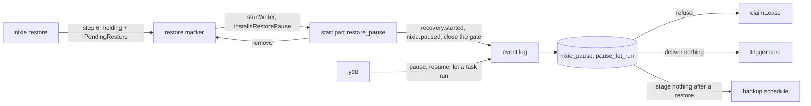

# The pause, and the restore that starts paused

- **Status:** draft
- **Work items:** [the `holding` marker](https://linear.app/zgeoff/issue/GEO-2561),
  [the pause tables, the reader gate and the claim check](https://linear.app/zgeoff/issue/GEO-2566),
  [the install at the next start](https://linear.app/zgeoff/issue/GEO-2564),
  [the resume and letting one task run](https://linear.app/zgeoff/issue/GEO-2559). These build on
  the contracts here:
  [the pause API, the commands and the web client](https://linear.app/zgeoff/issue/GEO-2571),
  [the restore notice](https://linear.app/zgeoff/issue/GEO-2572),
  [the backup schedule while paused](https://linear.app/zgeoff/issue/GEO-2558).

You can pause all of nixie at once. While nixie is paused, no task takes a step, no action starts an
attempt, and no schedule fires. Messages, notices and action outcomes still land, so nothing is
lost, and each waits until you resume. You can let one task run while the rest stay paused, such as
the conversation, so you can talk to nixie while you check the rest.

A restore starts nixie paused. A restored log is up to one backup interval behind the lost host, and
only you can check what happened outside nixie in the lost span. So the restore records which tasks
were midway through a step or owned an action that had not finished, and nixie shows you that list.
You check each one, then resume.

The restore ends by writing the marker in the state `holding`. The next start of the server reads
the marker, pauses nixie, records the list, and removes the marker.
[The backup pair](backup-pair.md) holds the restore's steps 1 to 5, which this design follows with
step 6.

Terms:

- A **recovery** is one restore, under one `recoveryID`.
- **Letting a task run** puts one task on the list of tasks that run while nixie is paused. A resume
  empties the list.
- The **restore marker** is the file `restore-incomplete` in the data directory, which the built
  restore writes.
- The **reader gate** is the stored `oldest_reader` value, raised while nixie is paused, so that a
  release without the pause refuses the database.
- A **start part** is a named step of the server's start. "The start part `recovery`" is the built
  one that marks unfinished attempts unknown.

## Shape



## Contracts

### The restore marker

```ts
// log module: the marker's states and moves, extending the built ones
type RestoreState = 'none' | 'replacing' | 'holding';

const restoreMoves: Readonly<Record<RestoreState, readonly RestoreState[]>> = {
  none: ['replacing'],
  replacing: ['replacing', 'holding', 'none'],
  holding: ['replacing', 'none'],
};

// log module: the payload of a marker in the state `holding`
interface PendingRestore {
  version: 1;
  recoveryID: string; // random, made by the restore
  restoredAt: number;
  backupTakenAt: number; // the time of the record with the highest sequence in the staged nixie.db
}

interface StartWriterOptions {
  // …existing fields
  installsRestorePause?: boolean; // only the server passes true
}

interface Writer {
  // …existing fields
  pendingRestore: PendingRestore | null; // null: the marker is absent
}
```

nixie reads the marker file this way:

| The file                   | The state   |
| -------------------------- | ----------- |
| absent                     | `none`      |
| empty, or does not parse   | `replacing` |
| parses as `PendingRestore` | `holding`   |

### The tables and the records

```sql
-- One migration appended to nixieSchema. It leaves the schema's oldestReader as it is.
create table nixie_pause (
  id              integer primary key check (id = 1), -- at most one row: nixie is paused
  cause           text not null,                      -- 'restore' or 'owner'
  recovery_id     text,                               -- set when cause is 'restore'
  paused_sequence integer not null references records (sequence)
) strict;

create table pause_let_run (
  task_id      text primary key,                      -- runs while nixie is paused
  let_sequence integer not null references records (sequence)
) strict;

create table recoveries (
  recovery_id      text primary key,
  restored_at      integer not null,
  backup_taken_at  integer not null,
  started_sequence integer not null references records (sequence)
) strict;

alter table schema_version add column open_oldest_reader integer; -- null while the gate is open
```

```ts
// log module: the 4 record kinds, each on no thread. The tasks projection folds none.
type PauseCause = 'restore' | 'owner';

interface NixiePaused {
  kind: 'nixie.paused'; // inserts or replaces the nixie_pause row, and empties pause_let_run
  payload: { cause: PauseCause; recoveryID?: string; by?: string }; // by: the identity, for 'owner'
}

interface NixieResumed {
  kind: 'nixie.resumed'; // deletes the nixie_pause row and every pause_let_run row
  payload: { by: string };
}

interface TaskLetRun {
  kind: 'nixie.task_let_run'; // inserts a pause_let_run row
  payload: { taskID: string; by: string };
}

interface RecoveryStarted {
  kind: 'recovery.started'; // recoveries gets one row
  payload: {
    recoveryID: string;
    restoredAt: number;
    backupTakenAt: number;
    toCheck: readonly TaskToCheck[]; // read by recovery/read
  };
}

interface TaskToCheck {
  taskID: string;
  stateAtBackup: TaskState;
  wasRunning: boolean; // a step had started and had not committed
  pendingActions: number; // actions with no outcome that the task owns
}
```

### The pause and its readers

```ts
// log module, exported: every module that obeys the pause reads it through readPause
const pause = await readPause(tx); // → { cause: 'restore', recoveryID: '5b7e0c2a-…' }, or null
declare function readPause(tx: Transaction<unknown>): Promise<Pause | null>;

interface Pause {
  cause: PauseCause;
  recoveryID: string | null;
}

// log module: each writes its record and changes the tables in the caller's transaction
declare function pauseNixieInTransaction(
  tx: Transaction<unknown>,
  request: { cause: PauseCause; recoveryID?: string; by?: string },
): Promise<void>;
declare function resumeNixieInTransaction(
  tx: Transaction<unknown>,
  request: { by: string },
): Promise<{ wasPaused: boolean }>;
declare function letTaskRunInTransaction(
  tx: Transaction<unknown>,
  request: { taskID: string; by: string },
): Promise<void>;
```

### The reader gate

```ts
// db lib
await closeToOlderReaders(tx, pauseMigrationVersion);
// open_oldest_reader := the stored oldest_reader; oldest_reader := the version given
declare function closeToOlderReaders(tx: Transaction<unknown>, reader: number): Promise<void>;

// oldest_reader := open_oldest_reader; open_oldest_reader := null
declare function reopenToOlderReaders(tx: Transaction<unknown>): Promise<void>;

// At each start: reopens a closed gate when nixie_pause has no row
declare function syncPauseGate(db: Kysely<unknown>): Promise<void>;
```

### The claim check

```ts
// tasks module: readCandidate returns a candidate that names the task whose pause stops the claim
interface ClaimCandidate {
  workID: string;
  taskID: string; // the task itself, or the action's owner
}

interface ClaimRequest {
  // …existing fields
  readCandidate: (tx: Transaction<unknown>, now: number) => Promise<ClaimCandidate | null>;
}

// tasks module: each candidate query adds this to its where clause
declare function buildPauseCheck(
  eb: ExpressionBuilder<unknown, never>,
  taskIDColumn: string,
): Expression<SqlBool>; // true when nixie is not paused, or the task is on pause_let_run

// tasks module, exported: takes the caller's transaction
const paused = await isTaskPaused(tx, '7c1d2e9a'); // → true
declare function isTaskPaused(tx: Transaction<unknown>, taskID: string): Promise<boolean>;
```

### The install at the next start

```ts
// server app, in the start part restore_pause
const installed = await installRestorePause(context, {
  pending: writer.pendingRestore,
  readTasksWithPendingActions, // from the actions module
});
// → { recoveryID: '5b7e0c2a-91d4-4f3b-8e6a-2c1f9d7b4a10', toCheck: 4, isNew: true }, or null when no restore is pending

declare function installRestorePause(
  context: TasksContext,
  options: {
    pending: PendingRestore | null;
    readTasksWithPendingActions: (tx: Transaction<unknown>) => Promise<readonly string[]>;
  },
): Promise<{ recoveryID: string; toCheck: number; isNew: boolean } | null>; // isNew false: the recoveries row existed

const restorePausePart: AnyPartDeclaration<ServerPartValues> = {
  name: 'restore_pause',
  needs: ['server_parts', 'first_seed'],
  // installRestorePause, the fault point recovery.pause.committed, the marker's removal, then
  // the fault point recovery.pause.marker_cleared
  start: makeRetriedStart('restore_pause', installPauseAndClearMarker),
};
// The built start part `recovery` adds 'restore_pause' to its needs.

type RestorePauseFaultPoint =
  | 'recovery.pause.committed' // after the commit of the pause, the list and the closed gate
  | 'recovery.pause.marker_cleared'; // after the marker is removed
```

## Constraints

### The marker

- Step 6 of the restore writes the `PendingRestore` payload to a second file and renames that file
  over the marker, so the marker exists at every instant of the step and a kill never gives `none`.
- Step 6 runs after the move of both databases and after the restore note, and the server never
  starts on `replacing`. So a started server finds no set folder of the replaced database in
  staging.
- On `holding`, `startWriter` starts for a caller with `installsRestorePause` and refuses every
  other caller. On `replacing`, it refuses every caller.
- A kill before step 6 leaves `replacing`, and you finish it by running the restore again, as the
  [built restore](../../architecture/deployment/host-commands.md#backup-and-restore) requires: a
  server never starts on `replacing`.
- The restore writes nothing into the restored database. The backup's schema can predate the pause
  tables, and the migrations run at the next start.

### The pause

- nixie is paused exactly while `nixie_pause` holds its row. nixie stores the pause only there,
  never as a task state, a lease or a far `claimable_at`. A task state stops records from landing,
  the start part `recovery` frees every lease of an earlier start, and folds rewrite `claimable_at`.
- A pause, a resume and letting a task run change no task state, lease, `resume_state` or
  `claimable_at`. A task that you paused yourself stays paused after nixie resumes, and the `resume`
  control of a task never resumes nixie.
- Every task is paused while nixie is paused, except a task on `pause_let_run`. A task created while
  nixie is paused is paused too, such as a task that a let-run task starts.
- While nixie is paused, inbox records, fired timers, action outcomes and the records of the start
  part `recovery` land on each task's thread as on any day, and each task control works. nixie takes
  no step that reads them until the resume, or until you let that task run.
- When nixie pauses on a running server, a step that holds a lease runs to its commit, and an
  attempt that has started runs to its outcome. Nothing new starts after either.
- Only you pause, resume or let a task run: through the API, a host command or the web client. No
  tool does any of the three.
- A pause while nixie is paused replaces the cause. A resume while nixie is not paused writes
  nothing.
- A log reset empties `nixie_pause` and `pause_let_run` with every other table.

### What the restore records for you to check

- `toCheck` holds every task that was running at the backup, and every task that owns an action with
  no outcome, the conversation included. A done, stopped or closed task can own one: a stop cancels
  only the actions with no started attempt, and a started attempt runs on to its outcome
  ([attempts](../../architecture/core/actions.md#attempts)).
- The install reads `stateAtBackup` and `wasRunning` from each task's row before the start part
  `recovery` moves a running task.
- The install writes `recovery.started`, then `nixie.paused` with the cause `restore`, in one
  transaction. `nixie.paused` empties `pause_let_run`, so a let-run list that the backup held never
  runs a task.
- `installRestorePause` writes nothing for a `recoveryID` that has a `recoveries` row, so a repeated
  install never pauses nixie again after you resumed.
- The start part `restore_pause` runs after the built start part `first_seed`, so the first seed's
  tasks are paused with the rest.

### Triggers while paused

- While nixie is paused, `deliverTriggerBatch` writes nothing, takes no key and returns
  `{ delivered: 0 }`, for every source and every target, the conversation included. The watermark
  stays where it was.
- The source delivers the same events at its next tick, so the first tick after the resume finds
  each missed fire late, and the catch-up rule of [triggers](triggers.md#decisions) decides: one
  catch-up within half the interval, and a `too_late` skip beyond it.
- A definition's task that you let run gets no fire while nixie is paused.

### The reader gate

- The transaction that pauses nixie closes the gate. The resume reopens it in its transaction.
- A migration that runs while the gate is closed reads `open_oldest_reader` in its transaction, sets
  it to the value the built runner would give `oldest_reader`, and never lowers `oldest_reader`.
- `pauseMigrationVersion` is the pause migration's index plus one, and the db lib exports it.
- `syncPauseGate` reopens a closed gate with no pause at each start. A log reset is the one case
  that leaves one.
- While nixie is paused, each release without the pause refuses to start, with the built
  `SchemaTooNewError`.

### The claim check

- `claimLease` refuses a candidate whose task is paused, in the transaction that writes the lease
  and the step start. A refused claim writes nothing.
- The refusal covers every claim: by any runner, for a retry, by the start part `recovery`, by task
  ID, and for an action that started an attempt before the backup. The sweep that revives waiting
  tasks writes its records on a paused task as on any task, and the claim after it is refused.
- Every caller of `readCandidate` returns a `ClaimCandidate` in the same change.
- Each candidate query filters with `buildPauseCheck`, so a paused task at the head of the order
  never hides a let-run task's work behind it. Under `NIXIE_TEST_BUILD`, `claimLease` throws when
  `readCandidate` returns paused work.
- The action query's filter has no `attempt_count = 0` condition, so it covers an action with a
  started attempt.
- The attempt start refuses an action whose task is paused, with `isTaskPaused` in the transaction
  that writes the attempt record, as it refuses an action that a stop cancelled after its claim. A
  pause between the claim and the attempt then starts no attempt. The refused action stays pending,
  and its next claim after the resume, or after you let its task run, starts it.
- The pause check sits before the write of `task.run_opened` that the task run records add to the
  claim's transaction.

### The next start after a restore

1. `startWriter` starts for the server on `holding`, and the migrations run.
2. The start part `restore_pause` commits the pause, the list and the closed gate in one
   transaction, then removes the marker.
3. The start part `recovery` runs, then the runners.

| A kill lands                              | The next start                                                                |
| ----------------------------------------- | ----------------------------------------------------------------------------- |
| before the restore writes `holding`       | every build refuses on `replacing`; you run the restore again                 |
| after the restore, through the migrations | the release before refuses on the marker; this build starts again from step 1 |
| before the pause commits                  | starts again from step 1                                                      |
| at `recovery.pause.committed`             | finds the `recoveries` row, writes nothing, and removes the marker            |
| at `recovery.pause.marker_cleared`        | claims nothing paused; the release before refuses with `SchemaTooNewError`    |

### The resume

- `resumeNixieInTransaction` writes `nixie.resumed`, deletes the pause and the let-run list, and
  reopens the gate, in one transaction. When nixie dies before the commit, nixie stays paused.
- After the resume, each task is in the state its records give it, and the next claim takes it with
  whatever its inbox holds.
- Letting a task run and the resume each act at once, with no confirm step. After a restore, the web
  client shows the `toCheck` list beside the resume control.

### A rollback

The release before reads this design's changes this way:

| The change                                   | The release before                                                 |
| -------------------------------------------- | ------------------------------------------------------------------ |
| the marker in `holding`                      | refuses to start, as on any marker                                 |
| the migration                                | refuses with `SchemaTooNewError` while paused, and starts when not |
| `nixie_pause`, `pause_let_run`, `recoveries` | never selects them                                                 |
| `open_oldest_reader`                         | never selects it                                                   |
| the 4 record kinds                           | never meets them on a thread: each is on no thread                 |

To roll back while nixie is paused, after a restore or not:

1. When a restore marker exists, start this build once, so the start part `restore_pause` removes
   it.
2. Resume nixie. Tasks run on this build until you stop it.
3. Start the release before.

## Decisions

- **nixie pauses as a whole, and you can let single tasks run; a restore starts nixie paused.** The
  owner chose this on 13 Nov, in place of a hold on each task: one switch stops everything, with or
  without a restore, and letting a task run covers the fine case, such as talking to nixie before
  you resume.
- **The next start pauses nixie, not the restore.** The backup's schema can predate the pause
  tables, and the migrations run only at a start.
- **The gate is the stored `oldest_reader`, never the schema's `oldestReader`.** A raised schema
  value would stop the release before from reading the database again, paused or not.
- **Every pause closes the gate, your own included.** One rule covers every pause, and a release
  that does not know the pause never runs the tasks you paused.
- **The pause lives in the log module.** The tasks module, the trigger core and the backup schedule
  each read it, and each already imports the log module, so none imports another for it.
- **A pause has no port.** SQLite is the one store, by the queue's port rules.
- **The pause records go on no thread.** A thread reader of the release before then never meets
  them.
- **`claimLease` checks the task that each claim candidate names.** An agent's call on 13 Nov, which
  the owner accepted: one check covers every runner and every action attempt, and the platform
  design keeps the pause apart from the lease and the task state.
- **The restore writes `holding` last, after the move of both databases and the restore note.** An
  agent's call on 13 Nov, which the owner accepted: a kill before the move then leaves `replacing`,
  so no start pauses the database the restore meant to replace.
- **Every restore starts nixie paused, and `nixie restore` has no flag that skips it.** An agent's
  call on 13 Nov, which the owner accepted: the platform's
  [backup and restore](../platform/deployment/backup-and-restore.md#restoring-on-a-new-host) gives
  the restore no exception, and a resume after the start covers a test host.

## Builder decides

- The internal names of the queries, the folds and the files.
- The wording of each refusal and log line.
- Whether `syncPauseGate` runs in the start part `restore_pause` or in `startWriter`, as long as it
  runs at each start before a claim.
- The layout of the tests.

## Out of scope

- `nixie rollback`, and what it would pause.
- A pause from a tool, and a timed pause that resumes on its own.
- A config key, and a change to a model's prompt.
- A marker that lasts until the resume.

## Open questions

None.
