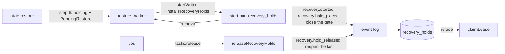

# The recovery hold after a restore

- **Status:** draft
- **Work items:** [the `holding` marker](https://linear.app/zgeoff/issue/GEO-2561),
  [the hold tables, the reader gate and the claim check](https://linear.app/zgeoff/issue/GEO-2566),
  [the install at the next start](https://linear.app/zgeoff/issue/GEO-2564),
  [the hold release](https://linear.app/zgeoff/issue/GEO-2559). These build on the contracts here:
  [the recovery API and host commands](https://linear.app/zgeoff/issue/GEO-2571),
  [the restore notice](https://linear.app/zgeoff/issue/GEO-2572),
  [the backup schedule under a hold](https://linear.app/zgeoff/issue/GEO-2558).

A restored log is up to one backup interval behind the lost host, and only you can check what
happened outside nixie in the lost span. After a restore, nixie takes no step of a recovered task
and starts no attempt of a recovered action until you release that task. A recovery hold does this:
a row of its own beside the task, which survives a crash at any point of the restore and of the next
start, and which keeps a release without the hold from starting while one exists.

The restore ends by writing the marker in the state `holding`. The next start of the server reads
the marker, places a hold on each recovered task, and removes the marker.
[The backup pair](backup-pair.md) holds the restore's steps 1 to 5, which this design follows with
step 6.

Terms:

- A **recovery** is one restore, under one `recoveryID`. A rollback that holds the tasks of a
  discarded span would be a second cause, and is not designed.
- A **hold release** clears one recovery hold. "Release" alone means a release of nixie.
- The **restore marker** is the file `restore-incomplete` in the data directory, which the built
  restore writes.
- The **reader gate** is the stored `oldest_reader` value, raised so that a release without the
  hold's tables refuses the database.
- A **start part** is a named step of the server's start. "The start part `recovery`" is the built
  one that marks unfinished attempts unknown.

## Shape



## Contracts

### The restore marker

```ts
// log module: the marker's states and moves, extending the built ones
type RestoreState = 'none' | 'replacing' | 'holding';

const restoreMoves: Readonly<Record<RestoreState, readonly RestoreState[]>> = {
  none: ['replacing'],
  replacing: ['replacing', 'holding', 'none'],
  holding: ['replacing', 'none'],
};

// log module: the payload of a marker in the state `holding`
interface PendingRestore {
  version: 1;
  recoveryID: string; // random, made by the restore
  restoredAt: number;
  backupTakenAt: number; // the time of the record with the highest sequence in the staged nixie.db
}

interface StartWriterOptions {
  // …existing fields
  installsRecoveryHolds?: boolean; // only the server passes true
}

interface Writer {
  // …existing fields
  pendingRestore: PendingRestore | null; // null: the marker is absent
}
```

nixie reads the marker file this way:

| The file                   | The state   |
| -------------------------- | ----------- |
| absent                     | `none`      |
| empty, or does not parse   | `replacing` |
| parses as `PendingRestore` | `holding`   |

### The tables and the records

```sql
-- One migration appended to nixieSchema. It leaves the schema's oldestReader as it is.
create table recovery_holds (
  subject_key     text primary key,     -- 'task:<id>'
  subject_kind    text not null,        -- 'task'; the column leaves room for another subject kind
  subject_id      text not null,
  recovery_id     text not null,
  cause           text not null,        -- 'restore'
  placed_sequence integer not null references records (sequence)
) strict;

create table recoveries (
  recovery_id      text primary key,
  cause            text not null,
  started_at       integer not null,
  backup_taken_at  integer,             -- null for a cause with no backup
  started_sequence integer not null references records (sequence)
) strict;

alter table schema_version add column open_oldest_reader integer; -- null while the gate is open
```

```ts
// tasks module: the 3 record kinds. None is an inbox kind, and the tasks projection folds none.
type HoldSubject = { kind: 'task'; id: string };
type RecoveryCause = 'restore';

interface RecoveryStarted {
  kind: 'recovery.started'; // on no thread; recoveries gets one row
  payload: { recoveryID: string; cause: RecoveryCause; startedAt: number; backupTakenAt: number };
}

interface RecoveryHoldPlaced {
  kind: 'recovery.hold_placed'; // on the task's thread; inserts or replaces the subject's row
  payload: {
    subject: HoldSubject;
    recoveryID: string;
    cause: RecoveryCause;
    stateAtBackup: TaskState; // read by recovery/read only
    wasRunning: boolean; // a step had started and had not committed; read by recovery/read only
  };
}

interface RecoveryHoldReleased {
  kind: 'recovery.hold_released'; // on the task's thread; deletes the subject's row
  payload: { subject: HoldSubject; recoveryID: string; by: string }; // by: the identity whose session released it
}
```

### The reader gate

```ts
// db lib
await closeToOlderReaders(tx, recoveryHoldMigrationVersion);
// open_oldest_reader := the stored oldest_reader; oldest_reader := the version given
declare function closeToOlderReaders(tx: Transaction<unknown>, reader: number): Promise<void>;

// oldest_reader := open_oldest_reader; open_oldest_reader := null
declare function reopenToOlderReaders(tx: Transaction<unknown>): Promise<void>;

// At each start: reopens a closed gate when recovery_holds has no row
declare function syncRecoveryHoldGate(db: Kysely<unknown>): Promise<void>;
```

### The claim check

```ts
// tasks module: readCandidate returns a candidate that names its hold subject, in place of a work ID
interface ClaimCandidate {
  workID: string;
  subject: HoldSubject; // the task whose hold stops the claim: the task itself, or the action's owner
}

interface ClaimRequest {
  // …existing fields
  readCandidate: (tx: Transaction<unknown>, now: number) => Promise<ClaimCandidate | null>;
}

// tasks module: each candidate query adds this to its where clause
declare function buildRecoveryHoldCheck(
  eb: ExpressionBuilder<unknown, never>,
  taskIDColumn: string,
): Expression<SqlBool>; // true when the task has no hold

// tasks module, exported: takes the caller's transaction
const held = await isRecoveryHeld(tx, { kind: 'task', id: '7c1d2e9a' }); // → false
declare function isRecoveryHeld(tx: Transaction<unknown>, subject: HoldSubject): Promise<boolean>;
```

### Place, install and hold release

```ts
// server app, in the start part recovery_holds
const placed = await installRestoreHolds(context, {
  pending: writer.pendingRestore,
  exemptTaskIDs: restoreExemptTaskIDs,
  readTasksWithPendingActions, // from the actions module
});
// → { recoveryID: '5b7e0c2a-91d4-4f3b-8e6a-2c1f9d7b4a10', held: 4, isNew: true }, or null when no restore is pending

const released = await releaseRecoveryHolds(context, {
  subjects: [{ kind: 'task', id: '7c1d2e9a' }],
  by: 'id_3f1a9c',
});
// → { released: [{ kind: 'task', id: '7c1d2e9a' }], left: 3 }
```

```ts
// tasks module
interface PlacedHolds {
  recoveryID: string;
  held: number;
  isNew: boolean; // false: the recoveries row existed, and the call wrote nothing
}

interface PlacedSubject {
  subject: HoldSubject;
  stateAtBackup: TaskState;
  wasRunning: boolean;
}

declare function placeRecoveryHoldsInTransaction(
  tx: Transaction<unknown>,
  context: TasksContext,
  request: {
    recoveryID: string;
    cause: RecoveryCause;
    startedAt: number;
    backupTakenAt: number;
    subjects: readonly PlacedSubject[];
  },
): Promise<PlacedHolds>;

declare function installRestoreHolds(
  context: TasksContext,
  options: {
    pending: PendingRestore | null;
    exemptTaskIDs: readonly string[];
    readTasksWithPendingActions: (tx: Transaction<unknown>) => Promise<readonly string[]>;
  },
): Promise<PlacedHolds | null>;

declare function releaseRecoveryHolds(
  context: TasksContext,
  request: { subjects: readonly HoldSubject[]; by: string },
): Promise<{ released: readonly HoldSubject[]; left: number }>; // left: holds that remain

// server app: the tasks that a restore never holds
const restoreExemptTaskIDs: readonly string[] = ['memory-writer', 'memory-consolidator'];
```

### The start part

```ts
// server app, beside the built recovery part declarations
const recoveryHoldsPart: AnyPartDeclaration<ServerPartValues> = {
  name: 'recovery_holds',
  needs: ['server_parts'],
  // installRestoreHolds, the fault point recovery.holds.committed, the marker's removal, then
  // the fault point recovery.holds.marker_cleared
  start: makeRetriedStart('recovery_holds', installHoldsAndClearMarker),
};
// The built start part `recovery` adds 'recovery_holds' to its needs.

type RecoveryHoldFaultPoint =
  | 'recovery.holds.committed' // after the commit of the holds and the closed gate
  | 'recovery.holds.marker_cleared'; // after the marker is removed
```

## Constraints

### The marker

- Step 6 of the restore writes the `PendingRestore` payload to a second file and renames that file
  over the marker, so the marker exists at every instant of the step and a kill never gives `none`.
- Step 6 runs after the move of both databases and after the restore note, and the server never
  starts on `replacing`. So a started server finds no set folder of the replaced database in
  staging.
- On `holding`, `startWriter` starts for a caller with `installsRecoveryHolds` and refuses every
  other caller. On `replacing`, it refuses every caller.
- The restore writes nothing into the restored database. The backup's schema can predate the hold's
  tables, and the migrations run at the next start.

### The holds

- nixie stores a recovery hold only as a row of `recovery_holds`, never as a task state, a lease or
  a far `claimable_at`. A task state stops records from landing, the start part `recovery` frees
  every lease of an earlier start, and folds rewrite `claimable_at`.
- A subject has at most one recovery hold.
- A placed hold and a hold release change no task state, lease, `resume_state` or `claimable_at`.
- The fold of `task.closed` never ends a recovery hold. A hold release ends one, and a log reset
  empties `recovery_holds` with every other table.
- While a task is held, inbox records, fired timers, action outcomes and the records of the start
  part `recovery` land on its thread, and each task control works on it as on any task. nixie takes
  no step that reads them until the hold release.
- `placeRecoveryHoldsInTransaction` writes nothing for a `recoveryID` that has a `recoveries` row,
  so a repeated install never holds a released task again.
- When a hold is placed on a running server, a step that holds a lease runs to its commit.

### Which tasks a restore holds

- A restore holds every task that is not done or closed, and every task that owns a pending action,
  less the exempt tasks. A done or closed task that owns a pending action is held, so the action
  cannot retry.
- A done, stopped or closed task can own a pending action with a started attempt. A stop cancels
  only the actions with no started attempt, a started attempt runs on to its outcome
  ([attempts](../../architecture/core/actions.md#attempts)), and the built action claim skips only
  the actions of a paused or closed task.
- The conversation and the queue check are held.
- The install reads `stateAtBackup` and `wasRunning` from each task's row before the start part
  `recovery` moves a running task.
- nixie takes the steps of a task that the restore did not hold, such as a task created after the
  restore.

### The reader gate

- The transaction that writes the first recovery hold closes the gate. The hold release that clears
  the last one reopens it in its transaction.
- A migration that runs while the gate is closed reads `open_oldest_reader` in its transaction, sets
  it to the value the built runner would give `oldest_reader`, and never lowers `oldest_reader`.
- `recoveryHoldMigrationVersion` is the hold migration's index plus one, and the db lib exports it.
- `syncRecoveryHoldGate` reopens a closed gate with no hold at each start. A log reset is the one
  case that leaves one.
- One recovery hold, a hold on a closed task included, stops each release without the hold from
  starting, with the built `SchemaTooNewError`.

### The claim check

- `claimLease` refuses a candidate whose subject is held, in the transaction that writes the lease
  and the step start. A refused claim writes nothing.
- The refusal covers every claim: by any runner, for a retry, by the start part `recovery`, by task
  ID, and for an action that started an attempt before the backup. The sweep that revives waiting
  tasks writes its records on a held task as on any task, and the claim after it is refused.
- Every caller of `readCandidate` returns a `ClaimCandidate` in the same change.
- Each candidate query filters with `buildRecoveryHoldCheck`, so a held task at the head of the
  order never hides the work behind it. Under `NIXIE_TEST_BUILD`, `claimLease` throws when
  `readCandidate` returns held work.
- The action query's filter has no `attempt_count = 0` condition, so it covers an action with a
  started attempt. The actions module needs nothing else from the hold.
- The hold check sits before the write of `task.run_opened` that the task run records add to the
  claim's transaction.

### The next start

1. `startWriter` starts for the server on `holding`, and the migrations run.
2. The start part `recovery_holds` commits the holds and the closed gate in one transaction, then
   removes the marker.
3. The start part `recovery` runs, then the runners.

| A kill lands                              | The next start                                                                |
| ----------------------------------------- | ----------------------------------------------------------------------------- |
| before the restore writes `holding`       | every build refuses on `replacing`; you run the restore again                 |
| after the restore, through the migrations | the release before refuses on the marker; this build starts again from step 1 |
| before the holds commit                   | starts again from step 1                                                      |
| at `recovery.holds.committed`             | finds the `recoveries` row, places nothing, and removes the marker            |
| at `recovery.holds.marker_cleared`        | claims nothing held; the release before refuses with `SchemaTooNewError`      |

### The hold release

- `releaseRecoveryHolds` writes `recovery.hold_released` for each subject in one transaction.
- After a hold release, the task is in the state its records give it, and the next claim takes it
  with whatever its inbox holds. A closed task stays closed.
- When nixie dies before a hold release commits, the hold remains. After the commit, nixie claims
  the waiting work as any other work.
- The `resume` control never clears a recovery hold.

## Decisions

- **The next start installs the holds, not the restore.** The backup's schema can predate the hold's
  tables, and the migrations run only at a start.
- **The gate is the stored `oldest_reader`, never the schema's `oldestReader`.** A raised schema
  value would stop the release before from reading the database again, holds or none.
- **A hold has no port.** SQLite is the one store, by the queue's port rules.

## Builder decides

- The internal names of the queries, the folds and the files.
- The wording of each refusal and log line.
- Whether `syncRecoveryHoldGate` runs in the start part `recovery_holds` or in `startWriter`, as
  long as it runs at each start before a claim.
- The layout of the tests.

## Out of scope

- `nixie rollback`, and the holds it would place on the tasks of a discarded span.
- A gate on a trigger source, and a hold release for a source.
- A config key, and a change to a model's prompt.
- A marker that lasts until the last hold release.
- What a fire does for a held task. The definitions design owns it, with `isRecoveryHeld`.

## Open questions

- **Is a recovery hold its own row, with claim candidates that name their subject?** The owner
  settles it, among: this design; one table keyed by subject, with a launch checked outside
  `claimLease`; or a table shaped like `leases`, where a close also ends a hold. Until then, nothing
  in this design is built. This design's cost: one hold stops the release before from starting.
- **Does the restore write `holding` after the move and the restore note, or first?** The owner
  settles it. Until then, step 6 comes last, as written.
- **Which tasks does a restore hold?** The owner settles it, among: every unfinished task; all but
  the conversation; all but the conversation and the system tasks; or every unfinished task less
  `memory-writer` and `memory-consolidator`. Until then, the last, which changes
  `restoreExemptTaskIDs` only. Under [no built-in memory task](no-built-in-memory-tasks.md) those 2
  tasks are deleted before this work, so the 2 IDs reach only task rows that an older log holds.
- **Does every restore place holds, or can a flag turn them off?** The owner settles it. Until then,
  every restore places holds, and `nixie restore` has no such flag.
- **Does a restore hold the source of a trigger?** The owner settles it. Until then, it holds none,
  and `HoldSubject` has the one kind `task`. Holding sources needs a gate in the trigger core, a
  list of sources in `recovery/read`, and a hold release for a source.
- **Does one hold release take one task, or can it take all?** The owner settles it. Until then, one
  task a call from the API and the commands. Only `subjects` changes.
- **Does every thread reader of the release before skip a record of a kind it does not know?** A
  check settles it, run on the code before the hold tables land: a sessions test that rebuilds a
  session from a thread with a `recovery.hold_placed` record, a sessions test that renders an inbox
  with a record of an unknown inbox kind, and a web client test that renders a thread page with one,
  under `bun run test` and `bun run test:browser`. Until then, the 3 kinds go on the task's thread.
  When one reader throws, that reader is fixed in a release before the hold ships, or the kinds go
  on no thread and `recovery/read` joins by subject.
